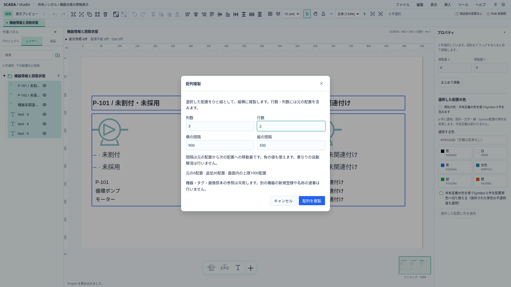
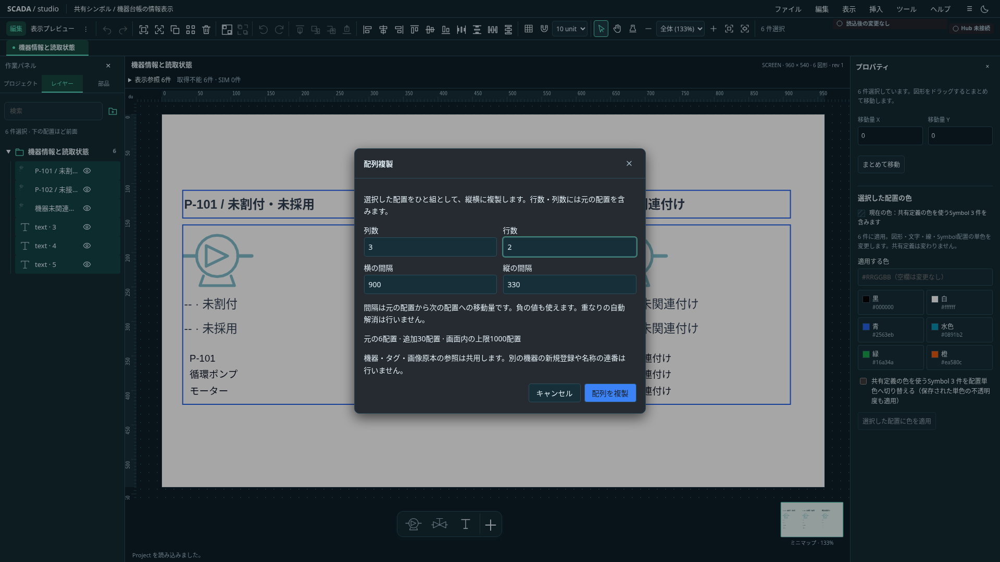

# 選択配置の配列複製

状態: Project0.31.0の共通作図操作。新しい保存項目は追加しない。[現場作図の追加提案§4](../proposals/scada-authoring-plant-operations-proposal.md#4-図形合成部品作成作図補助)の配列複製を先行し、連番は後続とする。

## 操作

図形を選び、共通ツールバーまたは選択メニューの「配列複製」を開く。選択した図形全体を一組として縦横に複製する。共有定義内でも使える。幾何グループはメンバー全体の選択が必要。

| 項目         | 意味                                                           |
| ------------ | -------------------------------------------------------------- |
| 列数・行数   | 元の配置を含む組数。各1以上の整数、積が2〜100組                |
| 横・縦の間隔 | 元の組から次の組への移動量（ピッチ）。図形間の隙間ではない     |
| 負の間隔     | 左または上へ配列する                                           |
| 初期値       | 2列・1行、選択外形の幅／高さ＋20                               |
| 追加配置数   | 選択配置数×（列数×行数−1）。グループのメンバーも配置数へ数える |

複数並べる軸の間隔0は拒否し、使用しない軸は0を許可する。スナップでは丸めない。重なりや図面外の配置を自動で修正しない。元の配置はそのまま残し、右へ進めてから次の行へ進む順で複製する。

## 所有者と参照

各組へ新しい配置ID・グループIDを発行し、内部のグループ所属と状態色参照を組ごとに再対応する。フォルダー所属・名前・寸法・回転・スタイルは引き継ぐ。元の描画順を保って複製を最前面へ追加する。

機器・タグ・Symbol定義・画像原本・埋込Viewの参照先は共用する。同じ機器の表示を増やす機能であり、別機器の登録や外部タグの採番は行わない。共有定義のTextはslot・metadataの宣言を維持する。複製元が選択に含まれない状態色参照は、既存の複製と同じく元のTextを参照する。

既存の複数配置複製も同じID再対応処理を使い、従来の20／20移動を維持する。

## 原子性と入力

開く前に既存の未適用入力を解決する。解決後にProject世代・画面／共有定義・選択・モードとrevisionを固定し、対象変更やProject置換時は要求を失効する。Modal内の入力はキャンセルで破棄し、Projectへ保存しない。IME確定のEnterで複製しない。Modal中はProjectの保存・読込・Undoのショートカットを抑止する。

画面1000配置・共有定義100配置の既存上限を先に検査する。最終の有限座標・ID・グループ・埋込数／展開描画予算の検証は既存の原子的編集で行う。失敗時は元の配置・履歴を保持する。成功した配列全体を一回のUndoで戻す。開く前に入力を適用した場合、その入力は別のUndoになる。

名称の連番・機器複製・複製先フォルダー・図上の未適用プレビュー・円形配列は後続。

## 実画面

