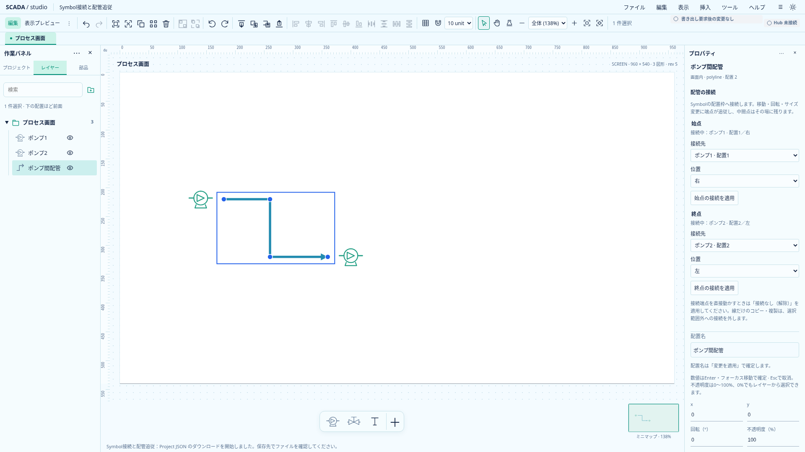
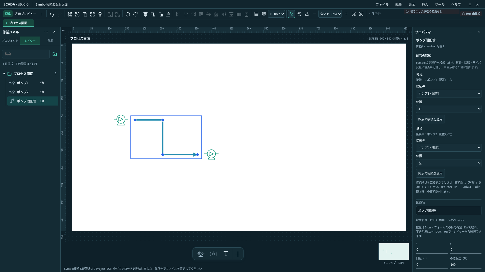

# I8：Symbol配置への接続と配管端点追従

2026-10-21（日本時間）。状態: **採用した初回範囲を設計、I8aは全体CI成功。I8bの保存・編集・コピーも全体CI成功。I8cの接続・解除UIは完了・CI成功**。[単体開発計画](../../project/upstream-independent-plan.md)の対応する区切り。Astraの読取レビューを反映する。

## 初回の範囲

画面上のPolylineの始点／終点を、**同じ画面のSymbol配置枠**の上・右・下・左の辺中央または中心へ明示的に接続する。枠のローカル座標に配置の回転を適用し、Symbolの移動・サイズ変更・回転で接続端点を追従させる。接続口の名称・吸込／吐出の役割・Symbol内の絵柄や輪郭・Equipment上の接続は表現しない。Symbolのcontain余白があっても配置枠基準とする。表示上の線の交差と、保存された端点参照を区別する。

対象は画面上のSymbolとPolylineのみ。画像・矩形・Text・埋込View、Symbol定義内の接続、線同士の接続、任意の名前付きport、直交化・障害物回避・自動routing、設備の制御関係、Hub／serverは対象外。非表示のSymbolも参照を保持する。初回UIではInspectorの明示選択を優先し、マウス吸着・作成ツールは別工程とする。

## I8bの保存・追従契約

Polylineのshapeに任意の`connections: { start?, end? }`を保存する。各端の参照は`{ targetObjectId, anchor }`。参照先は同一画面の配置IDであり、Symbol定義IDやEquipment IDではない。各端点は独立し、同じSymbolの異なるanchorも選べる。循環する線参照は型と対象制約で導入しない。

**保存pointsは、接続解決済みの実際の形状**とする。描画ごとに別の形状へ置換するモデルにはしない。既存の選択・hit領域・ミニマップ・埋込・小窓・書出しが同じpointsを使う。読込では参照先の存在・種別・所有者・anchorと、端点world座標の一致を検証し、不一致を黙って補修しない。TS／Rustはworld座標のx／y各成分の絶対差`1e-7`を許容する。I8bで保存版をProject0.35.0へ進め、schema・TS／Rust・共通ケース・現行サンプルを同時に更新した。I8a時点は0.34.0を維持した。0.34.0からの自動移行は追加しない。

`editor.ts:finish`の候補確定前に追従を一箇所で解決する。既存Projectは変更前に検証し、接続先の消失や不正形状をfinishの補修で隠さない。接続・解除と他の編集は既存command／Undoへ接続する。ドラッグ途中も同じ幾何を使い、確定時だけ端点が跳ぶ状態は受入不可。

## 幾何の不変条件

- Symbolのanchorは配置枠の寸法・中心・回転だけで決める。定義内の絵柄・定義サイズ・state色・原本画像・設備値からは求めない。
- 接続先だけの変更では、**中間点と未接続端点のworld座標を保持**する。
- 線も移動・回転等を行うときは、通常変換後の線を入力し、その時点の中間点・自由端点を保持して接続端点を再解決する。同時移動で端点を二重にずらさない。
- 線の回転中心は点列boundsから導出される。両端を**変更前の同じ変換**でlocalへ戻し、同時更新後のpivot差をx／yへ補正する。順次更新やpointsの単純な上書きに依存しない。
- 原点が負、任意回転、端点と中間点の大小関係が逆転、両端同位置でも中間点が残る形を扱う。全点一致と非有限値は拒否し、入力を変更しない。有限でも大きな座標による丸めで保持精度を満たせない操作は拒否する。すべての出力頂点を要求端点／元のworld座標と照合し、端点だけの検証で中間点のずれを見逃さない。
- 解決済みの端点が許容誤差内なら元のオブジェクトを返し、反復解決で微小差を保存・Undoへ増やさない。座標の丸め・グリッド吸着・経路最適化をここへ混ぜない。

## 編集・削除・ロック・グループ

接続／解除は明示操作。解除は現在の端点形状を保持し、1回のUndoで戻せる。接続端点の直接ドラッグは拒否して解除を案内し、中間点の編集は許可する。

生き残る線から参照されるSymbolの削除・cutは使用先を示して全体拒否する。線も同時に削除する場合は許可。cutは書込開始前にも検査し、既存の非同期書込成功後の削除・所有者照合を維持する。自動detachで関係を消さない。

追従によってロックされた線の形状が変わるときは、接続先の操作ごと原子的に拒否する。接続先の色・名前変更など、端点が変わらない編集は妨げない。Symbol側のロックは既存の直接編集保護を維持する。

初回はgroup内の線への接続と、接続線をgroupへ入れる操作を拒否する。Symbolがgroupに含まれることは許可し、そのgroupの移動／回転で外部の線を追従させる。整理フォルダーはgroupではなく、接続の所有者境界にしない。

## 複製・clipboard

コピー集合内に含むSymbolへの接続だけを保持し、配置ID対応表で新しいSymbolへ再配線する。集合外への接続は外し、見えていた形状を複製する。同一workspaceだからという理由で古い配置へ再接続しない。片端だけ含む場合も端点ごとに適用する。この規則は操作ガイドとUI説明に示す。

Symbolだけ複製しても元の線は元Symbolを参照する。画面複製は画面内の参照をすべて対応付け、配列複製は組ごとのID対応表を使う。別画面・別Projectへ元の配置IDを持ち込まない。group・slot・状態色・画像原本の既存コピー契約を維持する。

## 保存区切り

| 工程 | 内容                                | 完了条件                                                                                             | 状態         |
| ---- | ----------------------------------- | ---------------------------------------------------------------------------------------------------- | ------------ |
| I8a  | anchorと両端同時更新の純粋幾何      | cardinal／任意回転、両端／片端、world中間点、退化・不正・no-op・入力不変性。保存・UI未対応を明記     | 完了・CI成功 |
| I8b  | 保存・検証・command・既存操作の追従 | TS／Rust／schema／サンプル、参照と座標一致、lock／group／削除、複製／clipboard、Undo、drag途中の投影 | 完了・CI成功 |
| I8c  | Inspectorによる接続・解除UI         | 始点／終点のSymbol・anchor選択、接続状態と使用先・拒否理由、draft／IME・両テーマ、保存往復           | 完了・CI成功 |

I8aは新しい公開Project属性・描画機能ではない。I8bで受理する接続をどの入口でも失わず保存・描画・コピーできるよう揃え、I8cで利用者の操作へ接続する。各区切りの関連検証・全体CIを確認して次へ進む。

## 実装の入口

- `lib/connection-geometry.ts`：配置枠anchorとworld端点の同時解決。参照索引・lock・Project書込は所有しない。
- `lib/connection-geometry.test.ts`：純粋計算の不変条件。
- 既存の`rotation.ts:objectToWorld/worldToObject/rotationPivot/rotateVector`を使い、別の回転系を作らない。
- 後続は`project.ts`／Rust／schema、`editor.ts:finish`、single-object／selection handler、複製・clipboard／paste、`Renderer.svelte`の一時操作投影を確認する。

`lib/`は`apps/banto-scada/src/lib/`を指す。

## I8aの検証記録（2026-10-21）

新規21ケースで5anchor、cardinal／任意角度、片端／両端同時更新、world中間点と自由端点の保持、線と接続先の同時移動での二重変位防止、no-op・入力不変性、全点一致・不正値・有限大座標の精度不足拒否と表現可能な大座標の許可を確認した。Astraの初回レビューで全頂点の事後条件不足を補強し、再レビューで必須修正なし。Astraは読取確認のみで試験を実行していない。

ローカルではTS全1,163件、型チェック（エラー・警告0）、本番build・整形・文書リンクが成功。既存回転操作のブラウザ13件も成功。Rust／schema／保存版・画面UIは今回変更せず、保存・接続操作の提供済みとはしない。新しい実画面はI8cで記録する。I8aの全体CI39572973873は成功した。

## I8bの実装と受入（2026-10-21）

`connections.ts`は画面内の参照検証・候補端点解決・使用先・コピーID対応を担当する。`project.ts`とRustの`connections.rs`は、保存された端点を補修せず検証する。候補の追従は全てのProject確定入口へ置き、対象の非表示やフォルダーによって参照を捨てない。接続のない画面ではID Mapと解決結果を作らない。

`set-line-connection`で片端ずつ接続／解除できる。commandはSymbol定義・非Polyline・不正指定・ロック・不正参照を拒否し、接続中の端点の直接編集も拒否する。削除／cutは生き残る参照があれば配管名を含む理由を返し、既存のcut事前検証と書込成功後の削除を共用する。groupに入ったSymbolは追従対象とするが、接続線のgroup化は拒否する。

Rendererは一時操作の全配置を投影してから同じ解決関数を呼ぶ。線とSymbolの同時移動は一度だけ加算する。精度・lockにより拒否される候補は確定済み形状を表示し、確定操作で具体的なエラーを返す。接続端点のハンドルは移動不可と示し、中間点は既存操作を使う。プレビュー・ミニマップ・埋込・小窓は保存pointsを使う。

複製・配列複製・画面複製・root貼付と依存画面の取込はそれぞれの配置ID対応を使う。集合外の参照は形状を保って解除する。ScreenViewの依存画面を別Projectへ移すときは内部で再配線し、同じworkspaceの現行画面を再利用するときは古い接続snapshotを復活させない。

### 数値の保存往復

Rustの角度変換をTSと同じ`(angle * PI) / 180`へ揃えた。359.99度・幅`1e11`のSymbolをTSで解決した共有ケースを追加したところ、既定のserde_json読込でx座標`99999999338.45645`が`99999999338.45644`となり、絶対誤差契約を満たさず拒否されることを再現した。

既存serde_json依存の`float_roundtrip` featureをworkspaceで有効にし、同じ入力で受入成功、Rustの読込→書出し→再読込も成功することを確認した。SDKのrevやcrate版は変更していない。許容誤差の相対化、新しい座標上限、独自のtrig実装は追加しない。Industrialへ統合するときもこの数値読込設定を保持する。

### サンプルと検証入口

[接続済みProject](../../../examples/connection.project.json)を開くと、2つのSymbol配置と両端接続のPolylineを試せる。画像原本は不要。I8bでは読込・既存編集での追従を提供し、I8cで下記の設定UIを追加した。

[共通保存ケース](../../../examples/connection-cases.json)の25件をTS／Rustで確認する。0／90／180／270／33度、各軸の誤差境界、所有者・種別・欠落・group・定義内拒否、非表示保持、大座標と359.99度の数値往復を含む。`connections.test.ts`の13件は移動・回転・Undo、削除／lock／group、複製／配列・画面・root／依存画面clipboardの参照を確認する。`e2e/connections.spec.ts`は両テーマのdrag途中・Esc取消・Undo・回転／resize、lock、削除／cut事前拒否とclipboard保持を確認する。

### I8bのローカル結果

TS全1,201件（共有25ケースとcommand／コピー13ケースを含む）、Rust全54件、型チェック（エラー・警告0）、Clippy／rustfmt、本番build・全体整形・文書リンクが成功。接続・drag新規4件＋回転・配列／group・原本clipboard・View依存・Symbol画像の既存47件、計51ブラウザケースが成功した。CLIはminimal／process／tag-binding／symbol-image／connectionの5サンプルを検証した。元バイト入り画像サンプルも0.35.0へ更新し、native読込・書出し・バイト一致を回帰した。

Astraの読取レビューで角度演算順・大座標のJSON往復と、依存画面clipboardの検証不足を指摘され、修正／共通ケース・2つの依存画面ケースを追加した。serde_jsonのfeature変更後はRust全体とClippyも確認した。I8aの`3894f4c`は[全体CI39572973873](https://github.com/tyaro/temp-scada/actions/runs/39572973873)で全job成功。I8bの`7faff97`は[全体CI39576110879](https://github.com/tyaro/temp-scada/actions/runs/39576110879)で全job成功。

## I8c：Inspectorでの接続・解除（2026-10-21）

配管を選ぶと、プロパティに始点／終点それぞれの接続先・位置と適用ボタンを表示する。選択しただけではProjectを変更しない。「接続なし（解除）」の明示適用で形状を保って参照だけを外す。候補と適用済み状態には配置順を併記し、同名のSymbolを識別できる。非表示の候補もその状態を表示する。

対象は現在の同一画面のSymbol配置のみ。定義編集では設定を出さず、配管のlock・幾何group・候補なしは操作を無効化し理由を示す。Symbol選択時は、その配置を参照する配管名・端点・位置を表示し、削除前の解除または同時選択を案内する。

`ConnectionSettings.svelte`は表示とdraftを担当し、`forms/line-connection.ts`がgeneration／owner／選択配置／候補／anchorを再検査して既存commandへ変換する。IME中は直接適用も「適用して続行」の事前検証も拒否する。別のdirtyフォームが先に登録されていても一部だけ適用しない。Undo／Redo・no-op・取消後の入力保持は既存の入口を使う。

実画面は1920×1080のブラウザで取得した。接続先は設備絵のノズルではなく配置枠なので、Symbolの余白によって絵と線に隙間が見える場合がある。マウス吸着・任意port・routing・使用先からのジャンプは今回のUIには含めない。

### I8cの検証

TS全1,207件、型チェック（エラー・警告0）、本番build・整形・文書リンクが成功。保存版0.35.0・Rust／schema・固定依存はこの工程では変更していない。スクリーンショット取得時は配管上の画素も確認した。

新しいフォーム契約6件とブラウザ7ケース（両テーマの設定・解除／保存往復、draft取消・IME、lock／参照保護、候補なし、複数dirtyフォームの部分適用防止、同名配置の識別）が成功。既存の接続drag4件・数値入力10件・回転13件も成功し、計34ケースを確認した。

Astraの読取レビューで、IME中の「適用して続行」が別のdirtyフォームだけ先に適用する経路と同名候補の曖昧さを指摘され、事前検証へのcomposition状態伝達と配置順併記・回帰試験を追加した。再レビューの必須修正なし。新規ブラウザ試験の初回はテストの欄名を「オブジェクト名」と誤指定して1件timeout。実UIの「配置名」へ合わせ、34ケースが成功した。I8cの`eef69fd`は[全体CI39578127673](https://github.com/tyaro/temp-scada/actions/runs/39578127673)でFrontend・Rust・ブラウザ4分割・集約checkがすべて成功した。
