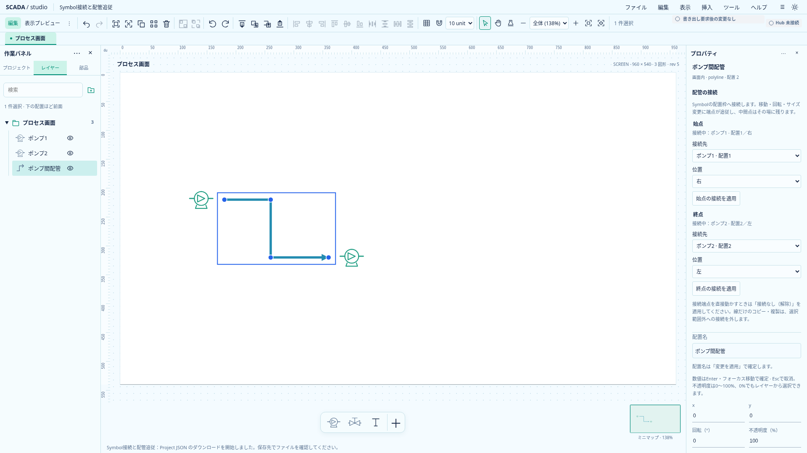
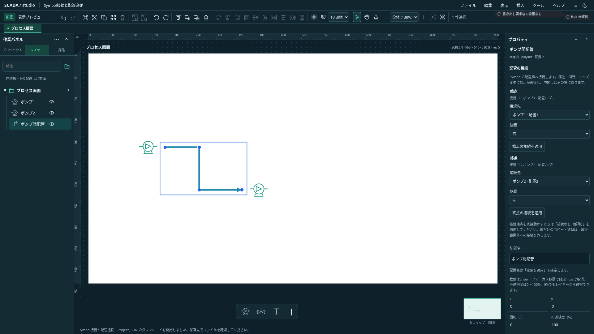

# I8：Symbol配置への接続と配管端点追従

2026-10-21（日本時間）。Issue #306 の面の図形への接続の設計は末尾の節（2026-11-21、未実装）。状態: **採用した初回範囲を設計、I8aは全体CI成功。I8bの保存・編集・コピーも全体CI成功。I8cの接続・解除UIは完了・CI成功**。[単体開発計画](../../project/upstream-independent-plan.md)の対応する区切り。Astraの読取レビューを反映する。

## 初回の範囲

画面上のPolylineの始点／終点を、**同じ画面のSymbol配置枠**の上・右・下・左の辺中央または中心へ明示的に接続する。枠のローカル座標に配置の回転を適用し、Symbolの移動・サイズ変更・回転で接続端点を追従させる。接続口の名称・吸込／吐出の役割・Symbol内の絵柄や輪郭・Equipment上の接続は表現しない。Symbolのcontain余白があっても配置枠基準とする。表示上の線の交差と、保存された端点参照を区別する。

対象は画面上のSymbolとPolylineのみ。画像・矩形・Text・埋込View、Symbol定義内の接続、線同士の接続、任意の名前付きport、直交化・障害物回避・自動routing、設備の制御関係、Hub／serverは対象外。非表示のSymbolも参照を保持する。初回UIではInspectorの明示選択を優先し、マウス吸着・作成ツールは別工程とする。

## I8bの保存・追従契約

Polylineのshapeに任意の`connections: { start?, end? }`を保存する。各端の参照は`{ targetObjectId, anchor }`。参照先は同一画面の配置IDであり、Symbol定義IDやEquipment IDではない。各端点は独立し、同じSymbolの異なるanchorも選べる。循環する線参照は型と対象制約で導入しない。

**保存pointsは、接続解決済みの実際の形状**とする。描画ごとに別の形状へ置換するモデルにはしない。既存の選択・hit領域・ミニマップ・埋込・小窓・書出しが同じpointsを使う。読込では参照先の存在・種別・所有者・anchorと、端点world座標の一致を検証し、不一致を黙って補修しない。TS／Rustはworld座標のx／y各成分の絶対差`1e-7`を許容する。I8bで保存版をProject0.35.0へ進め、schema・TS／Rust・共通ケース・現行サンプルを同時に更新した。I8a時点は0.34.0を維持した。0.34.0からの自動移行は追加しない。

`editor.ts:finish`の候補確定前に追従を一箇所で解決する。既存Projectは変更前に検証し、接続先の消失や不正形状をfinishの補修で隠さない。接続・解除と他の編集は既存command／Undoへ接続する。ドラッグ途中も同じ幾何を使い、確定時だけ端点が跳ぶ状態は受入不可。

## 幾何の不変条件

- Symbolのanchorは配置枠の寸法・中心・回転だけで決める。定義内の絵柄・定義サイズ・state色・原本画像・設備値からは求めない。
- 接続先だけの変更では、**中間点と未接続端点のworld座標を保持**する。
- 線も移動・回転等を行うときは、通常変換後の線を入力し、その時点の中間点・自由端点を保持して接続端点を再解決する。同時移動で端点を二重にずらさない。
- 線の回転中心は点列boundsから導出される。両端を**変更前の同じ変換**でlocalへ戻し、同時更新後のpivot差をx／yへ補正する。順次更新やpointsの単純な上書きに依存しない。
- 原点が負、任意回転、端点と中間点の大小関係が逆転、両端同位置でも中間点が残る形を扱う。全点一致と非有限値は拒否し、入力を変更しない。有限でも大きな座標による丸めで保持精度を満たせない操作は拒否する。すべての出力頂点を要求端点／元のworld座標と照合し、端点だけの検証で中間点のずれを見逃さない。
- 解決済みの端点が許容誤差内なら元のオブジェクトを返し、反復解決で微小差を保存・Undoへ増やさない。座標の丸め・グリッド吸着・経路最適化をここへ混ぜない。

## 編集・削除・ロック・グループ

接続／解除は明示操作。解除は現在の端点形状を保持し、1回のUndoで戻せる。接続端点の直接ドラッグは拒否して解除を案内し、中間点の編集は許可する。

生き残る線から参照されるSymbolの削除・cutは使用先を示して全体拒否する。線も同時に削除する場合は許可。cutは書込開始前にも検査し、既存の非同期書込成功後の削除・所有者照合を維持する。自動detachで関係を消さない。

追従によってロックされた線の形状が変わるときは、接続先の操作ごと原子的に拒否する。接続先の色・名前変更など、端点が変わらない編集は妨げない。Symbol側のロックは既存の直接編集保護を維持する。

初回はgroup内の線への接続と、接続線をgroupへ入れる操作を拒否する。Symbolがgroupに含まれることは許可し、そのgroupの移動／回転で外部の線を追従させる。整理フォルダーはgroupではなく、接続の所有者境界にしない。

## 複製・clipboard

コピー集合内に含むSymbolへの接続だけを保持し、配置ID対応表で新しいSymbolへ再配線する。集合外への接続は外し、見えていた形状を複製する。同一workspaceだからという理由で古い配置へ再接続しない。片端だけ含む場合も端点ごとに適用する。この規則は操作ガイドとUI説明に示す。

Symbolだけ複製しても元の線は元Symbolを参照する。画面複製は画面内の参照をすべて対応付け、配列複製は組ごとのID対応表を使う。別画面・別Projectへ元の配置IDを持ち込まない。group・slot・状態色・画像原本の既存コピー契約を維持する。

## 保存区切り

| 工程 | 内容                                | 完了条件                                                                                             | 状態         |
| ---- | ----------------------------------- | ---------------------------------------------------------------------------------------------------- | ------------ |
| I8a  | anchorと両端同時更新の純粋幾何      | cardinal／任意回転、両端／片端、world中間点、退化・不正・no-op・入力不変性。保存・UI未対応を明記     | 完了・CI成功 |
| I8b  | 保存・検証・command・既存操作の追従 | TS／Rust／schema／サンプル、参照と座標一致、lock／group／削除、複製／clipboard、Undo、drag途中の投影 | 完了・CI成功 |
| I8c  | Inspectorによる接続・解除UI         | 始点／終点のSymbol・anchor選択、接続状態と使用先・拒否理由、draft／IME・両テーマ、保存往復           | 完了・CI成功 |

I8aは新しい公開Project属性・描画機能ではない。I8bで受理する接続をどの入口でも失わず保存・描画・コピーできるよう揃え、I8cで利用者の操作へ接続する。各区切りの関連検証・全体CIを確認して次へ進む。

## 実装の入口

- `lib/connection-geometry.ts`：配置枠anchorとworld端点の同時解決。参照索引・lock・Project書込は所有しない。
- `lib/connection-geometry.test.ts`：純粋計算の不変条件。
- 既存の`rotation.ts:objectToWorld/worldToObject/rotationPivot/rotateVector`を使い、別の回転系を作らない。
- 後続は`project.ts`／Rust／schema、`editor.ts:finish`、single-object／selection handler、複製・clipboard／paste、`Renderer.svelte`の一時操作投影を確認する。

`lib/`は`apps/banto-scada/src/lib/`を指す。

## I8aの検証記録（2026-10-21）

新規21ケースで5anchor、cardinal／任意角度、片端／両端同時更新、world中間点と自由端点の保持、線と接続先の同時移動での二重変位防止、no-op・入力不変性、全点一致・不正値・有限大座標の精度不足拒否と表現可能な大座標の許可を確認した。Astraの初回レビューで全頂点の事後条件不足を補強し、再レビューで必須修正なし。Astraは読取確認のみで試験を実行していない。

ローカルではTS全1,163件、型チェック（エラー・警告0）、本番build・整形・文書リンクが成功。既存回転操作のブラウザ13件も成功。Rust／schema／保存版・画面UIは今回変更せず、保存・接続操作の提供済みとはしない。新しい実画面はI8cで記録する。I8aの全体CI39572973873は成功した。

## I8bの実装と受入（2026-10-21）

`connections.ts`は画面内の参照検証・候補端点解決・使用先・コピーID対応を担当する。`project.ts`とRustの`connections.rs`は、保存された端点を補修せず検証する。候補の追従は全てのProject確定入口へ置き、対象の非表示やフォルダーによって参照を捨てない。接続のない画面ではID Mapと解決結果を作らない。

`set-line-connection`で片端ずつ接続／解除できる。commandはSymbol定義・非Polyline・不正指定・ロック・不正参照を拒否し、接続中の端点の直接編集も拒否する。削除／cutは生き残る参照があれば配管名を含む理由を返し、既存のcut事前検証と書込成功後の削除を共用する。groupに入ったSymbolは追従対象とするが、接続線のgroup化は拒否する。

Rendererは一時操作の全配置を投影してから同じ解決関数を呼ぶ。線とSymbolの同時移動は一度だけ加算する。精度・lockにより拒否される候補は確定済み形状を表示し、確定操作で具体的なエラーを返す。接続端点のハンドルは移動不可と示し、中間点は既存操作を使う。プレビュー・ミニマップ・埋込・小窓は保存pointsを使う。

複製・配列複製・画面複製・root貼付と依存画面の取込はそれぞれの配置ID対応を使う。集合外の参照は形状を保って解除する。ScreenViewの依存画面を別Projectへ移すときは内部で再配線し、同じworkspaceの現行画面を再利用するときは古い接続snapshotを復活させない。

### 数値の保存往復

Rustの角度変換をTSと同じ`(angle * PI) / 180`へ揃えた。359.99度・幅`1e11`のSymbolをTSで解決した共有ケースを追加したところ、既定のserde_json読込でx座標`99999999338.45645`が`99999999338.45644`となり、絶対誤差契約を満たさず拒否されることを再現した。

既存serde_json依存の`float_roundtrip` featureをworkspaceで有効にし、同じ入力で受入成功、Rustの読込→書出し→再読込も成功することを確認した。SDKのrevやcrate版は変更していない。許容誤差の相対化、新しい座標上限、独自のtrig実装は追加しない。Industrialへ統合するときもこの数値読込設定を保持する。

### サンプルと検証入口

[接続済みProject](../../../examples/connection.project.json)を開くと、2つのSymbol配置と両端接続のPolylineを試せる。画像原本は不要。I8bでは読込・既存編集での追従を提供し、I8cで下記の設定UIを追加した。

[共通保存ケース](../../../examples/connection-cases.json)の25件をTS／Rustで確認する。0／90／180／270／33度、各軸の誤差境界、所有者・種別・欠落・group・定義内拒否、非表示保持、大座標と359.99度の数値往復を含む。`connections.test.ts`の13件は移動・回転・Undo、削除／lock／group、複製／配列・画面・root／依存画面clipboardの参照を確認する。`e2e/connections.spec.ts`は両テーマのdrag途中・Esc取消・Undo・回転／resize、lock、削除／cut事前拒否とclipboard保持を確認する。

### I8bのローカル結果

TS全1,201件（共有25ケースとcommand／コピー13ケースを含む）、Rust全54件、型チェック（エラー・警告0）、Clippy／rustfmt、本番build・全体整形・文書リンクが成功。接続・drag新規4件＋回転・配列／group・原本clipboard・View依存・Symbol画像の既存47件、計51ブラウザケースが成功した。CLIはminimal／process／tag-binding／symbol-image／connectionの5サンプルを検証した。元バイト入り画像サンプルも0.35.0へ更新し、native読込・書出し・バイト一致を回帰した。

Astraの読取レビューで角度演算順・大座標のJSON往復と、依存画面clipboardの検証不足を指摘され、修正／共通ケース・2つの依存画面ケースを追加した。serde_jsonのfeature変更後はRust全体とClippyも確認した。I8aの`3894f4c`は[全体CI39572973873](https://github.com/tyaro/temp-scada/actions/runs/39572973873)で全job成功。I8bの`7faff97`は[全体CI39576110879](https://github.com/tyaro/temp-scada/actions/runs/39576110879)で全job成功。

## I8c：Inspectorでの接続・解除（2026-10-21）

配管を選ぶと、プロパティに始点／終点それぞれの接続先・位置と適用ボタンを表示する。選択しただけではProjectを変更しない。「接続なし（解除）」の明示適用で形状を保って参照だけを外す。候補と適用済み状態には配置順を併記し、同名のSymbolを識別できる。非表示の候補もその状態を表示する。

対象は現在の同一画面のSymbol配置のみ。定義編集では設定を出さず、配管のlock・幾何group・候補なしは操作を無効化し理由を示す。Symbol選択時は、その配置を参照する配管名・端点・位置を表示し、削除前の解除または同時選択を案内する。

`ConnectionSettings.svelte`は表示とdraftを担当し、`forms/line-connection.ts`がgeneration／owner／選択配置／候補／anchorを再検査して既存commandへ変換する。IME中は直接適用も「適用して続行」の事前検証も拒否する。別のdirtyフォームが先に登録されていても一部だけ適用しない。Undo／Redo・no-op・取消後の入力保持は既存の入口を使う。

実画面は1920×1080のブラウザで取得した。接続先は設備絵のノズルではなく配置枠なので、Symbolの余白によって絵と線に隙間が見える場合がある。マウス吸着・任意port・routing・使用先からのジャンプは今回のUIには含めない。

### I8cの検証

TS全1,207件、型チェック（エラー・警告0）、本番build・整形・文書リンクが成功。保存版0.35.0・Rust／schema・固定依存はこの工程では変更していない。スクリーンショット取得時は配管上の画素も確認した。

新しいフォーム契約6件とブラウザ7ケース（両テーマの設定・解除／保存往復、draft取消・IME、lock／参照保護、候補なし、複数dirtyフォームの部分適用防止、同名配置の識別）が成功。既存の接続drag4件・数値入力10件・回転13件も成功し、計34ケースを確認した。

Astraの読取レビューで、IME中の「適用して続行」が別のdirtyフォームだけ先に適用する経路と同名候補の曖昧さを指摘され、事前検証へのcomposition状態伝達と配置順併記・回帰試験を追加した。再レビューの必須修正なし。新規ブラウザ試験の初回はテストの欄名を「オブジェクト名」と誤指定して1件timeout。実UIの「配置名」へ合わせ、34ケースが成功した。I8cの`eef69fd`は[全体CI39578127673](https://github.com/tyaro/temp-scada/actions/runs/39578127673)でFrontend・Rust・ブラウザ4分割・集約checkがすべて成功した。

## Issue #306：矩形・楕円・多角形への接続（設計、2026-11-21）

状態: **設計のみ。実装は未着手**。I8 の接続先を Symbol 配置から面の図形（矩形・楕円・多角形）へ広げ、フロー図の箱を動かしても線が離れないようにする。2026-11-21 にユーザーが次の 2 点を決めた。

- 枠の辺の中央が形の外に出る多角形の anchor は、**形の外周へ寄せる**（下の「多角形の anchor」）。
- マウスでの吸着は**この Issue の後の区切り**で扱う（E3・E4）。

ほかの未決は次のとおりに置く（設計 PR のレビューで変えてよい）。

- Text・画像・表・埋込 View への接続は入れない。文字入りの図形（#305、`graphics/shape-label.md`）が入ったので、箱に文言を持たせて図形へつなぐ。
- 保存版は **0.37.0 のまま**。schema の `endpointConnection` は配置の id と anchor だけで接続先の種別を持たないので変わらない。変わるのは TS と Rust の接続先の検査だけで、接続先を図形にしたファイルは E1 より前の版では読込の検査で理由つきで拒否される（黙って読み違えない）。リリース前の Project は後方互換を保証しない方針（2026-10-18）にも合う。

### 接続先と anchor

接続先は同じ画面の `shape.type` が `symbol`・`rectangle`・`ellipse`・`polygon` の配置。anchor は今の 5 つ（`top`・`right`・`bottom`・`left`・`center`）のまま。どの種類も、配置の中の座標（枠の左上が原点）で点を決め、既存の `objectToWorld`（Rust は `world`）で反転・回転を当てて world の点にする。別の回転系は作らない。

| 種類   | 辺の anchor（配置の中の座標）                  | `center` |
| ------ | ---------------------------------------------- | -------- |
| Symbol | 枠の辺の中央（今のまま）                       | 枠の中心 |
| 矩形   | 枠の辺の中央                                   | 枠の中心 |
| 楕円   | 枠の辺の中央。楕円の頂点に一致する             | 枠の中心 |
| 多角形 | 中心線と外周の交点のうち辺に最も近い点（下記） | 枠の中心 |

- anchor は形の幾何の外周で決め、枠線の幅・点線・塗り・状態の色・文字（`label`）からは求めない。矢印の先は枠線の中心線に当たる。
- `center` は多角形でも枠の中心のまま（凹んだ形では形の外に出ることがある）。重心にすると頂点の編集で中心の意味が変わるため。

### 多角形の anchor

辺の anchor は、頂点の割合（`PolygonShape` の 0〜1）の空間で、枠の中央を通る線と外周との交点のうち、その辺に最も近い点とする。

- `top`・`bottom`: 縦の中心線 `u = 0.5` と外周の交点のうち、`top` は `v` が最小、`bottom` は `v` が最大の点。
- `left`・`right`: 横の中心線 `v = 0.5` と外周の交点のうち、`left` は `u` が最小、`right` は `u` が最大の点。
- 得た割合の点 `(u, v)` に幅・高さを掛けて配置の中の座標にし、`objectToWorld`（Rust は `world`）で world へ写す。

この規則は「中心から辺の中央へ向けた線と外周の交点のうち外側のもの」を、反対側の辺まで延ばした中心線へ広げたもの。中心から引いた線が外周と交わる形では同じ点になる（2026-11-21 のユーザーの決定「外周へ寄せる」）。延ばすのは、凹んだ形で中心が形の外にあり、中心からの線が形をよけるときにも点を 1 つに決めるため。外周は閉じていて、外接矩形が枠そのもの（`u`・`v` とも最小 0・最大 1）なので、中心線とは必ず交わる。

交点は次の式で、TS と Rust で同じ順序で求める。許容誤差は使わない。

- 辺は最後の点から最初の点へ閉じた辺を含む、頂点の順の全ての辺 `A→B`。
- 縦の中心線では、`min(A.u, B.u) <= 0.5 <= max(A.u, B.u)` の閉区間を厳密に比べて交わる辺を選ぶ。頂点がちょうど線の上にある（接するだけの）ときも交点に数える。`A.u == B.u == 0.5`（辺が線に重なる）ときは `A.v` と `B.v` の両方を交点にする。それ以外は `t = (0.5 - A.u) / (B.u - A.u)`、`v = A.v + t * (B.v - A.v)`。横の中心線は `u` と `v` を入れ替えた同じ式。
- 割合の空間で決めるので、anchor は割合の定点になり、大きさの変更で交点の選び方が丸めで揺れない（拡大・縮小はアフィンなので交点と順序は変わらない）。

枠の辺の中央と同じ点になるかは辺ごとに違う。枠の辺の中央が外周の上にある辺（矩形・ひし形の 4 辺、台形の上下、正五角形の `top`）ではその点になる。正三角形・正五角形の `left`・`right` のように辺の中央が外周に乗らない辺では、中心線の高さの外周の点になる（正五角形の最も左の頂点は高さの約 38% にあり、`left` はその頂点ではなく `v = 0.5` の斜辺の上の点）。

- 凹んだ形では、頂点の編集で中心線をまたぐ外周の部分が入れ替わると、anchor が大きく動くことがある（どの規則でも残る）。操作ガイドの注意として E2 で書く。
- 自己交差・折り返し（とげ）のある多角形は、今の検査（`validatePolygonPoints`）が受理するので、規則は辺の集合のまま当てる。anchor が塗りの内側の辺やとげの先に乗ることがあるが、見た目は保証しない。契約ケースに 1 件入れる。
- anchor の関数は、多角形の前提（頂点の数・外接矩形が枠・幅と高さが正）を満たさない入力では例外を投げる。一時の候補でも呼ばれるので、Renderer は既存どおり確定済みの形を表示し、確定の操作で理由を返す。読込では多角形の検査が接続の検査より先に走る（TS・Rust とも）。

頂点の編集（`reframePolygon`・頂点のドラッグ・頂点の文字での入力）で外周が変わると anchor も動くので、接続中の線は追従する。これは移動・大きさの変更と同じく `editor.ts:finish` の追従と Renderer の一時の投影が受け持つ。ただし今の頂点のドラッグの投影（`previewPolygonVertex`）は枠を作り直さず、割合が 0〜1 の外へ出る。そのままでは、ドラッグ中は古い枠、確定後は作り直した枠で anchor を求め、確定で端点が跳ぶ（I8 の受入不可の状態）。接続の解決へ渡す候補は `reframePolygon` を通した形にし、作り直しが拒否される形（幅・高さが小さすぎるなど）では確定済みの形を表示する。

### 編集・削除・ロック・グループ・複製

Symbol 配置への接続と同じ規則を図形にも当てる（上の「編集・削除・ロック・グループ」「複製・clipboard」）。

- 生き残る線から参照される図形だけの削除・切取りは、使用先を示して全体を拒否する。
- 追従でロックされた線の形が変わる操作は、接続先の操作ごと拒否する。図形の色・文字・状態の色の変更など、anchor が変わらない編集は妨げない。
- group に入った図形への接続は許し、group の移動・回転で外の線を追従させる。group の中の線の接続と、接続線の group 化は今のまま拒否する。
- 複製・貼付け・画面複製・配列複製は配置の id の対応表で振り直す。集合の外への接続は形を保って外す。
- 選んだ図形を Symbol 定義へまとめる操作と、図形の種類を変える操作は、2026-11-21 の時点で無い（`create-symbol` は名前と寸法から空の定義を作るだけ）。どちらかを足すときは、外の線から参照される図形が接続先の 4 種から外れる操作を、削除と同じく使用先を示して拒否する。

### 保存区切り

| 工程 | 内容                              | 完了条件                                                                                                                                                                                                                                                                                                                                                                                                                                                                                                                                                                                                                       |
| ---- | --------------------------------- | ------------------------------------------------------------------------------------------------------------------------------------------------------------------------------------------------------------------------------------------------------------------------------------------------------------------------------------------------------------------------------------------------------------------------------------------------------------------------------------------------------------------------------------------------------------------------------------------------------------------------------ |
| E1   | 接続先の検査と幾何を 4 種へ広げる | `connection-geometry.ts`（`symbolAnchorPoint` を 4 種の anchor の関数へ改める）・`connections.ts` の検査と文言（「接続先のSymbol配置…」）・`editor/single-object-handler.ts` の `set-line-connection` の検査・Rust の `connections.rs` の検査と文言・頂点のドラッグの投影（作り直した枠で解決し、途中と確定で端点が一致）。共通の `examples/connection-cases.json` に 4 種・反転・回転・多角形の境界（頂点を通る中心線、辺が中心線に重なる、中心が形の外の凹形、正五角形の `left`、自己交差）・種類の誤りを足し、既存ケース `line-is-not-symbol` の名前と期待を見直す。削除・ロック・group・複製の回帰。保存版は 0.37.0 のまま |
| E2   | Inspector と見本                  | `designer/ConnectionSettings.svelte` の接続先の候補に図形を足し種類を併記、図形を選んだときの使用先の表示、箱 10 個のフロー図の見本（`examples/`）、操作ガイド（凹んだ形で anchor が動く注意を含む）、両テーマの e2e と保存往復                                                                                                                                                                                                                                                                                                                                                                                                |
| E3   | 線の端のドラッグで吸着            | 接続していない端を anchor の近くへドラッグすると接続する。吸着の距離・表示・Undo 1 回・ロックと group の拒否を設計してから実装                                                                                                                                                                                                                                                                                                                                                                                                                                                                                                 |
| E4   | 線を引きながら接続                | 線の作成中に始点・終点を anchor へ吸着させる。E3 の判定を使う                                                                                                                                                                                                                                                                                                                                                                                                                                                                                                                                                                  |

- E1 と E2 は 1 つの PR にしてもよいが、E1 だけで受理した接続をどの入口でも失わないこと（I8b と同じ）を先に CI で確かめる。
- 直交の線の保持（接続先を動かしても折れ線の直角を保つ）は E1〜E4 に含めない。必要なら別の Issue にする。
- E3・E4 の吸着の距離・候補の表示・Shift などでの吸着の止め方は、E3 の着手時にこの節へ追記して決める。

### 受入（Issue の受入の言い換え）

- 線の端を矩形・楕円・多角形の anchor につなげ、接続先の移動・大きさの変更・回転・反転・頂点の編集で端点が追従する。
- 接続先だけの削除・切取りが Symbol 配置と同じ規則で拒否され、複製・貼付けで参照が正しく振り直される。
- 保存して読み直しても接続と形が変わらない。接続先と端点の座標が合わないファイルは黙って直さず拒否する。
- 箱 10 個を線で結んだフローで、箱を動かしても線が離れない。
- Rust と TypeScript が同じ契約ケースを通る。両テーマの e2e。
