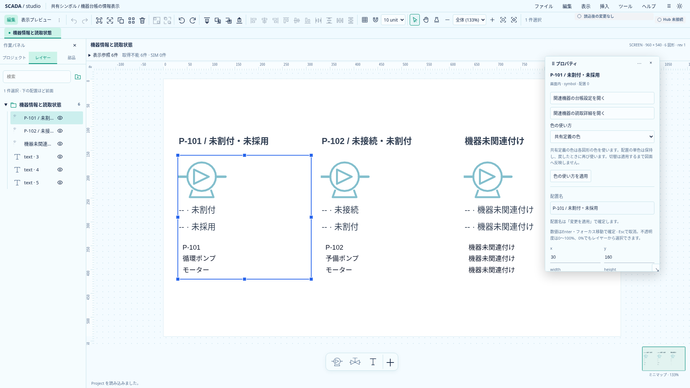
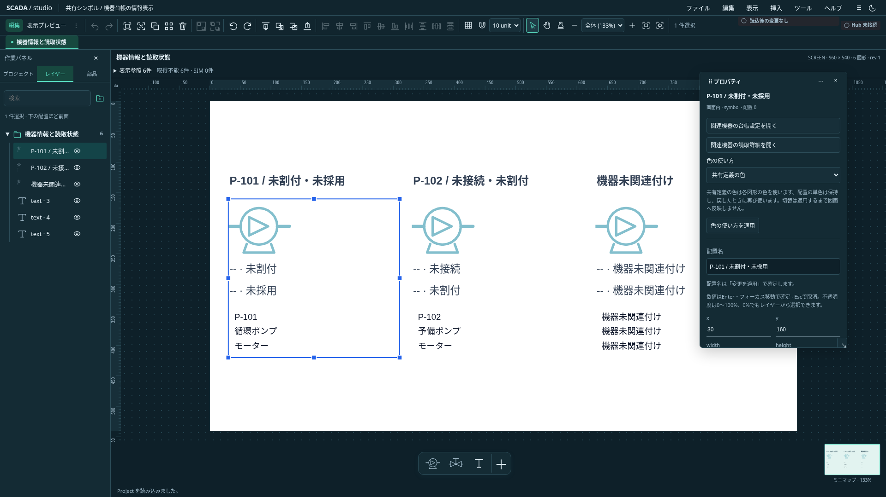

# プロパティパネルの浮動化・初回設計

状態: **プロパティ単体の右固定／浮動を実装・関連検証済み**。AstraのUXレビューを反映した初回範囲。任意ドッキングや全パネルの浮動化完了を示すものではない。[UI改訂](designer-ui-revision.md)・[統合設計](../scada-integrated-design.md)を具体化する。

## 最初の範囲

安定したPanel ID `inspector`を持つプロパティだけを、同一アプリ内で右固定／浮動へ切り替える。初期状態は左右固定を維持する。浮動時は移動・サイズ変更・右への復帰・非表示を提供する。任意の端へのドロップ、左3タブの分離、タグ参照の浮動、タブ結合、別OS窓は後続。

`InspectorPanel`の同じaside・form・inputを維持し、CSS配置だけを変える。浮動化で所有コンテナを変えたり、配置モードを`{#key}`へ含めたり、フォームを二重に描いたりしない。既存の表示非表示も同じDOMを維持する。構造のdraftはまだDOM依存であり、unmountする方式のドッキングを実装する前にはdraftの独立保持が必要。

## 操作と領域

- 見出しメニューに浮動／右へ戻す／隠すと、プロパティ配置の保存・保存配置へ戻すを用意する。常設メニューからも復帰できる。
- 浮動で空いた右側の幅をキャンバスへ返し、既存の手動倍率と表示中心の保持を使う。
- 見出しのハンドルで移動し、右下でサイズを変更する。pointer captureを使い、Esc・pointercancel・capture喪失・window blur・モード変更で取消と解放を行う。
- 操作開始時の実際のwindow寸法を保持し、move／pointerup等でも照合する。resize通知の到着前にマウスを離しても、旧寸法のドラッグを確定しない。
- ハンドルはキーボードでも操作できる。Enter／Spaceで開始し、矢印8px、Shift＋矢印32px、Enterで確定、Escで取消。Tabで現在位置を確定して通常移動する。
- 非モーダルとしfocus trapを作らない。通常のTab順を維持する。移動・サイズ変更中は他の作図・パン・配置・DnDと排他にする。
- 浮動は幅1100px以上・高さ480px以上で提供し、十分な作業高さがない場合も右固定へ一時退避する。拡大後は元の浮動希望を使う。画面縮小による補正で保存配置を書き換えない。

初回調査は`@banto/ui`に限定していた。2026-10-21の再調査で、別パッケージ`@banto/dock-svelte`には固定依存版の時点から浮動・分割・タブの基盤があることを確認した。以前の「Bantoにdocking workspaceがない」という記載を訂正する。[比較評価](../../reviews/banto-dock-comparison.md)では、このモデルを土台とし、入力保護を既存`@banto/forms`の拡張へ集約する案を推奨する。移行は未実施。Modal／Drawerはfocus trapを含むため、この非モーダルなパネルの器へ流用しない。テーマのz tokenと公開layering helperを使い、Menu・確認Modalより上へ出さない。常時表示の浮動パネルをEscで閉じる層には登録せず、操作中の取消だけを扱う。

## 数値・draft・フォーカス

ポインタで見出しをつかむ操作では`preventDefault`で入力のフォーカスを奪わず、配置処理から数値確定・draft適用を呼ばない。入力の値・不正文字列・IME状態を維持する。

Tabやメニュー操作で入力からフォーカスが移る通常のblurは、既存どおり有効な数値を確定する。「パネル操作時には一切確定しない」という別契約にしない。不正数値・通常文字列・他フォームの未適用入力は保持する。

## 保存と復元

Project、Undo、保存状態と完全に分離する。Banto UI設定に`layoutVersion: 1`のプロパティ配置専用slotを一つ追加する。保存対象は右固定／浮動の希望と浮動矩形だけ。既存の幅自動保存、パネルの一括非表示、Projectの保存とは分ける。

「配置を保存」を明示したときだけ保存slotを更新する。ドラッグ確定・右への復帰・標準復元・画面縮小で自動上書きしない。保存失敗では編集を継続し、前の保存slotを維持して通知する。破損値・未知versionは無視し、標準配置で起動する。

初期表示は保存slotがあればそれを採用する。保存配置への復帰はプロパティを再表示する。表示非表示・検索・タブ・選択・Project・draftを保存slotへ入れない。全体の標準配置復元でも固定へ戻すが、明示保存slotを消さない。

## 受入

1. 同じform／inputのDOM identity、dirty登録、入力値を浮動／移動／サイズ／右固定／非表示／標準復帰の全経路で保持する。
2. 有効数値の通常blur確定、不正数値、文字列、複数フォーム、IMEを区別し、layout操作から余分なUndoを作らない。
3. ポインタとキーボードの取消、capture喪失・window blur・画面縮小・モード変更で操作を残さない。別のMenu／ModalのEscを奪わない。
4. 手動倍率・表示中心、画面縮小時の一時退避、再拡大時の復帰、非表示後の常設メニューからの復帰を確認する。
5. 明示保存・保存配置への復帰・標準復帰を区別し、破損設定・保存失敗も確認する。

配置のpure model、保存境界、同じDOMのCSS配置、入力を奪わない操作、保存／復元を実装した。上部の高さはResizeObserverで再計測し、メニューバー復帰時にも境界を更新する。右下resizeは左上固定で残り領域に制限する。操作途中に上位Menu／Modalが現れた場合も入力捕捉時に再確認し、取消して上位層へイベントを渡す。

## 実画面と検証

`scripts/capture-inspector-floating.mjs`は選択配置のフォームを表示し、図面文字の実画素を確認したPNGを保存する。合成イメージではない。

単体6件を含むTS全1027件、型チェック（エラー／警告なし）、本番ビルドが成功した。新規11件と既存の左右幅・下部高さ・表示切替・数値入力を合わせたブラウザ46件を2並列で確認した。全ブラウザのローカル再実行ではない。DOM identity、複数draft、不正数値、通常blur、IME、pointer／keyboardの確定・取消、capture喪失・window blur・画面縮小、保存失敗と旧slot復帰、破損値・reload・手動倍率と中心・上位Menuを含む。既存のJS bundleサイズ警告は継続する。

左／下部の浮動と任意ドッキング、名前付き全体配置、DOMから独立したdraftは後続。Project0.31.0とRust保存契約は変更していない。

## 画面サイズ変更と確定の競合修正

`873af9e`の[全体CI](https://github.com/tyaro/temp-scada/actions/runs/39420563834)で、resize通知より先にpointerupが届くと移動位置を確定する競合が判明した。後続`1b04755`の全体CIは成功したが、同じUIでのタイミング依存を示すものであり、修正不要とはしない。

resize通知だけに依存せず、開始時のnative window寸法と各捕捉時の`innerWidth`／`innerHeight`を比較して取消する。通知を遅延させる再現試験は修正前にCIと同じ差分で失敗し、修正後に成功した。型チェック（エラー／警告なし）・本番ビルドが成功。関連ブラウザ21件の初回は20成功・保存復元1件がローカル2並列実行で総時間上限30秒へ到達したため、保存復元・保存失敗・capture取消・新規再現の4件を単独再実行してすべて成功した。timeout延長や自動retryは追加していない。
