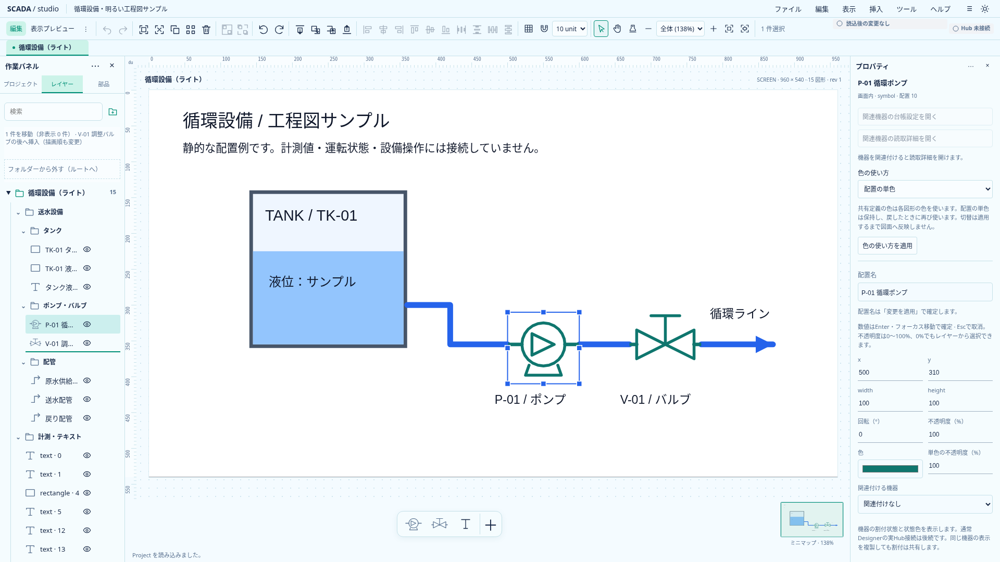
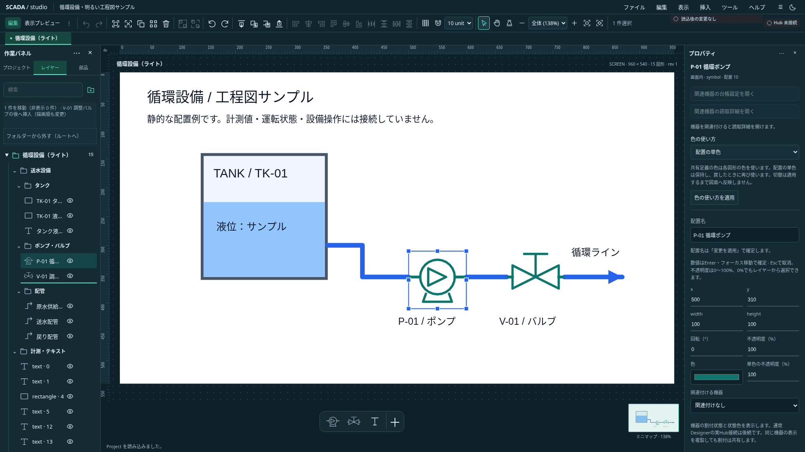

# レイヤーの兄弟内挿入

2026-10-21。状態: **I2a／I2bを実装・全体CI成功確認済み**。[単体開発計画](../../project/upstream-independent-plan.md)のI2a／I2b。Project0.32.0の既存orderだけを使い、Banto／Industrialの契約は変更しない。

## 操作と意味

フォルダー行の上端／下端の各25%は、その兄弟フォルダーの前／後への挿入。中央50%は既存の親変更・所属変更のままとする。配置行は上半分／下半分で、その兄弟配置の前／後へ挿入する。有効な位置には線を表示し、ドラッグ案内に操作と対象を示す。禁止位置には挿入線を出さず理由を示す。

- フォルダー同士の順変更はツリーの順序だけを変更し、配下の配置・描画順・選択・開閉を維持する。locked／非表示の配下があっても許可する。
- 配置同士は同じfolderIdに限る。一つの配置、または完全な一つの幾何グループを移動する。任意の複数配置・複数グループは今回の挿入では拒否し、既存の所属変更では引き続き扱える。
- 配置の順変更は描画順を変更する。別フォルダーの配置を含む他の配置同士の相対順は保ち、移動先のグループの前後へ単位ごと挿入する。移動元のロックは拒否し、非表示配置は移動可能。移動先のロックは挿入位置の参照を禁止する意味にはしない。
- フォルダーと配置を混在した順序にはしない。所属と描画順のモデルは独立したまま。親変更と前後への挿入を一操作で兼ねない。
- 検索中の挿入は無効。検索を解除すれば再度操作でき、検索中の所属変更は既存仕様を維持する。
- 自分自身・同じ位置への挿入はno-opで、revision／Undoを増やさない。キーボード用の既存の上下・前面／背面操作を残す。

## 入力保護と再検証

既存の専用MIMEとtoken、世代／所有先、捕捉IDを共用する。挿入先と前後位置はdrop時に固定する。順序・所属・グループ構成のsnapshotも照合し、確認待ちの間に意味が変わった古い操作を適用しない。名前や座標だけのdraft適用は順変更と別のUndoとして許可する。

入力確認のキャンセルではモデル・選択・文字列を保持する。古いtoken、対象消失、ロック、親不一致、検索、previewをhover・drop・入力確認後に検査する。未dropの取消、端スクロール、パネル浮動、native dragend後の確認続行は既存の経路を使う。

## 実装と受入の単位

I2aは純粋な挿入順計算と`reorder-folder-relative`／`reorder-relative`コマンドを追加する。保存schemaは変えない。Screen／Symbol、原子性、sparse order、所属保持、グループ、no-op、Undo／Redo、不正な対象・positionを単体で確認する。

I2bは既存のdrop surfaceへ位置判定と挿入線を追加する。ライト／ダークのnative drag、既存中央drop、検索、入力の適用／取消、古いtoken、選択・開閉、保存往復と同値操作を確認する。合成DragEvent試験はclient座標を明示し、native dragの代わりとは扱わない。

## 実装・検証

`relative-layer-order.ts`が兄弟内の挿入順と構造snapshotを計算する。folder handlerは既存の兄弟order枠だけを交換し、selection handlerは配置／グループのブロックを移動する。型付きcommand分類と既存のlock／group／finish／historyを共用する。`layer-drag.ts`の位置判定とcontrollerがsnapshot・検索・token・入力確認を接続し、LayerTreeは挿入線と固定高の案内を表示する。案内の文量でhover先の行を動かさない。

関連単体5ファイル67件、型エラー／警告なし、本番buildが成功。新規ブラウザ6件、順序変更による失効を強化した1件、案内高調整後の両テーマnative drag2件が成功した。既存の所属／親変更・フォルダー順の回帰は22件中、初回21件成功・1件が並行実行した別runnerとの成果物ディレクトリ競合によるtrace保存ENOENTで失敗した。出力先を分離し、そのdark nativeケースを再実行して成功した。アプリのassertionを緩めず、CIのretry／timeoutも変更していない。以後、別runnerを同時実行する場合は`--output`を分離する。

Project0.32.0・schema・原本・SDK依存は不変。Rustのローカル再実行は対象外とし、実装コミット`e53a304`の[全体CI39462449843](https://github.com/tyaro/temp-scada/actions/runs/39462449843)が成功した。

## 実画面

`SCADA_CAPTURE_LAYER_INSERTION=1 node scripts/capture-layer-drag.mjs docs/assets/frontend-ux`で撮影する。サーバーは`SCADA_CAPTURE_URL`で指定可能。撮影は合成DragEventで案内を表示し、マウスのnative dragは別途ブラウザ試験で確認した。

## CIで検出したドラッグ後の新規クリック（2026-10-21）

I4の全体CI39534625475で、暗色のnativeドラッグ試験がフォルダー折りたたみ保持の確認に失敗した。既存の300msの派生click抑制が、ドラッグ後に始まった新しいpointer操作まで遮っていた。フォルダー・配置行の新しいpointerdownで、ドラッグ中でなければ抑制を解除する。新規pressを伴わない派生clickの抑制は維持する。同一ブラウザtask内でdragend→派生click→新規pointerdown→clickを発火する回帰試験を追加し、時間待ちやretryで隠さない。

修正後のフォルダー移動・配置所属・兄弟順ブラウザ26件が成功し、型チェックはエラー・警告なし、本番build・全体整形も成功した。修正`bf187f6`を含む[全体CI39535689050](https://github.com/tyaro/temp-scada/actions/runs/39535689050)でFrontend・Rust・ブラウザ4分割・集約checkがすべて成功した。
