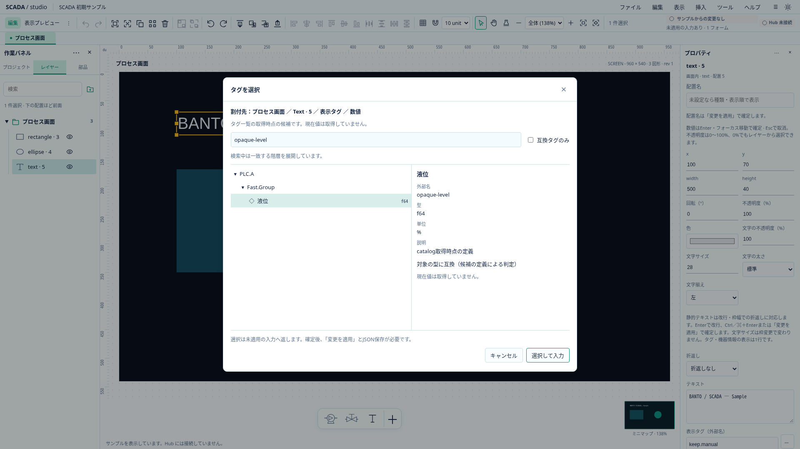
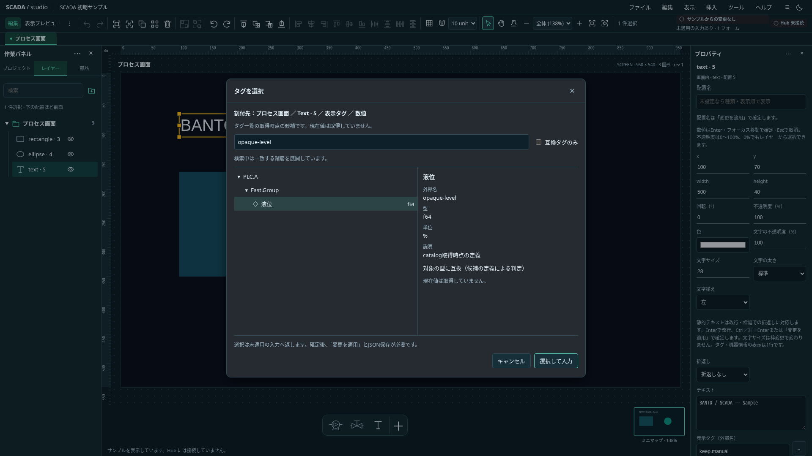

# P4: Host catalogとタグ選択

2026-11-01（日本時間）。状態: **実装・ローカル検証済み、製品transport未接続**。[SOAK中の計画](../../project/soak-independent-runtime-plan.md)のP4。製品transportは[P3bの再開条件](../runtime/transport-boundary.md)に残す。

## RustとDTO

`CatalogHost`はSDKの`RestClient.fetch_catalog()`を明示要求ごとに一度呼ぶ。SDKの値購読とは独立し、要求タグ0件でもcatalogを参照できる。自動poll・値購読・PLC接続は行わない。Project／接続先の置換、停止、新しい取得要求はローカルtokenを更新する。完了した結果も`accept`で現在tokenを照合し、古い成功・失敗を無視する。transport adapterは旧futureも取り消す。

表示DTOはProject ID／revision、catalog revision／run ID／collection modeとタグ行だけ。行はexternalName、connection、group、name、dataType、unit、enabledを持つ。アドレス・式・資格情報・現在値・書込属性は含めない。外部名はopaqueな参照として扱い、ドット分割で階層を推測しない。connection／groupの明示metadataからUI用ツリーを生成する。

SDKの重複名検査を再利用する。空名・過大文字列・未知collection mode・JS safe integer外のmetadata・過大件数はDTOへ流さずエラーとする。未知dataTypeと無効タグは一覧で確認できるが割付候補にはしない。

## フロントと選択

Appは任意の`CatalogSource`を受ける。通常起動では既存の明示したサンプル候補を維持する。sourceがある場合はサンプルへフォールバックせず、取得前・切断・不正結果では選択を無効にする。Projectコピーをsourceへ渡し、tokenに束縛したdeliveryだけを受け入れる。source／Project変更・終了・例外で旧候補を消す。

タグ選択は候補確認→未適用入力→適用→保存を分離する。数値Textは数値型、登録済み機器slotはnumber／boolに対応する型だけを確定する。新規機器は登録後に選択する。一度に表示するタグ候補は先頭200件までとし、全catalogを検索して範囲外の候補も選べる。選択中のProject所有者・配置／機器／slot・入力要素・catalogの参照が変わったら取消す。新しいcatalogに同名があっても旧候補を自動確定しない。失敗・取消で現在の入力を上書きしない。

catalog全件とmetadataは編集session内だけに保持する。保存するのは明示的に確定したexternalNameだけで、タグを自動作成・renameしない。catalogによる型確認は取得時点の情報であり、現在値の取得成功や接続継続を示さない。

## 受入

- Rust: SDK RESTとloopback Hub、空Project、同時要求の逆順完了、置換・停止後の旧結果、HTTP失敗、DTO最小化、共通fixtureとSchema。
- TS: Schema／意味検査、metadata階層、未知・無効型、Project所有者、token、payloadコピーと終了後の消去。
- ブラウザ: 両テーマ、検索・型絞込み・明示確定、catalog変更・接続断・対象変更で旧候補を拒否、入力保持、外部名のみの保存。
- 実Hub・製品transport・認証・Windows運用は未検証として残す。

## 実施結果と実画面

- Rust workspace75件成功（catalogのSDK REST／投影4件を含む）。Clippy `-D warnings`、rustfmt成功。
- TS単体113ファイル・1,267件成功。型検査0エラー・0警告、build成功。既知のchunkサイズ警告は残る。
- 関連ブラウザ6spec・21件成功。候補上限追加後のTagPicker／catalogの10件も成功。共通fixtureから通常Appへ差し込み、両テーマで数値Text・機器bool／number、catalog更新・切断・source切替／例外、旧close拒否、外部名のみの保存往復を確認した。
- Project0.35.0・固定SDK・依存versionを維持した。製品entrypointへのsource注入やテストglobalは追加していない。全体CIはPRで確認する。
- 実Hub・S7環境・PLC・Windows運用は未検証。選択結果の型は取得時点の情報であり、現在値・設備操作の成功を保証しない。

以下は共通fixtureを通常AppのCatalogSourceへ渡した画面であり、実Hub接続の画面ではない。

| ライト                                                         | ダーク                                                        |
| -------------------------------------------------------------- | ------------------------------------------------------------- |
|  |  |
