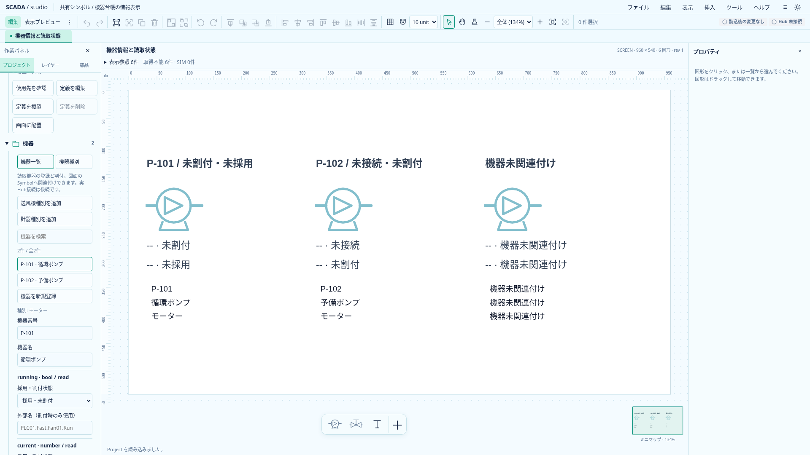
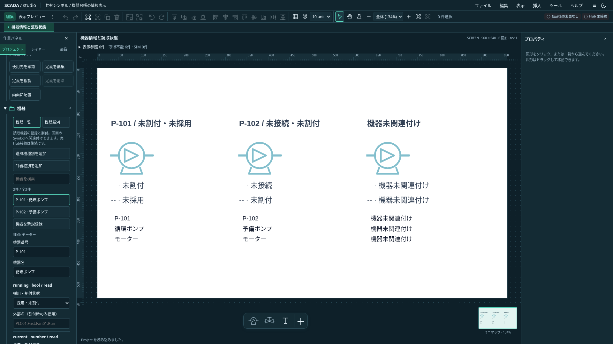

# 共有シンボル内の機器情報表示

状態: Project **0.31.0** のローカル表示機能。[機器作成の詳細提案](../proposals/equipment-authoring-detail-proposal.md#162-bindingの解決と検証)の機器metadata参照を先行実装する。正式Faceplate、機器context付き共通画面、実Hub接続は含めない。

## 表示と保存

共有定義内のTextに`equipmentProperty: { field: "code" | "name" | "typeName" }`を保存する。配置Symbolの`equipmentId`と**現在の保存済みProject台帳**から、機器コード・機器名・機器種別名を解決する。子Textへ機器IDや名称をコピーしない。複数配置は同じ定義を使い、それぞれの機器を参照する。

これは信号の読取slotではない。`binding`／`slotBinding`／`boolColors`と併用できず、画面直下のTextには設定できない。信号値・Quality・SIM・通信状態とは独立し、readSlotコールバックを呼ばない。台帳の未適用入力は表示しない。機器名や種別名を適用すると使用する全配置が更新され、Undoでも戻る。

| 場所・状態                           | 表示                                                                 |
| ------------------------------------ | -------------------------------------------------------------------- |
| 関連付け済み配置                     | 台帳の指定項目                                                       |
| 未関連付け・機器が見つからない       | `機器未関連付け`                                                     |
| 種別名を要求したが種別がない         | `機器種別なし`（不正contextへの防御。通常のProject読込は参照を検証） |
| 明示した共有定義編集・定義サムネイル | `〈機器名：例示〉`など、例示と分かる文言                             |

context欠落だけを根拠に例示へ切り替えない。現在の選択機器や直前に開いた機器を代用しない。runtime frameを保存台帳の所有者にしない。

## 編集と操作

共有Textのプロパティ「表示元」から、静的テキスト・機器情報3項目・宣言済み読取slotを選ぶ。元の静的文字列は保持するが、機器情報が指定されている間はfallbackとして表示しない。例示は保存しない。

表示元は既存の配置フォームと同じ未適用入力・IME・ロック・対象世代の保護に従い、「変更を適用」で確定する。bool slotから変更すると状態別文字色も一括解除する。ただし、そのTextに他図形の状態色が追従している場合は変更全体を拒否する。先に追従を解除する。一回の変更は一回のUndo、同値コマンドはno-op。

長い名称は既存の通常Textの省略表示を使い、SVGのtitleとアクセシブルな説明に全文を残す。number用の収まり判定は使わない。メイン図面・ミニマップ・埋込画面・画面小窓で同じ描画を共用する。埋込View自体へ新たな機器contextの設定は追加していない。

機器情報Text単体のコピー・切り取りは拒否し、clipboardと図面を保持する。共有定義内の複製・定義の独立化は宣言を保持する。未関連Symbol全体のコピーは定義ごと保持する。機器関連付きSymbolのclipboard拒否は維持する。

## 実画面

[サンプルProject](../../../examples/equipment-property.project.json)は同一定義に異なる機器を関連付けた配置と未関連配置を並べる。

## 検証と残り

TS／Rustが同じJSON Schemaと追加した共有slot契約9ケースで保存範囲・排他・所有者を検証する。pure resolver・原子的変更・Proxyの同値no-op・コピー・例示のテスト、ブラウザでテーマ・台帳適用とUndo・省略全文・未関連とProject置換・draft・コピー拒否・埋込／小窓を確認する。検証件数は[実装状況](../../project/implementation-status.md)に記録する。

任意metadata、文字列slot、機器context付き共通画面、正式Faceplate、値の条件式・操作系は後続。industrial #682の共有購読ライフサイクルを独自実装しない。
