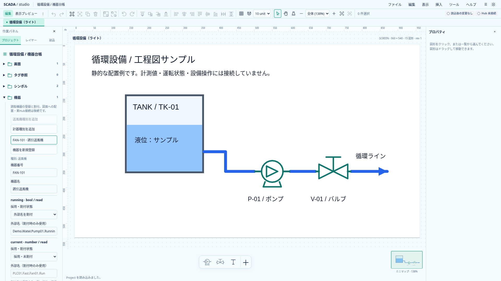
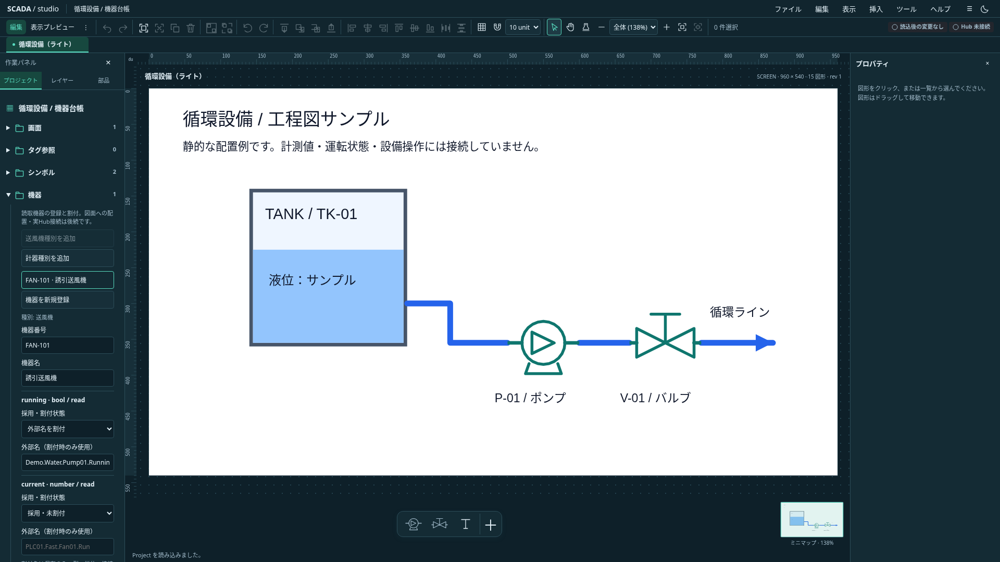
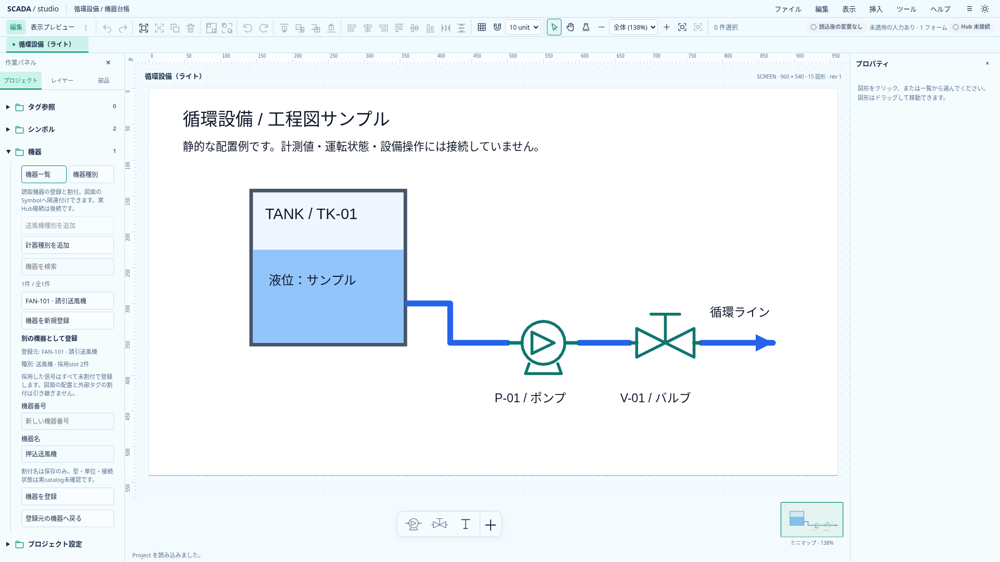
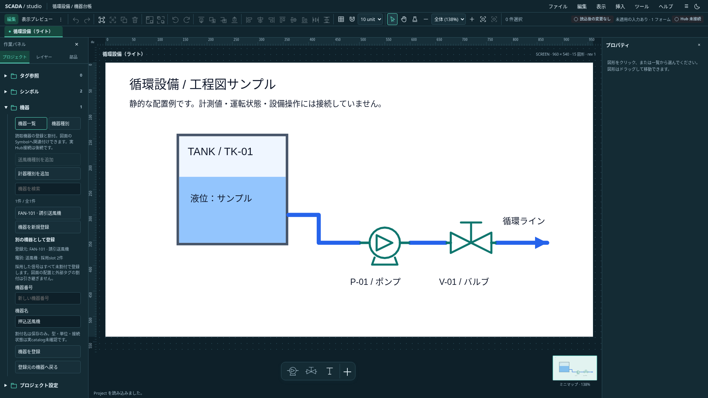

# Equipmentの保存契約と初期台帳

状態: **Project 0.23.0の保存・検証・CRUDと、プロジェクトツリー内の初期台帳を実装。** 2026-10-20。機器と図面の関連付け、動的Symbol、実Hub接続、Faceplate、書込みは後続。[統合設計](../scada-integrated-design.md)を基準に、[追加検討](../proposals/equipment-authoring-detail-proposal.md)から読取機器の最小範囲を具体化した。

本文は0.23.0の区切りを記録する。0.24.0で[Symbol配置の機器参照と使用先](equipment-symbol-association.md)を追加し、使用中機器の削除も保護した。現在の対応範囲は実装状況を参照する。

## 所有者と保存形式

Projectへ省略可能な`equipmentTypes`（最大100）と`equipment`（最大1000）を追加する。未使用の既存サンプルへ空配列を勝手に補完しない。Type・InstanceのIDは他の配置・画面等と同じProject全体のUUIDv7一意性を使う。機器番号や表示名でIDを置き換えない。

| 保存項目          | 内容                                                                    |
| ----------------- | ----------------------------------------------------------------------- |
| EquipmentType     | `id`、`name`、`slots`。名前は200文字まで、slotは最大64                  |
| slot宣言          | `name`、`type: bool / number`、`direction: read`。型内で名前は一意      |
| EquipmentInstance | `id`、`typeId`、`code`、`name`、`bindings`。座標・現在値を持たない      |
| 採用slotのbinding | `slotName`と`externalName: string / null`。最大64、同じ役割の重複を拒否 |

slot名はASCII英字またはunderscoreから始まる英数字／underscoreの1〜64文字。機器番号はASCII英数字から始まる英数字と`._:/-`の1〜64文字とし、Project全体で大文字小文字を区別して一意にする。日本語の名称は別の`name`に設定できる。CRUDでは番号・名称の前後空白を除き、ファイル読込時の非正規形番号は拒否する。許可文字以外を明示拒否し、JSの`$`が末尾改行直前にも一致する差を避ける。

binding行なしは**未採用**、行があり外部名nullは**採用・未割付**、文字列は**割付済み**。外部名をtrim・推測変換せず、複数機器・slotで同じ外部名を使える。空欄・空白だけの外部名は拒否する。Unicode空白の集合はschemaとRuntime planで明示的に揃え、U+0085・U+1680・FEFF等を共通fixtureで検証する。

Project内に値・Quality・接続先・認証情報を保存しない。0.1.0の既存読込経路は0.23.0へ移行するが、0.2.0〜0.22.0の移行は追加しない。リリース前の互換性保証はしない。TS／Rust／schema／現行サンプルとバージョン表示を揃えた。

## 原子的な編集

`create/update/remove-equipment-type`と`create/update/remove-equipment`を既存のProjectコマンド分類へ追加し、`equipment-handler.ts`へ分離した。入力Projectの検証、候補上の編集、全体検証、revision更新とUndoの境界は既存経路に保つ。失敗では現在のProjectと履歴を変更せず、同値はno-opになる。

採用中slotは外部名nullでも、削除・改名・型変更を拒否する。外部名を一度消すだけでは未採用にならないため、明示的にbinding行を除く必要がある。未採用slotの変更は可能。使用中Typeの削除を拒否し、Instanceの種別変更コマンドは初回には提供しない。別種別の同名slotへ暗黙移行しない。

Instanceの削除は可能。現段階では図面から機器への参照自体がないためであり、配置参照を追加する段階で使用中削除保護も追加する。画面の複製で機器を量産せず、Projectの機器台帳を共有したままにする。今回の図形clipboardは機器を取り込まない。

## 初期UI

編集モードの「プロジェクト」→「機器」で、送風機（running／current）と計器（value）の読取種別を追加できる。同じ初期定義がある場合は追加ボタンを無効化する。機器番号・名称・種別を選んで登録し、成功後は作成機器を選択して割付を続ける。

機器を選ぶと番号・名称と、各slotの「未採用／採用・未割付／外部名を割付」を編集できる。外部名欄は「外部名を割付」の場合だけ保存に使う。登録・適用は明示ボタンで一括確定する。実catalog未確認であり、割付を保存しても型・単位・接続の正常性が確認済みとは表示しない。

既存draft guardへ全フォーム項目の確定基準値を渡し、機器選択・新規登録・画面切替・Undo等で未適用入力を保護する。IME中のEnter／submitを適用へ使わない。遅延適用ではworkspace世代とProject ID、接続済みのformと機器IDを検査する。プレビューには編集UIを出さない。

これは小規模台帳の初期導線。種別の汎用編集・削除UI、大量機器の検索／一覧workspace、複製、タグ選択ダイアログ、図面からの機器化は後続とする。

## 読取adapterとの接続

`Project::equipment_read_bindings()`が採用slotだけを返し、`ReadSlotPlan::from_project()`で機器IDと役割を型付きcontextへ変換する。未採用は含まず、未割付はNoneを保持する。plan構築は`Result`で返し、検証済み入力からでもpanicへ落とさない。

[先行した読取adapter](typed-read-slots-design.md)と固定SDKの境界を維持する。SDK #682、session世代管理、Host・認証の前提を迂回せず、ブラウザからの実設備要求は追加しない。今回新しいBanto／industrialの変更要求は発生していない。

## 検証とレビュー

- TS715件、型チェックはエラー／警告なし。
- Rust43件（model25、runtime15、SDK統合3）、Clippy、buildが成功。
- TS／Rust共通の保存ケース35件。参照欠損・ID／番号／slot重複・write拒否・改行12ケース・特殊空白5ケースを含む。
- 関連ブラウザ24件が成功。両テーマの登録／割付／保存、入力保護とUndo、重複番号、未入力でのmode切替、IME、旧版拒否、既存group／folder drag／画面／viewportを確認。

Astraレビューで、未入力の種別selectがdraft扱いになる問題と、改行／Unicode空白の解釈差を修正した。初回ブラウザは前者で3件失敗。次の2件の失敗はselectのラベルlocatorに起因し、roleで対象を指定して解消した。最終24件は全て成功し、テストの無効化やassert緩和はしていない。修正後の静的再レビューでも追加の必須修正なしと確認した。

## 実画面

`scripts/capture-equipment.mjs`で1920×1080、両テーマを撮影。中央は独立した静的な工程図サンプルで、左の機器と図面の配置はまだ関連付けていない。背景は画面設定の色を保持する。台帳の下部項目は左パネル内をスクロールして操作する。

撮影後の説明文整理も機器UIの5件で再確認し、全成功した。全体整形と変更文書のローカルリンクを確認してコミットする。最終差分の全体CIはPush後に確認する。

## 台帳の検索とページ表示

機器一覧には検索欄を一つ置き、機器番号・名前・種別名を絞り込む。全角英数字と英字の大小を吸収し、保存値は変更しない。登録順を保って20件ずつ表示し、検索条件を変えると最初のページへ戻る。

検索やページ切替だけでは編集対象を変えない。結果外になった機器も入力を保持し、その機器番号を表示する。別機器の選択時には既存の未適用入力確認を使う。検索・ページはProject／履歴へ保存せず、別ファイルの読込で初期化する。55件の台帳でページ境界、全角検索、種別名検索、結果なし、入力保持・破棄・保存不変を実ブラウザで確認する。

## 既存機器を元に別機器を登録

機器を選び「この機器を元に別の機器を登録」を開く。種別と採用slotを引き継ぐが、外部名はすべてnullの未割付に戻す。未採用slotは追加しない。番号は空欄から明示入力し、名称だけ元機器を編集可能な候補にする。外部名の文字列置換、種別の複製、図面配置の作成はしない。

確定は既存の`create-equipment`一回で行う。番号重複等の失敗では登録せず入力を保持する。Undoで新機器全体を取り除き、Redoで同じ機器を戻す。元機器・共有種別・図面配置は変更しない。通常の図形複製が同じ機器を参照する動作とも区別する。

元機器に未適用入力があれば適用／破棄／キャンセルで解決し、解決後の保存済み情報を使う。新規登録中の「登録元の機器へ戻る」も入力保護を通す。「適用して続行」は登録したうえで元機器へ戻り、「入力を破棄して続行」は登録せず戻る。クリック時の元機器IDと世代を固定し、遅延時に存在を再確認する。フォームでも対象世代・元機器の存在を再確認する。

両テーマのブラウザで、割付済み／採用未割付／未採用、番号重複、保存・Undo／Redo、元機器draftと登録draftの保護を確認する。以下は実アプリで別機器の登録フォームを撮影したもの。元機器へのDemo割付は新機器へ引き継がれない。

## 割付の一覧表

2026-11-12（[フロー図の差分 §5.2](../editor/flow-diagram-gap-2026-11-12.md) の A5）。「プロジェクト」→「機器」の「割付の一覧表」で開く。行が機器、列が機器種別のslotで、機器種別ごとに表を切り替える。開く前に台帳の未適用入力を適用／破棄／キャンセルで解決する。

- セルの意味: 外部名を入れたセルは採用・割付済みになる。空欄（schemaと同じ空白の集合だけの文字も含む）は採用・未割付で、元が未採用なら未採用のまま。表から未採用には戻さない（機器ごとの割付で行う）。外部名はtrimしない。
- 貼付け: 表計算ソフトの範囲（タブ区切り・改行区切り）を貼り付けると、選んだセルから右下へ入る。表の外にはみ出したセルは入れず、件数を示す。1つの値だけの貼付けは通常の入力と同じ。
- 照合: タグ一覧を使えるときは、名前がない「未解決」と、型が合わない・無効なタグ（`compatibleTag`、state はnumberとして読む）を示す。どちらも保存は拒否しない。タグ一覧を使えないときは照合していないと明示する。512文字を超える名前は差分確認へ進めない。
- 適用: 「差分を確認」で機器番号・機器名・slot・変更前・変更後の一覧を示し、「N件を適用」で`assign-equipment-tags`の1回の編集として適用する（Undo／Redoも1回）。変更前は各セルを最初に編集した時点の保存値（そのとき表に見えていた値）を使い、適用時の保存値と一致しないセルが1件でもあれば全体を適用しない。照合はタグ一覧を外部名で索引化して行う。
- 閉じる: 未適用の変更があるときは、Esc・×で「破棄して閉じますか」を出す。閉じると開いたボタンへフォーカスを戻す。表を開いている間はメニュー・編集ショートカットを止める。

### 接頭辞から入れる（2026-11-12、A5b）

機器種別の slot に「タグ名の末尾」（`tagSuffix`、[機器種別の編集](equipment-type-editing.md#タグ名の末尾2026-11-12a5b)）があれば、表の「接頭辞」列からタグ名を組み立てて入れられる。

- 接頭辞は保存しない。表を閉じると消える。接頭辞列にも縦方向（改行区切り）・範囲の貼付けができ、接頭辞列から貼ると右の slot 列へも続けて入る。
- 「接頭辞から入れる」は、接頭辞のある行（空白だけは空とみなす）で、`tagSuffix` を持つ全 slot のセルに `接頭辞 + 末尾` を入れる。単純な連結で、区切り文字は接頭辞側に含める（例 `s7.line1.P101_` + `RUN`）。末尾のない slot と接頭辞が空の行は触らない。既にある値も上書きする（差分確認で見える）。
- タグ一覧を使えるとき、`allowUnassigned` の slot で組み立てた名前が一覧にないと、そのセルは空欄（採用・未割付。元が未採用でも採用する）にする。それ以外の見つからない名前はそのまま入れ、従来どおり「未解決」と示す。タグ一覧を使えないときは照合せずに全部入れる。
- 入れた値は手入力と同じ未適用の変更で、照合・差分確認・1回の `assign-equipment-tags`・離脱保護に乗る。空欄にしたセルを手で入力し直すと通常のセルに戻る（空なら元が未採用のまま）。
- 実行後、ステータスに「N件を入れました。未割付を許すslotで見つからないM件は空欄にしました。」を出す。末尾を持つ slot がない・接頭辞のある行がないときは、その旨を出す。
- 組み立ては `equipment-binding-table.ts` の純関数 `prefixFill`。試験: `equipment-binding-table.test.ts`（prefix fill）、`e2e/equipment-binding-table.spec.ts`（種別で末尾を設定 → 縦貼付け → 入れる → 適用）。

### Hub 登録用 CSV を書き出す（2026-11-12、A7）

SCADA は Hub へは読取専用で、Hub への登録は SCADA から書き出したファイルを Hub の「タグの CSV インポート」で取り込む運用とする。表の「Hub 登録用 CSV を書き出す」で、保存済みの割付からその CSV をダウンロードする。

- 形式: Hub のタグ CSV と同じ。ヘッダは上流の `TAG_CSV_COLUMNS`（19 列、2026-11-12 時点）と厳密に一致させる。先頭に UTF-8 BOM、改行は CRLF、カンマ・引用符・改行を含むセルは `"` で囲んで `"` を二重化する（上流の `serializeCsv` と同じ）。既定のファイル名は `hub-tags-<Project名>.csv`（ファイル名に使えない文字は `_`）。
- 対象: 全機器（表で選んでいる機器種別に限らない）の、採用済みかつ割付済み（外部名が文字列）の slot。行の順は機器の順、その中は機器種別の slot の順。同じ外部名を複数の slot が使うときは 1 行にまとめ、comment に先頭の使用箇所と「ほかN件」を書く。
- 照合: タグ一覧を使えるときは、一覧にある名前を除いて新規登録分だけを書き出す（除いた件数を出す）。使えないとき、およびHub未接続のサンプル候補しかないとき（サンプル候補はHubのタグ一覧ではない）は照合せずに全部を書き出し、その旨を出す。
- 列の値: connection／group／name は外部名を「接続.グループ.タグ」に分けたもの（分け方は次項）。address は空欄（利用者が Excel などで埋めてから取り込む。Hub は `tagKind=plc` で address を必須とするので、空のままでは取込みでエラーになる）。dataType は候補で、bool→`bit`、state→`u16`、number→空欄（Hub は空欄を不正とするので利用者が選ぶ）。型の違う slot が同じ名前を使うときも空欄。enabled `true`、writable `false`、tagKind `plc`、retain `false`。decimals・stringEncoding などそのほかは空欄（Hub の取込みは decimals の空欄を 0、string 以外の stringEncoding を無視する）。comment は `機器番号 機器名 / slot名`（500 文字まで）。comment が `=`・`+`・`-`・`@` で始まるときは先頭に `'` を付け、表計算ソフトで数式として読まれないようにする。文字数は Hub と同じくコードポイントで数える。
- 分け方: 接続名・グループ名には `.` を使わない（2026-11-12 ユーザー判断。Hub 側でも禁止する）。外部名を最初の 2 つの `.` で分け、残りをタグ名とする（タグ名には `.` を含められる）。
- 分けられない名前: `.` が 2 個未満、空（空白だけ）の部分がある、部分の前後に空白がある（Hub の取込みで trim される）、カンマ・制御文字を含む、100 文字を超える部分がある、先頭が `=`・`+`・`-`・`@` の部分がある（Excel などで開くと引用しても数式として読まれ得る。名前を変えるとタグ名が変わるので書き出さない）名前は書き出さず、表の上に「書き出さなかった名前」（機器番号・slot・外部名・理由）として出す。**この分割は書き出し専用**で、ほかの機能では従来どおり外部名を分割しない（[タグ選択](catalog-selection.md)）。
- 未適用の変更: 表に未適用の変更があるときは書き出さず、適用か取消しを促す。書き出しは保存済みの割付から作るため、直前に入れた名前が抜けた CSV を気づかずに渡すことを避ける（接頭辞から入れる → 適用 → 書き出す、の順に使う）。
- ステータス: 「Hub 登録用 CSV にN件を書き出しました。」と、Hub に既にあって除いた件数（名前の数）・分けられずに除いた件数（slot の数）を出し、address 列を埋めてから取り込むよう案内する。dataType が空欄の行があるときは、その件数と dataType 列も埋めることを案内する。書き出す名前がないときはダウンロードしない。
- 組み立ては純関数 `hub-tag-csv.ts`（`hubTagCsv`）、保存はアプリ共通のダウンロード（`download.ts`、Project の保存と同じ）。試験: `hub-tag-csv.test.ts`、`e2e/equipment-binding-table.spec.ts`（ダウンロードした CSV の内容）。

### I/O 一覧の CSV を取り込む（2026-11-14）

ベンダーの I/O 一覧（1 行が 1 信号）を CSV のまま取り込み、表のセルへ実タグを入れる。2026-11-14 ユーザー選択（表と同じ横長の形ではなく、1 行 1 信号で列を選ぶ）。

- 操作: 表の「I/O 一覧の CSV を取り込む」でファイルを選ぶ → 「機器番号の列」「slotの列」「タグ名の列」を見出しから選ぶ → 「表へ入れる」。3 つの列はそれぞれ別の列にする。ほかの列（address・備考など）は使わない。
- 読取り: 5MB まで。UTF-8（BOM の有無を問わない）として読めなければ Shift_JIS（日本語版 Excel の「CSV」の既定）として読む。区切りはカンマ、`"` で囲んだ欄は `""` を引用符、改行を含められる（RFC 4180）。1 行目を見出しとし、すべての欄が空の行は無視する。引用符が閉じていなければ読まない。
- 列の推定: 見出し（前後の空白を除き大文字小文字を区別しない）が「機器番号・code・機器」「slot・信号・信号名」「タグ名・タグ・tag・tagname・外部名・externalname」なら、その列を選んでおく。
- 照合: 機器番号と slot は前後の空白を除いて、機器の `code` とその機器種別の slot 名に完全一致させる。表で選んでいる機器種別に限らず全機器が対象（ほかの種別に入った件数を示し、差分確認で見える）。タグ名は手入力と同じく trim しない。
- 入れる値: 当たったセルに手入力と同じ未適用の変更として入れる（既にある値も上書き、未採用の slot は採用する）。照合・差分確認・1 回の `assign-equipment-tags`・離脱保護に乗る。
- 取り込まない行: 機器番号が空・見つからない、slot が空・機器種別にない、タグ名が空（空白だけを含む。未割付にはしない）、タグ名が 512 文字を超える、同じセルに別のタグ名を書いた行（その全行。同じ名前の重複は 1 件として入れる）。表の上に「取り込まなかった行」（CSV の行番号・機器番号・slot・タグ名・理由）として出す。
- ステータス: 「CSV のN件を入れました。」と、ほかの機器種別に入れた種別数・取り込まなかった行数を出す。
- 組み立ては純関数 `equipment-io-csv.ts`。試験: `equipment-io-csv.test.ts`、`e2e/equipment-binding-table.spec.ts`（列の推定と選択 → 取込み → 適用）。
