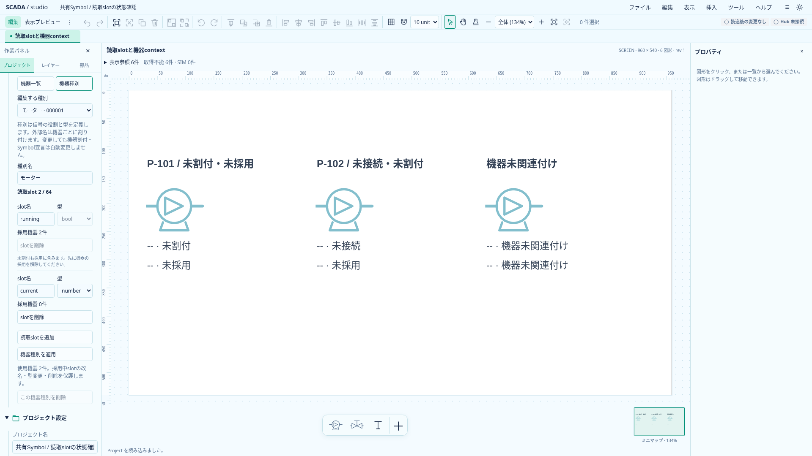
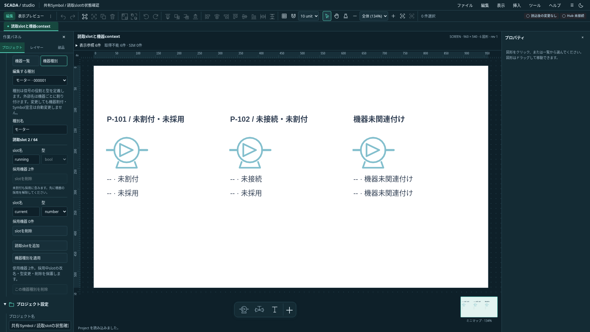

# 機器種別と任意の読取slotの編集

2026-10-20。Project 0.27.0で既存の機器種別コマンドをDesignerへ接続する。任意のbool／numberの役割を作り、機器登録・採用と割付・Symbol関連付け・読取詳細へつなぐ。正式な設備テンプレートやFaceplate定義の導入ではない。

## 操作

左の「プロジェクト」→「機器」で「機器一覧／機器種別」を切り替える。切替前に未適用入力を解決する。機器割付と種別構成のフォームは同時に編集させず、構造変更による未適用の割付入力の消失を防ぐ。送風機・計器の固定プリセットも機器一覧側で引き続き利用できる。

機器種別では、新規または既存の種別を選び、名前と読取slotを編集する。slotは英字または`_`で始まる英数字と`_`の64文字以内、型はbool／number／state、最大64件。重複名は拒否する。slotなしの種別も作れる。種別名と全slot構成は一回で適用し、一回のUndoで戻す。種別は100件まで。

各slotの採用機器数を表示する。`externalName:null`の未割付も採用に含め、採用中のslotは改名・型変更・削除を制限する。種別を使う機器が一件でもあれば種別は削除できない。UIを通さない場合も既存ドメインが拒否する。未採用slotは変更できるが、機器割付やSymbolの同名宣言を自動変更しない。その結果、図面が「機器種別にslotなし／slot型不一致」となる場合がある。

作成後は新しい種別を選択する。機器一覧に戻ると、その種別で機器を登録できる。採用したslotの外部名は機器ごとに割り付ける。通常Designerは実Hub未接続で、実値を代用して表示しない。

## 未適用入力と責務

構成行の追加・削除もdirtyとして扱う。可視行は構成の編集を担当し、フォームでは名前と全slot構成のJSONを追跡する。行をDOMから取り除いたことだけで変更を判断しない。破棄時は保存された構成から行を復元し、キャンセル時は入力を保持する。無効な名前・重複・採用保護の失敗でも入力を保持する。

フォームはProject世代・Project ID・種別IDを照合する。IME確定前のEnterでは適用しない。種別の作成・更新・削除は既存EquipmentCommandとProjectの最終検証を使用し、保存schemaやRust契約は変更しない。

`EquipmentTypes.svelte`が表示と構造draft、`forms/equipment-type.ts`が対象と入力の検査、`equipment-handler.ts`が既存の参照保護と変更を担当する。機器一覧との切替は`EquipmentLibrary.svelte`、フォームの適用・Undo・draft事前検証はAppの既存経路を使う。

## 検証

純粋なフォーム検証では世代・対象・行形式・型・重複・禁止文字・64件上限と、採用中の変更拒否の原子性を確認する。ブラウザでは両テーマで任意種別作成から機器登録・採用・Symbol関連付け・読取詳細までを通す。構造draftのキャンセル／破棄／適用、無効入力保持、Undo／Redo、未割付を含む採用保護を確認する。既存の機器登録・プリセット・使用先・割付の試験も維持する。

以下は実アプリの撮影。採用済み／未採用の違いを示すため、撮影用Projectはrunningだけを採用し、currentを未採用にした。

## 状態の定義（2026-11-12、段階1-A の A1）

状態の定義は機器種別の slot だけが持つ（[フロー図の差分 §5.1](../editor/flow-diagram-gap-2026-11-12.md)）。Symbol 定義の `readSlots` は名前と型だけを持つ。

- `state` の slot は `stateDisplay` を必ず持つ。`source` は `value`（ワードの値と一致）か `bits`（ワード内のビット 0〜31 が立っている）。`rows` は `match`・`text`・`color` の行で最大64件、上の行が優先。`otherwise` は該当なしの文字と色。`match` の重複は拒否する。値の範囲は −2147483648〜4294967295。
- `bool` の slot は、任意で `boolDisplay`（`true`／`false` それぞれの文字と色）を持てる。`number` は表示の定義を持たない。
- `allowUnassigned: true`（true のときだけ保存）は、未割付を異常として扱わず「なし」とする指定。評価は `lib/slot-state.ts` の `evaluateSlotState`（A2）が行う。
- 読取の型は、`state` を数値のワードとして読む（Rust の `EquipmentReadType::Number`、TS の `slotReadType`）。
- 文字は64文字以内で改行なし。空文字（色だけの表示）は許す。
- 型を変えたら合わない表示を外す（number にしたら `allowUnassigned` も外す。評価するのは bool と state だけのため）。

### 状態の行の編集（2026-11-12、A4）

ユーザー指示「表現力は参照画面以上、ただし操作は容易に」に沿って、bool／state の slot の下に定義の欄を出す。採用中の slot でも、名前・型と違って定義は変えられる（割付に影響しない）。

- 「未割付を許す（その機器にない信号は「なし」として表示）」のチェック。
- bool: 「true／falseの文字と色を決める」をチェックすると、運転（緑）／停止（灰）を初期値にして文字と色の欄を出す。外すと `boolDisplay` を消す。
- state: 「元の値」（ワードの値が一致／ワード内のビットが立っている）、行の一覧、「状態の行を追加」、該当なしの文字と色。
  - 行は 2 段。1 段目が値（またはビット）・文字・色、2 段目が見え方（文字を定義の色で表示）と「上へ」「下へ」「削除」。上の行が優先なので、並べ替えで優先を変える。
  - 追加した行は、値なら最大の次、ビットなら空いている最小のビットを入れ、色は順に変える。ビットが 32 個埋まると追加できない。
  - 行がないときは「例を入れる」で停止・運転・故障の行を入れる（ビットのときは故障を上に置き、該当なしを停止にする）。
  - 重複（上に同じ値・ビットの行がある）・ビットの範囲（0〜31）・整数でない値・値の範囲は、その行の下にすぐ出す。元の値をビットへ変えても値は自動で直さない。
- 適用時は `forms/equipment-type.ts` が同じ検査で拒否し、「slot名の行N: 理由」の形でステータスへ出す。入力は保持する。
