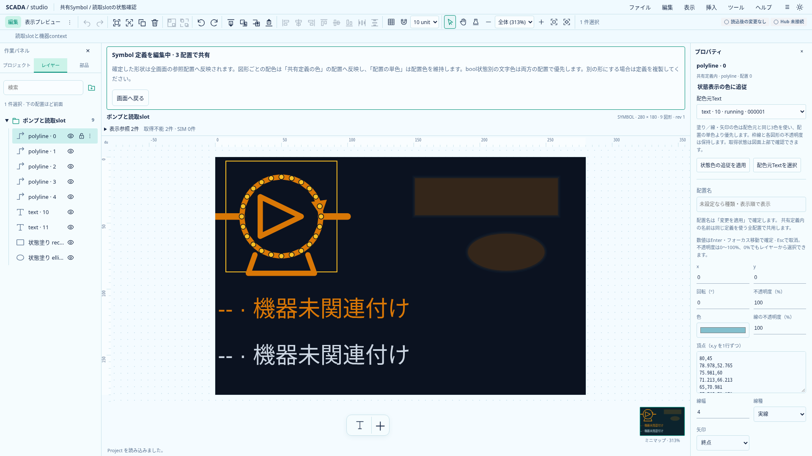
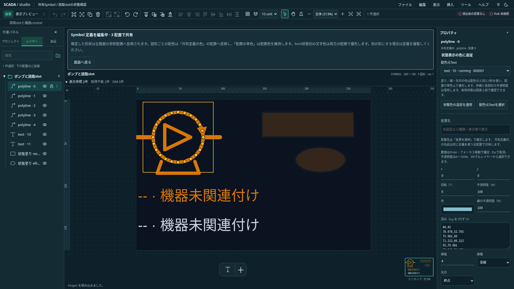

# 共有Symbolの図形・配管の状態色追従

2026-10-20（日本時間）。Project 0.27.0の実装。通常Designerは実Hubに未接続であり、ここでのGood値・Quality・SIMの検証はテスト入力を使用する。

## 設定と表示

共有定義内の矩形・楕円・Polylineを選び、「状態表示の色に追従」で配色元Textを指定して適用する。同じ定義にある、bool slotに割り当て済みで状態別文字色を持つTextを選べる。「配色元Textを選択」で設定元へ移動できる。Text側には追従先の件数を表示する。

矩形・楕円は有効な単色塗りだけが対象。Polylineは線と矢印へ適用する。配置の単色指定より状態色を優先し、矩形・楕円の枠線は通常の定義色／配置色を維持する。各図形自身の色α・opacityを維持し、Textの透過度は引き継がない。gradient・pattern・枠線の動的配色、任意式や数値範囲の配色は後続。

取得できたboolのtrue／falseだけをそれぞれの色へ解決する。Bad・Stale・未接続・未採用・未割付・型不一致等は取得不能色となる。前のGood色を残さない。配置ごとに機器を解決するため、同じ定義でも設備ごとに異なる色になる。SIMはbool値に応じた色と併存し、図面外の「表示参照」に取得状態・SIM・来歴を表示する。定義編集・サムネイルは機器未関連付けのため取得不能色を使う。

非表示／α0の配色元Textも許可する。取得状態はTextの可視性に依存しない「表示参照」で確認できる。追従図形を普通の画面へ単体コピーすることはできない。

## 保存・参照と編集保護

保存は対象shapeの `stateColor: { textId }`。同じ定義の有効な配色元をTS／Rust共通の意味検証で確認する。画面直下やText自身には設定できない。旧0.2〜0.26形式は拒否し、移行機能は追加しない。

追従先が残る配色元の削除、状態色解除、静的Text／number化は拒否する。先に追従を解除するか、配色元と全追従先をまとめて削除する。塗りを無効・gradient・patternへ変える際も先に追従を解除する。失敗時はProject・履歴を保持する。フォームの未適用入力には画面移動・選択変更の確認を適用する。

定義全体の複製と、配色元＋追従図形の複数選択複製は新しいText IDへ参照を振り直す。追従図形だけの定義内複製は元のTextを参照する。参照を失う単体clipboardは理由付きで拒否し、全体Symbolの既存のコピー条件は維持する。

## 検証と実画面

共通18ケースをTS／Rust双方で実行し、参照・型・塗り・保存範囲を検証する。編集コマンドでは拒否の原子性、Undo、複製と参照再採番、clipboard、フォーム対象のガードを確認する。ブラウザでは両テーマで設定・解除・未適用入力・参照保護・保存を確認し、同一mountの主画面・埋込・Popupで別設備のtrue／false、SIM、Bad／Stale、切断、世代変更、αと枠線の保持を確認する。

以下は実アプリの定義編集画面。色は機器未関連付けによる取得不能色であり、実機の運転表示ではない。

