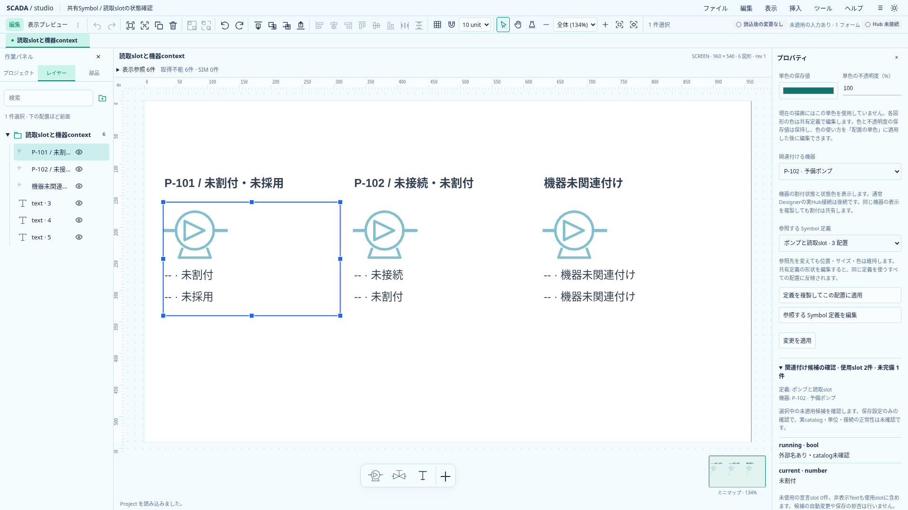
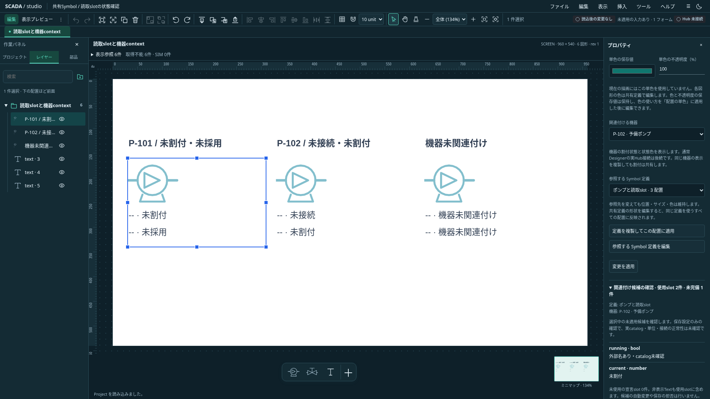

# Symbolと機器の関連付け候補の確認

2026-10-20。Project 0.27.0の保存契約を変更せず、単一Symbol配置のプロパティに読取専用の確認欄を追加した。正式Faceplate、実catalog検証、実Hub接続の完成ではない。

## 確認する対象

「関連付け候補の確認」は、同じフォームの「参照するSymbol定義」と「関連付ける機器」の現在値を使う。未適用の候補でも確認できる。採用後の保存値へフォールバックせず、未関連付けなら未関連付けを表示する。対象定義がなくなった場合は対象なしを明示する。

定義内でTextが参照する宣言slotだけを列挙する。非表示Textも含め、同じslotを複数のTextが参照しても一行にまとめる。未使用の宣言数は別に表示する。使用slot・未完備の件数と、各slotの型・不足／型不一致／未採用／未割付を示す。外部名がある場合も「外部名あり・catalog未確認」と表示し、設定があることと実値の正常性を区別する。表示値やQualityはこの確認欄へ混ぜない。

折り畳んで領域を節約し、展開時は最大20行ずつページを切り替える。候補を変更すると最初のページへ戻る。ロック中も確認できるが、確認欄から選択・割付・draftを書き換えない。不適合候補を理由に保存を新たに拒否することもない。

## 責務と検証

`symbol-equipment-check.ts`は既存`symbolSlotUsages`と`resolveSymbolSlot`を使い、明示した保存contextだけで判定する。実値用の`readSlot`を渡さない。`SymbolEquipmentCheck.svelte`は親フォームだけを参照し、selectの現在値を読む。ロックでFormDataから外れる値も読める。change／resetとモデル反映後のtickで追従し、同じフォーム・接続状態・対象keyを照合する。未適用入力の所有は既存draft guardのまま。

単体テストはhidden・重複Text・未使用宣言・各設定状態・runtime readerの不使用・静的／欠損定義を確認する。ブラウザは両候補の変更順序、キャンセル／破棄／適用／Undo、ロック中と未関連付け、24slotのページ境界を確認する。

以下は実アプリの未適用候補を撮影したもの。外部名と未割付を確認するためのサンプルであり、実機の正常値を示さない。

