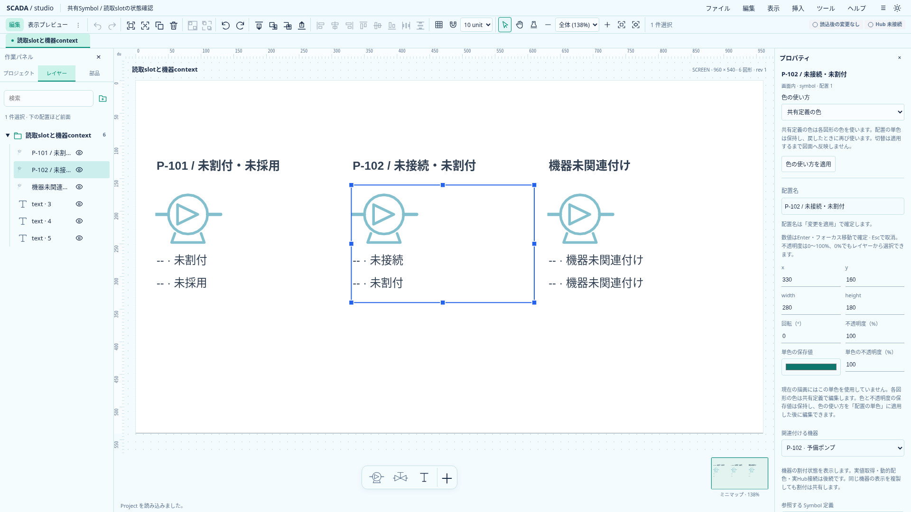
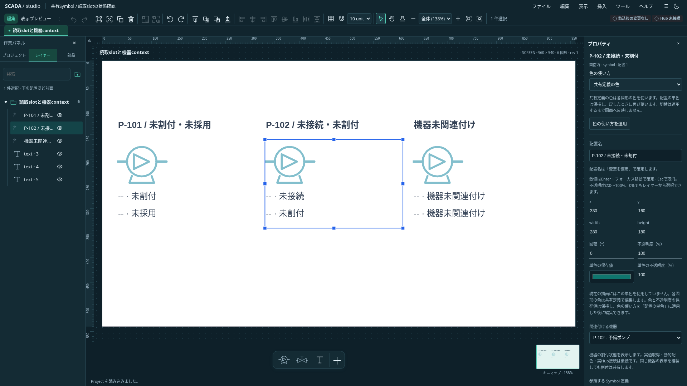

# 共有Symbolの読取slotと割付状態表示

状態: **宣言・表示Textの追加・既存宣言への割付と、機器contextの取得前状態を実装**。2026-10-20、Project 0.25.0。[統合設計](../scada-integrated-design.md)§5と上流§7の段階実装。後続で[表示DTOの受入とGood／Quality表示](read-slot-presentation.md)を実装した。実Host・動的配色・Faceplateは未実装。

## 保存契約

`SymbolDefinition.readSlots`は省略可能な読取宣言で、最大64件。`name`は機器slotと同じASCII識別子、`type`は`bool`／`number`、`direction`は`read`。同一Symbol内の名前重複を拒否する。共有定義には機器IDや外部タグ名を持たせない。

共有定義内のTextは`shape.slotBinding: { slotName }`で宣言を参照する。画面上のTextへの設定、宣言の欠落、直接タグ`binding`との併用、未知プロパティはTS／Rust共通検証で拒否する。子Textが参照する宣言を失うProjectは保存できない。未使用の宣言は保持できる。既存の直接数値Textの契約は維持する。

配置は前工程の`shape.equipmentId`を通して機器を参照する。機器種別のslot欠落・型不一致、未採用・未割付は編集中に存在し得るため、Symbolとの不適合だけでProject全体を拒否しない。従来どおり、存在しない機器・機器種別・未宣言の機器bindingは拒否する。

保存形式は0.25.0へ更新し、TS／Rust／schema／現行サンプルを揃えた。0.24.0からの移行は提供しない。現在値・接続状態をProject・Undo・clipboardへ保存しない。

## 編集操作

共有定義を開き、`running · bool`／`current · number`／`value · number`の表示追加を選ぶ。`add-symbol-readout`は宣言とTextを一回の編集で追加し、Undoで同時に戻す。同名・同型の宣言は再利用し、同名・異型は候補全体を拒否する。追加位置は定義の左上。通常の移動・寸法編集で配置する。

Textのプロパティ「読取slot」で既存宣言を選び、「変更を適用」で確定する。空欄は静的Textへ戻す。未適用入力の保護とUndoを利用する。後続で[任意名の追加・未使用宣言の改名／型変更／削除](symbol-slot-editing.md)を実装した。編集と表示追加は左のプロジェクト設定へ集約し、使用中のText参照を保護する。状態ランプや動的色のルールUIは後続。

配置／画面／共有定義の複製は宣言と参照を保持する。機器未関連付けのSymbol配置全体のclipboardは宣言ごと保持する。slot表示Text単体を含むコピー・切り取りは、依存する宣言を失わないよう選択全体を理由付きで拒否する。機器付き配置のclipboardは前工程同様に拒否する。

## 表示の解決順

使用しているTextごとに、宣言 → 配置の機器 → 機器種別の同名slot → 型一致 → 採用 → 割付を確認する。slot名や外部名の補完・大文字小文字変換をしない。

| 状態                                  | 表示                      |
| ------------------------------------- | ------------------------- |
| 配置に機器がない／定義編集・thumbnail | `-- · 機器未関連付け`     |
| 機器種別に同名slotがない              | `-- · 機器種別にslotなし` |
| bool／numberが一致しない              | `-- · slot型不一致`       |
| binding行なし                         | `-- · 未採用`             |
| binding行の外部名がnull               | `-- · 未割付`             |
| 外部名あり、Host未接続                | `-- · 未接続`             |

不成立はそのTextに限定し、Symbolの静的図形や他のslot表示を消さない。別配置の機器contextを流用しない。静的文字、0／false、以前の値を代用しない。メイン図面・プレビュー・minimap・埋込画面・読取小窓で同じ解決を使う。

`601be15`の区切りは保存contextだけの解決だった。後続の[表示DTO受入口](read-slot-presentation.md)でProject identity・ID／revision・session generation・構造化key・expectedType・externalNameの照合と、Good／Bad／Stale・simulation由来を接続した。通常Designerにはまだ実Hostがなく、外部名設定済みでも未接続を表示する。SDKのcatalog公開・未解決を含む購読は引き続き[industrial #682](https://github.com/tyaro/banto-industrial/issues/682)が前提。

## 検証と実画面

共通`examples/symbol-slot-cases.json`をTS／Rustで検証する。原子的追加・同型宣言再利用・異型拒否・Undo・clipboard境界、機器ごとの状態分離、静的文字の非露出、埋込contextを単体検証する。`e2e/symbol-slots.spec.ts`は両テーマの編集／プレビュー・保存・Undoと、slot選択のdraft保護・切り取り拒否を確認する。Astraの静的レビューで必須修正指摘なし。

`examples/symbol-slots.project.json`は同じSymbolを3配置し、未割付／未採用、未接続／未割付、機器未関連付けを比較する。数値の見本を実測値として表示するサンプルではない。

最終ローカル検証は型チェック0エラー／0警告、TS747件、Rust45件・Clippy・Rust fmt、本番build、CLIの新サンプル／工程図確認が成功。関連ブラウザは既存16件と、追加3件・埋込／小窓／数値表示22件の計41件が成功。全体CIはPush後に確認する。

実画面は`scripts/capture-symbol-slots.mjs`で1920×1080に撮影した。画像の加工はしていない。
