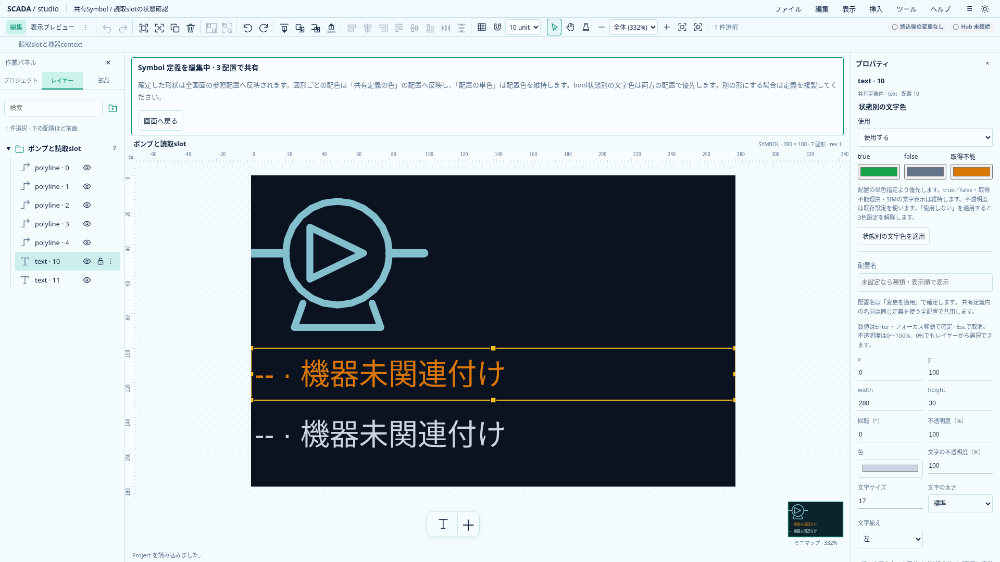
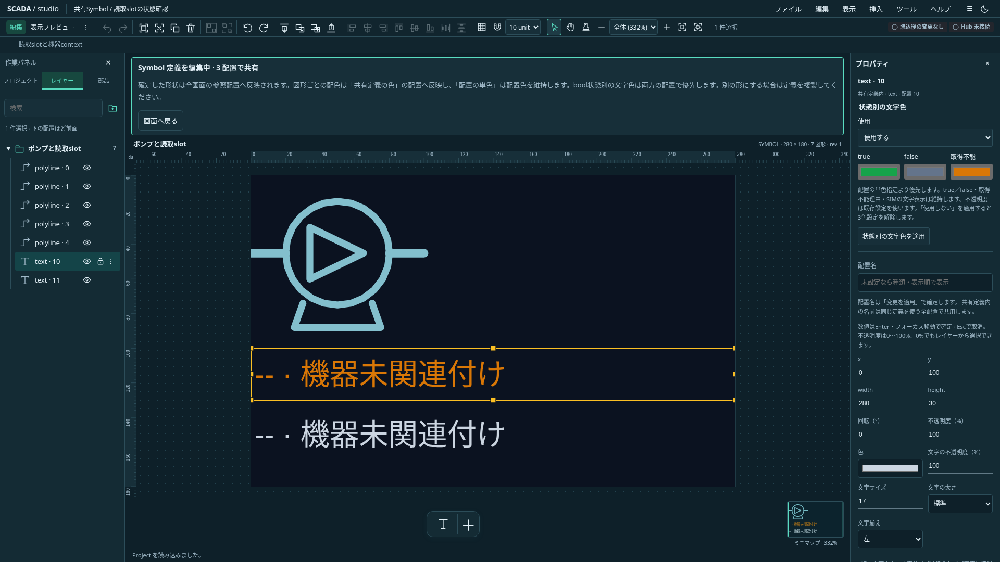

# bool slot表示Textの状態別文字色

状態: **共有Symbol内のbool Textに対する保存・編集・描画を実装**。2026-10-20、Projectは0.26.0。[boolの型付き状態判定](../equipment/bool-slot-state.md)を描画へ接続する。基準は[統合設計](../scada-integrated-design.md)。矩形・楕円の塗り／枠線、配管の動的色は後続。

## 保存と参照

共有Symbol内のTextに、任意の`shape.boolColors`を追加する。

```json
{
  "slotBinding": { "slotName": "running" },
  "boolColors": {
    "trueColor": "#16a34a",
    "falseColor": "#64748b",
    "unknownColor": "#d97706"
  }
}
```

対象slotは同じ共有定義の宣言済みboolでなければならない。3色をすべて`#RRGGBB`で指定する。部分指定、余分な項目、静的Text、number、画面直下のText、他種の図形は拒否する。TS／Rustは共通schemaと同じ意味検証を使う。0.25.0は旧形式として拒否し、現行サンプルとTS／Rustを0.26.0へ揃えた。リリース前の互換性維持・旧形式migrationは追加しない。

参照は既存の`slotBinding`が所有し、配色用の別slot参照は作らない。hidden／lockedを含むTextの使用保護・単体clipboard拒否を再利用する。共有定義と配置の複製は配色も保持する。値・Quality・由来はProjectへ保存しない。

## 色の解決

優先順位は **有効なbool配色 → 配置の単色 → 定義の静的文字色**。`boolSlotState()`が返すtrue／false／unknownだけで対応色を選ぶ。文字列・数値・Qualityから真偽を推測しない。

Good boolだけをtrue／false色にする。未関連付け・slot不足・型不一致・未採用・未割付・未接続・未解決・不正・Bad・Staleは取得不能色にする。直前の正常色やfalse色を代用しない。定義編集・thumbnailは機器contextがないため取得不能色になる。

Textのtrue／false、取得不能理由、SIMの文字表示と由来の詳細は維持する。trueを正常／運転、falseを異常／停止と固定しない。既存の配置opacityと色αを維持し、動的色によって不透明度を変更しない。メイン・埋込画面・小窓・minimapで同じPrimitiveを利用する。

通常Designerは実Host未接続のまま。サンプルと実画面では取得不能色が表示される。Good／Quality遷移はテスト入力で検証し、実Hub接続の完了を意味しない。

## 操作とUndo

共有定義を編集し、bool slotへ割り当てたTextを選択すると、プロパティに「状態別の文字色」が現れる。使用と3色を設定し、「状態別の文字色を適用」で確定する。カードを増やさず、既存の区切りと独立フォームを使う。

「使用しない」を適用すると配色宣言を解除する。slotのText表示は維持し、通常の単色／定義色へ戻る。3色設定も解除されるがUndoで復帰できる。

読取slotを静的Text／numberへ変更する際は、配色解除も同じ適用・Undo単位で行う。boolから別boolへの切替は3色を保持する。直接コマンドに不整合な組合せが渡された場合は、自動修復せず原子的に拒否する。

未適用入力・対象世代・所有者・選択・現在のbool宣言を検査する。slotを静的／numberへ変える入力と配色フォームの入力が両方未適用なら、「適用して続行」で一部だけ確定しないよう事前に拒否して両方の入力を保持する。配色側の入力を元へ戻してからslotを変更する。

## 検証と実画面

共通`symbol-slot-cases.json`は3色必須・bool制約・対象所有者・色形式をTS／Rustで確認する。`bool-colors.test.ts`は保存、編集、解除、slot変更との一括Undo、原子的拒否、既存参照保護、フォームの世代・選択境界を確認する。

`e2e/bool-colors.spec.ts`は両テーマの編集・draft・解除・Undo・slot変更・保存と、二重draftの一部確定防止を確認する。`e2e/read-slot-session.spec.ts`は同一mountのメイン／埋込／小窓でtrue／false／SIM／Quality劣化／切断／不正／reset、配置の単色と定義色、既存opacity×色αの維持を確認する。静的レビューで見つかった二重draft競合に、事前拒否とブラウザ検証を追加した。





実画面は`scripts/capture-bool-colors.mjs`で1920×1080に撮影した。暗い定義canvasに合わせて撮影入力の静的Text色を設定する。画像加工は行わない。

最終ローカル検証は型0エラー／0警告・TS852件・Rust46件・Clippy・Rust fmt・本番build・全体整形・CLIサンプル検証が成功。関連ブラウザ11件に加え、二重draftと定義色／αの追加後に4件を再確認した。Astraの最終静的レビューで追加の必須修正なし。全体CIはPush後に確認する。

後続のProject 0.27.0では[共有図形・配管の状態色追従](../equipment/state-color-following.md)を追加した。この文書の初回範囲と区別する。
