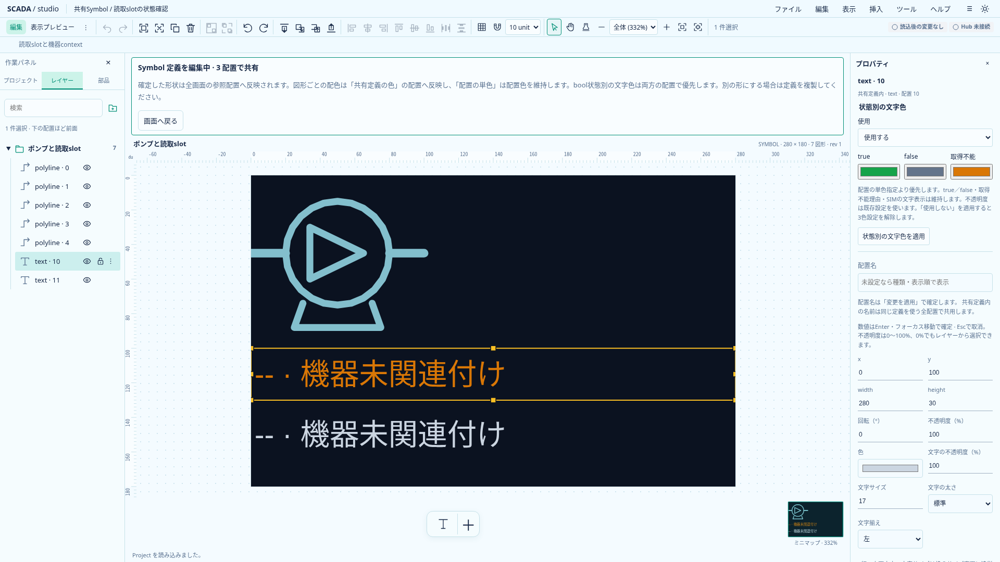
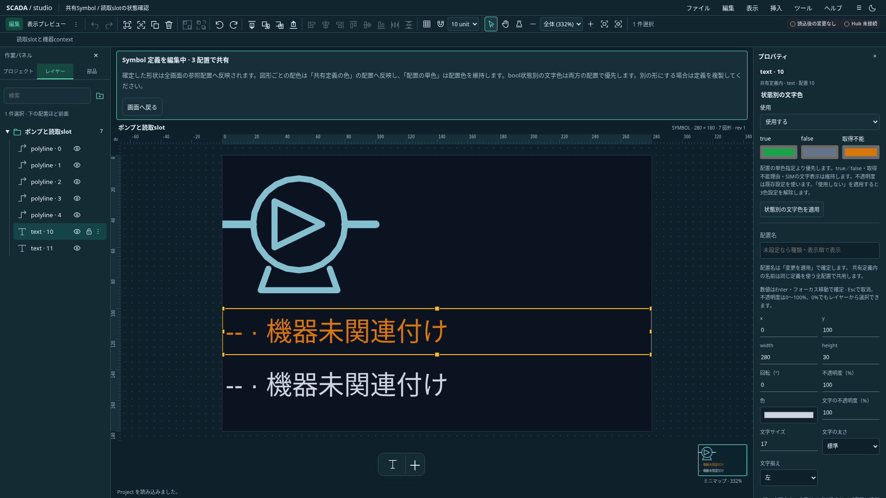

# slot表示Textの「状態の色に従う」指定

状態: **共有Symbol内のbool／state Textに対する保存・編集・描画を実装**。初版は2026-10-20（Project 0.26.0、Text側の`boolColors`3色）。2026-11-12のフロー図 段階1-A A3b（[差分計画](../editor/flow-diagram-gap-2026-11-12.md)）で`boolColors`を廃止し、機器種別のslotの状態の定義に従う`stateColors`へ置き換えた。schemaVersionは0.37.0を据え置く。基準は[統合設計](../scada-integrated-design.md)、状態の定義は[機器種別の状態の定義](../equipment/bool-slot-state.md)とA2・A3aの評価（`lib/slot-state.ts`）。

## 保存と参照

共有Symbol内のTextに、任意の`shape.stateColors`を追加する。

```json
{
  "slotBinding": { "slotName": "running" },
  "stateColors": { "unknownColor": "#d97706" }
}
```

対象slotは同じ共有定義の宣言済み`bool`か`state`でなければならない。保存するのは「状態の色に従う」指定と取得不能の色（`#RRGGBB`）だけで、既知の状態の色は機器種別のslot（boolの`boolDisplay`、stateの`stateDisplay`）だけが持つ。項目不足、余分な項目、静的Text、number、画面直下のText、他種の図形は拒否する。TS／Rustは共通schemaと同じ意味検証を使う。旧`boolColors`は読み込まず、移行も作らない（リリース前で後方互換は不要）。

参照は既存の`slotBinding`が所有し、配色用の別slot参照は作らない。hidden／lockedを含むTextの使用保護・単体clipboard拒否を再利用する。共有定義と配置の複製は指定も保持する。値・Quality・由来はProjectへ保存しない。

## 色の解決

`lib/state-color.ts`の`stateTextColor`が、配置の機器と機器種別のslot（`symbolEquipmentSlot`）から`evaluateSlotState`で状態を評価して決める。

- 既知で色あり（stateの行／otherwise、`boolDisplay`を持つboolのtrue／false、許可された未割付）: その色。配置の単色・定義の静的色より優先する。
- 既知で色なし（`boolDisplay`のないbool）: 通常の色（配置の単色 → 定義の静的文字色）。
- 不明（機器未関連付け、機器種別にslotがない・型が違う、未採用・未割付・未接続・未解決・不正・Bad・Stale・値の型不一致、stateの定義なし）: `unknownColor`。直前の正常色やfalse色を代用しない。定義編集・thumbnailは機器contextがないため取得不能色になる。

文字表示（A3aの状態の文字、取得不能理由、SIM）と由来の詳細は維持する。既存の配置opacityと色αを維持し、動的色によって不透明度を変更しない。メイン・埋込画面・小窓・minimapで同じPrimitiveを利用する。通常Designerは実Host未接続のままで、Good／Quality遷移はテスト入力で検証する。

## 操作とUndo

共有定義を編集し、bool／state slotへ割り当てたTextを選択すると、プロパティに「状態の色に従う」が現れる。使用の有無と取得不能の色を設定し、「状態の色に従う指定を適用」で確定する。「使用しない」を適用すると指定を解除し、通常の単色／定義色へ戻る。Undoで復帰できる。

読取slotを静的Text／機器情報／numberへ変更する際は、指定の解除も同じ適用・Undo単位で行う。bool／stateの間の切替は指定を保持する。直接コマンドに不整合な組合せが渡された場合は、自動修復せず原子的に拒否する。

未適用入力・対象世代・所有者・選択・現在のbool／state宣言を検査する。slotを静的／numberへ変える入力と指定フォームの入力が両方未適用なら、一部だけ確定しないよう事前に拒否して両方の入力を保持する。

## 検証と実画面

共通`symbol-slot-cases.json`は項目必須・bool／state制約・対象所有者・色形式をTS／Rustで確認する。`state-text-color.test.ts`は保存、編集、解除、slot変更との一括Undo、state slotへの切替での保持、原子的拒否、既存参照保護、フォームの世代・選択境界を確認する。`state-color.test.ts`は色の解決規則（stateの行・otherwise、boolDisplayのないboolの通常色、不明の取得不能色）を確認する。

`e2e/state-text-color.spec.ts`は両テーマの編集・draft・解除・Undo・slot変更・保存と、二重draftの一部確定防止を確認する。`e2e/slot-state-color.spec.ts`はモックの読取でstateの行の色、boolDisplayの色、取得不能の色と図形の追従を確認する。`e2e/read-slot-session.spec.ts`は同一mountのメイン／埋込／小窓でtrue／false／SIM／Quality劣化／切断／不正／reset、配置の単色と定義色、既存opacity×色αの維持を確認する。





上の画像は0.26.0時点の旧フォーム（true／false／取得不能の3色）である。撮影は`scripts/capture-state-text-color.mjs`（旧`capture-bool-colors.mjs`）で1920×1080に行う。暗い定義canvasに合わせて撮影入力の静的Text色を設定する。画像加工は行わない。

0.26.0時点の最終ローカル検証は型0エラー／0警告・TS852件・Rust46件・Clippy・Rust fmt・本番build・全体整形・CLIサンプル検証が成功。関連ブラウザ11件に加え、二重draftと定義色／αの追加後に4件を再確認した。Astraの最終静的レビューで追加の必須修正なし。全体CIはPush後に確認する。

後続のProject 0.27.0では[共有図形・配管の状態色追従](../equipment/state-color-following.md)を追加した。この文書の初回範囲と区別する。
