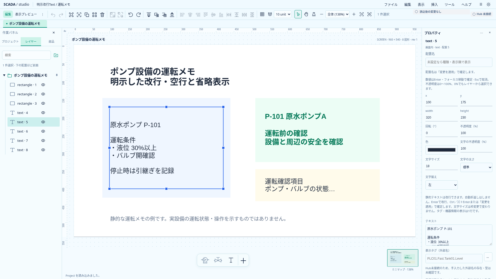
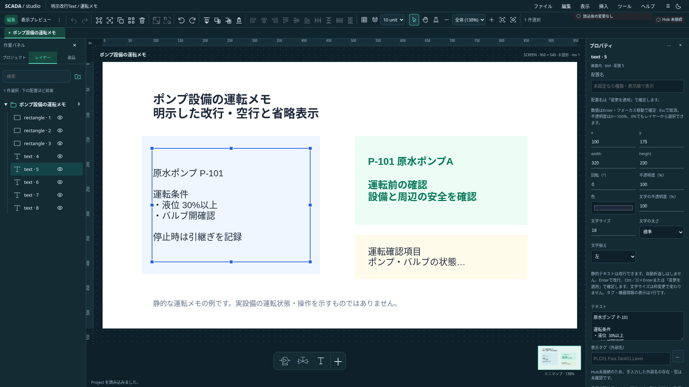

# 静的Textの明示改行

状態: **Project0.32.0で保存・編集・描画へ接続済み**。AstraのUX・描画計算レビューを反映した初回範囲。正式Runtimeの完成を示すものではない。

2026-10-21追記: 枠幅での自動折返しは後続の[I3・Project0.33.0](static-text-wrap-design.md)で実装した。以下は明示改行の導入時の範囲と根拠を保持する。

## 表示と入力

最初は静的Textの明示改行だけを対象とし、自動折返し・任意行間・縦揃え編集・個別フォント・縁取りは後続とする。タグ、read slot、機器情報の表示は既存の1行と取得不能／SIM／省略契約を維持する。`numeric=false`だけで静的と判定しない。表示元を明示して判定する。

本文は自動折返しを無効にしたtextareaで編集し、Enterで改行、Ctrl／Command＋Enterまたは適用ボタンで確定する。IME変換確定中は適用しない。既存の全dirtyフォームの検証・対象世代・Undoへ接続する。動的表示へ切り替えても保存した静的本文を消去・1行へ書き換えず、静的へ戻すと再利用する。

CRLF／CRとUnicodeの行区切りをLFへ正規化する。先頭・途中・末尾の空行と空白を保持し、本文へ`trim()`を適用しない。TS／Rustの公開読込と編集で正規化し、保存用schemaはLFを許可して他の区切りを拒否する。最大1000文字の検証は正規化後に行う。serializerは呼出元を変更せず正規化済み本文を出力する。リリース前の互換性は保証しない。

## 計算と描画

既存`fitText`を変更せず、独立した幅用helperと静的複数行用のpure関数を追加する。**静的で明示改行を含む**配置だけが新経路を使い、一行Text・数値・機器情報の描画を維持する。

行送りは`1.2 × fontSize`。基準文字の実metricsから共通のbaselineを求め、各行のセルと実際に幅省略した文字のinkのunionを取る。収容できる先頭行だけを表示し、**可視ブロック**を上下中央へ配置する。全文ブロックを中央配置して上下clipする方式にはしない。

隠れ行があれば最終可視行へ必ず「…」を付け、その分を含めて横幅を測る。末尾は既に省略した文字ではなく元の行から再計算し、記号を重複生成しない。空の最終可視行も「…」になる。横幅はgrapheme単位で省略し、絵文字・結合文字を切断しない。

収容行数候補は`min(全文行数, floor(height / 行送り))`から減らす。最終行の省略でinkの高さも変わるため、行数の二分探索は使わない。一回の計測内だけ文字列metricsをcacheし、保存やProjectへ入れない。1行も収まらない場合は既存と同様に極小の警告表示へ戻す。title／AXは改行を含む全文を保持し、可視文字の読み上げ重複を避ける。

## 段階と受入

1. 計算関数と単体試験。正規化、空行、横／縦省略、実inkのはみ出し、最終「…」で高さが変わる場合、grapheme、極小枠を確認する。この段階ではProject0.31.0・既存描画は維持する。
2. 保存契約と編集コマンド、textarea、静的複数行描画を同時に接続する。TS／Rust／現行サンプル・共有ケースを揃える。
3. 既存一行の画素・数値状態、Font完了と非表示計測、両テーマ・共有定義・ミニマップ・埋込View・小窓、保存・コピー・Undo・IME・入力保護を確認し実画面を記録する。

## 先行した計算基盤の検証

`multiline-text-layout.ts`に区切り正規化、幅用grapheme省略、セルと実inkのunionによる可視行計算を追加した。既存`text-layout.ts`は変更していない。新規10件と既存Textの単体を合わせたTS14件、型チェック（エラー／警告なし）が成功した。

この先行区切りでは保存・UIへ未接続だった。次の区切りで以下を接続した。

## Project0.32.0の接続と検証

`text-content.ts`が画面・共有定義の本文を安全に正規化し、読込・編集・保存・Rust validator・共有ケースを揃える。0.31.0は拒否し、既存0.1.0経路だけ現行へ移行する。TextStyleにフィールドは追加しない。

`Primitive.svelte`はタグ／slot／機器情報の表示元がなく、本文にLFを含む場合だけ`MultilineTextPrimitive.svelte`を使う。既存の`TextPrimitive.svelte`と`text-layout.ts`は変更していない。Font完了／失敗と非表示からの復帰で再計測し、結果はProjectに保存しない。既存の単一行サンプルを両テーマで再撮影し、前回記録のキャンバス領域（x286、y172、1323×746px）と画素差分ゼロを確認した。

TS全1062件、Rust workspace50件、Clippy、型チェック（エラー／警告なし）、本番build、現行サンプル19個のCLI検証が成功。ブラウザは既存Text9件と新規11件が成功。明示空行・行送り・ink境界・縦省略・全文AX、Enter／IME／Ctrl+Enter、ネイティブ貼付の正規化、極小枠、Font更新、静的／タグ／slot／機器情報の切替、共有Symbol・ミニマップ・埋込View・小窓、clipboard・保存再読込・Undo・dirty保護・非表示サムネイル復帰を検証した。

追加試験では共有定義に配置と同じIDを使ったfixtureと、小窓に埋込View用selectorを使った誤りを修正した。Undo後は選択が解除される既存契約に従って再選択して入力保護を確認する。アプリの保護条件を緩めずに検証した。

[サンプル](../../../examples/multiline-text.project.json)と`node scripts/capture-multiline-text.mjs docs/assets/frontend-ux`で記録する。撮影は実画素の文字色を確認した同一PNGを保存し、合成していない。

