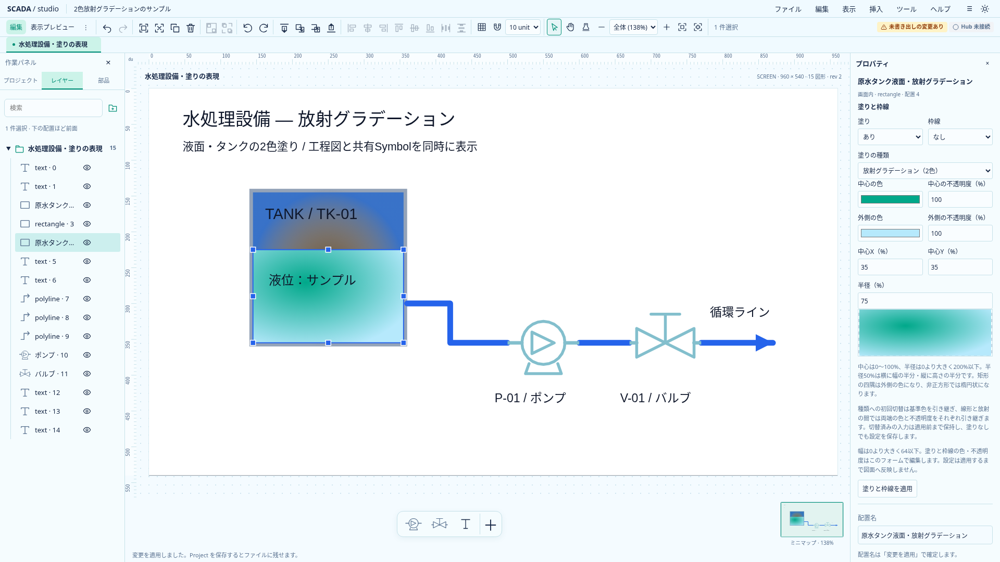
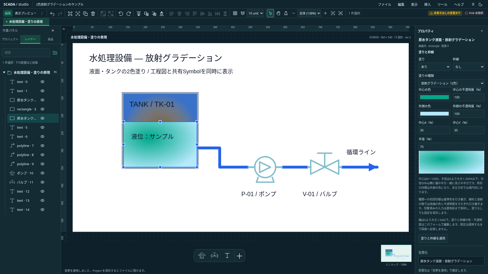

# 2色の放射グラデーション

2026-10-20。採用設計。Project0.30.0へ実装済み。[表現の拡張計画](../proposals/scada-graphics-runtime-extension-design.md)と[線形グラデーション](linear-gradient-design.md)の後続として、矩形・楕円の塗りへ2色の放射グラデーションを追加する。

## 保存と描画

Project0.30.0のFillPaintへ`radialGradient`を追加する。中心`center: { x, y }`は各軸0〜1、半径`radius`は0より大きく2以下。`start`／`end`は既存PaintColor（RGBと不透明度0〜1）を使う。全値と変換後の楕円外接範囲を有限として検証し、不正な入力をclampして保存しない。TS／Rust／schema／現行サンプルと共通正常・不正fixtureを揃える。

座標は図形のbounding boxを正規化した値。半径0.5は横半径が図形幅の50%、縦半径が高さの50%となる。非正方形では楕円状になり、図形の回転とリサイズへ追従する。中心0.5／0.5・半径0.5を初期値にする。楕円では外周に終点色が届き、矩形の四隅は終点色になる。半径2では図形内に終点色が現れない場合も正常な表示とする。

SVGでは`gradientUnits="objectBoundingBox"`、`cx/cy/r`、`fx=cx/fy=cy`、`spreadMethod="pad"`を明示する。各描画instanceのIDを分離し、線形・patternの定義と混同しない。編集・表示プレビュー・ミニマップ・埋込View・画面内Popupを共通Primitiveの描画へ接続する。

## 操作

「塗りの種類」に「放射グラデーション（2色）」を追加し、中心X／Y・半径を％で入力する。中心は0〜100%、半径は0より大きく200%以下。色・αを含め、既存のフォーム全体の適用、IME、未適用入力・ロック・対象世代の保護を使う。

線形と放射は種類ごとの未適用入力を保持する。初めて別のgradientへ切り替える際は始点と終点の色・αをそれぞれ引き継ぐ。単色・patternから初めて切り替える場合は基準色・αを両端へ使う。一度入力した種類へ戻すと、その種類の数値と色・αを復元する。適用前はProjectを変更せず、適用1回はUndo1回とする。

Symbolの定義色では両端の色・αを保持する。単色モードでは両端のRGBだけを配置色で置換し、stopのαと既存の配置opacityを保つ。一括色や状態色追従は既存の非solid制限を維持し、放射gradientを黙って単色へ変更しない。

## 初回の範囲と受入条件

塗りだけを対象とし、枠線のgradient、多点stop、独立した焦点位置、図上ハンドルは後続へ分ける。

- 中心の四隅、半径の最小側と上限、範囲外・欠落・NaN／InfinityをTS／Rustで判定する。
- 非正方形・回転・リサイズ・stopごとの異なるαを実画素で確認する。
- 線形と放射の未適用往復、初回の両端色引継ぎ、取消・ロック・対象変更を確認する。
- 同じSymbolの複数配置でSVG IDを分離し、定義色／単色を両テーマで確認する。
- JSON・原本付きclipboard・Undo／Redoと共通描画の各入口で設定を保持する。

Astraの設計レビューで数値契約・粒度を確認し、半径の説明、SVG属性、種類ごとのdraft保持と`paintBaseColor()`の更新を設計へ反映した。

## 実画面

独自の[工程図サンプル](../../../examples/radial-paint.project.json)を使った1920×1080の実画面。`node scripts/capture-radial-paint.mjs docs/assets/frontend-ux`で再取得できる。図面内の描画画素を確認したスクリーンショットをそのまま保存する。

## 検証記録

型エラー／警告0、TS987件（88ファイル、％入力のFormData4件も再確認）、Rust49件、Clippy・Rust fmt・本番build、CLIサンプル17件が成功。新規放射5件と既存線形・pattern12件の関連ブラウザ17件で、両テーマの実画素・回転・非正方形・resize、種類往復と両端継承、IME・不正入力の非適用、Symbol／miniのID分離とα、埋込View・Popupの共有描画を確認した。共通fixtureは中心・半径・α・不足／余剰属性・極端な寸法の描画範囲までTS／Rustで一致する。Astraの実装レビューでも必須修正なし。両テーマの原寸スクリーンショットを確認済み。
