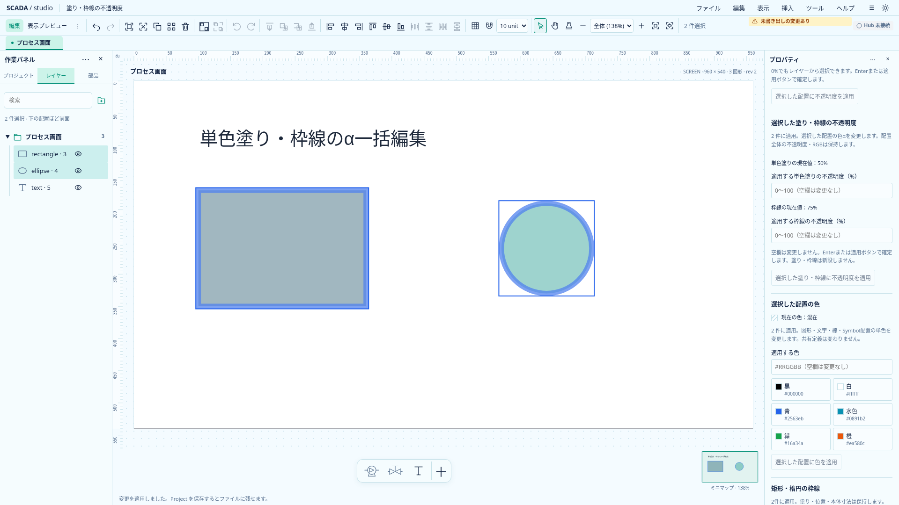
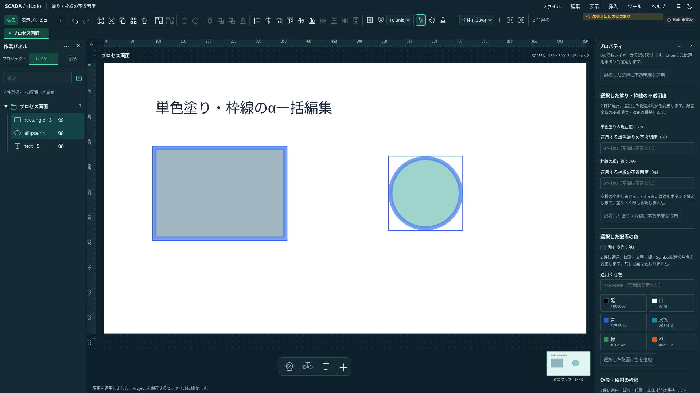

# 単色塗り・枠線のα一括編集

2026-10-21。状態: **I4完了・全体CI成功確認済み**。[単体開発計画](../../project/upstream-independent-plan.md)のI4。[単独の色α](color-alpha-design.md)と[配置opacity一括編集](selection-opacity-design.md)を区別する。

## 初回の範囲

矩形・楕円だけの複数選択に、単色塗りと既存枠線の不透明度（0〜100%）を個別指定する。空欄は変更しない。両方指定すると一つの原子的command・Undoになる。塗りalphaは既存solid paint、枠線alphaは既存strokeに保存し、Project0.33.0を維持する。RGB・配置opacity・形状・状態色参照・非表示状態は保持する。

塗りは全対象が有効なsolidであること、枠線は全対象にstrokeがあることを必要とする。無効な塗りを有効化したり、枠線を新設したり、gradient／patternを単色化しない。枠線のみの変更なら塗りの方式・有効状態を問わない。Text・Polyline・Symbol・画像・埋込画面・グループを含む選択には対応しない。一部だけの適用はしない。

現在値は項目ごとに共通値／混在／適用不可を表示する。strokeの省略alphaは1として比較するが、100%の無変更適用で省略値を追加しない。alpha0でも配置・塗り・枠線を解除せず、レイヤーから選択できる。

## 入力と安全な確定

入力は空欄から開始し、Enterまたは適用ボタンで明示確定する。フォーカス移動だけでは一括変更しない。IME変換中のEnterは確定しない。失敗時は入力を保持し、成功時はこのフォームの入力だけを空にする。他フォームの未適用入力・選択変更・所有画面／共有定義／workspace世代の変更は既存draft guardと対象照合を利用する。ロックを一つでも含む場合は全件拒否し、非表示の対象数を明示する。

UIとドメインは同じ適用可否判定を利用する。commandは未知キー・空patch・不正型・非有限値・範囲外・空／重複／欠落IDを拒否する。変更前Projectは不変、同値は履歴なし。共有定義内でも同じ操作を使い、Symbol配置の色モードや定義自体の置換は行わない。

## 受入

単体で項目独立・同時指定・混在・0／1・省略のno-op・原子性・Undo／Redo・保存往復・共有定義と拒否条件を確認する。ブラウザで両テーマ、空欄、明示確定、入力保持、IME合成イベント、他フォームとの独立、選択変更、ロック・非表示・非対応選択を確認し、実画面を保存する。実OSのIME・Windows実機は別確認とする。

gradient stop／pattern別α、Text・線・Symbolの単色α一括指定、枠線新設との同時指定は後続。認証・正式Runtime・上流SDK・Banto共通パネルは今回変更しない。

## 実装と検証

`selection-paint-alpha.ts`の項目別判定をフォームとcommandで共有し、既存の選択handler・所有者照合・draft guardへ接続した。現行のProject0.33.0へ保存し、新しい保存属性や依存更新はない。

全TS単体102ファイル1104件、関連単体4ファイル23件（新規7件）、新規ブラウザ4件、既存の色α／一括RGB／配置opacity／枠線回帰27件が成功した。型チェックはエラー・警告なし、本番buildも成功。ブラウザの初回は前回セッションの開発サーバーが停止していて接続拒否となったため、サーバー起動後に4件すべてを確認した。製品コードの不具合や再試行設定の緩和ではない。実OSのIME・Windows実機は未検証。

## 実画面

1920×1080、配置opacity80%を維持したまま単色塗り50%・枠線75%へ変更した例。`SCADA_CAPTURE_URL=http://127.0.0.1:5207 node scripts/capture-selection-paint-alpha.mjs docs/assets/frontend-ux`で取得し、表示文字画素も確認する。

## 全体CIの追加確認

実装`361aded`の[初回全体CI39534625475](https://github.com/tyaro/temp-scada/actions/runs/39534625475)はFrontend・Rustとブラウザ3分割が成功し、ブラウザ2/4の既存レイヤー試験1件で失敗した。[ドラッグ後の新しいクリックの修正](../editor/layer-relative-order-design.md)を別コミットで行った。α編集の新規試験は成功。修正後のレイヤー関連ブラウザ26件、型・build・全体整形が成功した。修正`bf187f6`を含む[全体CI39535689050](https://github.com/tyaro/temp-scada/actions/runs/39535689050)でFrontend・Rust・ブラウザ4分割・集約checkがすべて成功した。I4を完了した。
