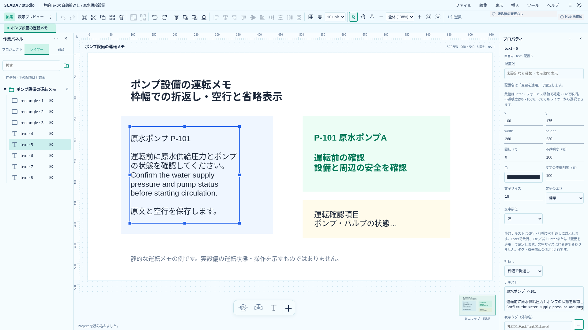
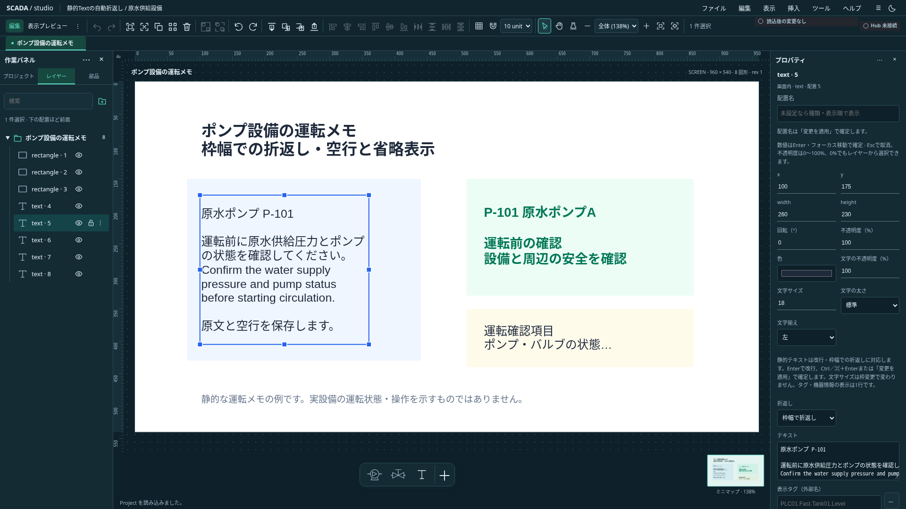

# 静的Textの枠幅での折返し

2026-10-21。状態: **I3a／I3b完了・全体CI成功確認済み**。[単体開発計画](../../project/upstream-independent-plan.md)のI3a／I3b。[明示改行](multiline-text-design.md)の計測・省略・空行保持を再利用する。I2の全体CI成功後に着手した。

## 初回の提供範囲

Textの文字書式に「折返しなし／枠幅で折返し」を追加する。既定は折返しなしで、従来の一行・明示改行の表示を保つ。設定は静的本文の表示にだけ適用し、タグ・slot・機器metadataの表示は従来の一行・Quality／SIM／幅不足の規則を使う。動的表示への切替で静的本文や折返し設定を消さない。

折返し位置を本文へ書き込まない。保存・clipboard・Undoは元の本文と表示設定を保持する。幅変更・字体計測の変更に応じて、編集・プレビュー・Symbol・埋込・小窓・ミニマップの共通描画で再計算する。折返しだけでProjectを変更しない。

## 行の計算

1. 既存のLF正規化を行い、明示改行の各行を独立して扱う。先頭・途中・末尾の空行、空白はtrimやcollapseしない。
2. 現在の字体・文字サイズでSVGの計測adapterを使い、枠左右の既存余白を除いた幅へ収める。画面の拡大率や文字数推定で改行しない。
3. 語の境界を優先する。枠より長い語・URL・連続記号はUnicode書記素単位で分割し、絵文字の結合列・結合文字を分断しない。初回はIntl.Segmenterによる語境界と書記素境界を使い、完全な日本語禁則・ハイフネーション・任意の改行規則を提供するものとはしない。
4. 1書記素も入らない幅でも処理を前進させ、既存の省略／幅不足表示へ戻す。無限ループや元文字の欠落を起こさない。
5. 行高・垂直中央配置・左右揃え・実ink境界は既存の複数行計算を使う。高さ不足は最後の可視行へ一度だけ省略記号を付け、完全な本文はtitle／aria descriptionへ残す。

計測cacheは一回のレイアウト計算内に留める。非表示・フォント未取得は既存の再計測経路を使い、0幅の計測を正常な文字幅として固定しない。フォント・ICUの違いを越えた完全同一の改行位置は保証しない。

## 保存と編集

TextStyleへ任意の`wrap: "none" | "word"`を追加する。未指定はnone。初回のUIは単独Textの既存フォームへ接続し、数値のEnter／blur確定・IME・明示適用・他のdraft保護を維持する。文字サイズや揃えの一括編集では既存wrapを保持し、wrap自体の一括編集は含めない。

保存契約変更時はProject0.33.0として、TS／共通JSON Schema／Rust／現行サンプル／共通ケースを揃える。0.1.0の既存移行入口以外の旧形式migrationは必須にせず、0.32.0を黙って解釈しない。正式Runtime・Design API・Industrial SDKの契約更新は行わない。

## 受入と区切り

I3aは純粋な折返し計算、保存値の正常／不正、未知属性、原子性・no-op・Undo／Redo、clipboardと共有定義の保持を確認する。I3bは単独フォーム・共通描画・動的表示への往復を接続する。幅の変更で再折返しし、明示改行・空行・絵文字・長い語・空白・高さ不足を両テーマで確認する。原文は表示行の連結から再構成できることを単体で検証する。

任意行間・縦揃え編集・縁取り・フォント配布・リッチテキスト・動的値の複数行化は対象外。実OSのIMEとWindows実機を確認できなければ、ブラウザ合成イベントの検証と区別して記録する。

## 実装と検証

Project0.33.0へ保存契約と現行サンプルを揃え、共通`text-style-cases.json`にword／noneと不正値を追加した。`static-text-wrap.ts`は一つのLFなし段落を語／書記素境界で分割し、各段落の行の連結が原文へ戻ることを確認する。`fitStaticLines`は同じ計測cacheで折返しと高さ不足の省略を処理する。`MultilineTextPrimitive`の再計測keyへwrapを含め、`Primitive`は静的な非空本文にだけ折返しを適用する。空本文は従来の空表示を使う。

objectフォームと初期値へ折返し選択を追加し、単独編集・数値確定・一括書式・動的タグへの往復で設定を保持する。コピー／貼付・保存往復・Undo／Redoと共有Symbol・ミニマップ・埋込・小窓を確認した。既存の旧形式読込は0.1.0のみで、0.32.0拒否をTS／Rustで確認した。

関連単体8ファイル103件、Rust51件・Clippy、CLIでminimal／process／multiline／text-wrapの4サンプルが成功。全TS単体は初回の同時実行で1095成功・既存opacity／color-alphaの2件が5秒超過した。ブラウザ・撮影と実行を分離し、2 workersで全1097件が成功した。関連ブラウザは新規4件成功、共通描画のword追加を含む既存回帰26件は初回24成功・既存2件が時間上限超過し、同じコードで該当2件を分離再実行して成功した。timeout・retry・assertionを緩めていない。実OSのIMEとWindows実機は未検証。

実装`858225d`の[全体CI39466367294](https://github.com/tyaro/temp-scada/actions/runs/39466367294)が成功した。Frontend・Rust・ブラウザ4分割・集約checkがすべて成功した。

## サンプルと実画面

[表示確認用Project](../../../examples/text-wrap.project.json)をそのまま開ける。`SCADA_CAPTURE_TEXT_WRAP=1 node scripts/capture-multiline-text.mjs docs/assets/frontend-ux`で実画面を再取得する。実際の文字画素を確認した1920×1080の画像で、計測位置は現在のフォントに依存する。

