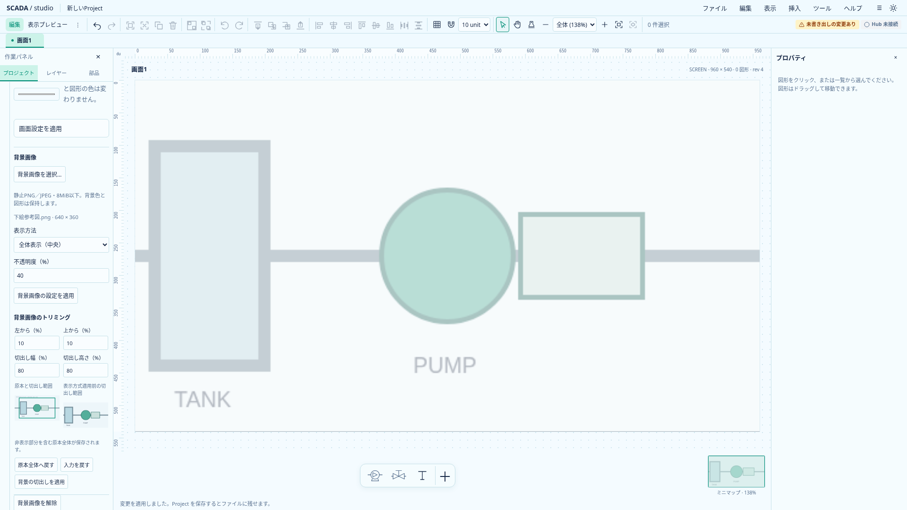
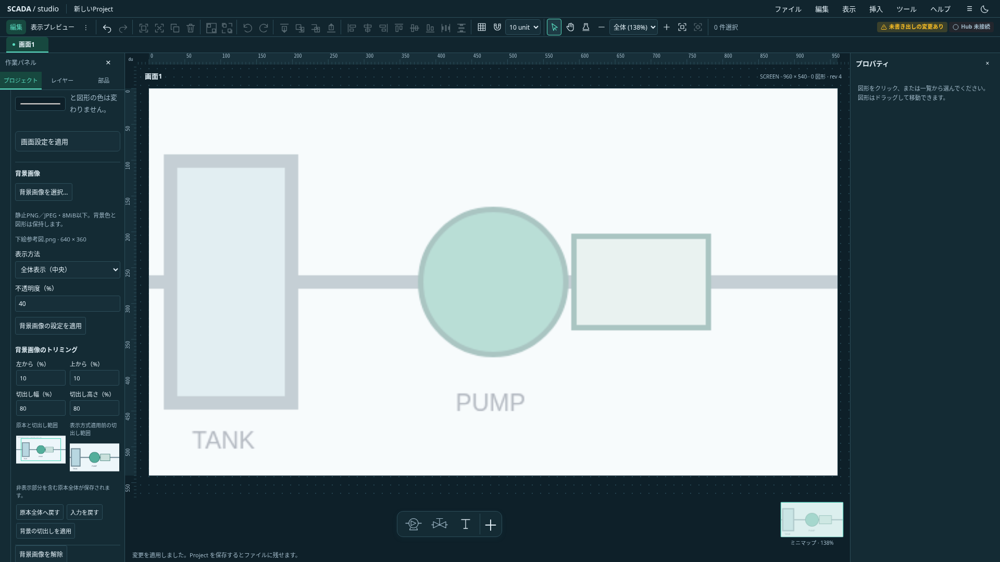

# 背景画像の数値トリミング

2026-10-20。配置Imageに続く独立工程。背景に任意のcropを保存し、既存の元画素・1px以上・丸め境界の数値契約を共用する。Project／minRuntimeVersionを0.29.0へ揃える。文書追加だけで実装済みとはしない。

contain／cover／stretchは切出し後の範囲へ適用する。背景固有のoriginalは、切出し範囲を元の表示画素寸法のまま画面中央へ置く。画面viewportと切出し範囲を共にclipし、opacityは一度だけ適用する。背景色・図形配置・画面寸法は変更しない。背景は通常の選択対象にしない。

背景設定に独立した数値cropフォームと原本・結果の未適用見本を置く。配置cropの既存フォームと数値解析を再利用する。全範囲は省略へ正規化する。未適用入力・IME・対象世代とasset照合、Esc／入力を戻すを共用する。表示方法・opacityは別フォームのままにし、一回の適用／Undoでcropだけ更新する。

同じhashの原本を再選択した場合はcropを維持し、別原本では解除する。fit・opacity・画面寸法は維持する。取込decode開始後に背景の原本またはcropが変わった場合は、その変更を戻した場合も古い取込を破棄する。取込前のdraft適用は許容し、その解決後を開始世代とする。fit／opacityだけの変更では破棄せず確定時の設定を維持する。

保存・複製・Undo／Redo・画像同梱packageで原本とcropを保持する。配置Imageのcropとclipboardは変更しない。TS／Rustの共通crop fixture、背景4方式の実画素、同hash／異hash差替え、遅延decodeの変更・往復・draft明示適用、埋込・小窓・ミニマップを確認して完了とする。

## 実装と検証

0.29.0の保存とTS／Rustの共通数値検証、共通描画、数値フォーム、取込epochへ接続した。背景コマンドはSvelte Proxyからも通常のcropデータを作り、未知属性は最終schemaの拒否へ残す。同原本取込でもProxyをstructuredCloneへ渡さない。

背景4方式とopacity50%を両テーマで実画素確認し、同hash保持・異hash解除・元原本の保存・Undo、draft保護・明示適用後の取込、decode中のcrop変更と往復の永久失効、fitだけの変更の継続を確認した。originalの元画素配置は埋込・ミニマップ・小窓でも共通の結果を使う。既存背景の試験も含め、ブラウザ17件が成功した。

以下は独自生成した下絵を使う実アプリの撮影。opacity40%で背景として表示し、原本・切出し範囲と数値を確認できる。`node scripts/capture-background-crop.mjs docs/assets/frontend-ux`で再撮影できる。外部リポジトリの画面やアセットは使用しない。

