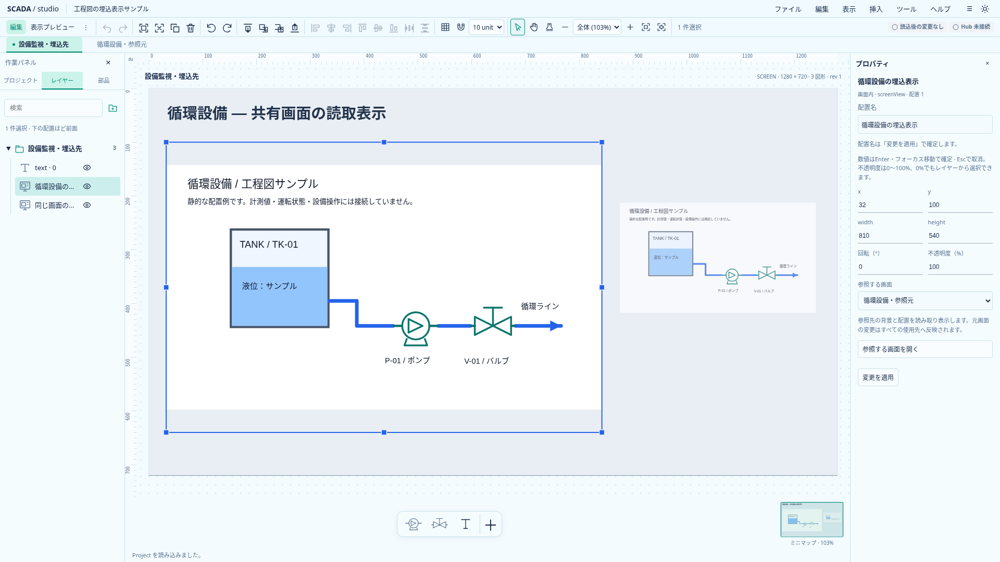
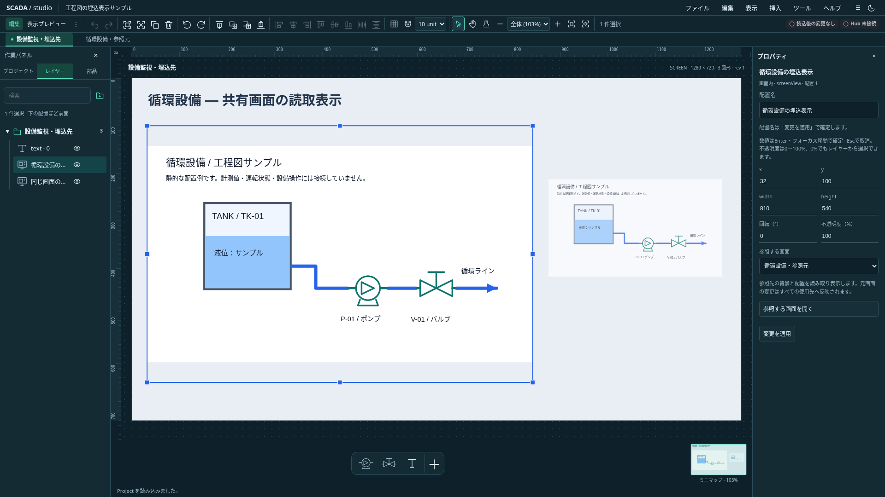

# 別画面を表示する埋込View

文書の位置付け: **採用済み設計・導入時の実装記録。文中の旧版・件数・当時の未実装表記は記録時点のもの。** 現在の対応範囲と保存契約は[実装状況](../../project/implementation-status.md)を正とする。

2026-10-20（日本時間）。ユーザー指定の「別画面を現在の画面内に埋め込む」を、[拡張計画](../proposals/scada-graphics-runtime-extension-design.md)とAstraの読取専用レビューから具体化する。**Project 0.20.0で同一Project・1段の読取表示を実装**。保存・追加UI・参照先変更・削除保護を接続した。初期範囲を下記へ記録し、正式Runtime／機器操作の完成と区別する。

## 最初の範囲と保存

初期は同一Project・1段・読取専用とする。配置型は `shape: { type: "screenView", screenId, fit: "contain" }` とする。幅・高さ・回転・opacity・visible・locked・名前・所属は外枠の配置に保存する。色・色α・枠線は持たず、混在の一括色変更は全体拒否する。Symbol定義内は禁止する。

参照先の画面実体を共有し、図形・背景・寸法の変更を全使用先へ反映する。自己参照・参照切れ・循環・2段以上は保存／全コマンド確定時にTSとRustで拒否する。A→Bがある状態でBへViewを追加する場合も、全Projectのグラフを再検証する。非表示Viewも参照として扱い、表示切替で制約を回避させない。

初期上限は画面内View32件、Viewを含む画面の展開後配置数20,000件とする。これは描画要素の増幅を抑える初期契約で、性能保証値ではない。実装後の実測で見直す。

- 通常配置は1件、Symbol配置は外枠1件＋内部配置件数を基礎コストとして数える。非表示の配置・子も含める。
- Viewは外枠1件＋参照画面の基礎コスト。繰返し使用先もそれぞれ加算する。
- これはSVGの実DOMノード数ではなく展開後の配置数。Textやpatternの実コストは別途計測する。
- Viewを持たない通常画面へ新しい20,000件制限を広げない。大きい通常画面を埋め込む場合は使用先側の予算で拒否する。
- 超過時に一部を黙って描画省略せず、Project・履歴を変えず理由付きで拒否する。

## 非対話の描画

枠内へ参照画面全体を中央containで表示する。背景色と背景画像を含め、containの余白は透明。参照画面の寸法が変わっても外枠寸法を変えない。枠と参照画面の境界を両方clipし、画面外配置を余白へ漏らさない。

ドラッグ・ResizeObserver等を持つ現行Rendererを再帰配置せず、Symbol・画像・Primitiveの共通描画部分を分離して再利用する。参照画面内の図形へ選択・ハンドル・グリッド・キー・クリック操作を付けない。画像URL・Symbol定義・TagReadingsを共有し、ViewごとにStoreやHub接続を作らない。実Hub接続・Equipment・Actionはこの段階に混ぜない。

編集するのは外枠だけ。プロパティに参照画面と「参照する画面を開く」を用意し、対象移動には既存の未適用入力保護を使う。外側opacityは完成した表示へ一度適用する。「背景を透過」は背景色と背景画像のどちらを除くかを後続で定義し、初回は追加しない。

## 画面管理と複製

参照中の画面削除は拒否し、使用先画面・配置名を案内する。自動解除しない。名前変更はID参照のまま追従する。

配置の複製・Viewを含む画面の複製では参照先を共有する。参照先画面の複製は新画面を作るだけで、既存Viewを付け替えない。Undo／Redoは参照も含めて戻す。参照先変更・サイズ変更等は確定後の全体グラフと予算で検証する。

## clipboardと保存の段階

現行clipboardは1画面の断片Projectを検証するため、画面IDだけを含むViewを混ぜると参照切れになる。依存画面の同梱は資産・Symbol・IDの閉包を変えるので、初回から既存clipboardへ小さな例外で混ぜない。

1. 初回はViewを含むcopy／cutを混在全体で理由付き拒否し、OSへの書込・削除を行わない。Viewの通常複製は使える。非Viewのclipboardを維持する。
2. 同一編集中Projectへの参照pasteを別工程にする。Project IDだけで同一性を判断せず、セッションと読込世代を照合し、貼付先による自己参照・深さも再検証する。
3. 別Projectへは参照画面・依存Symbol・背景と画像原本まで閉じた一式を運ぶ。画面・配置・フォルダー・Symbol・asset IDを対応付け、hashだけ共有して一括確定する。増える画面数も利用者へ示す。

Project全体のJSON／最小画像同梱packageは、通常どおり全画面と画像資産を保存する。正式package／Runtime完成の意味ではない。リリース前の旧形式の移行は必須にせず、次期の現行モデルをRust／TS／schema・サンプル・検証で揃える。

## 計算基礎の実装

`screen-references.ts`で、使用先の索引・全体の1段制約・参照数と展開配置数を検証する。入力の参照行を変更せず、返却する使用先も読取専用の型で扱う。先に変更対象画面だけを見ると、既存のA→Bに対するBの変更を見逃すため、全体を検査する。

単体5件と型チェックで、共有先の索引・全体の入れ子拒否・件数とコストの境界・入力不変を確認した。計算基礎の時点ではアプリにViewを追加できなかった。その後、保存契約→共通の非対話描画→追加／参照先変更と削除保護→編集・保存往復を接続した。背景画像・Symbol・タグ状態、回転・clip・opacity、複製の共有維持、全体深さ超過の原子的拒否とUndo、両テーマを受入対象とする。

## 共通描画の分離

Symbol・Image・Primitiveの表示を`ObjectPainting.svelte`へ、背景色と背景画像を`ScreenBackground.svelte`へ分離した。選択・ヒット判定・ドラッグ・ハンドルはRendererに残し、埋込先では描画だけを再利用できるようにした。描画分離の時点ではProject0.19.0のままで、View本体は未接続だった。

TypeScript全567件、型チェック（エラー・警告なし）、本番ビルドが成功。背景色・背景画像・Symbol配色のブラウザ25件が成功した。最初の関連33件では32件成功し、別Projectコピーで再採番されるIDまで比較したテスト1件を修正した。IDの再採番を確認し、色・形状・論理的な所属を比較する。既存のJSチャンク500kB超の警告は継続。

## 初期機能の接続（Project 0.20.0）

「挿入」の画面選択ダイアログは検索と選択不可理由を表示する。参照先変更はプロパティの既存フォームで適用し、元画面を開く際も未適用入力保護を通す。候補判定は現在の参照索引とコストを再利用し、確定では全Projectを再検証する。

TypeScript／Rust／schema・新規生成・各サンプルの現行形式を0.20.0へ同期した。Viewの色・色αと未知フィールド、Symbol内部配置を拒否する。Project全体のJSON／画像同梱packageでは依存元画面も保存する。片方だけの部分コピーは提供せず、copy／cutは混在全体で書込・削除前に拒否する。

背景と画像の原本URL・Symbol・読取値を共有する専用表示を使い、Rendererを再帰配置しない。内側には操作対象IDを付けず、外枠の選択・移動・サイズ・回転・opacity・表示・ロック・所属・複製に既存操作を使う。参照中の画面削除は使用先画面名と配置名を示して拒否する。

同じ参照先の変更は全使用先へ反映される。参照元の寸法変更で枠を変更しない。通常画面の数値Text表示へ渡されるTagReadingsをそのまま共有するが、アプリの実Hub接続は引き続き未実装。

## 検証と実画面

TypeScript全589件、Rust29件、型チェック（エラー・警告なし）、Clippy、本番ビルドが成功した。共通ケースで保存形・欠損／自己／入れ子・Symbol内部禁止・色禁止を照合し、非表示のSymbol子を含めて展開20,000件ちょうどと超過、32件と33件、Viewを持たない通常画面の範囲を確認した。

ブラウザは埋込9件を含む背景画像・Symbol配色・clipboardの38件、画面管理と回転20件の計58件が成功した。全477ケースの再実行ではない。両テーマ、共有元変更、サイズ・回転・opacityとUndo、source境界からcontain余白への漏れを実ピクセルで確認し、画像原本の共有とpackage再読込、書込前のcopy／cut拒否、未適用入力保護、使用先案内を検証した。ホストと複数Viewへ同じTagReadingsを渡し、Good・Stale・未接続の表示が一致することも確認した。

Astraの読取専用レビューを実施した。SymbolのCSSが寸法を上書きする可能性の指摘には、非正方形の180×45／50×90配置の属性・相対CTM倍率と中央配置のoffsetをブラウザで実測し、保存寸法とcontainの規則に一致した。実害は再現せず既存CSSを維持した。描画配置数20,000は性能保証ではない。JS564.19kB（gzip170.32kB）、既存の500kB超警告は継続する。

独自の読込用サンプル`examples/embedded-screen.project.json`を、`scripts/capture-screen-view.mjs`で1920×1080撮影した。画面内の数値は静的サンプルで、実Hub接続を示さない。

## clipboard v4への拡張（Project0.29.0）

[参照画面・Symbol・画像原本を同梱するclipboard v4](screen-view-clipboard-design.md)を追加した。同一編集世代の現行再利用、別Projectへのsnapshot取込、背景のcrop／fit／opacityと原本保持、内部ID・外部参照の再配線を実装する。初回copy／cut拒否の記録を置き換える現行範囲で、1段埋込・機器関連付けを含むコピー拒否は維持する。
