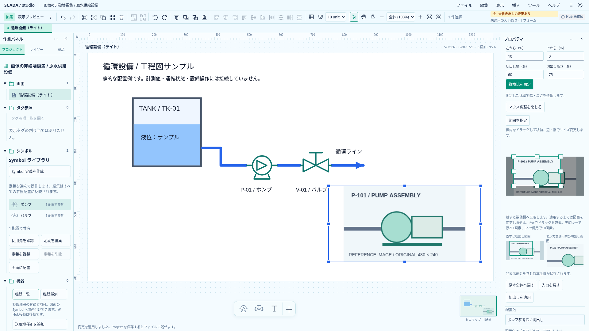
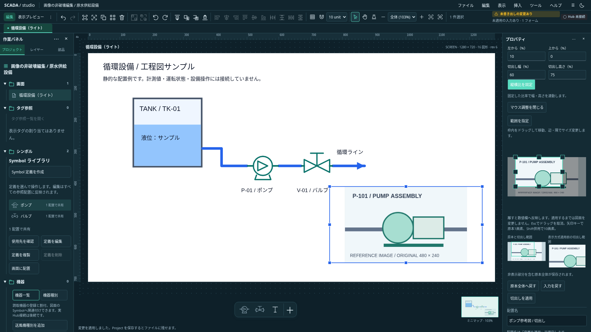

# 原本プレビューのトリミング比率固定

2026-10-21。状態: **I1a／I1bを実装しローカル受入・全体CI成功確認済み**。[単体開発計画](../../project/upstream-independent-plan.md)のI1a／I1b。[既存のcrop操作](image-crop-pointer-design.md)を拡張し、画像・背景で同じ計算を使う。

## 操作

数値欄の下に「縦横比を固定」ボタンを置く。初期状態は自由。押した時点の有効な未適用範囲から、EXIF適用後の原本画素で幅／高さを取得する。押すだけでは値・dirty・Project・Undoを変更しない。不正な数値がある間は新たに固定できず、固定済みなら解除は可能にする。固定状態はフォームの入力補助であり、ProjectにもUI設定にも保存しない。

- 四隅は反対の隅を固定する。幅方向と高さ方向の比率換算した変化のうち大きい方を基準にサイズを決め、画像境界で比率を保って縮小する。
- 左右辺は反対辺の中央、上下辺は反対辺の中央を固定する。辺の操作方向でサイズを決め、直交方向は中央から均等に変える。
- 新規指定は開始点を固定してドラッグ方向へ広げる。幅・高さの大きい要求を包む比率矩形を候補とし、原本境界で止める。最小サイズも比率を維持して両辺1画素以上。開始点が端から最小サイズ未満のときだけ、最小範囲が原本内に入る位置へ開始点を補正する。
- 移動は比率・幅・高さを変更しない。矢印キーも同じ計算を使う。
- 数値の幅を変更すると高さを、高さを変更すると幅を連動する。左上は固定。原本外・1画素未満・未完成入力は勝手にclampせず、入力を残して修正を求める。有効になった時点で対応する欄を更新する。
- 「原本全体へ戻す」「入力を戻す」・フォームのEsc／resetは固定を解除する。適用後は同じ比率なら固定を維持し、Undo等のモデル更新で比率が変わったときは解除する。対象／原本変更で解除する。

候補は既存数値欄へ反映し、明示適用1回をUndo1回にする。ドラッグ取消は開始前の入力文字列をそのまま保ち、比率設定変更も進行中候補を取り消す。IME変換中は数値欄の連動処理を保留し、変換終了後に検証する。Bantoの汎用フォーム・画像取込・gesture基盤を追加しない。

## 変更しない境界

Project0.32.0・cropの保存属性・原本bytes・画像Store・参照SDKは変更しない。プリセット比率、比率の数値指定、図面上での直接crop、回転した図面ハンドル、Symbol内画像は含めない。既存のPNG／JPEG・crop矩形・明示適用・入力保護を使用する。

## 受入

比率維持、四隅／辺の固定点、新規指定の両方向、原本境界、1画素画像・細長い画像・最大辺の計算、入力の不変性を単体で確認する。配置／背景、数値幅・高さ連動、不正入力・IME、自由操作への復帰、固定だけでdirtyにしないこと、取消・Undo／Redo・ファイル往復をブラウザで確認する。ライト／ダークの実画面を保存する。これは正式Runtime・画像共通基盤の実装ではない。

## 実装・検証

`image-crop-gesture.ts`に原本画素の比率取得・比率固定の辺／隅／新規指定・数値連動の純粋計算を追加した。1画素境界で既存validatorが許す丸め誤差も受け入れる。`image-crop-fields.ts`が軸ごとの入力を同じ計算へ渡し、`ImageCrop.svelte`が非永続の固定状態、入力の連動、不正値のnative validity、IME、resetを担当する。既存draft guard・保存command・描画は共用する。

型チェックはエラー／警告なし、本番build成功。関連TS4ファイル72件、操作ブラウザ13件と強化した再起動試験1件の再確認、既存配置／背景crop18件が成功した。実OSのIME・Windows実機は未検証で、ブラウザIME試験は合成compositionイベントを使用する。共有モデルに変更がないため、Rustは今回ローカル再実行の対象外。実装コミット`316a12c`の[全体CI39457887476](https://github.com/tyaro/temp-scada/actions/runs/39457887476)が成功し、frontend／Rust／E2E4分割とcheckを通過した。

## 実画面

`SCADA_CAPTURE_IMAGE_CROP_ASPECT=1 node scripts/capture-image-crop.mjs docs/assets/frontend-ux`で再取得できる。適用済みの図面と、比率を固定して高さ75%・幅60%へ連動した未適用の見本を表示した。図面上の実画素を確認した1920×1080のスクリーンショット。

