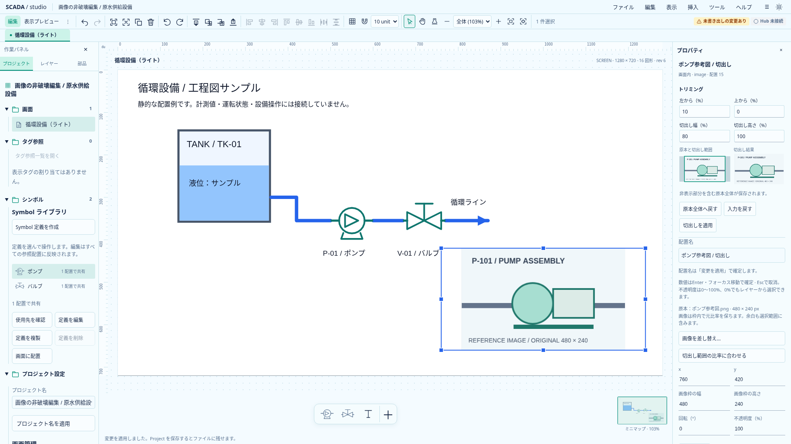
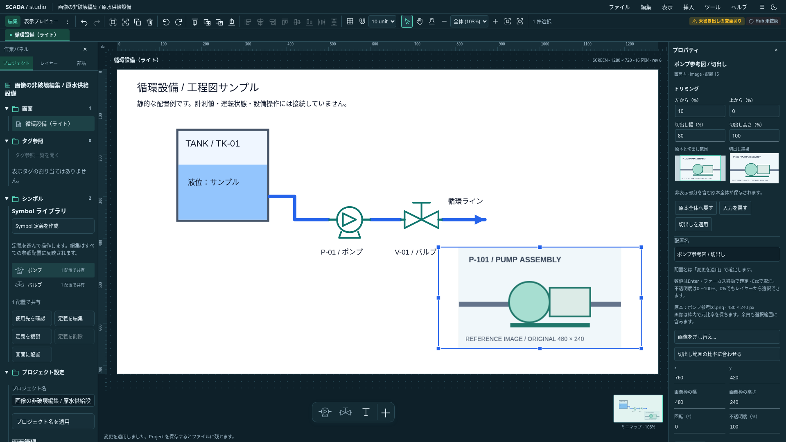

# 配置画像の非破壊トリミング

文書の位置付け: **採用済み設計・導入時の実装記録。文中の旧版・件数・当時の未実装表記は記録時点のもの。** 現在の対応範囲と保存契約は[実装状況](../../project/implementation-status.md)を正とする。

2026-10-20（日本時間）。[画像配置](image-placement-design.md)の次工程。Astraの読取レビューを反映した具体設計。以下は接続先と受入条件であり、文書の追加だけでUI・保存形式の対応完了とはしない。

## 対象と操作

画面上の静的Image配置を対象にする。画像のプロパティに「トリミング」を設け、「左から（%）」「上から（%）」「切出し幅（%）」「切出し高さ（%）」を一つのフォームで編集する。明示的な適用またはEnterで全体を確定し、blurで一部だけ確定しない。Esc／入力を戻すで適用済みへ戻す。既存の未適用入力・IME・対象切替保護を使う。

原本全体と切出し矩形、切出し結果の二つを未適用プレビューとして示す。無効な入力は理由を表示し、以前の正常なプレビューを現在の入力結果と誤認させない。「原本全体へ戻す」は入力を全範囲へ戻し、適用まではProjectを変更しない。

トリミングは配置ごとに保存する。枠の位置・幅・高さ・回転・不透明度・名前を維持し、他の配置や背景を変えない。原本を再圧縮せず、短い説明「非表示部分を含む原本全体が保存されます」を表示する。

初期は数値編集。背景のトリミング、ドラッグハンドル、cover／stretch、Symbol内画像は別工程。

## 数値と保存の契約

Image shapeへ任意の `crop: { x, y, width, height }` を追加する。いずれもEXIF適用後の表示画像に対する0〜1の割合。原点は左上、配置の回転前。省略は原本全体。編集コマンドは全範囲を省略へ正規化する。外部ファイルの明示的な全範囲も有効とし、parseが入力を暗黙に書き換える設計にはしない。

各値は有限、x／yは0以上、幅／高さは正、右端／下端は1以下とする。切出し幅・高さは原本の表示画素で1px以上。原本寸法は既存の画像制限を使う。境界計算には `16 * Number.EPSILON`（Rustは`16 * f64::EPSILON`）だけを許容し、受理した丸め誤差を右端・下端へ丸める。目に見える範囲外やサブピクセルは補正せず拒否する。

保存契約へ接続する段階でProject版を更新し、Rust・TS・schema・サンプル・共通正常／不正fixtureを揃える。リリース前の旧Project互換性は保証しない。画像同梱packageやclipboardは元の原本を運び、cropを配置属性として保持する。履歴は元原本とcropを復元する。

## 描画と比率

切出し範囲を元画像の画素座標のviewBoxへ変換し、既存の外枠へ中央containで表示する。切出し矩形と配置viewportの両方でclipし、余白へ切出し外の画像を漏らさない。枠の選択・整列・回転中心は変えない。回転とopacityは既存の外側で一度だけ適用する。

共通のImage描画を編集・表示プレビュー・ミニマップ・埋込View・画面内Popupで使う。元画像を物理的に拡大した巨大な座標を作らず、ネイティブSVGのviewBoxとcontainへ任せる。

cropありの比率復帰は「切出し範囲の比率に合わせる」と表示する。幅を保持し、比率 `(asset.width * crop.width) / (asset.height * crop.height)` に高さを合わせ、枠の中心・回転を保つ。cropなしは既存の「元比率へ戻す」を使う。

## 差し替えと遅延応答

異なるhashの原本へ差し替える場合はcropを解除し、同じUndo1回で参照先とcropを更新する。枠は保持し、「差し替え後は画像全体を表示します」と案内する。同じhashは既存のno-opを維持し、cropも保持する。

ファイル選択時の対象を固定し、既存のcrop draftを明示適用してから取込へ進むことを許容する。実際のdecode開始時に確定済みcropの世代を新たに固定し、その後にcropが変わったら差し替えを破棄する。一度変更して戻した場合も古い取込を復活させない。単に対象選択世代へcropを混ぜ、利用者が許可したdraft適用を古い応答と誤判定しない。

## 受入条件

- 四隅・端・全範囲・最小1px・丸め境界、NaN／Infinity・範囲外・0幅・サブピクセルをTS／Rustで同じように判定する。
- EXIF回転JPEG、透過PNG、縦横比の異なる枠で切出し外が漏れず、回転と比率復帰後も中心を保つ。
- 原本共有先・背景は不変。差し替えの同hash保持／異hash解除とUndoを確認する。
- draft取消・対象変更・読込中crop変更・変更後の往復で、意図しない適用を残さない。
- 複製、clipboard、画像同梱保存、Undo／Redoでcropと原本を保持する。
- 両テーマ、編集・ミニマップ・埋込View・Popupで同じ切出し結果を確認する。

## 実装記録

数値契約と元画素viewBoxの計算を独立した `image-crop.ts` に追加した。7件の単体試験で方向別の境界、画素単位、正規化、入力非破壊、有限値を確認した。この区切りではProject0.20.0を変更せず、UI・共通描画・保存モデルへの接続は次の工程。

## 保存・描画・編集の接続（Project0.21.0）

任意cropの契約をTS／Rust／schema・生成と現行サンプルへ接続した。編集コマンドは不正範囲・非画像・Symbol内・ロック・プレビューを拒否する。ImagePaintingを共通描画として使い、原本と切出し枠・結果の未適用見本、独立フォーム、全体適用／取消、比率復帰を追加した。共有原本・画像同梱保存・原本付きclipboard・Undo／Redoを維持する。

差し替えの対象世代とcrop世代を分け、既存draftの明示適用後に新たなdecode世代を固定する。読込中のcrop変更・往復は破棄する。Astraの実装レビューでも重大な不整合はなかった。

検証はTS全630件、Rust workspace30件、型チェック（エラー／警告なし）、本番ビルド、Clippyが成功。新規crop9件と配置・差し替え・背景・小窓の関連ブラウザ計42件が成功。全508件の再実行ではない。実画素でcontain余白への漏れ・透過PNG・EXIF適用後JPEG、原本付きclipboard／同梱往復、比率復帰の中心、入力保護と非同期破棄を確認した。ビルドの既存500kB警告は継続している。

実画面は独自に生成した参考図を使い、`node scripts/capture-image-crop.mjs docs/assets/frontend-ux`で再取得できる。外部リポジトリの画像を取り込んだものではない。

## 表示方式の拡張（0.28.0）

[配置Imageのcover／stretch](image-fit-design.md)を追加した。cropの元画素範囲は維持し、その後に表示方式を適用する。crop編集の見本は表示方式適用前の切出し範囲として明示し、実配置の枠比率を使う未適用見本は表示方式フォームへ置く。

## 背景への拡張（0.29.0）

[背景画像の数値トリミング](background-image-crop-design.md)を独立した設定として追加した。切出しの数値と元画素の検証を共用し、背景固有のoriginalは切出し範囲の元画素サイズを中央に表示する。配置Imageのcropはそのまま保持する。

## 原本プレビュー上のマウス調整（0.29.0）

[範囲の指定・移動・四辺／四隅のサイズ変更](image-crop-pointer-design.md)を配置・背景で共用する。ドラッグ中は候補だけを保持し、離した後の数値入力と既存の適用を正とする。保存契約は変更しない。
