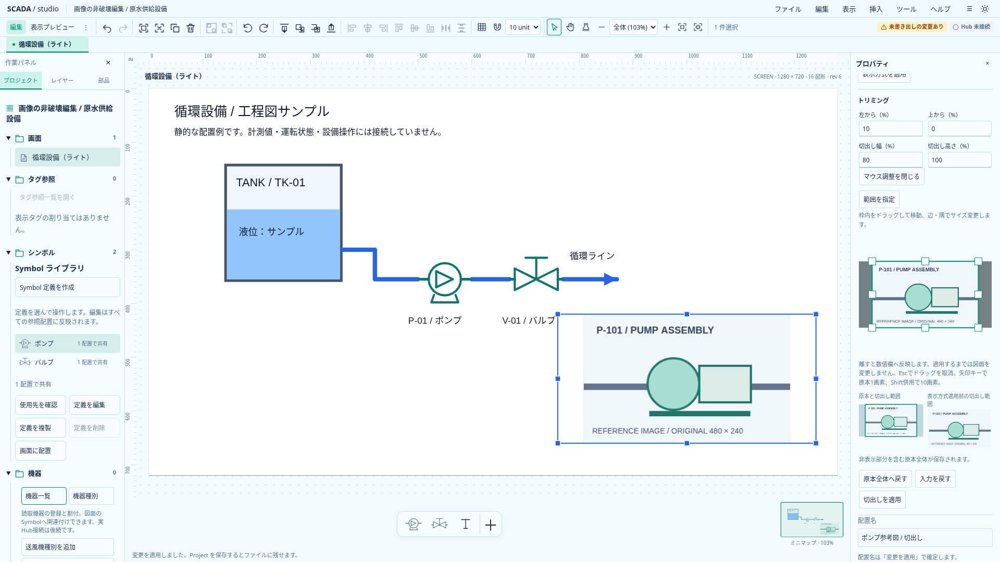
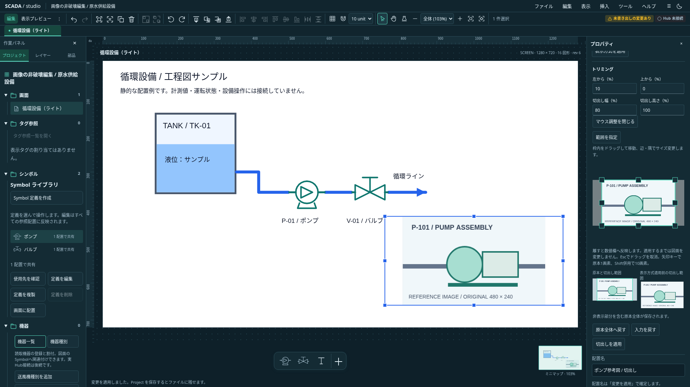

# 原本プレビュー上のトリミング操作

2026-10-20。採用設計と実装範囲。[数値トリミング](image-crop-design.md)と[背景の切出し](background-image-crop-design.md)に、マウスと矢印キーによる入力補助を追加する。Project 0.29.0の保存契約・原本保持・既存コマンドは変更しない。

## 操作

配置画像と背景画像のトリミングフォームで「範囲をマウスで調整」を開く。操作面はフォーム幅全体、高さ240pxで、原本の縦横比を保持する。通常は枠内のドラッグで移動、四辺・四隅のハンドルでサイズ変更する。「範囲を指定」を押すと原本上のドラッグで新しい矩形を作る。単なるクリックや3px未満の動きでは既存入力を消さない。

ドラッグ中は操作面だけに候補を表示する。マウスを離すと4つの数値欄へまとめて反映し、既存の未適用入力として扱う。図面は「切出しを適用」または「背景の切出しを適用」で更新し、適用1回をUndo1回で戻す。保存・表示方式・元画像の差し替えは従来の入力保護を経由する。数値欄が不正な場合は操作面を隠し、理由と数値欄・全体へ戻す操作を残す。

操作面のフォーカスでは矢印キーで移動、ハンドルのフォーカスでは対応する辺を変更する。1回は原本の1画素、Shift併用は10画素。細長い画像や小さな範囲の精密指定は数値欄も使える。

## 境界・取消

- EXIF適用後の原本画素を基準にSVG行列を逆変換する。中央containの余白からは新規指定を開始しない。
- 移動は幅・高さを保持して画像境界で止まる。サイズ変更は反対側を固定し、反転せず原本1画素以上を保つ。新規指定の両端も原本内へ制限する。
- Escはドラッグ候補だけを取り消し、開始前の未適用入力を文字列表現も含めて保持する。このEscをフォームの「適用済みへ戻す」へ伝播させない。
- pointercancel、capture喪失、windowのblur、操作面のリサイズ・位置変化、submit/reset、Ctrl／Command操作、Tab／Enterで候補を破棄する。正常終了は候補を消してからcaptureを解放する。
- 原本・crop・対象・世代の変更やフォーム破棄で候補を捨てる。古い候補を別のフォームへ書き戻さない。操作面だけをtouch-action:noneにし、主pointer一つを扱う。

## 責務

`image-crop-gesture.ts`は元画像の矩形計算だけ、`ImageCropSelection.svelte`は候補とpointer／キー・取消、`ImageCrop.svelte`は既存の数値入力・draft管理との接続を担当する。候補からProjectへ直接書き込む経路を作らない。

回転済みの図面上で直接トリミングする操作、描画中の数値欄への逐次書き戻しはこの工程に含めない。縦横比固定は後続の[I1で追加](image-crop-aspect-design.md)した。

## 実画面

独自に生成した参考図を使った1920×1080の実画面。`SCADA_CAPTURE_IMAGE_CROP_POINTER=1 node scripts/capture-image-crop.mjs docs/assets/frontend-ux`で再取得できる。図面の表示画素を確認したスクリーンショットをそのまま保存する。

検証: 型エラー／警告0、TS954件（86ファイル）、本番build、全体整形が成功。既存の配置crop11件・背景crop7件と新しい操作8件を確認した。ドラッグ終了前保存、開始前の入力文字列を保つ取消、capture／blur／resize、余白・単クリック・原本外の逆方向・実ハンドル、背景とUndo、プレビュー切替を検証した。Astraの指摘した境界計算とフォーカスの座標ずれを修正済み。保存契約は不変でRustの変更はない。
