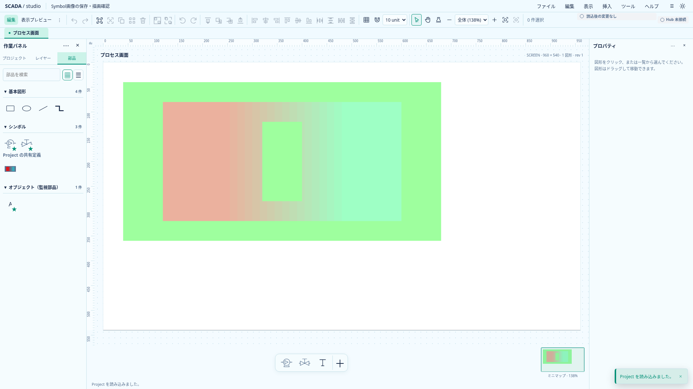
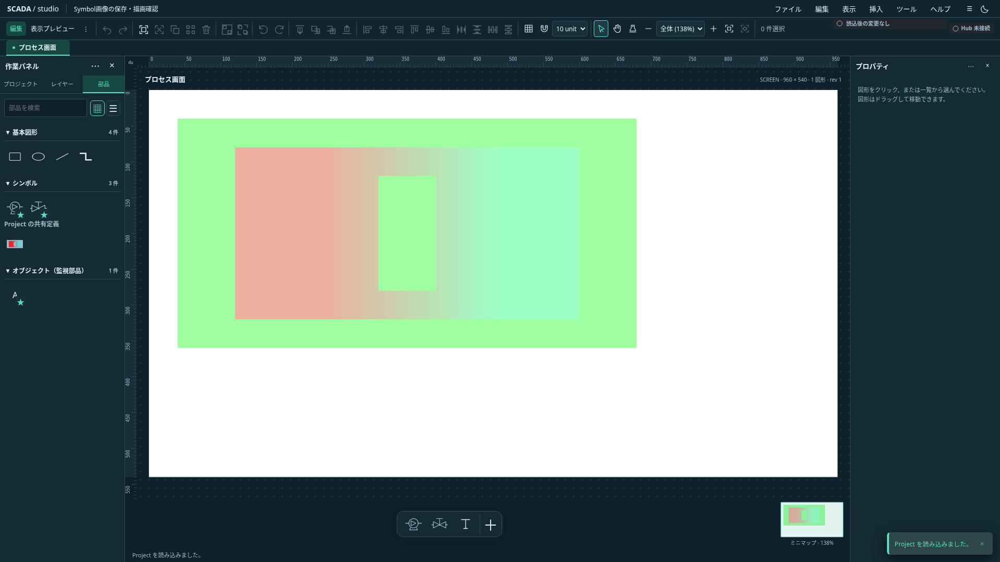
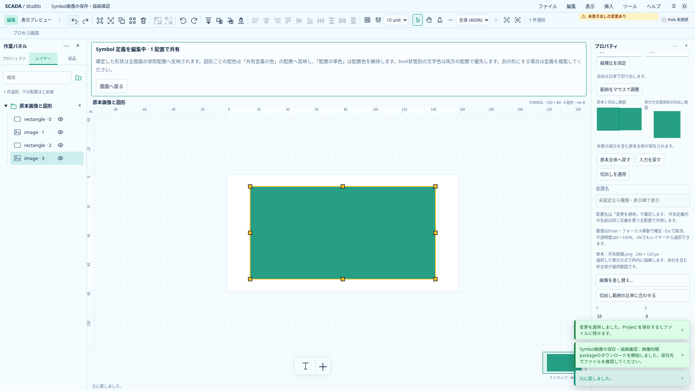
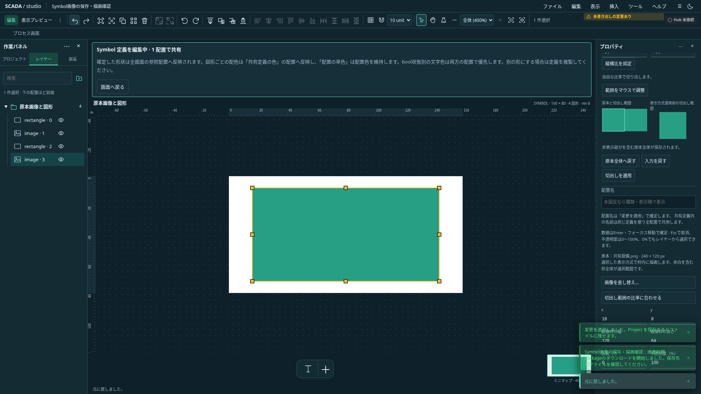

# I7：共有Symbol内の静止画像

2026-10-21（日本時間）。状態: **I7a完了・全体CI成功。I7bの保存・読込・共通描画は全体CI成功。I7cの取込・編集UIも全体CI成功**。[単体開発計画](../../project/upstream-independent-plan.md)で、既存Imageの共有Symbolへの再利用を段階化する。Astraの読取レビューを反映した。統合設計・現在の[画像配置仕様](image-placement-design.md)を置き換えず、公開する範囲ごとに保存・描画・コピーを揃える。

現行保存版はI8bのProject0.35.0。以下の0.34.0はI7b導入時の記録で、サンプルは現行版へ更新している。

## 初回の対象と除外

目標はPNG／JPEGの静止画像をSymbol定義に持ち、原本を共有しながら配置・回転・opacity・fit・cropを既存Imageと同じ規則で扱うこと。未配置定義・非表示配置の原本も保存する。外部URL・SVG取込・動画・Symbol入れ子・任意拡縮・新しいAssetStoreは含めない。

Project0.33.0（I7a）まではSymbol内Imageを拒否していた。I7bでは0.34.0に進め、保存・読込・共通描画とSymbol配置の原本付きコピーへ対応する。Symbol定義内への取込・貼付・画像編集の作成UIはI7cで接続する。低層の参照集計が対応することと、公開validator／command／UIで利用できることを区別する。リリース前の旧形式互換は必須にしないが、保存属性を拡張するときはTS／Rust／schema／サンプルを同時に更新する。

## 資産の保持とコピーの範囲

| 用途                              | 必要な資産                                                                                                                                    |
| --------------------------------- | --------------------------------------------------------------------------------------------------------------------------------------------- |
| Project保存・検証・現在状態の剪定 | 全画面の背景／Image、全Symbol定義内のImage。未配置・非表示・ロックを理由に除外しない                                                          |
| 選択配置のclipboard               | 選択配置から到達する埋込画面・Symbolと画像だけ。到達した画面の背景も含む。無関係な定義・資産は混ぜない                                        |
| 貼り付け                          | 先に実際に取り込む画面／定義を決め、内部画像だけ資産登録・ID再配線。同一workspaceの現行定義を再利用するときは古いsnapshotの資産を復活させない |
| Undo／Redo・書出し中              | 現在Projectだけの参照と区別し、既存の履歴保持・原本pin／leaseの寿命を維持する                                                                 |

参照索引はasset IDと所有者種別・所有者ID・配置IDを返す。重複する原本の集合化は利用側で行い、索引から使用先を消さない。資産宣言の欠落を索引で補修・黙って除外しない。公開validatorが欠落・孤立宣言・不正crop等を拒否する。

閉包収集は重複訪問を止めるが、深さ・循環・Symbol入れ子の許可を判断しない。既存Project検証が構造の正となる。参照収集の対応を理由に、貼付時の現行定義再利用・asset ID付替えを省略しない。

## 描画・色とαの後続契約

I7bはAstraの推奨を採用し、既存の合成後のα契約を維持する。画像のRGBと原本αは両colorModeで保持し、単色RGBの置換は既存の図形・文字・線に限定する。子Imageのopacityはその画像へ、Symbol配置opacityは合成後の全体へ一回適用する。

単色SymbolのcolorAlphaは現行の[合成後の契約](../graphics/color-alpha-design.md)を維持し、**画像を含む全体**に作用することをUI・仕様に明記する。定義色では従来どおり非適用。colorAlphaを子ベクタに個別乗算すると重なりの濃さが変わり、全ベクタをまとめると「ベクタ→画像→ベクタ」の順序が変わるため、その代替実装は行わない。I7aでは描画・opacity・colorAlphaを変更しない。

## 保存区切りと受入

| 工程 | 内容                                       | 完了条件                                                                                                                  | 状態         |
| ---- | ------------------------------------------ | ------------------------------------------------------------------------------------------------------------------------- | ------------ |
| I7a  | TS／Rust資産参照集計、clipboard依存収集    | 低層共通fixtureで全定義／背景／共有を確認。既存の保存・剪定・履歴・package／clipboardを回帰。公開のSymbol内画像拒否を維持 | 完了・CI成功 |
| I7b  | 保存版・検証、貼付時の資産再配線、共通描画 | 未配置定義の保存・同hash共有・削除／Undo・別Project貼付・現行定義再利用・欠落時原子性、各描画入口・両配色と重なり順を確認 | 完了・CI成功 |
| I7c  | 取込・編集・clipboardの作成UI              | 画面／定義の所有者、遅延decode中の切替・往復、draft／IME、lock、fit／crop、原本解放と両テーマ実画面を確認                 | 完了・CI成功 |

I7bでschemaの拒否を外すときは、読込できた画像が消える・保存で原本が失われる・コピーで依存が欠落する状態を公開しない。描画・保存・pasteの必要範囲を同じ受入区切りで揃える。I7c完了前はSymbol内への取込操作を提供済みと記載しない。

## 読む入口

- `lib/asset-references.ts`と`project.ts:referencedAssets`：全所有者の参照索引と保存資産集合。
- `crates/scada-model/src/lib.rs:referenced_assets`：schema検証後の資産参照集計。
- `lib/clipboard-dependencies.ts`：選択配置からの依存閉包。`editor/paste-handler.ts`の実取込・再配線とは分ける。
- `examples/image-reference-cases.json`：TS／Rustの低層集計用。**読込用Projectサンプルではない**。
- 後続の描画は`ObjectPainting.svelte`／`SymbolThumbnail.svelte`等と既存`ImagePainting.svelte`、取込は`designer/controllers/image-import.svelte.ts`を確認する。新しい画像Storeは作らない。

`lib/`は`apps/banto-scada/src/lib/`を指す。現行の画像・背景の読込用サンプルと低層集計fixtureを取り違えない。

## I7aの検証結果（2026-10-21）

TSの追加8件で全使用先の識別・同一原本の集合化・未配置／非表示定義・選択配置からの到達範囲・重複訪問停止・参照欠落の拒否・入力不変性を確認した。共通の低層4ケースをRustでも確認した。低層fixtureには公開形式外の形を含むが、公開validatorで受理した証拠にはしない。現行のSymbol内Image拒否はTS／Rustの既存契約試験とブラウザの貼付拒否で維持を確認した。

ローカル結果は、型チェック（エラー・警告0）、TS全1129件、Rust全52件、Clippy、rustfmt、CLI3サンプル、画像原本／clipboard／埋込画面のブラウザ12件、本番build、整形・文書リンク確認が成功。画面・schema・保存版・配色は変更していないため、新しい機能の実画面はない。I7aの全体CI成功は後述のリンクで確認済み。pasteの資産再配線・公開形式拡張・共通描画と取込UIはI7b／I7cに残す。

## I7bの実装範囲（2026-10-21）

Project0.34.0でSymbol定義内Imageを保存・検証・表示できるようにした。現在のサンプル・TS／Rust／schema・workspace版を揃え、0.33.0からの自動移行は追加していない。Banto・Industrial SDK依存は維持する。

貼付は実際に取り込む画面／Symbol定義を先に決め、内部画像の原本登録とasset ID再配線を行う。同hashの原本は共有し、同一workspaceの現行定義を再利用するときは古いsnapshotの画像を復活させない。未配置定義の原本保持・定義削除／Undo・欠落時の原子性も既存入口を使う。

描画は既存ImagePaintingで、子の回転・opacity・fit／cropを保持する。編集キャンバス・プレビュー・ミニマップ・埋込・画面内Popup・部品パレット／定義・レイヤーのサムネイルに画像Mapを渡す。画像を挟んだ図形の描画順を変えず、colorAlphaを子へ分配しない。Inspectorに画像を含む全体へのα適用を明記した。

### 試せるサンプルと実画面

[原本同梱サンプル](../../../examples/symbol-image.bantoscada)を「Projectを開く」で読み込む。赤・半透明シアンの自作2画素PNGと、前後の矩形による配色／重なり確認用で、実設備画面ではない。[Project JSON](../../../examples/symbol-image.project.json)と[PNG原本](../../../examples/assets/symbol-image.png)を併せて保存している。画像付きJSON単体の読込制限は従来どおり。

I7aの`2cbc930`は[全体CI39563806934](https://github.com/tyaro/temp-scada/actions/runs/39563806934)で全job成功。I7bの`969a0c4`は[全体CI39568399640](https://github.com/tyaro/temp-scada/actions/runs/39568399640)で全job成功。取込・差替え・crop／fit操作の接続は下記I7cを参照する。

### I7bのローカル検証

- TS単体は全1137件の成功後、現行定義の差替え原本を再利用する追加1ケースを含む関連9件も成功（計1138ケース）。Rust全53件、型チェック（エラー・警告0）、Clippy・rustfmt、CLI4サンプル、本番buildが成功した。
- 新規ブラウザ6ケースで両テーマのRGB／原本α・画像前後の図形の重なりを画素比較し、別Projectコピーと元バイト保存・Undo／Redo、ミニマップ・部品・埋込・Popup・定義編集画面、配布用サンプルを確認した。未提供のcrop／fit／原本差替えは定義内で操作不可にし、既存の幾何・opacityと区別する。
- 既存の配色・α・原本付きclipboard回帰24件は、初回23件成功／1件が初期操作で30秒timeout。ビルド・単体試験等の併走を終えて同一コード・同じ制限で単独確認し8.5秒で成功した。原因を断定せず、全体CIでも回帰を確認する。新規6件と合わせて異なるブラウザ30ケースを確認した。
- 原本同梱サンプルは既存profile 1のまま、native PNG decodeとchecksumを含めて読込・保存・原本バイト一致を確認した。0.33.0の読込・自動変換は未提供。固定依存や認証延期は変更しない。

## I7c：定義内の取込・編集UI（2026-10-21）

Symbolの「定義を編集」で、ファイルメニュー「画像を配置」、PNG／JPEGのOS貼付、画像単体の原本付きコピー／切取／貼付を利用できる。選択した画像のプロパティからcontain／cover／stretch、原本座標の非破壊crop・縦横比固定、原本差替え、元比率復帰、幾何・opacityを編集する。変更はその定義を使う全配置へ反映される旨を表示する。背景画像は画面専用のまま。Symbol入れ子・埋込画面・group・タグ付きTextの定義内貼付は引き続き拒否する。

既存image-import controllerの`screenId`は、画面または編集中の定義のIDを表す。generation・所有者ID・mode・取込requestのepochを照合し、画面／定義を切り替えて戻っても遅延decodeを復活させない。差替えは選択・元asset・crop・lockのepochも照合する。背景専用の拒否は維持し、配置／差替えだけを定義へ許可する。fit／cropフォームはgeneration・所有者ID・定義種別・対象配置（cropはasset IDも）を確認し、draft／IMEと明示適用、1操作＝Undo1回を共用する。

モデルはProject0.34.0のまま。画像は既存ImagePainting・AssetStore・履歴pin／lease・原本同梱packageを使い、別Storeや原本変更処理は作らない。同hashを共有し、差替え後の保存では現在参照する原本だけを同梱、Undo時は履歴から旧原本を復帰する。

### I7cのローカル検証

TS全1,142件が成功。新規4ケースは定義内fit／crop・差替え／Undo・原本剪定・入力不変性・lock／不正crop／preview／所有者不一致・子画像コピーのhash共有・フォームの対象照合を確認する。既存の画像貼付拒否の契約試験は新しい受入仕様へ更新した。

ブラウザは新規6件＋既存40件の計46ケースを確認した。新規は両テーマの取込・fit／crop・差替え・lock・Undo・原本バイト保存と保存対象の剪定、定義内／画面への原本付きコピー、OS貼付、遅延配置／差替え中の所有者往復、draft取消とIMEを確認する。既存はSymbolの画素／α・重なり、サムネイル・埋込／Popup・packageと、画面画像の原本・clipboard・権限／破損／容量失敗・fit・貼付・差替えを回帰した。初回は遅延decodeのテスト用mockが保存検証時まで残り2件timeoutしたため、decode完了時にnative関数を復元して再実行し成功した。旧仕様の定義内画像拒否を期待していた既存ブラウザ1件も更新後に成功。timeout上限は変更していない。

型チェック（エラー・警告0）、本番build・整形・文書リンク確認が成功。Rust／schema／原本同梱サンプル・保存版・固定依存は今回変更せず、I7bの全体CI成功を基準とする。I7cの`313b806`は[全体CI39570702994](https://github.com/tyaro/temp-scada/actions/runs/39570702994)で全job成功。
