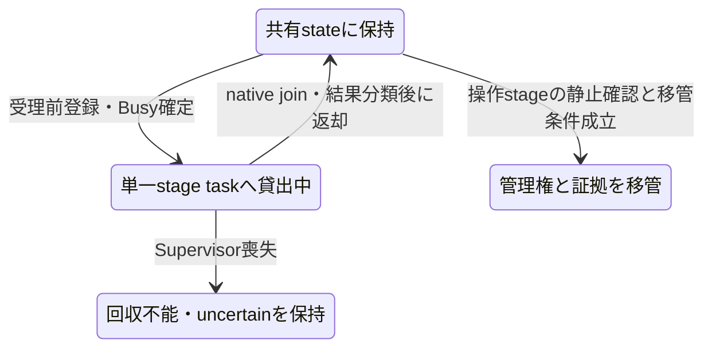

# 記録操作の共有native owner

状態: **H5d4c2の採用設計・実装未着手**。2026-11-04（日本時間）。主設計はユーザー指定のAstra。今回は設計だけをReady PRにし、その後、共有ownerから三段階操作・結果投影までを一つの実装PRとして受け入れる。

## 1. 範囲と工程

[明示操作契約](historian-recording-operations.md)のd4a純粋JSON、d4b optional service／App monitor、[c1 receipt reader](historian-recording-receipt-reader.md)は実装済み。c2は単一supervisorを全callerで共有するnative ownerと受理前registry、preflight→明示pause/join→明示apply、d4aへの結果投影を実装する。c3でc1 readを同ownerの明示reconciliationへ接続する。

薄いpreflight wrapperだけを先に公開すると、受付ID・apply結果・owner寿命の責務が未完のままになる。c2では三段階を一貫して受け入れ、HTTP／IPC／Tauri commandやJS serviceの実接続は追加しない。Rust ownerを作っただけで通常Appのin-process serviceが接続済みとは扱わない。

既存mappingによる単一groupの設定変更だけを対象とする。initialIdle bootstrap、mapping登録、SDK再解決／resume、複数group、認証・製品transport・実Hub/S7/本番DBは対象外。Project 0.37.0／DB7／H1／SDK・依存版を維持する。

## 2. 根拠と採用する所有構造

[RecordingSupervisor](../../../crates/scada-runtime/src/recording_host/supervisor.rs)はHostと同storeのHistoryReader一個を所有する。preflight、resume inspectionはこのreaderを貸し出してspawn_blockingし、borrowed joinで回収する。[plan turn](../../../crates/scada-runtime/src/recording_host/plan_turn.rs)もwriterをblocking workerへ移し、join後に戻す。現行は`&mut self`のcallerが正しく生存することが前提であり、複数のUI callerへそのまま可変参照を配らない。

新module候補は`scada_runtime::recording_operations`。単一の非Clone管理ownerとClone可能なclientを分ける。内部は共有stateの短い排他区間と単一dispatcherを持ち、全clientが同じregistry・Busy gate・native supervisorを使う。supervisorの可変参照、writer、native runの再構成入口はclientへ公開しない。

```rust
pub struct RecordingOperationsOwner { /* administrative root */ }
#[derive(Clone)]
pub struct RecordingOperationsClient { /* shared gate */ }
#[derive(Clone)]
pub struct RecordingChangeHandle { /* owner token + change token */ }
#[derive(Clone)]
pub struct RecordingOperationHandle { /* owner token + operation token + result watch */ }

impl RecordingOperationsOwner {
    pub fn try_new(
        supervisor: RecordingSupervisor,
        context: scada_model::recording_operations::RecordingOperationsContext,
        recording_run: RecordingRun,
    ) -> Result<Self, Box<RecordingOperationsInitError>>;
    pub fn client(&self) -> RecordingOperationsClient;
    pub fn try_handoff(&mut self) -> Result<RecordingOperationsHandoff, OwnerError>;
}

impl RecordingOperationsClient {
    pub fn state(&self) -> Arc<RecordingOperationsState>;
    pub fn watch(&self) -> tokio::sync::watch::Receiver<Arc<RecordingOperationsState>>;
    pub fn preflight(
        &self, request: RecordingChangeRequest, control: QueryControl,
    ) -> Result<AcceptedRecordingChange, OperationRejection>;
    pub fn pause_join(
        &self, change: &RecordingChangeHandle, operation_id: &str,
        control: QueryControl,
    ) -> Result<RecordingOperationHandle, OperationRejection>;
    pub fn apply(
        &self, change: &RecordingChangeHandle, operation_id: &str,
        control: QueryControl,
    ) -> Result<RecordingOperationHandle, OperationRejection>;
    pub fn discard(&self, change: &RecordingChangeHandle) -> Result<(), OperationRejection>;
}

impl RecordingOperationHandle {
    pub fn request(&self) -> &RecordingOperationRequest;
    pub fn watch(&self) -> tokio::sync::watch::Receiver<Option<Arc<RecordingOperationResult>>>;
    pub async fn wait(&self) -> Result<Arc<RecordingOperationResult>, OwnerError>;
    pub fn request_cancel(&self) -> CancelDisposition;
}
```

この節のowner／client／handleは公開API案であり、まだ実装していない。上記ChangeRequest／OperationRequest／Result／Contextはd4aの検証済みprivate Value wrapperを指す。AcceptedRecordingChangeは`{change,operation}`の二field。init errorは入力supervisorを返して所有を失わず、safe errorを持つ（Debugで内部path/error本文を漏らさない）。OwnerError／OperationRejectionは閉じたcodeで、native StoreErrorのDisplayをbrowser用DTOへ流さない。具体実装のenum名はこの責務に沿って整理し、公開前に整合確認する。

## 3. initと対象の束縛

try_newは渡されたopaque RecordingRunがsupervisor.stateのrunと同一で、context.sessionIdがそのsessionと一致することを確認する。Runningまたは正常Joined、pending candidate／resume ticket／未join管理readやturnなし、plan recovery／retention gateなしを要求する。既存start_preflightの純粋なowner/gate判定を共有helperへ最小抽出し、constructorでpreflightやDB照会を代行しない。SDK接続や新しいsessionも開始しない。

context.targetのProject/deployment/store/namespaceはcaller宣言のままである。既存supervisorから稼働中writerを取り上げてこれらを検証しない。recordingRunRef文字列をnative runへ変換せず、factoryへ渡されたopaque runへの別名として保持する。callerが別store宣言を供給していないことは将来composition root／transportの責任であり、認証済みidentityと称さない。

contextはowner生存中immutableであり、既存ownerを別contextへ再bindするAPIは提供しない。registry上限時も正常candidate/pausedがあれば明示discardし、安全な管理handoffを経て新context/capabilityの新ownerを作る。blockedの場合は移管でnative recovery gateをstampするため、新ownerへの作り直しで解除できない。

ownerは既存supervisorを消費するため、そのsupervisorへ別callerが直接mutationする経路は残らない。同一storeの独立writerは既存lockが拒否する。全caller gateとはこのownerの全Clone clientを指し、他processの要求をbrowser文字列だけで制御したという意味ではない。

init失敗はsupervisorをそのまま返す。init時点で実行runtimeの存在を確認し、ownerが使うTokio Handleを固定する。SDK executorとこのruntimeをownerより長く保つのはhost applicationの責任である。

## 4. 同期受付とdispatcher

受付は次の順で行う。排他は小さいstate変更にだけ使い、SQLite／SDK／joinをlock保持中に待たない。`try_lock`等で別callerの競合を同期Busyとして拒否し、内部にmutation待ちqueueを作らない。

1. d4a wrapper、native ApplyRecordingPlanRequestへの有限投影、context全文、元change/owner、phase、ID、QueryControlと期限・取消状態、registry残量を検査する。
2. 一個のoperation枠を確保し、元request全文、元native run、operation token、cancel token、completion watchをregistryへ保存する。preflightではchangeも同時に登録する。
3. supervisorを単一dispatcherへ貸し出す。登録済みstateを公開してOk(handle)を返す。実処理開始前にも元deadlineを確認する。
4. dispatcherだけがnative start、borrowed join、typed outcomeの分類を行う。完了後にsupervisorを戻し、有限latest stateと元handleの完了を公開する。

Ok(handle)は**ownerの受理**であり、native start成功・stop要求・commit・Runningを意味しない。既存nativeの同期拒否がdispatcher内で起きた場合も、受付済みhandleへfailed/notDispatchedを返す。同期OperationRejectionは手順2より前の、何もdispatchしていない拒否だけに限定する。native呼出中panicを未dispatchの同期拒否に変換しない。

Supervisorはdispatcherが常時所有するのではなく、stage実行中だけ共有stateから移し、native joinと結果分類が終わったら共有stateへ返してから終端通知する。結果だけ先にcompletedへしてSupervisorの返却を遅らせない。

Supervisorの所在は次のように変わる。これは操作結果のphaseとは別で、返却後もblockedが残る場合がある。



各ownerのdispatcher実行は最大1。tokio::spawnのstage taskがsupervisorを所有し、native同期SQLは既存spawn_blockingへ委譲する。task監視側はJoinErrorも結果へ分類してregistryに残す。監視taskをclientへAbortHandleとして公開しない。段階taskのpanicでsupervisorを失った場合はunknown／recovery trueにし、同ownerの新mutationを禁止する。捕捉したpanicから内部状態が健全だと仮定して再利用しない。

watchは最新一件、operationのwaitは同じ完了watchのcloneを待つだけとする。wait FutureをDrop／timeoutしてもdispatcherやnative joinを中断しない。subscribeとcompletionの順に依存せず、observerが取り付く前に即時完了しても同じhandleから結果を読める。watch receiverのDropも操作取消ではない。

## 5. 有限registryとID再利用

一capability contextでmutation用に登録できるIDは**合計4096件**。実登録数と未使用予約creditの和を4096以下に保つ。changeIdとoperationIdを役割付きkeyとして保持し、各H1 ID最大64文字。本文の全履歴は保存しない。変更全文は現在workflow一個、operation handleは最大3stage、最新成功pair一個だけをowner stateへ保持する。外部callerが過去handleを保持する分はcaller所有であり、ownerが過去Promise全配列を蓄積しない。

- preflightはchangeIdと3stageのoperationIdのため計4枠を一括確保する。changeId/preflight operationIdの2枠を実登録し、pause/apply用に2creditを予約する。残量が4未満なら登録／dispatch前に拒否し、受理済みCandidateがcapacityだけで停止／適用へ進めなくなる状態を作らない。ID発行はcheckedなsafe単調counterを使用し、例えば固定ASCII prefix `native-op:` と十進counterだけでH1の64文字以内に収める。contextId文字列を連結しない。一意性のscopeはregistryのcontextであり、文字列にcontext全体を埋め込む必要はない。callerが既登録のoperationIdと衝突した場合は次counterへ進め、既登録最大4096件に基づく最大4097候補の有限探索で避ける。counter上限や探索枯渇は受付前に拒否し、wrapや乱数への暗黙切替は行わない。
- pause/applyのoperationIdも全stage共通poolで再使用禁止。別役割の同じ綴りは別keyだが、同役割の同IDを再受付しない。拒否した未受付IDは登録せずcreditも消費しない。受理したpause/applyで予約creditを1ずつ実登録へ変換する。
- cancel・正常終了・discardで既登録IDを削除しない。Replay/検査失敗/明示discard/正常完了/blocked終端で、以降同workflowの新stageを受理しないことを確定したときだけ未使用creditを解放する。予約済みcreditがあるstageには上限到達を理由とする拒否を追加しない。上限後の新workflowには新capability／明示owner移管が必要で、自動resetしない。
- **native apply.requestIdはこの再使用禁止poolに入れない。** 過去要求と同じID・canonical本文を新しいchangeで検査するとReplayになり得る。DBのimmutable全文照合が権威であり、新operationとして過去receiptを再表示しても再applyはしない。

登録の上限と本文予算は別である。d4a Context/Change/OperationRequestの128KiB・4096node、Result256KiB・8192node、nested H5a64KiBを満たしてからnativeの128KiB/node8192要求検査も通す。budgetやID上限をnative dispatch後に初めて判定して「未送信」と返さない。

## 6. nativeへの三段階対応

| owner操作  | native処理                                       | 次状態                                                                            |
| ---------- | ------------------------------------------------ | --------------------------------------------------------------------------------- |
| preflight  | Apply intentのみでstart_preflight→join_preflight | Candidateならcandidate、Replayならcompleted。errorならcompleted/blocked/uncertain |
| pause_join | 元PreflightRunへrequest_pause→join_pause         | 正常joinだけpaused。自然終了済みでもこの明示段階を通す                            |
| apply      | execute_candidate→join_recording_plan_turn       | commit確認ならcompleted、回復必要ならblocked、物理不明ならuncertain               |
| discard    | 元PreflightRunへdiscard_candidate                | candidate/paused・物理処理なしだけidle。stop撤回／resumeしない                    |

pause/applyの引数に新desiredや期待版を渡さない。registryの元owned ChangeRequestとnative PreflightRunを使う。context/run/sessionが変われば拒否する。applyをownerが受理した時点でowner候補はconsumeし、native executeの成否にかかわらず別IDによる自動再実行を許さない。nativeが同期拒否した場合もその失敗を元handleへ記録し、正常候補へ勝手に戻さない。native request_pause/execute_candidateが拒否した時点では旧native候補が残り得る。owner受理後のこの失敗はnotDispatched/confirmedでもowner recoveryRequired=true/blockedとし、新preflightも止める。自動discardせず元native候補を保持する。これに対してowner受理前の同期OperationRejectionは元candidate/pausedをそのまま維持する。

discardは非同期投稿ではなく同期完了のAPIとする。物理stageがなくSupervisorが共有stateへ返却済みの場合だけ、短い排他内で既存discard_candidateの同期判定・候補解放を実行する。この既存処理はSQL／SDK I/O／awaitを行わない。native成功後にだけownerの候補を消し、未使用creditを解放してidleを公開する。エラーなら元候補／gateを保持する。RPC投稿やtask予約だけでvoid成功を返さず、UI側の待機queueで代用しない。将来native discardが非同期化する場合はservice契約自体の改訂を先に行う。

既存nativeでrequest_pauseにQueryControlはない。pause受理前とdispatcherのstop発行直前に期限・取消を確認するが、stop発行後の期限切れはjoinの待機打切りにしない。pause/joinのcancelはnotSupported。preflight/applyは渡されたQueryControl.cancellationを保持し、handleから同tokenへcooperative cancelを要求する。

d4bのperformance.now()とRust Instantは別のclock領域である。c2のRust APIはnative QueryControl／Instantだけを受け、JSのnumberをInstantのepochとして解釈・castしない。将来bridgeのclock対応付け、残余時間の算出、IPC遅延の扱いは接続前に別途設計レビューする未実装事項である。異なるclockの無条件な換算やtransport待機の計上を今回の実装では保証しない。

各段階は利用者が渡した一個の絶対deadlineを引き継ぎ、dispatcher schedulingやblocking pool待機で延長しない。stageごとの新しい明示呼出で新deadlineを渡すのはよい。既存native VM・rows・byte予算は増やさず、callerの不正な上限を縮小で隠さない。

現行QueryControl::validateはstore内可視であり、runtimeから呼べる公開APIではない。c2実装時にHistorian側のpure予算validatorを公開する最小変更（例: validateの公開化）を予定する。runtimeへ検査規則を複製せず、このhelperは実行・deadline更新・DBアクセスを行わない。cancelled／既到来deadlineは、これとは別に同じnative clockとtokenで受付前・dispatch直前に確認する。helperは本設計時点では未追加である。

## 7. DTO投影・失敗・単調性

RecordingOperationsStateは非JSONのowned Rust stateで、context、phase、現在change/operation handle、latest結果、lastAppliedの元request付きpair、closed flagを持つ。browser向けはd4aの検証済みJSON envelopeだけをprojectionする。run token、JoinHandle、SqliteStore、任意error文字列をSerializeしない。`active`は現在または最後の受理stageとしてsettle後も保持し、非nullだけを物理Busyの証拠にしない。

| native／ownerの根拠                         | d4a結果                                                                     | gate                                                                                                                                |
| ------------------------------------------- | --------------------------------------------------------------------------- | ----------------------------------------------------------------------------------------------------------------------------------- |
| owner受付前の拒否                           | 同期有限OperationRejection                                                  | 元状態維持、dispatchなし                                                                                                            |
| native startがtyped拒否、何も開始していない | failed/notDispatched/confirmed                                              | preflightは再検査可。pause/applyはowner recovery=true/blockedとして元候補を再使用しない                                             |
| preflight Candidate／Replayの正常join       | candidate／replay、confirmed/false                                          | Candidate以外でstopしない                                                                                                           |
| preflight正常join、outcome Err              | failed/notCommitted/confirmed。read worker開始後なのでnotDispatchedにしない | 健全readerの取消・期限・予算超過等はcompleted/false。ReaderUnusable・reader fault・保存証拠破損等はblocked/trueとし、新検査を止める |
| pauseの正常join・正常cleanup                | paused、confirmed/false                                                     | 明示apply待ち                                                                                                                       |
| pause要求後のjoin／cleanup異常              | failed/unconfirmed、証明できなければunknown/true                            | blockedまたはuncertain。apply不可                                                                                                   |
| plan turn正常join、outcome Applied          | applied、confirmed/false                                                    | 設定commit済み、resumeしない                                                                                                        |
| plan turn正常join、outcome Err              | failed/unconfirmed、confirmed/true                                          | native plan recovery latch維持。Errからrollback完了を推論しない                                                                     |
| stage panic、join結果喪失、壊れた出力       | failed/unconfirmed、unknown/true                                            | uncertain。新mutation禁止                                                                                                           |
| native receiptはあるがDTOへsafe投影不能     | failed/projectionFailed/unconfirmed、証明済みquiescenceだけ保持             | commitなしと表示せずblocked/uncertain                                                                                               |

native u64がMAX_SAFEを超えた場合は丸めない。完了watchへ有限projectionFailedを出すため、元requestは先に検証して保持する。receipt自体の公開に失敗しても元native evidenceをboundedに保持し、成功commitを未送信へ変換しない。typed原因だけを閉集合へmapし、StoreError／HostのStringをparseしない。

native要求への変換では、検証済みU1／nullを数値の整数同値に基づいてchecked変換する。d4aで同値な1と1.0を、Option<u64>へのserde_json::from_value直適用の表記差で拒否しない。native request構築用だけ数値を正規化し、保持する元Valueは変形しない。context一致もd4aの同値helperで照合し、JSON表記やobject key順の一致に置き換えない。

結果のrequestは元owned OperationRequest全文をechoする。native canonicalがmember順を整理していても、echoは元表示順を保持する。receipt.requestId、desired版、期待applied+1、PlanRef、bound版、hash形式はd4a validatorで検査する。Replayは現在headや現在Runningを証明しない。

preflightのnotCommittedは当該read操作がwriteを実行していないという意味で、照会対象applyが過去または並行にcommitしていない証明ではない。Conflictや入力不整合などreaderが健全な確定拒否もcompleted/falseとし、typedなReaderUnusable/ReaderFailed/CorruptDataや不明な内部障害を正常化しない。join自体が失敗してread cleanupを確認できない場合は表のunknown/true経路へ進む。

native正常joinは物理完了根拠でありcommitの証明ではない。一方、c3でreceiptが見つかっても物理完了は別に確認する。既知receiptを後のnotFoundで消さず、quiescence confirmedをunknownへ戻さず、recoveryはORで維持する。元OperationHandleのcompletionは一回だけ確定し、後日のreconciliationはowner.latestを更新する。c2ではreconciliation未提供である。

正常結果の後でもnative／ownerの新しいblocked状態を古い成功でclearしない。owner stateに独立のsticky blockを持ち、追加診断・UI再mount・current読取で解除しない。自動rearm、旧appliedへのrollback、失敗後の新ID再試行は行わない。

## 8. client、外部owner、終了と移管

Clientのcloneは同gateを共有する。client／watch／wait FutureのDropはunsubscribeだけで、記録や操作を止めない。UIより長く生存する非Clone RecordingOperationsOwnerをcomposition rootが保持することが、操作継続の前提である。JS側monitorが破棄されても外部ownerは元handleと結果を保持する。

管理ownerのDropはUI closeとは別の明示的なサービス寿命終了である。新受付を閉じ、受理済みpreflight/applyへcooperative取消を要求するが、dispatcherをabortせず、stage taskが保持する共有state／supervisorをcleanupまで存続させる。pauseのstopは撤回しない。driverが最後に資源をDropしても正常shutdown／joinしたとは主張しない。稼働中recorderの正常終了が必要なら、owner移管後に既存native stop/join手順を使う。

`try_handoff`は管理ownerだけの明示移管APIであり、clientには渡さない。返却するRecordingOperationsHandoffはSupervisorと有限のRecordingOperationsRecoveryEvidenceを一緒に保持する。evidenceは元context、最後のOperationRequest／Result各最大1、lastAppliedの元request付きpair最大1、DTO投影不能時も丸めないnative receipt最大1、owner_recovery_requiredを持つ。任意error本文や全履歴は含めない。物理operation/readが未join、または正常candidate/pausedが進行中の場合はBusy。元handleを捨てて通さない。全stageの物理完了が確認できて候補がない場合は、recovery latch付きsupervisorも**回復用として**返せる。ownerがblocked終端で旧native候補を残している場合も、管理権による回復移管としてその候補とlatchを保持したまま返せる。候補の自動discardや正常化はせず、移管先が既存native tokenで明示回復する。

owner-onlyのblocked／invalid／投影失敗がある場合、移管前に実装で追加するcrate内専用helper `RecordingSupervisor::latch_recording_operations_recovery()` を必ず呼び、既存`host.plan_turn.recovery_required`をtrueにする。このhelperはtrueへの設定だけで解除入口を持たず、DBを書き換えない。これによりnative側のlatchが元々falseでも、返却Supervisorを別ownerへ渡す、start/preflightへ直接使うといった経路で既存gateを回避できない。evidenceにもowner recoveryを保持する。

latchをclearせず、残存clientへclosedを公開して永久拒否にする。新しい操作資格の発行や自動resumeを含めない。supervisorを失ったpanicやunknown物理状態では移管を成功扱いにしない。

handoffで確認する静止は管理operation／readのものである。recorderがRunningでも、そのworkerとrunを所有したSupervisor自体の移管は記録の停止を意味しない。移管先もSDK executorを維持し、記録を終了する場合は改めて既存のstop／joinを実行する。

Tokio runtime shutdownは正常owner shutdownの代替ではない。SDK runtime／dispatcher runtimeはownerとcleanupを完了するまで維持する。停止したruntimeから正常結果・quiescenceを推測せず、応答不明とwriter lockによる実資源保護を残す。これをprocessを跨ぐ永続operation registryとは称さない。

## 9. c3 readとの接点

c2は元ApplyRecordingPlanRequest、元RecordingPlanTurnRun、元RecordingRun、確認済みquiescence、immutable completionと最新結果を最大一件ずつ保持する。c3はこのregistryからc1のHistoryReader readを発行する。JSの任意requestIdだけを受けて別要求へ照会しない。

現supervisorのresume inspectionはplan turn実行中やpending candidateでBusyになるため、c3は専用の同reader loan／join経路を設計する必要がある。借用中の`join_*(&mut self).await`と同時に別の`&mut Supervisor`を作らない。元operation completionが確定してSupervisorが返却された後、registryの元要求を照合して専用readをloanし、その後にread joinをawaitする。native子workerのJoinError等でHostがFaultedでもSupervisorとread leaseが健全ならreadだけを許す。dispatcher自体のpanic等でSupervisor／readerを失った場合は読取不可を返してuncertainを保持し、receiptを必ず回収できるとは主張しない。native joinがまだ未完了なのにownerが結果不明を先行公開してreadも並行開始する拡張はc2に入れない。その機能が必要ならread leaseをawait前に独立ownerへ移す設計・受入を追加してから行う。c2で新しい無制限connectionを先行追加しない。既存preflight/resumeと共有する一read枠、全store二reader lease、同deadline/token・row予算を維持する。

結果不明／recovery-required内でreadだけを許し、writer gateを解放しない。c2のmutation ID上限到達を理由にc3の回復readを拒否しない。c3は独立した有限read採番／登録予算を設計し、mutationの未使用creditに依存させない。元applyがunknownへ確定した後でもreadは最大1、queueなし。receiptFound/Noneと物理完了根拠を分離する。Noneから再dispatch許可は出さず、旧completionを再resolveしない。c3の公開read handle・reconciliation DTO投影・元resultとの単調統合は別実装PRで受け入れる。

## 10. c2実装の受入matrix

| 境界            | 必須ケース                                                                                                                                                                             |
| --------------- | -------------------------------------------------------------------------------------------------------------------------------------------------------------------------------------- |
| init            | 別run/session、InitialIdle、未join／latchを拒否してsupervisor返却。対象宣言を認証と偽称しない                                                                                          |
| 全caller gate   | clone client二個から同時受付、一方だけ受理・queueなし。current/watchだけでdispatchしない                                                                                               |
| 受理前登録      | native startが即時拒否／即時完了／panicしても元operationIdが残り、同期未dispatch拒否と区別                                                                                             |
| registry        | 4096件境界、preflight四枠一括確保、残量4でCandidate→pause→apply完走・残量3で事前拒否、未使用creditだけ解放、ID再使用拒否、discard後再使用拒否、native apply.requestIdのReplayは可能    |
| 三段階          | 実mockHubで録画継続中Candidate、別click相当のpause/join、別apply、commit後は停止状態のまま                                                                                             |
| Replay/Conflict | 過去receipt・別本文Conflictでstop未実行。検査後mapping／保持版変化でapply失敗、元要求維持                                                                                              |
| 寿命            | wait timeout/client Dropでも処理継続、runtime上のSDK生存、owner Dropとreader/writer lock、正常移管とclient失効、owner-only blockをnative stampした後の別owner init/start/preflight拒否 |
| 失敗            | source shutdown不良、actual SQLite FULL、commit後応答喪失、worker panic、callback/観測者破棄、recovery latch保持                                                                       |
| 予算/取消       | dispatcher開始前deadline、blocking待機中期限、元QueryControl上限、latecancel成功receipt維持、pause cancel非対応                                                                        |
| 投影            | d4a受理、expected_*の1.0／整数同値と元member順echoの組合せ、context同値helper、MAX_SAFE超過を丸めない、有限error、join成功とoutcome成功の区別                                          |
| 有限保持        | 最大3stage＋最新成功一件、履歴queueなし、古いhandle waitは当時結果を返し現在appliedと偽称しない                                                                                        |

テストは制御clock／隔離SQLite／mockHubのみ。native sourceへの接続を含むローカルlibrary試験と通常Appへの製品接続を区別する。実装時に最小共有helperを既存supervisorへ足してよいが、既存manual／managed start、読取、保持gateを弱めない。コード完成後にAstra read-onlyレビューを行い、既存workspace・Clippy・共通DTO/browser回帰を通してReady PRとする。
