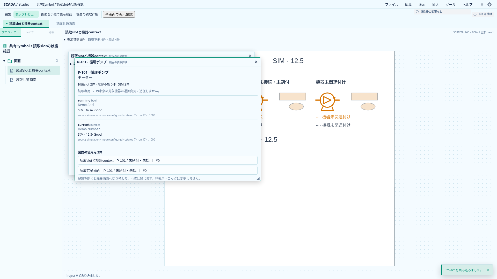
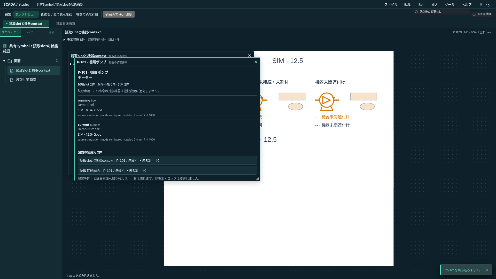

# P3a: Host表示DTOと画面sessionの接続

2026-11-01（日本時間）。状態: **P3aはPR #12でCI成功・マージ済み、P3b製品実装は保留**。P2は[PR #11](https://github.com/tyaro/temp-scada/pull/11)でマージ済み。

## 提供区切り

P3のうち、P3aとしてRust Hostの表示用DTO、フロントの一括受入、通常Appから各描画先への配布を実装する。製品のTauri／HTTP transportはP3bに分ける。今回はネットワーク待受・Hub接続設定・資格情報の受渡し・認証を追加しない。通常起動は未接続のまま。fixtureによる画面検証を実Hubの端から端までの接続完成と扱わない。

## Rust側の配送契約

`ReadDisplayStream`は一つの`ReadHostFrame::session()`へ束縛する。`next(frame)`は同じsessionだけを許し、`sequence`を1から増やした`ReadDisplayUpdate`を返す。sessionが変わったら旧streamでは送れず、新streamと新deliveryを用意する。opaque token自体はJSON化しない。

updateは`sequence`・`sdkGeneration`・`text`・`slots`だけ。Textとslotは同じHost frameから取り出し、別々に送らない。SDK catalog全件、接続先、秘密情報は含めない。JSON SchemaをRustとAJVで共有し、slotの既存schemaを参照する。u64／i64の識別情報はJS safe integerに制限し、表現不能な値を丸めない。

## フロント側のsession

`createReadPresentationSession`がTextとslotの受入を所有する。Project所有者の参照同一性、ID／revision、参照名集合、slot plan、接続状態、metadataReady、由来、SDK世代、配送sequenceを検証する。どちらかが不正なら両方を無効化し、片方だけ新しい値を表示しない。既存`createReadSlotSession`の型・slot検査と表示は再利用する。

`sequence`が既受入以下なら旧配送として無視する。新sequenceの不正入力は旧値を消し、その番号を消費する。同一deliveryでSDK世代の逆行、停止後の旧SDK世代の復活、同じSDK世代での由来metadataの変更を許さない。再接続は新しい有効更新を必要とする。

`ReadSource.subscribe(project, begin)`が画面の差込み口。`begin()`はローカルsessionをresetし、そのsessionに束縛した`receive`／`close`／`fail`を返す。Host sessionの変更時にも新しくbeginする。旧deliveryの通知・closeは新deliveryへ影響しない。payloadから新sessionを発行しない。

P3bのtransport adapterはRust streamとbeginで返されたdeliveryを対応付ける。resetを任意の遅延payloadに同梱して新sessionとして受け入れる方式にはしない。通信順序はsequenceで検証し、購読の終了・切断・失敗はそのdeliveryへ伝える。

## Appと描画

Appは任意の`readSource` propを受ける。通常entrypointは渡さない。Project置換・編集・Undo／Redo・source変更・unmountでは、旧callbackを無効化してから購読を解放する。sourceへはProjectの検証済みコピーを渡し、編集本体を変更させない。

controllerの一つのreactive frameからText用readingsと機器contextを同時に導出し、主画面、Symbol、埋込画面、小窓、機器詳細、ミニマップへ配る。数値Textにも由来とSIMを付け、Bad／Staleは値を残さない。別Projectや旧frameに保持したreadingsも、呼出時に所有者・currentを検査して旧値を返さない。

Sourceの同期例外、unsubscribe例外、終了後の遅延通知で編集操作を壊さない。新しい汎用イベント基盤やテスト用のwindow globalを製品に追加しない。検証はfixture sourceを渡して通常Appをmountする。

## 受入と残り

- Rust serializerと共通fixture／Schemaの一致、streamのsession変更拒否・連番を確認。
- TSは片側破損、Text参照の不足／追加、slot plan、混在metadata、非有限値、safe integer、旧token／旧sequence、世代逆行、停止後の旧値、payload変更を検証。
- ブラウザは通常Appを同じmountで更新し、数値Text・Symbol・埋込・小窓・機器詳細のGood／部分未解決／Unbound／Bad・Stale／切断／SIMを両テーマで確認。Project置換・source終了・古い配送を含める。
- P3bは製品transportと接続設定の明示設計・実装、実Hubへの接続試験。認証延期とS7非接続を維持し、P3a完了だけでP3全体を完了扱いしない。

## 検証結果と実画面

Rust workspace71件、Clippy／rustfmtが成功。共通fixture6種はRust投影・serializerとSchemaで一致し、TS単体1,253件と型検査も成功した。buildは成功し、既知のchunkサイズ警告が残る。関連ブラウザ5spec・13件が成功した。全体CIはPRを参照する。

通常Appへのfixture source注入は`e2e/read-presentation.spec.ts`だけで行う。旧session／sequence、sourceの終了／置換／例外、同ID・revisionのProject再読込、sourceに渡したProjectコピーの変更と保存往復を確認した。製品entrypointへのテストglobalや実Hub接続は追加していない。

以下はfixtureのSIM値を表示した同じApp。toolbarの「Hub 未接続」は通常Designerに実Hub接続設定がない現行の表示であり、実Hubへの接続成功を示さない。図面の白背景・文字色はProject定義、周囲のshellと小窓は選択テーマに従う。

| ライト                                                           | ダーク                                                          |
| ---------------------------------------------------------------- | --------------------------------------------------------------- |
|  |  |

P3bの現行境界と再開条件は[製品transport・接続設定](transport-boundary.md)を参照する。
