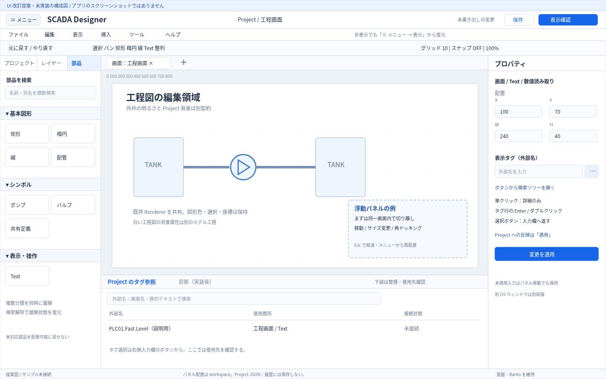
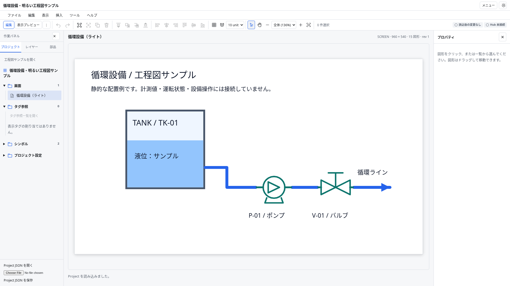
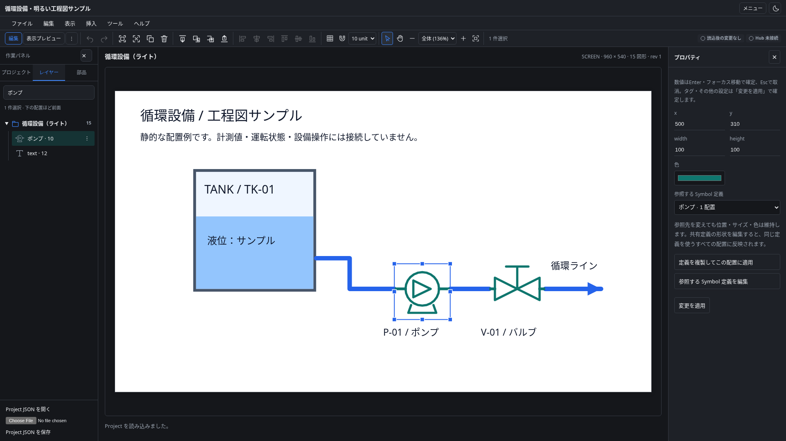
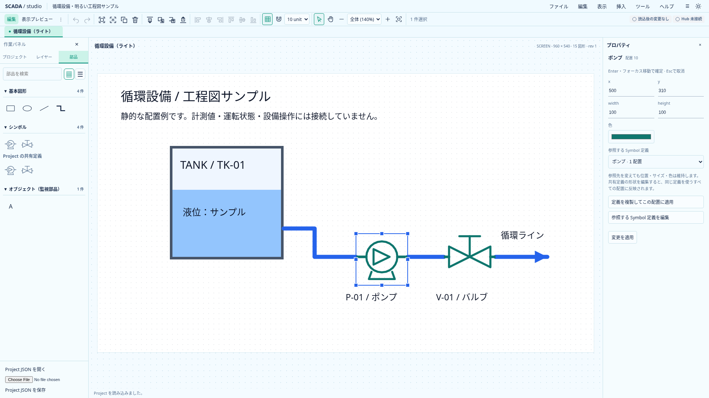
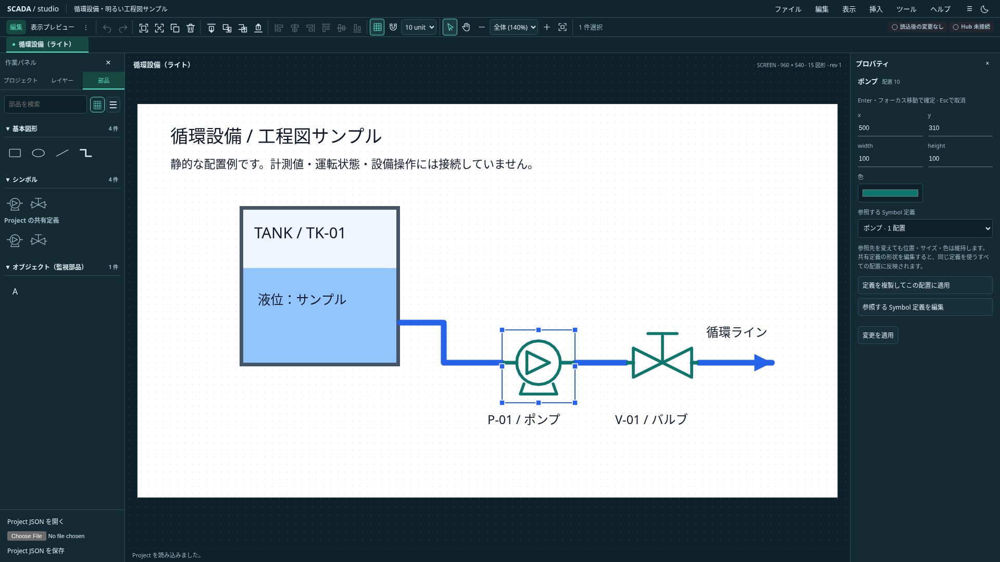
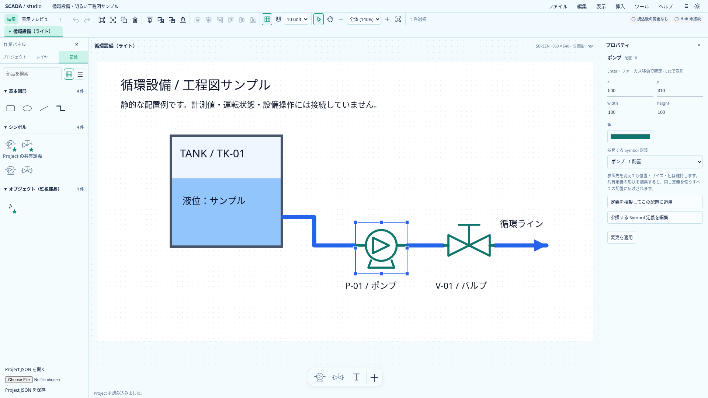
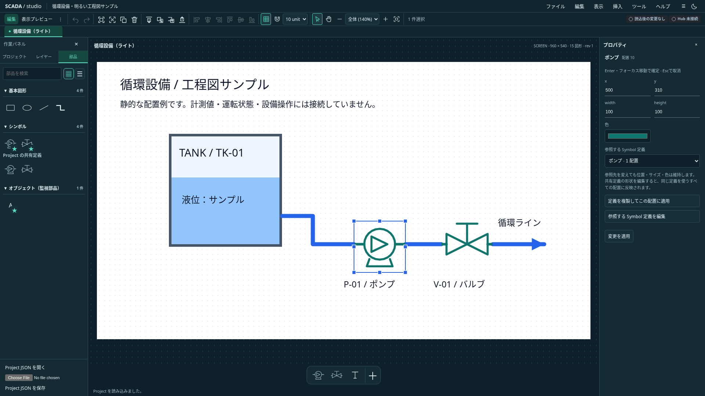
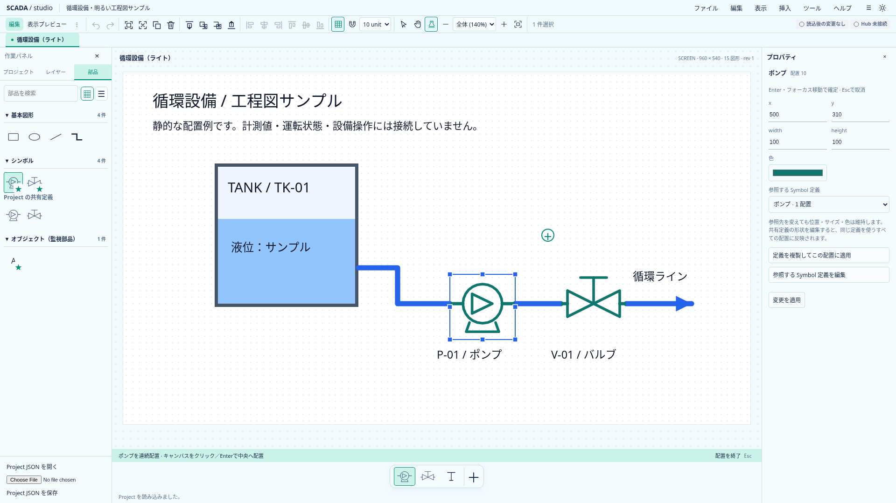
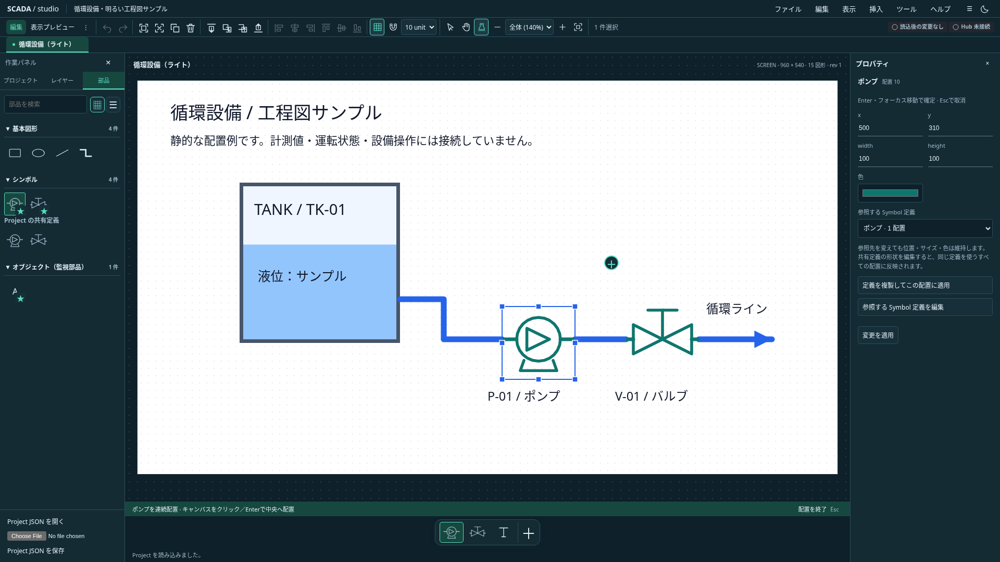

# SCADA Designer UI 改訂提案

文書の位置付け: **統合設計の詳細操作を補う提案・採用判断。未実装のパネルや配置を含む。** 現在の対応範囲と保存契約は[実装状況](implementation-status.md)を正とする。

2026-10-18（日本時間）。ユーザーのサイドチャット案と添付コンセプト画像を、Astra のレビューを経て既存の [UX 設計](frontend-ux-design.md) に取り込むための提案。**統合設計の採用後は、その詳細操作設計として参照する。アプリへの実装完了を示す文書ではない。** 今回はアプリのコード、Project schema、依存を変更しない。

同日後続の画面設計と機能検討は [統合設計](scada-integrated-design.md) に集約し、ユーザー確認により基準設計書として採用した。ライト／ダークを同等に扱い、監視部品を一覧・グラフ・映像まで拡張する。本書はパネル・タグ選択・メニューの詳細操作を担当し、統合設計は画面カタログ、オブジェクト、外部連携、開発支援と既存ロードマップの対応を担当する。

## 提案の評価

| 提案                                       | 評価と既存設計への変更                                                                                          |
| ------------------------------------------ | --------------------------------------------------------------------------------------------------------------- |
| ライト／ダークの専用デスクトップ型         | 採用を推奨。管理画面のカード配置に固定せず、キャンバスと作図操作を主役にする。Banto 基盤は維持する              |
| 左の「プロジェクト／レイヤー／部品」       | 採用を推奨。現在の長い縦積みを 3 つのパネルへ整理する                                                           |
| 切り離し・再ドッキング・配置保存／標準復元 | 明示的な実装段階として設計へ追加する。固定パネルを先に整え、機能を単に「後続」の一語で落とさない                |
| 部品のアコーディオンと横断検索             | 採用を推奨。「基本図形／シンボル／オブジェクト（監視部品）」を候補とし、第3分類を一覧・グラフ・映像まで拡張する |
| 入力欄横から開くタグ選択ツリー             | 採用を推奨。候補の確認・入力への確定・Project への適用を区別する                                                |
| 6 分類のメニューバーと表示切替             | 採用を推奨。非表示でも独立した上部「メニュー」ボタンから復元できるようにする                                    |

従来の「機能優先・固定パネル先行」は実装順として維持できる。完成形の目標を今回の構成へ更新し、固定配置からドッキングへ移るための状態分離を先に行う。新提案のために、認証・MES・設備操作・共有 SDK の実装範囲を広げない。

## 構成イメージ

[編集元 SVG](assets/frontend-ux/designer-revision-wireframe.svg)。本リポジトリで独自に作図した構成図で、動作画面のスクリーンショットではない。破線の浮動パネルは移動先の例示で、標準配置では閉じる。ユーザー添付の原画像はローカルファイルとして取得できておらず収録していない。画像中の高度な機器表現・値・回転等を現行機能とみなさない。`ems-apps` の画面・コード・画像は流用しない。

### 外観と領域

基準は 1440×900 CSS px。1280×720 でも主要な編集を完了できることを検証する。薄い区切り、コンパクトな行高、控えめな面の差を使い、パネルの大きなカード余白を減らす。後続のユーザー要望に合わせ、light / dark の両方を同等に設計し、system 連動も維持する。標準設定の切替は実装時に扱い、既存利用者の選択を勝手に上書きしない。

| 領域           | 初期の目安                | 挙動                                                                           |
| -------------- | ------------------------- | ------------------------------------------------------------------------------ |
| 上部アプリバー | 40px                      | Project 名、常設メニュー、テーマアイコン。サブタイトルなし                     |
| メニューバー   | 28px、初期は表示          | ファイル／編集／表示／挿入／ツール／ヘルプ。非表示時は行を畳む                 |
| 編集ツールバー | 約40px、狭い幅では折返し  | 編集／表示プレビュー、保存状態、共通編集、選択・パン、グリッド／スナップ、倍率 |
| 左ペイン       | 240px、200〜340px         | プロジェクト／レイヤー／部品。初期はプロジェクト、本文は独立スクロール         |
| 中央           | 残り幅、通常は最小480px   | 画面・定義の作業タブ、ルーラー、工程図。左右を畳んで編集領域を拡大できる       |
| 右プロパティ   | 280px、240〜380px         | 対象・種別・影響範囲を固定し、内容をスクロール                                 |
| 下部管理       | 初期は閉、展開時200px程度 | Project のタグ参照・使用箇所と診断。現在値の catalog 一覧とは区別する          |
| ステータス     | 24px                      | 選択数・座標・倍率・適用状態。未接続を正常運転と表示しない                     |

狭幅では中央480pxのためにページへ横スクロールを押し出さず、左右を一時表示へ切り替える。パネル内とキャンバス内のスクロールを分ける。下部領域は作業高の40%以内を基準とする。

外枠の light 化と Project の背景は別契約。現行 `0.4.0` は画面ごとの背景色を保存する。背景変更で既存の明るい線や文字を自動で再配色しない。白い工程図には背景色と図形色を明示し、新規配置だけは背景に合う既定色を使う。Rust / TS / renderer・サンプルを合わせて検証する。リリース前なので旧形式 migration は必須にしないが、既存データを無言で別の配色へ変えない。

## 左の3パネル

「プロジェクト」「レイヤー」「部品」を別のパネル ID として扱い、初期配置では左のタブグループへ収める。部品を浮動化した後もプロジェクトとレイヤーを左に残せる。パネルの閉じる操作は内容の削除ではない。

- **プロジェクト**：画面と共有 Symbol の構造、追加・複製・削除・保存順の変更。タグは「Project のタグ参照」へつなぐ。未実装のレシピやスクリプトを空ノードとして常設しない。
- **レイヤー**：初期は「レイヤー（配置一覧）」と説明し、現在編集中の画面／定義の配置と重なり順を扱う。キャンバスと選択を同期する。永続レイヤー、グループ、可視性、ロックが既に存在するように見せない。
- **部品**：作図と配置に集中する。共有定義の管理・編集はプロジェクト側、部品側はサムネイルからの配置を主目的とする。

画面と共有定義を切り替えても、どちらを編集中かを上部とプロパティで識別する。作業タブの順は workspace、保存される画面順は Project であり、タブを動かして画面の保存順を変えない。

### 部品の分類と検索

| 分類                     | 現行機能からの対応                 | 未対応機能の扱い                                                                                         |
| ------------------------ | ---------------------------------- | -------------------------------------------------------------------------------------------------------- |
| 基本図形                 | 矩形、楕円、線、配管の折れ線       | 回転や新しいパス編集は個別に追加                                                                         |
| シンボル                 | ポンプ、バルブ、Project の共有定義 | 多色・状態別表現・slot はモデル整備後                                                                    |
| オブジェクト（監視部品） | 現在は Text とその数値タグ割り当て | 表示・操作・ナビゲーション・一覧／履歴・グラフ・映像／画像・コンテナを、対応する契約と機能の実装後に追加 |

旧案では「表示・操作」を推奨したが、アラーム／イベント一覧・トレンド・カメラ等の後続要望を含め、第3分類を「オブジェクト（監視部品）」へ広げる候補に整理した。model の図形・配置全体を指す Object と区別し、最終表示名は未確定とする。詳細は [統合設計](scada-integrated-design.md) を参照。Text を基本図形にも重複掲載する構成にはしない。

各分類は独立したアコーディオンとし、複数を同時に開ける。横断検索は閉じた分類も検索し、一致する分類を一時展開、件数と所属を示す。検索解除後は検索前の展開状態へ戻す。名前・別名を検索しても配置される部品の identity は変えない。共有定義の編集中は入れ子の Symbol を配置できない既存制約を維持する。

### 実装状況（2026-10-19）

同日後続で Draw.io を参考に部品の密度を調整し、アイコン一覧／名称一覧の切替と保存、1行の検索領域、ドラッグ配置を追加した。分類の開閉・検索・未適用入力は切替で保持する。図形の中心をドロップ位置へ合わせ、スナップと Alt の一時解除、既存の Undo・保存経路を共用する。

左3タブと部品の3分類・横断検索を実装した。パネルを非表示にするだけの切替ではフォームを保持し、検索解除で分類の開閉を復元する。共有 Symbol 管理はプロジェクト側、配置は部品側へ整理した。永続レイヤーや未実装の監視ウィジェットを追加したものではない。可動パネルで必要となるフォームの unmount / remount 対応は B 段階に残る。詳細と検証範囲は [開発・統合方針](development-plan.md) を参照。

## フローティングと再ドッキング

### 最初に提供する範囲

まず**同じアプリ画面内**で、パネルの移動・サイズ変更・左／右／下への再ドッキングを扱う。プロジェクト／レイヤー／部品／プロパティ／参照管理を対象にする。未実装の診断パネルは、機能を導入した段階で登録する。

別の OS ウィンドウや別モニターへの分離はこの段階に含めない。後続で Tauri の window lifecycle、権限、状態共有、ウィンドウを閉じた場合の再ドッキングを検討する。

ドラッグだけを操作経路にせず、パネルメニューから「左へ配置／右へ配置／下へ配置／浮動にする／標準位置へ戻す」を使えるようにする。配置できる領域はパネルごとに宣言し、キャンバスは常に中央の作業面として残す。ドラッグ中は配置先を表示し、Esc で移動を取消す。浮動パネルは modeless とし、画面全体を Modal の focus trap に閉じ込めない。メニュー・確認ダイアログとの前後関係を共有 layering と整合させる。

### プロパティの表示切替とキャンバスの拡大

ユーザーの追加要望により、**プロパティも他のパネルと同等に、表示／非表示・浮動・再ドッキング・サイズ変更の対象**とする。右側への常設を強制しない。見出しの閉じる操作と「表示 → パネル → プロパティ」で切り替え、隠した後も常設の上部メニューから再表示できる。

ドッキング中のプロパティを隠したら、右側の空欄や予約幅を残さず中央へ割り当てる。浮動中に隠す場合もキャンバスへの重なりを取り除く。再表示時には位置・サイズ・ドッキング先と、選択対象・展開中の項目・未適用入力を復元する。非表示にするだけで入力を適用・破棄しない。

「表示 → キャンバスを広く表示」で左右と下部の補助パネルをまとめて一時的に隠し、「前のパネル配置へ戻す」で直前の表示状態へ戻せる案を追加する。既に非表示だったパネルを勝手に開かず、保存済みレイアウトや標準配置も上書きしない。上部の復帰入口と作業対象の表示は残す。

パネルの開閉では Project の図形座標を変えず、手動設定した倍率と見ている design 座標の中心を維持する。「全体表示」を明示的に選んだ場合だけ fit を行い、作業位置の意図しない移動を避ける。

### 実装状況（2026-10-19・プロパティ）

固定配置のプロパティ分離と表示切替を実装した。非表示で中央の幅を広げ、フォームを維持して入力・選択・手動倍率の中心を保持する。見出し・表示メニュー・常設メニューから切り替え、不正入力やタグ使用箇所の編集では再表示する。表示状態は session 内のみで、配置保存・浮動化・再ドッキング・全補助パネルの一括非表示は後続。詳細は [開発・統合方針](development-plan.md) を参照。

### 入力とレイアウトの分離

安定したパネル ID と編集対象 ID を使う。移動・タブ切替・非表示・標準配置への復元で、Project、選択、viewport、未適用入力を消さない。入力を変えずにパネルを畳むだけなら、Project 変更として扱わない。

現行の未適用入力保護は DOM のフォーム登録に依存する。移動でフォームを unmount / remount すると dirty 状態が消えるため、そのままドッキングへ接続できない。編集対象ごとの draft をパネル配置と独立して保持し、再表示で復元する状態構造への整理を B 段階の前提とする。編集対象そのものを替える場合は、従来の適用／破棄／キャンセルを通す。

「標準配置へ戻す」は配置だけを戻し、Project の変更やフォーム入力を破棄しない。閉じたパネルは常設の上部メニューから再表示できる。移動の終了時は操作したパネルへフォーカスを戻し、閉じる場合は有効な復帰先へ戻す。

### 配置保存と復元

「配置を保存」で workspace 設定として保持し、次回起動に復元する。対象はパネルの位置・サイズ・ドッキング領域・選択タブ・開閉・メニューバー表示。保存済み配置の復元と、標準配置への復元を別操作にする。最初は保存スロット1つでよく、名前付きプリセットは必要性を確認してから増やす。

Project JSON、Project revision、Undo / Redo、未書き出し変更には含めない。設定用の独立した layoutVersion を持ち、未知のパネル・破損値・非有限寸法を検証する。画面外や縮小された画面でも見出しと復帰操作を使える位置に収め、標準配置へ安全に戻せるようにする。保存失敗やストレージ利用不可でも編集を継続し、保存できなかったことを表示する。設定キーは後続の Banto ユーザー設定へ移せるようにし、今回独自のユーザー管理を追加しない。

## タグ選択パネル

### 開く場所と対象

プロパティのタグ入力欄横の「タグを選択」ボタンから、一時的な検索ツリーパネルを開く。割り当て先の「画面／配置／プロパティ」と要求型を上部に固定表示する。下部のタグ参照一覧は Project 内の管理・使用先確認として残し、タグを選ぶためだけに全体を展開させない。

ツリーは catalog の connection / group 等の構造化情報から作る。`externalName` は不透明な identity なので、ドットで分割して階層や PLC アドレスを推測しない。保存・購読の identity には外部名を使い、Hub 内部の数値 ID は使わない。

### 操作と確定

| 操作                                                       | 結果                                                                  |
| ---------------------------------------------------------- | --------------------------------------------------------------------- |
| タグのシングルクリック／矢印キー                           | 候補を選び、型・単位・外部名等の詳細を表示。入力と Project は変えない |
| フォルダーのクリック／ダブルクリック                       | 展開／折りたたみ。割り当てを確定しない                                |
| タグ行のダブルクリック／行にフォーカスした Enter／「選択」 | 有効な候補の外部名を Inspector の未適用入力へ返す                     |
| 検索欄での Enter                                           | 検索の操作に限定。候補を自動確定しない                                |
| Esc／キャンセル／閉じる                                    | 開く前の入力と他の未適用項目を保持し、起点ボタンへ戻る                |
| Inspector の「適用」                                       | 他のプロパティと同じ検証済みコマンドで Project へ1回反映              |

選択ボタンの表示は「選択して入力」も候補とし、その段階で Project が保存・適用されるという誤認を避ける。候補確認を終えただけで既存のフォーム入力を保存・破棄しない。

初期対象は現在実装の数値読み取り Text。`i16/u16/i32/u32/f32/i64/u64/f64` を互換候補とし、bit / string はこの対象では不適合とする。「互換タグのみ」を初期値とし、全件表示したときも不適合の理由を示して確定を無効にする。未選択・フォルダー・対象消失・型不適合では選択ボタンを有効にしない。

パネルを開いたときの Project のローカル session 世代、対象 ID、プロパティ、catalog 世代を確認する。開いた後に対象・Project・catalog が変わった場合は候補を再検証し、古い候補を別の配置へ返さない。同一 projectId / revision の別ファイルもあるため、それらだけで session を識別しない。

検索の読み込み中・結果なし・未接続・取得失敗を区別する。大規模 catalog の全値を購読せず、ツリー／検索は metadata を対象にし、詳細の現在値は実接続成立時だけ出す。静的 fixture の値をライブとして表示しない。手入力によるオフライン割り当ては残し、「存在・型は未確認」と分かるようにする。

### SDK との関係

UI の状態遷移と fixture による検証は、[industrial #682](https://github.com/tyaro/banto-industrial/issues/682) の対応前でも進められる。実 catalog / 値取得は共有 SDK と Host の契約に従う。部分解決と同世代 snapshot の課題を UI 側の独自購読で回避しない。認証は industrial 側で修正中のため延期を維持する。タグ選択から設備への書込み Action は生成しない。

## ヘッダーと操作の集約（2026-10-19・実装）

ヘッダーは40pxで Project 名・常設メニュー・テーマアイコンを表示し、サブタイトルを削除する。テーマは太陽／月／モニターのアイコンから light / dark / system を選ぶ。グリッド・スナップ・間隔、選択・パン、倍率・拡大縮小・全体表示、編集／表示プレビュー、保存状態は上部ツールバーへ置く。補助パネルをすべて隠してもモードと保存状態を見失わない。

プレビュー時もモードと保存状態を残し、編集用操作群は非表示にする。保存状態の未適用件数と、書き出し要求であることの区別を維持する。デスクトップでは空いた高さをキャンバスへ戻し、小画面ではツールバーを折り返す。

## 共通編集操作とプロパティの役割（2026-10-19・実装）

共通編集ツールバーをメニューバー直下へ置く。Undo / Redo、全選択／選択解除、複製／削除、重なり順、整列はここへまとめ、プロパティの表示状態に依存させない。編集メニューも同じ操作定義を使う。単一選択の重なり順・複数選択の整列という現行コマンドの制約は保持する。

プロパティには選択対象の位置・サイズ・色・文字・参照タグ等の入力と適用、数値移動や Symbol 固有の設定を置く。共通操作のボタンは重複させない。アイコンには名称を持たせ、キーボード移動と小画面の折返しにも対応する。フローティング対応は後続。

## メニューバー

初期表示は「ファイル／編集／表示／挿入／ツール／ヘルプ」の6分類。未実装の命令を実行できるようには見せず、利用可能な共通コマンドと同じ可否判定・履歴・未適用入力保護を使う。

| 分類     | 初期の内容例                                                                         |
| -------- | ------------------------------------------------------------------------------------ |
| ファイル | Project JSON を開く／書き出す、サンプル                                              |
| 編集     | Undo / Redo、選択・複製・削除、整列                                                  |
| 表示     | メニューバー、各パネル、ルーラー、倍率・全体表示、テーマ、配置の保存／復元／標準配置 |
| 挿入     | 実装済みの基本図形、Text、共有 Symbol                                                |
| ツール   | グリッド／スナップ設定、Symbol 管理。診断は実装後                                    |
| ヘルプ   | 操作ガイド、ショートカット、アプリ情報                                               |

メニューバーを隠しても、別の上部アプリバーにある常設「メニュー」ボタンは消さない。そのメニューの「表示 → メニューバー」を使って再表示でき、キーボードからも到達可能にする。メニューバー内にだけ復元命令を置かない。非表示で得た高さはキャンバスへ戻す。保存された好みがなければ初期は表示する。

メニューバーの左右移動、項目の上下移動、Enter / Space、Esc とフォーカス復帰を検証する。本文の入力や IME、ブラウザ・OS の既定ショートカットを一律に奪わない。Banto の単一 dropdown Menu を横に並べるだけで menubar のキーボード操作が完成したとは扱わない。

### 実装状況（統合設計採用後）

6分類のメニューバー、常設メニューからの表示切替・復元、設定保存、左右・上下キーと Esc の操作を実装した。利用できる既存コマンドのみを接続しており、左パネル・プロパティ・タグ参照一覧の個別表示切替と一括非表示／直前の表示への復帰にも対応した。レイアウト保存・ルーラー等は未実装。詳細と検証範囲は [開発・統合方針](development-plan.md) を参照。

## 右クリックのコンテキストメニュー

右クリックを、対象の近くから既存操作へ到達する入口として追加する。上部メニュー・ツールバーの操作も残し、右クリック専用の機能にはしない。メニューを開くだけでは Project の変更や履歴を作らない。

| 対象                     | 内容の例                                                                                        |
| ------------------------ | ----------------------------------------------------------------------------------------------- |
| キャンバスの空白         | 実装済み部品の挿入、全選択、全体表示、プロパティの再表示、キャンバスを広く表示                  |
| 図形・配置               | 複製、削除、重なり順、プロパティを表示。Symbol では共有定義の編集／この配置用の独立コピーも表示 |
| レイヤーの配置行         | キャンバスの同じ配置と同じ選択・可否判定・操作                                                  |
| Project の画面／共有定義 | 実装済みの名前変更・複製・順序変更・削除・定義編集。使用中定義の削除不可など既存制約を維持      |
| パネル見出し・タブ       | 非表示、浮動、許可された領域へのドッキング、標準位置へ戻す。プロパティも同じ扱い                |

クリップボード、回転、保存レイヤーのロック等、未実装の機能を利用可能な項目として出さない。複数選択では共通して実行できる操作だけを出す。整列は必要な個数が選択されている場合だけ利用可能にする。

### 左パネル内のメニュー

左ペインもタブ内の対象ごとにメニューを用意する。タブやパネル見出しの配置操作と、項目の編集操作を混ぜない。

| 場所・対象                                   | 内容の例                                                                               |
| -------------------------------------------- | -------------------------------------------------------------------------------------- |
| プロジェクト：画面フォルダー／画面一覧の空白 | 画面を追加、ツリーの展開／折りたたみ                                                   |
| プロジェクト：画面行                         | 開く、名前変更の入力へ移る、複製、上へ／下へ、削除                                     |
| プロジェクト：Symbol フォルダー              | 新しい共有定義を作成、展開／折りたたみ                                                 |
| プロジェクト：共有定義行                     | 定義を編集、複製、現在の画面へ配置、未使用なら削除、使用先一覧と配置への移動           |
| レイヤー：配置行                             | 選択、プロパティを表示、複製、削除、重なり順。複数選択中は対応済みの整列も提供         |
| 部品：基本図形／オブジェクトのカード         | 現在の画面へ配置、部品の種類・寸法等の情報確認                                         |
| 部品：標準シンボルのカード                   | 現在の画面へ配置、部品情報。組み込みテンプレート自体を直接編集・削除する項目は出さない |
| 部品：Project の共有定義カード               | 現在の画面へ配置、共有定義を編集、定義を複製。配置単体の独立コピーとは区別する         |
| 部品：分類見出し                             | この分類の展開／折りたたみ、全分類を展開／折りたたみ                                   |

Project の画面や部品カードを右クリックしただけでは、編集中の画面を切り替えたり配置を追加したりしない。メニュー見出しに対象名を示し、キャンバスの選択とは別のメニュー対象として保持する。「開く」「名前変更」「定義を編集」等を実行するときに必要な対象切替と入力保護を行う。レイヤー行はキャンバスと同じ選択を扱い、次項の複数選択ルールを適用する。

部品からの「画面へ配置」は、現在表示されているキャンバスの中央へ配置する。左パネル上の右クリック座標を工程図の配置座標として扱わない。定義編集中の Symbol の入れ子禁止、最後の画面の削除禁止、使用中定義の削除禁止など、入口によって制約を変えない。

標準テンプレートと、Project に取り込んで共有している定義を区別する。「共有定義を編集」は全参照配置への影響を示し、「定義を複製」は既存の配置先を変えない。「この配置だけを独立コピー」は実際の配置行・キャンバスの Symbol にだけ提供し、部品カードに対して実行しない。

左パネルでも、右クリックと同じ操作へキーボードや行／カードの操作ボタンから到達できるようにする。受入検証には、メニューを開いただけでは画面切替・配置・変更が起きないこと、対象名と実行先の一致、レイヤーの複数選択保持、使用中定義の削除不可、検索欄の標準メニュー、部品配置時の中央座標を含める。

### 選択と入力の保護

選択済み図形を右クリックした場合は複数選択を維持する。未選択の図形・配置行を右クリックした場合は、その対象だけを選択してメニューを開く。空白の右クリックは現在の選択を勝手に解除しない。選択変更が必要で未適用入力がある場合は、従来の適用／破棄／キャンセルを先に解決し、キャンセル時は対象も変更しない。

項目を実行するときも共通コマンド・可否判定・履歴・未適用入力保護を使う。開いた後に Project・編集対象・選択が変わった場合はメニューを閉じるか再検証し、古い対象へ操作しない。既存の削除確認を右クリックからだけ省略しない。

キャンバスからの挿入は、有効な描画面を右クリックした場合、その位置を viewport 変換から design 座標へ戻して配置する案とする。キーボードから挿入する場合は表示領域の中央を使う。ズーム・パン後も正しい位置を使い、右ボタンを押しただけで移動やドラッグを開始しない。

### キーボード・標準動作との共存

フォーカス中の対象へ Context Menu キー／Shift+F10、または名前付きの操作メニューボタンから到達できるようにする。上下キー・Enter・Esc を扱い、閉じたら元の有効な対象へフォーカスを戻す。メニューは画面端で収まる側へ配置し、浮動パネルや確認ダイアログの layering と整合させる。

input / textarea / contenteditable の内部では、コピー・貼り付け等のブラウザ標準右クリックを維持する。アプリ全体で contextmenu を一律に抑止しない。表示プレビューでは図形の編集・削除・設備操作を出さず、利用可能な表示操作だけにする。

受入検証には、複数選択の保持、未選択図形への切替と入力保護、空白での選択保持、キーボード、画面端、浮動パネル見出し、入力欄の標準メニュー、25〜400%とパン後の挿入位置、Undo / Redo、プレビューでの編集不可を含める。基本メニューは段階 A、可動パネルの項目は B の対応機能と一緒に実装する。

### 実装状況（2026-10-19・部品パレット）

部品カードと分類見出しに、Banto の既存メニューを使った右クリック／Shift+F10／Context Menu キー／操作ボタンの入口を追加した。組込・基本部品は配置と情報、共有定義は配置・定義編集・複製・情報、分類は単独／全体の開閉を提供する。開くだけでは編集せず、既存の入力保護・コマンドを使う。対象・Project 読込世代・表示／検索の変化で閉じ、入力欄の標準メニューを維持する。この初回の部品パレット実装時点では、他領域のメニューは未実装だった。後続の実装状況は次項を参照。詳細と検証は [開発・統合方針](development-plan.md) を参照。

### 実装状況（2026-10-19・キャンバスとレイヤー）

キャンバスの図形・空白とレイヤーの配置行に追加した。選択済み対象では複数選択を保ち、未選択への移動は入力確認後に行う。図形／配置行はプロパティ・複製／削除・重なり順／整列、Symbol は共有定義編集／独立コピーを提供する。空白は選択を解除せず、描画面内では基本図形等を設計座標へ挿入する。キーボード起点は表示中央を使う。レイヤー／上部の操作ボタンからも開ける。プレビューは標準の右クリックを維持する。この時点ではプロジェクト行と可動パネルは未実装だった。画面行の後続実装は次項を参照。

### 実装状況（2026-10-19・プロジェクト画面行）

画面行へ開く・名前変更・複製・上下移動・削除を追加した。右クリックだけでは編集対象を変えず、コマンド実行時に入力保護を通す。名前変更は既存の画面名欄へ移動し、別画面の移動・削除では現在の画面と図形選択を保つ。削除確認・画面数と順序の制約・Undo / Redo を共用する。操作ボタンとキーボードでも利用でき、プレビューでは編集項目を出さない。共有定義のプロジェクト行と可動パネルは後続。

### 実装状況（2026-10-19・プロジェクト共有定義行）

共有定義を名前・配置数付きの行一覧へ変更し、定義編集・複製・現在の画面への配置・未使用定義の削除を追加した。通常クリックは操作対象の選択に限り、右クリックだけでは選択・キャンバスを変えない。編集などの実行時に入力を保護し、使用中定義の削除・入れ子配置・定義数上限の制約を既存コマンドと共用する。別定義の削除時も図形選択を保ち、有効な行へフォーカスを戻す。キーボード・操作ボタンにも対応する。使用先への移動、フォルダー／空白、可動パネルのメニューは後続。

### 実装状況（2026-10-19・共有定義の使用先）

選択対象向けボタンと共有定義行のメニューから、左パネル内の使用先一覧を開ける。画面・配置を確認／検索し、明示的に選んだ配置へ入力保護付きで移動する。定義 ID の完全一致で全画面の直接参照を算出し、同名の独立コピーを区別する。配置削除や Undo / Redo に追従し、Project 再読込では一覧を閉じる。倍率とプロパティの表示状態を保ち、移動した配置をキャンバス内へ表示する。フォルダー／空白と可動パネルのメニューは後続。

### 実装状況（2026-10-19・固定パネルの幅）

1100px以上の編集画面で左パネルとプロパティの幅をドラッグ／キー操作で調整し、Banto UI 設定へ保存・復元する。狭いウィンドウでは表示幅を制限し、元の保存値を保持する。標準幅への復元・ドラッグ取消・設定破損／保存失敗からの復帰に対応する。フォームを維持して未適用入力と選択を保ち、手動倍率ではリサイズ中の設計座標の中心を固定する。固定パネルの幅保存までの実装で、浮動／ドッキングや配置全体の保存は後続。

## 下部パネルの高さ調整の実装状況（2026-10-19・同日後続）

タグ参照の展開中、デスクトップの作業領域に余裕があるときだけ上端の境界で高さを調整できる。ドラッグ・上下キー・標準復元・取消に対応し、高さを Banto UI 設定へ保存する。作業領域の40%以内、キャンバスと状態表示用に340px以上を残す範囲へ制限し、狭い配置では通常の自然な高さに戻す。入力・検索・選択・手動倍率の表示中心を保持する。固定領域のサイズ変更までの対応であり、浮動／ドッキングと配置全体の保存は後続。

## サイドチャット試作との照合（2026-10-19・同日後続）

新たな操作試作を [適用レビュー](prototype-design-review.md)で評価した。グラス調の外観・密度・お気に入り・タグ選択の入口は採用候補だが、既存の入力保護・共通コマンド・Banto 設定を使う。試作のピンを再ドッキングとみなさず、多色・状態別表示と実タグ接続も外観とは別工程とする。ユーザー回答により、左右固定を標準・浮動へ切替可能、数値はEnter／フォーカス移動で確定、フルHD以上・マウス中心を方針として確認した。数値の即時確定を加える際も、タグの明示適用・未適用入力の保持・Undoを維持する。試作全体の採用やアプリ変更の完了を示すものではない。

## 数値確定の実装状況（2026-10-19・同日後続）

単一選択の座標・サイズ・線幅をEnter／フォーカス移動で1項目ずつ確定する。下線入力、不正文字列の保持、Esc取消、IME、同値とblurの重複履歴防止に対応した。revision更新でフォームを作り直さず、他のタグ・文字・不正入力を保持する。Canvas編集開始前にも数値を同期確定し、確定後のgeometryで図形操作を始める。画面設定と複数選択の相対移動は明示適用を続ける。外枠全体のグラス調・浮動／再ドッキングは後続で、試作全面適用の完了を示さない。

## Banto と共有リポジトリの責務

Banto v6.7.0 / 固定コミット `1ffe507da973ca5103ede93b5ca438cda7c28d4e` の公開 API を確認した。初期化・通知・設定は維持し、テーマ tokens / mode と Menu / Modal / Drawer / layering helpers は再利用候補。PageHeader や SurfaceCard を Designer の全領域に使うことを必須にせず、SCADA の shell とレイアウトを構成する。見た目を変えることを基盤撤去や認証の独自実装へ広げない。

公開 entry には Tree / Tabs / Split / docking workspace がない。ただし、SCADA の配置・タグ選択をすべて Banto の共通責務へ移す理由にはならない。まず app 側のパネル契約と既存拡張点を設計し、ドッキング基盤は自前／既存ライブラリの Svelte adapter を、ライセンス・キーボード操作・状態保持・テーマ対応で比較する。依存の採用はまだ決めていない。

今回、新規 Issue は追加しない。現時点ではアプリ固有の提案で、複数製品に共通する不足が確定していないため。メニューバーの共通 keyboard helper、modeless layering、UI 設定保存、テーマの拡張点等で具体的な不足が確認できれば、最小再現と API 案を添えて Banto に起票する。共有 SDK の課題は既存 #682 を参照し、重複起票しない。

## 実装順と受入条件

この A〜D は提案の作業単位で、既存 U1〜U5 の完了や変更済みコードを表さない。ドッキングとタグ選択 UX は SDK 待ちの必須依存にせず、独立して進められる。

| 段階               | 内容                                                                           | 完了条件                                                                                                                                                                                                                                      |
| ------------------ | ------------------------------------------------------------------------------ | --------------------------------------------------------------------------------------------------------------------------------------------------------------------------------------------------------------------------------------------- |
| A：shell の整理    | 両テーマの外枠、6メニュー、左3タブ、分類・横断検索、プロパティの領域分離       | 1440×900 / 1280×720 の両テーマでキャンバス・保存・Undo・対象名へ到達。メニューバーを隠して復元可能。検索解除で展開状態が戻り、既存編集・未適用入力・JSON 往復が成立                                                                           |
| B：可動パネル      | draft 状態の独立、同一画面内の浮動／再ドッキング、配置保存／復元／標準化       | マウスとキーボードで再配置可能。移動・非表示・標準復元でも入力と Project を保持。再起動・画面縮小・破損設定・保存失敗から復帰。プロパティを含む全パネルを上部から再表示可能。非表示時に予約幅を残さず、一括非表示から直前の配置・入力へ戻せる |
| C：タグ選択 UX     | 検索ツリー、詳細、明示確定、型絞込、手入力との共存                             | fixture で単クリックは無変更、タグ行だけで確定、検索 Enter は非確定、取消で既存入力保持、型不適合／対象変更／catalog 更新時の誤適用を防止                                                                                                     |
| D：実 catalog 接続 | 更新 SDK、Host、同世代 metadata と current、状態表示                           | #682 の契約を確認。切断・未解決・型不一致・Stale / Bad・模擬を識別し、旧値・旧対象を使わない                                                                                                                                                  |
| 独立したモデル工程 | 白い工程図の背景（0.4.0で対応済み）、専用数値表示、多色・状態別 Symbol、回転等 | 必要な段階で現行 schema / Rust / TS / 描画 / サンプル・検証を揃える。A の外枠変更へ混入させない                                                                                                                                               |
| 別段階             | OS ウィンドウへの切り離し                                                      | Tauri 導入後に window 終了・モニター変更・状態同期・権限を検証                                                                                                                                                                                |

A から C への UX 作業は B の完成を必須にしない。位置と大きさの調整を、型・通信・認証の実装判断と分ける。正式な Runtime の権限境界、MES、認証延期、リリース前の互換性方針は既存設計を維持する。

## プロジェクト・レイヤーのツリー化の進捗

2026-10-19 同日後続。プロジェクトを画面・タグ参照・シンボル・設定の開閉できる枝へ整理し、レイヤーには検索と図形アイコン・共有定義の縮小表示・現在画面の枝を追加した。開閉は未適用入力を保持し、不正入力と名前変更では必要な設定を再展開する。これはツリー表示の最初の区切りで、ユーザー作成グループ・配置名・表示切替の保存・並べ替え・浮動は後続。詳細と実画面は[開発計画](development-plan.md)を参照。

後続の見た目調整では、画面・配置・共有定義をカードで囲まず、階層線とアイコンのある連続した行へ統一した。通常時は枠と背景を出さず、選択時だけ行全体へ淡い背景を付け、フォーカスは内側リングで区別する。以下の実画面も更新済み。

プロジェクトの実画面（ライト）:

レイヤー検索の実画面（ダーク）:

## 操作試作に合わせた Studio 外観

2026-10-19 同日後続。ユーザー指定の試作プレビューを基準に、薄いヘッダーと共通ツールバー、画面タブ、ドットの作業領域、青白色と青緑を使った左右固定パネルへ変更した。ダーク／OS連動も維持する。画面タブは既存の入力保護・画面操作へ接続し、検索・数値入力・Undo・パネルのサイズ調整の契約を継続する。浮動、ドック、ミニマップ、立体・多色シンボル、実タグ接続は後続で、見た目の適用と区別する。

実装範囲・小画面と検証は[開発計画](development-plan.md)を参照。

## お気に入り部品ドックの進捗

2026-10-19 同日後続。部品パネルの☆／★と下部ドックを実装し、既存の入力保護付きクリック・ドラッグ配置を共用した。基本図形・組込シンボル・共有定義に対応し、共有定義はProject別に登録する。ドックのための領域を下端に予約し、図面を覆う浮動化や連続配置とは分ける。詳細と検証は[開発計画](development-plan.md)を参照。

## 連続配置ツールの進捗

2026-10-19 同日後続。共通ツールバーと部品／お気に入りの右クリックから、部品選択→クリック位置への連続配置を開始できるようにした。既存の即時配置・ドラッグを残し、入力保護とコマンドを共用する。Esc・終了ボタン・対象変更で終了し、Spaceは一時パン、キャンバスEnterは中心配置とする。ツール選択だけではProjectを変更しない。詳細・検証は[開発計画](development-plan.md)を参照。

## ミニマップの進捗

2026-10-19 同日後続、実装照合 `c75ad3a`。お気に入りと同じ下端の帯へ、現行Rendererによる工程図全体と表示範囲の枠を追加した。手動倍率ではクリック・ドラッグ・矢印キーで表示位置を移動し、Enter／Spaceで全体表示へ戻る。ドラッグ中のEscで開始位置へ戻し、全体表示中は位置を動かさない。「表示」メニューから隠す／再表示でき、Banto UI設定へ保存する。表示プレビューと補助パネル一括非表示では隠す。

図形選択・Project・Undo・文字などの未適用入力を変更せず、連続配置中も部品を配置しない。画面／共有定義とProject読込世代に追従する。縮小図は読み上げを重複させず、操作用ボタンをキーボードで利用できる。大規模図面の性能評価と浮動化は後続。固定パネル開閉の表示中心保持も調整した。

対応済み／一部対応／未実装と直近の検証結果は[開発計画の進捗一覧](implementation-status.md)、詳細と各テーマの画像は[ミニマップの実装記録](implementation-history.md#minimap-progress)を参照する。過去の各進捗節にある「後続」は、その節の実装時点の記録として扱う。

### 2026-10-19・ルーラーの実装追記

編集領域の上・左の22px帯にdesign unitの目盛りを追加した。倍率・スクロール・画面／定義に追従し、表示設定をBantoへ保存する。Project・履歴・選択・未適用入力から分離し、手動倍率の表示中心を保持する。プレビューでは隠す。ガイド作成は未実装。[実画面・検証記録](implementation-history.md#rulers-progress)を参照する。

### 2026-10-19・タグ選択fixture UXの実装追記

数値Textの外部名入力から、明示した静的サンプルのmetadataを検索・ツリー選択するBanto Modalを追加した。数値型だけを確定可能とし、候補確認→未適用入力→適用→保存を分離する。検索Enter・IME・型不適合・非表示候補で誤確定しない。世代・対象・入力要素を返却前に再確認し、取消は元の入力へ戻る。実Hubのcatalog・値・接続状態を実装したものではない。[実装範囲・実画面・検証](implementation-history.md#tag-picker-progress)を参照する。

## 新規Projectと標準ファイル操作の実装追記（2026-10-19）

「新しいProject」は白い960×540の画面1枚から編集モードで始める。Ctrl／Command＋N・Oを新規作成／JSON読込へ接続し、未適用入力と内容置換の確認を共用する。選択取消・不正JSONで入力を失わず、古い非同期読込は採用しない。S／Shift＋Sは従来のJSONダウンロードで、保存先選択・既存ファイル上書きとは区別する。起動時は従来のサンプル表示を維持し、新規作成ウィザード・最近のファイル・復旧は後続。[実装範囲と検証](implementation-history.md#new-project-progress)を参照する。

## 配置名の実装追記（2026-10-19）

Project 0.5.0で任意の配置名を追加した。単一選択Inspectorの既存draft／適用経路、レイヤー表示・検索、SymbolとTextの使用先検索へ接続する。空欄は種類・表示順へ戻り、重複名とコピー時の名前保持を許容する。名前はUUIDによる識別・タグ外部名・共有定義名・画面上のTextと独立する。検索から外れた選択も保持する。表示／ロック／ユーザー作成グループは後続。[保存契約と検証](implementation-history.md#placement-name-progress)を参照する。

## 編集ロックの実装追記（2026-10-19）

Project 0.6.0で配置と定義内部の編集ロックを追加した。レイヤーから変更し、キャンバス・範囲・全選択では除外する。レイヤー選択とコピー・解除を許可し、Inspectorと共通コマンドの両方で直接変更を防ぐ。混在選択は原子的に拒否する。参照する共有定義の変更・履歴・Projectや画面全体の管理は反映するため、権限や共有状態の固定とは区別する。静的な表示切替は次の独立した工程とする。[実画面・保存契約・検証](implementation-history.md#edit-lock-progress)を参照する。

## 静的表示切替の実装追記（2026-10-19）

Project 0.7.0で配置と定義内部の`visible`を追加した。図面・表示プレビュー・ミニマップ・共有定義のサムネイルへ反映し、レイヤーとInspectorへ再表示の入口を残す。非表示でも管理・参照・読取を保持し、見えない配置へのキャンバスの直接変更を防ぎながら、一覧で確認した明示操作を許可する。ロックとの意味を分離し、静的表示を権限や動的な表示条件とは扱わない。[実画面・保存契約・検証](implementation-history.md#visibility-progress)を参照する。

Project名の編集とF2による対象の名前欄への移動、F1の操作ガイドを追加した。入力は既存draft guard・明示適用・Undoを使い、画面タブ／行のフォーカスと選択を区別する。[実装範囲と検証](implementation-history.md#standard-names-progress)を参照。

複数選択の色編集を実装した。混在色と適用する色の未指定を区別し、既存の入力保護・共通コマンド・Undoを使う。共通スタイル全体の完了を示すものではない。[実画面と検証](implementation-history.md#selection-color-progress)を参照。

3件以上の中心を水平方向／垂直方向に等間隔で配置する操作を追加した。両端中心を固定し、隙間の均等化とは区別する。[実装範囲と検証](implementation-history.md#distribute-progress)を参照。

固定パネルの「標準レイアウトに戻す」を実装した。寸法と補助領域の表示を戻し、タブ・ツリー・検索・draft・テーマ・お気に入り等の作業文脈を保持する。浮動／再ドッキングや名前付き保存は含まない。[実装範囲と検証](implementation-history.md#layout-reset-progress)を参照。
