# SCADA の独立開発と industrial への統合

状態: **Banto 基盤の最小工程図エディタを実装。折れ線と共有 Symbol に対応。Core v1 全体は未実装**。
決定日: 2026-10-18。ユーザー指示: industrial の開発を継続しつつ temp-scada で SCADA を先行開発し、最終的に industrial に戻す。

## 作成支援・プラント運用の追加検討（2026-10-20・日本時間）

[追加検討資料](scada-authoring-plant-operations-proposal.md)に、機器台帳と図面の双方向登録、機器ごとの任意信号・遠隔操作・Faceplate、図形合成、Studio／ドックの仕上げ、Hubタグからの記録設定・ペン選択・用途グループ・自動配色、監視用メニュー・文書・試験生成、機器／シーケンス／ステップの条件、アラーム対処、通信状態と復旧・引継ぎを整理した。ユーザー要望と追加提案、既存計画への対応、未決事項、受入観点を区別している。

設計資料の追加であり、実装状況表を完了へ変更するものではない。記録対象と表示グループのモデル対応、PLC情報との対応、各機能の提供範囲は詳細設計で決める。S9bはCore v1、Alarm／History等はその上のv1.1という既存段階、認証統合の延期、共有層の再利用とPLC直接接続なしの方針を維持する。

## 現在の実装状況（2026-10-20・日本時間）

実装の照合基準は `e6830b0`（範囲選択）と同日後続のホイール・クリップボード・ルーラー・方向キー移動・サンプルタグ選択・新規Project・配置名・編集ロック・静的表示切替・Project名とF2／F1・複数選択の色編集・中心の等間隔配置・標準固定レイアウトへの復元・レイヤーフォルダーの保存契約と階層UI・線と配管の一括スタイル編集・静的なSymbol配色・矩形／楕円の塗りと枠線・枠線一括編集・選択範囲の表示・配置のドラッグによる所属変更・配置の回転・編集途中の履歴変更に対する中断・Textの書式と枠内表示・フォルダー自身のドラッグ親変更・実線／破線／点線・配置全体の不透明度・色ごとのα・画像資産と背景画像・画面上のImage配置・画像clipboard・矩形／楕円の2色線形グラデーション・繰返しパターン・1段の読取埋込画面。以下を現在の進捗一覧とし、後続の各日付付き節は、その実装時点の履歴・検証記録として読む。履歴中の「未実装」「後続」は、その後の節で実装済みになっている場合がある。基準設計書の採用や操作試作の外観適用だけで、Core v1 全体を完了扱いにしない。

| 領域                   | 状況         | 実装済みの範囲                                                                                                                                                                                                                                                                                                                                                                                                                                                                     | 残っている範囲                                                                           |
| ---------------------- | ------------ | ---------------------------------------------------------------------------------------------------------------------------------------------------------------------------------------------------------------------------------------------------------------------------------------------------------------------------------------------------------------------------------------------------------------------------------------------------------------------------------- | ---------------------------------------------------------------------------------------- |
| Studio外枠・共通操作   | 基本対応済み | 薄いヘッダー、6分類メニューと復元、ファイル操作のメニュー集約、画面タブ、共通ツールバー、ライト／ダーク／OS連動                                                                                                                                                                                                                                                                                                                                                                    | 5種類の開発画面の完成（実タグ選択・設定・模擬値テスト等）                                |
| 左パネル・部品         | 基本対応済み | プロジェクト／レイヤー／部品、開閉ツリー、整理フォルダーとパス検索・ダイアログ／ドラッグでの所属と親変更、配置名と検索・編集ロック・静的表示切替、部品の分類・アイコン／名称切替、各実装済み対象の右クリック                                                                                                                                                                                                                                                                       | 幾何グループ、フォルダー単位の継承表示、編集時だけの一時非表示、フォルダーの手動並べ替え |
| 固定パネル             | 一部対応     | 個別・一括表示切替と復帰、左右幅・下部参照高さの調整とブラウザ保存、標準固定レイアウトへの一括復元                                                                                                                                                                                                                                                                                                                                                                                 | 浮動／再ドッキング、名前付きレイアウト保存、draftのDOMからの分離                         |
| 図形・画面編集         | 基本対応済み | 基本図形・線／配管、コピー／切取／貼付・画像原本を含むclipboard・Delete、複数選択・範囲選択・整列・中心の等間隔配置、移動・方向キー移動・サイズ・頂点編集、画面管理、背景色、複数選択の共通色と線幅・終端矢印、矩形／楕円の塗り・枠線と枠線一括編集、配置の回転、Textの文字サイズ・太字・揃えと枠内表示、線／配管・枠線の実線／破線／点線、配置全体と色別の不透明度、PNG／JPEG背景画像と画像枠・元比率復帰、2色線形グラデーションと斜線／交差線／点、1段の読取埋込画面、Undo／Redo | 幾何グループ、Textの縁取り・複数行、αの一括編集、放射gradient・多点stop等                |
| 配置・表示移動         | 基本対応済み | 即時／ドラッグ／クリック位置への連続配置、お気に入り、グリッド・スナップ、画面別ズーム・パン・選択範囲の表示、縦／横ホイールとCtrlズーム、操作可能なミニマップ・ルーラー                                                                                                                                                                                                                                                                                                           | 大規模図面の性能評価・最適化                                                             |
| プロパティ・入力保護   | 基本対応済み | 座標・サイズ・線幅のEnter／blur確定、Esc取消、未適用入力・IME・対象切替の保護                                                                                                                                                                                                                                                                                                                                                                                                      | 今後追加するオブジェクトや可動パネルへの適用                                             |
| 共有Symbol             | 一部対応     | 単色／定義色の静的配色と明示単色化、定義編集・複製・参照先変更・独立コピー、使用先検索と配置への移動                                                                                                                                                                                                                                                                                                                                                                               | 状態別表示、型付きslot、Equipment／Faceplate、動的表示                                   |
| タグ・Runtime          | 基礎のみ対応 | Textの外部名割付・参照一覧・未接続表示、サンプル候補の検索ツリー・型絞込・draftへの選択、Rust SDKの読み取り投影とモックHub接続検証                                                                                                                                                                                                                                                                                                                                                 | 実catalog・取得状態・大規模検索、型付きslot、製品Host、実Hub接続、正式Runtimeと操作境界  |
| 保存・検証・配布       | 一部対応     | schema 0.16.0のJSON検証・新規作成・保存／読込、画像原本の共有Storeと背景用の最小package、Ctrl／Command＋N・O・S／Shift＋S、Project名の変更、未書き出し表示、編集revision                                                                                                                                                                                                                                                                                                           | 正式package、Design Domain、contentHash・外部変更の競合、復旧、配布・実行版管理          |
| server・監視・外部連携 | 未実装       | 提供段階と共有層の設計を記録                                                                                                                                                                                                                                                                                                                                                                                                                                                       | Core v1のS9b、v1.1のAlarm／Event・Action／History・Trend、Camera、HTTP／Program          |
| 認証・MES              | 延期         | ログイン不要のローカル編集を継続                                                                                                                                                                                                                                                                                                                                                                                                                                                   | industrial側の修正後に認証契約を再確認。運用モード・ユーザー管理・MESは未実装            |

直近の画像clipboardはTypeScript486件・型チェック・ビルドと関連ブラウザ操作を検証している。Rustモデルは0.17.0契約時の27件・Clippyの検証記録を維持する。詳細な成功件数と再検証結果は下記の記録を参照する。線種・配置opacity・フォルダードラッグ・Text書式の履歴も保持している。

最新の実画面は[線種](#line-style-progress)・[フォルダー親変更](#folder-drag-progress)・[Text書式](#text-style-progress)・[配置回転](#object-rotation-progress)・[レイヤードラッグ](#layer-drag-progress)・[選択範囲表示](#selection-view-progress)・[枠線一括編集](#selection-outline-progress)・[塗りと枠線](#shape-paint-progress)・[Symbol配色](#symbol-color-progress)・[線・配管の一括スタイル](#selection-line-progress)・[レイヤーフォルダー](#layer-folder-ui-progress)・[中心の等間隔配置](#distribute-progress)・[複数選択の色編集](#selection-color-progress)・[表示切替](#visibility-progress)・[編集ロック](#edit-lock-progress)・[配置名](#placement-name-progress)・[サンプルタグ選択](#tag-picker-progress)・[ルーラー](#rulers-progress)を参照。既存の操作範囲と画像は、下記の[範囲選択](#range-selection-progress)・[ミニマップ](#minimap-progress)・[連続配置](#continuous-placement-progress)・[お気に入り](#favorites-progress)を参照。

## 画面内Popupの計算基礎（2026-10-20・日本時間）

[具体設計](preview-popup-design.md)へAstraレビューを反映した。プレビュー専用・一時的な非モーダル小窓として、4件・同じ画面の前面化・小窓全体の描画予算・枠内へのclampと縮小を計算する基礎を追加した。単体4件で件数とコストの境界、既存表示の保持、原子的拒否、入力不変を確認する。UI・起動・移動とサイズ操作・Escとフォーカスは次に接続する。Project0.20.0の保存契約は変更しない。

## 別画面の埋込表示（2026-10-20・日本時間）

[具体設計](embedded-screen-design.md)に従い、Project0.20.0で同一Project・1段の読取Viewを接続した。検索と使用不可理由付きの追加、プロパティでの参照先変更、入力保護付きの元画面への移動、使用先画面・配置名付きの削除保護を提供する。自己／欠損／入れ子・循環・32件と展開後20,000配置の上限を確定時にTS／Rustで全体検証する。非表示配置・Symbol内部配置も数える。

背景色・背景画像・Image・Symbol・数値Textの読取値を共有して非対話描画する。外枠と参照元の両境界をclipし、contain余白は透明。外枠の編集・回転・opacity・表示・ロック・所属・複製とUndo／Redo、Project全体のJSON／画像同梱往復を接続した。Viewを含むcopy／cutは混在全体を理由付きで拒否し、OSへ書込・削除しない。正式Runtime・Action・Hub実接続・画面内Popupは未実装。

検証: TS全589件・Rust29件・型チェック（エラー／警告なし）・Clippy・ビルドと、埋込9件を含む関連ブラウザ58件が成功。全477件の再実行ではない。上限境界・非表示参照・共有元変更・clip実ピクセル・画像同梱往復・数値TextのGood／Stale／未接続を確認した。Astraレビューと非正方形Symbolの実測も実施した。[両テーマの実画面](embedded-screen-design.md#検証と実画面)を掲載する。

## 埋込Viewに向けた共通描画の分離（2026-10-20・日本時間）

[具体設計](embedded-screen-design.md#共通描画の分離)に従い、背景とSymbol／Image／Primitiveの表示を非対話コンポーネントへ分離した。編集操作はRendererに維持した。TS全567件・型チェック・ビルドと関連ブラウザ25件で確認した。保存・View表示・UIは次の工程で接続し、現行0.19.0の提供範囲を増やすものではない。

## 埋込Viewの参照計算基礎（2026-10-20・日本時間）

[Astraレビューを反映した具体設計](embedded-screen-design.md)に従い、同一Project・1段・読取専用の最小範囲を整理した。使用先の索引、自己／欠損／重複参照、全体の入れ子・循環、View数と展開後配置数の計算基礎を追加した。画像・Symbol・読取値を共有し、使用中画面の削除を保護する設計とした。

現行clipboardは1画面断片の契約なので、初期のView copy／cutは混在全体を明示拒否し、同一編集中Project・別Projectへの持ち運びを別段階とする。Project全体の保存は対応する予定。単体5件と型チェック（エラー・警告なし）が成功。共有参照の使用先索引、全体の追加順に依存しない深さ拒否、32件と20,000展開配置の境界、空画面・入力不変を確認した。現在は0.19.0のままで、保存・UI・表示への接続は未実装。

## 繰返しパターンの編集・保存（2026-10-20・日本時間）

[仕様](pattern-paint-design.md)に従い、Project 0.19.0へpatternを追加した。矩形／楕円の塗りで斜線・交差線・点を選び、間隔・太さ・角度、前景と任意背景の色・αを同じフォームで明示適用する。見本は共通Primitiveから描画し、未適用入力の状態だけを表示する。入力不正では見本へ理由を出し、図面・履歴を変更しない。

種類への初回切替は元の色・αを引き継ぎ、塗り種類・模様種類の太さと角度・背景のありなしのdraft往復を保持する。塗りなしでもpattern設定を保存する。単色Symbolは前景・背景RGBのみを置換し、それぞれのαと間隔・太さを保持する。有効patternを含むRGB一括編集は全体拒否し、無効pattern＋有効枠線なら枠線だけを変更する。

TS／Rust／schema・新規生成・例・両clipboardを同期し、太さと間隔の相関制限、無効塗りの保存設定も検証する。旧0.18.0は自動移行しない。配置のresizeでは間隔を維持し、配置回転とSymbol拡縮では模様も一緒に変換する。Astraの読取専用レビューを反映した。

検証: TypeScript全562件、Rust27件、型チェック（エラー・警告なし）、Clippy、本番ビルドが成功。共有契約で3種類・透明／色付き背景・α・必須欄・未知欄・間隔／太さ／角度・相関上限・無効塗りを照合した。JSON・図形v1と画像原本同梱v2のclipboard・Undoを確認した。

ブラウザは新規pattern7件を含む関連21件と、clipboard・α・タイル実描画を含む31件が成功した（重複7件を除く計45ケース。全468ケースの再実行ではない）。半透明の交点と境界のα、同RGBの前景＋背景の通常合成、配置opacity、透明部分のhit、resize／回転、Symbol・IDの非衝突、未適用見本・種類のdraft往復・入力事前検証・両テーマと狭いパネルを検証した。Astraレビューでも重大な不整合はなかった。

独自サンプルを両テーマで撮影し、交差線の最大αと透明セルを実ピクセルで検証した。初期JS552.91kB（gzip 167.11kB）、既存500kB超警告は継続。任意画像タイル・自由ハッチ原点・pattern枠線は後続。

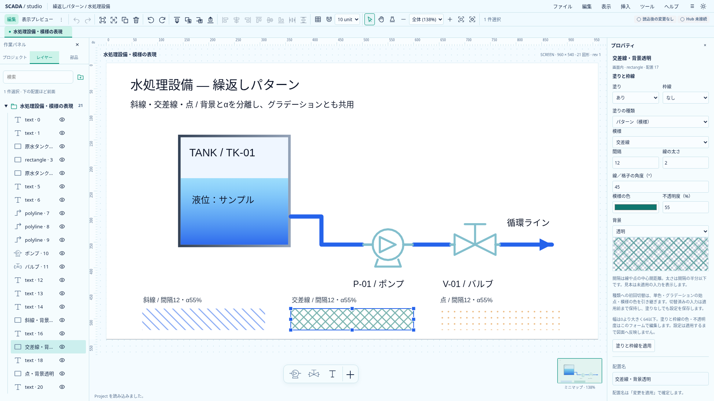

[ダーク](assets/frontend-ux/pattern-paint-dark.png)・[サンプル](../examples/pattern-paint.project.json)・[撮影スクリプト](../scripts/capture-pattern-paint.mjs)。

## 繰返しパターンのタイル計算（2026-10-20・日本時間）

[Astraレビューを反映した設計](pattern-paint-design.md)に従い、斜線・交差線・点のタイル形状を先行実装した。交差線を1回のfillとして描くことで、交点だけ半透明色が濃くなることを防ぐ。間隔・太さ・種類の制限と小数座標を単体3件で検証し、Chromium3件で交点のα・タイル境界・点の繰返しを実ピクセルで確認した。

Project・UIは0.18.0のまま。patternの保存契約・単独フォーム・Symbolと共通描画への接続は次工程。

## 2色線形グラデーション（2026-10-20・日本時間）

[設計](linear-gradient-design.md)に従い、Project 0.18.0で矩形／楕円の塗りをenabled＋solid／linearGradientの判別型へ整理した。塗りRGB・αをpaint内の一箇所へ保存し、旧root fill／colorAlphaの重複保存を拒否する。Text・Polyline・Symbol配置色は従来の単色契約を保持する。旧0.17.0の自動移行は行わない。

塗りなしでも設定を保持し、単独の明示適用フォームで両端の色・α・角度を編集する。未適用入力・IME・他フォームの事前検証を共用する。種類への初回切替は元の色を引き継ぎ、切替済みの入力は適用前まで保持する。Enterはフォーム全体の適用、blurでは一部を確定しない。

共通Primitiveで局所座標の端点を使い、回転・resize・Symbol・表示プレビュー・ミニマップを共用する。SVG IDは描画インスタンスごとに分ける。単色Symbolは両端RGBだけを上書きしてαを保持し、有効gradientを含むRGB一括編集は全体拒否する。無効gradient＋有効枠線の色変更は保存paintを保持する。Astraの読取専用レビューを反映し、説明文と実際のdraft挙動も一致させた。

検証: TypeScript全522件、Rust27件、型チェック（エラー・警告なし）、Clippyが成功。新規の共有契約ケースで両形状・定義内・異なる端点α・型／色／角度／未知欄・無効塗り・root色の重複・描画座標のoverflowを照合した。大きい有限寸法を一律に禁止せず、描画端点を表現できない場合を読込時に拒否する。JSON・図形clipboard v1・画像原本を伴うv2・Undo往復も確認した。

全ブラウザ458ケースを実行し445件が成功、13件が失敗した。12件は旧入力欄／保存先等の期待値を更新し、1件は未変更paintの項目順によってUndoが増える不具合を修正した。検証後の内容比較を既存の正規化比較へ統一し、不正入力を無変更として捨てない。失敗13件の再実行が全件成功し、修正後のgradient・塗り・αの関連20件も成功した。全体と再実行を合わせた確認であり、修正後に全458件を再実行したという意味ではない。

独自サンプルを両テーマで撮影し、液面のRGB・α変化をSVGから実ピクセルへ描いて検証した。本番ビルドは初期JS545.43kB（gzip 164.69kB）、既存の500kB超警告は継続。放射gradient・多点stop・図上ハンドル・pattern・αの一括編集は後続。

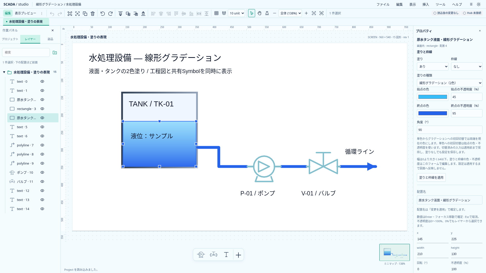

[ダーク](assets/frontend-ux/gradient-paint-dark.png)・[保存契約と操作](linear-gradient-design.md)・[読込用サンプル](../examples/gradient-paint.project.json)・[撮影スクリプト](../scripts/capture-gradient-paint.mjs)。

## 線形グラデーションの計算基礎（2026-10-20・日本時間）

[2色線形グラデーションの設計](linear-gradient-design.md)へAstraレビューを反映した。矩形・楕円の塗りをenabledとsolid／linearGradientの判別型へ整理し、RGBとαの二重保存を避ける。単独Inspector・Symbol配色・共通色の拒否・入力保護の規則を具体化した。保存契約の再編とUI／共通描画への接続は次工程。

`linear-gradient.ts`で局所座標の端点計算を追加した。0°左→右、90°上→下。四隅の射影範囲から端点を作り、非正方形の45°でも角度を維持する。幅・高さ・角度の有限性を検査し、不要な加算overflowを避ける。

TypeScript全492件が成功（新規6件）。直交方向・非正方形45°・縦横比／角度を変えた全四隅の射影・正規化・不正値・大きな有限座標を確認した。この段階でProjectモデルと画面は0.17.0のまま。アプリでgradientを編集・表示できる完成とはしない。

## 原本を含む図形clipboard（2026-10-20・日本時間）

[画像clipboardの第2段階](image-clipboard-design.md)を実装した。画像なしは従来v1・4MiB、画像ありはv2・原本16MiB／encoded32MiB／metadata4MiBに分ける。選択した図形・依存Symbol・必要原本だけを同梱し、同じhashは1回だけ保持する。背景や未選択の資産は含めない。単体画像8MiBとProject／Storeの上限も維持する。

copyイベントのDataTransferへawait後に書き込まず、ユーザー操作中にPromise付きClipboardItemをAsync Clipboardへ渡す。snapshotと原本leaseを確保し、原本をProject・Undoへ入れない。cutは書込成功後にscope・revision・選択・draftを再検証し、変わっていればコピーだけとして削除を中止する。対応外や拒否で参照だけのコピーへ切り替えない。

pasteでは全原本のbase64・hash・metadata・実decodeを一時Storeで確認し、資産・Symbol・配置をまとめてUndo1回で確定する。同じhashは既存資産へ共有し、別Projectの資産IDは新IDへ対応付ける。容量不足や欠損では部分配置せず、現在Projectと履歴を保持する。繰返し貼付のcacheには原本base64を残さない。Projectモデルは0.17.0を維持する。

検証: TypeScript486件、型チェック（エラー・警告なし）・ビルドが成功。新規単体7件で原本の一度だけの同梱・バイト一致・別Projectへの混在pasteとUndo・同hash共有・依存限定・破損／不足／余分／寸法不一致・Symbol禁止・pin／dispose・容量上限・資産ID衝突の再対応を確認した。

新規ブラウザ7件が両テーマの別ブラウザ往復、原本・配置名・依存Symbol、繰返し貼付とUndo／Redo、書込成功後のcut、対応外／拒否時のclipboard保持、遅延cutのcopy-only化、破損と容量不足、共有定義禁止と遅延検証取消に成功した。容量不足は1枚目の取込成功→2枚目失敗を起こし、Project・履歴を保持し、未参照原本のStore.countが0へ戻ることを再検証した。関連するOS貼付9件・画像配置6件・既存clipboard8件も成功した（関連計30ケースを複数実行で確認。全453ケースの再実行ではない）。途中のViteモジュール識別を使う検証fixtureを修正し、初回ナビゲーションの一時timeoutも再実行で成功した。

Astraの読取専用レビューでも、容量・snapshot／lease・原子的確定・ID再対応・scope往復・base64の保持範囲を照合した。両テーマで実際のcopy→別Project読込→pasteを撮影し、原本の実ピクセルを確認した。初期JS536.37kB（gzip 162.57kB）、ZIP chunk16.40kB（gzip 7.67kB）。既存の500kB超警告は継続。画像差替え・トリミング・Symbol内画像は後続。

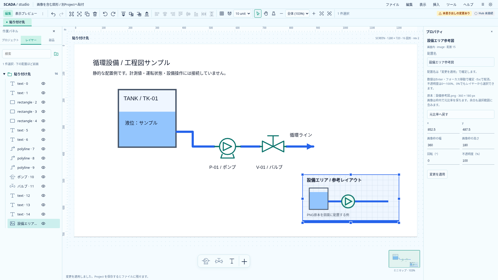

[ダーク](assets/frontend-ux/asset-clipboard-dark.png)・[撮影スクリプト](../scripts/capture-image-placement.mjs)（`--clipboard`）。

## OS画像の貼り付け（2026-10-20・日本時間）

[画像clipboardの段階設計](image-clipboard-design.md)へAstraレビューを反映し、第1段階の画面直置きを実装した。native pasteの文字列とFileを同期確保し、SCADA断片を優先、次に単一PNG／JPEGを既存の画像取込へ渡す。壊れたSCADA断片は付随画像へ切り替えず拒否する。入力欄・メニュー・Modal・previewでは横取りせず、共有定義では画像だけを理由付き拒否する。メニューpasteは明示操作でのみ`read()`を呼び、権限拒否時はCtrl／Command＋Vかファイル配置を案内する。

所有先・可視範囲・画面寸法を貼付開始時に固定し、clipboard待ちにもscopeのepochを追加した。画面／モードを離れて戻っても古い貼付・切取を再開しない。原本検査・共有・Undo・保存と未適用入力の保護は既存経路を共用する。Projectモデルは0.17.0を維持する。

検証: TypeScript479件、型チェック（エラー・警告なし）・ビルドが成功。新規単体5件で優先順位・形式／容量拒否・メニュー読取・代替形式・権限拒否を確認した。ブラウザのOS貼付9件と既存画像配置6件が成功し、既存clipboard8件も再検証して成功した（関連計23ケースを複数実行で確認、全446ケースの再実行ではない）。受渡しPNGのバイト一致とα128、原本共有、Undo／Redo、JPEG、壊れた画像、入力欄・preview・Symbol、draft取消／続行、遅延decode・遅延menu readを確認した。

初期JS532.33kB（gzip 161.06kB）、遅延ZIP chunk16.40kB（gzip 7.67kB）。既存の500kB超警告は継続。その後、図形と画像原本を一緒に運ぶ[第2段階](#asset-clipboard-progress)も追加した。

## 画面上のImage配置（2026-10-20・日本時間）

[Imageの設計](image-placement-design.md)に従い、Project 0.17.0で画面直置きの静止PNG／JPEGを追加した。現在参照の集計を背景＋Imageへ拡張し、最後の参照削除まで資産宣言を維持する。Rust／TypeScript／schema・現行サンプルを揃えた。最小ZIP profileは`banto-scada.image-project` version 1へ更新し、旧0.16.0・背景profileの自動移行は行わない。

ファイルメニュー「画像を配置」から原本を選ぶ。取込開始時の可視範囲と所有画面を固定し、元画像を拡大せず、画面内の可視部分の80%以内へ比率を保って置く。画面と重ならない場合は画面中心を使い、描画後に配置を見える位置へ出す。非同期取込の途中でProject・画面・編集scopeを離れた依頼は復活させない。

画像はcontainで枠に収め、余白も選択できる。枠の幅／高さ・座標・回転・配置opacity・配置名、移動・整列・複製・ロック／非表示・Undo／Redo・ミニマップ／表示プレビューを既存操作へ接続した。「元比率へ戻す」は枠の幅から高さを計算し、中心と回転角を維持する。原本名・寸法と配置名は独立する。画像にRGBや色αの欄は出さない。

画像混在の共通色は理由を示して無効にし、編集コマンドも全体を拒否する。画像のコピー／切り取りはclipboardへの書込み・削除の前に拒否し、画像を含む貼付データも拒否する。画像以外だけのclipboardは継続する。Symbol内画像はschemaと編集コマンドで拒否する。画像同梱保存では背景・配置画像・原本・設定を別環境へ復元する。

検証: TypeScript474件・Rust27件・Clippy・型チェック（エラー・警告なし）・本番ビルドが成功。新規単体6件で参照共有と最後の宣言除去、比率復帰の中心保持、混在色・clipboardの原子的な拒否、Symbol禁止と欠損参照、初期枠を確認した。RustもImage参照とSymbol内禁止を検証する。

新規ブラウザ6件が全件成功。両テーマの実撮影ピクセル・contain余白の選択・枠と回転・opacity・配置名と原本名・別ブラウザへの原本一致の復元、背景との共有・複製・削除・Undo、clipboard保護・色の無効化・遅延decode取消、ドラッグ／枠resize・ロック／非表示を確認した。関連する背景10件・既存clipboard8件・メニュー6件・新規Project5件・下部パネル8件・回転13件も成功した（複数回の関連検証を合算した計56件。現在の全437ケースを一括再実行したものではない）。

両テーマの実画面を撮影し、画像の実ピクセルを確認してから保存した。初期JSは529.88kB（gzip 160.92kB）、遅延ZIP chunkは16.40kB（gzip 7.67kB）。既存の500kB超警告は継続し、分割・性能評価は後続。OS画像clipboard・画像差替え・cover／stretch・トリミング・Symbol内画像・正式Runtimeの完成ではない。

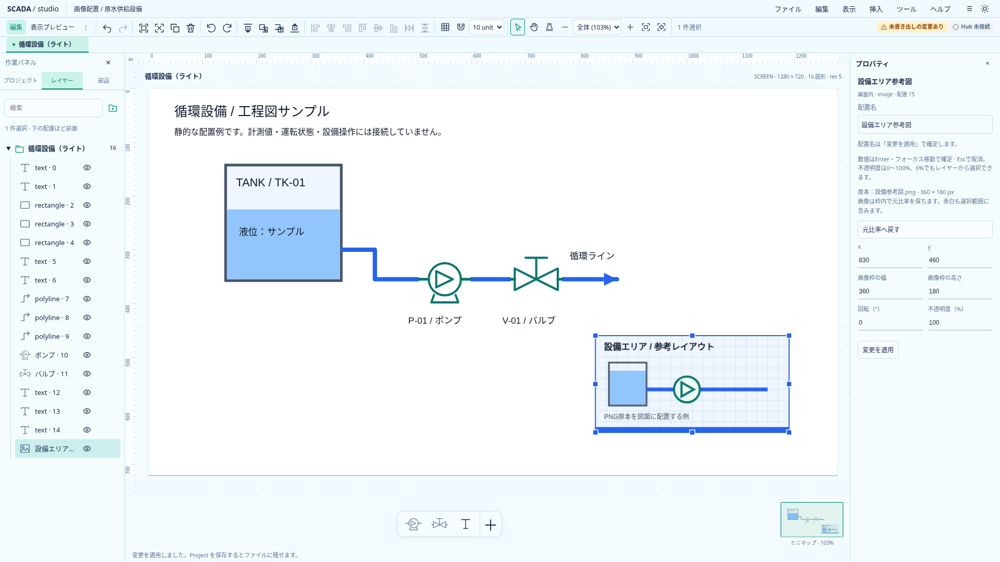

[ダーク](assets/frontend-ux/image-placement-dark.png)・[撮影スクリプト](../scripts/capture-image-placement.mjs)。画像素材は独自生成した静的な設備参考図。

## 背景画像と画像同梱の最小package（2026-10-20・日本時間）

[画像保存基盤の設計](image-assets-design.md)に従い、Project 0.16.0へassets宣言と画面の背景参照を追加した。Rust／TypeScript／schema・生成・現行サンプルを揃え、旧0.15.0は自動移行しない。資産IDの全体一意性・hash共有・参照一致・寸法／容量を共通fixtureで検証する。原本をProjectやUndoへ複製しない。

プロジェクトの画面設定から取込／差替え／解除し、contain・cover・stretch・元サイズと不透明度を明示適用する。差替えで表示設定を保持し、同じ原本は既存資産を再利用する。背景色と図形は保持し、Editor／表示プレビュー／ミニマップへ共通表示する。背景は通常選択に含めない。最後の参照解除で宣言を外しても、履歴が必要とする原本は保持し、Undo／Redoで復帰する。

画像ありは原本・宣言・checksumを同梱した `project.bantoscada`、画像なしはJSONで保存する。ファイルメニューを「Projectを開く／保存」に揃え、Ctrl／Command＋S・置換確認内も同じ保存経路を使う。画像付きの単体JSON、壊れたZIP・宣言不一致・不足／余分なentryを拒否する。fflate 0.8.3（MIT）は遅延読込し、宣言サイズと実展開量を制限する。

非同期書出しは開始snapshotと資産leaseを保持し、完了後も後続編集を未保存として残す。書出し中は対象名を示し、重複要求を案内する。Project差替え後のbaselineを更新しない。Astraレビューで指摘された「別画面・モードへ移動して戻ると古い取込が復活する」境界を、scope変更時の依頼失効で防いだ。IME確定Enterの誤適用も保護した。

検証: TypeScript468件・Rust26件・Clippy・型チェック（エラー・警告なし）が成功。新規契約・Store・package検証で原本共有・宣言照合・ZIP切れ／暗号化／重複／不正パス／実展開量・標準deflateを確認する。

ブラウザ全430件の実行では426件が成功し、4件は旧テストの不整合だった。背景用file欄とProject読込欄の区別、Text書式を保持するfixture、表示文字と計測ノードの区別、assetsを含む保存キーの期待値を更新した。アプリは変えず、該当ファイルと新規背景テストの計28件が全件成功し、追加GC検証1件を含む現在431ケースの成功を、全体実行と再検証を合わせて確認した（単一の431件実行ではない）。新規背景テストは両テーマ・別環境へのpackage往復・原本一致・Undo・保存snapshot・遅延decode取消・画面／モードを離れて戻る境界・IMEを含む。追加でRedo破棄後の原本回収も確認した。型チェック（エラー・警告なし）・本番ビルド・両テーマの撮影も成功。撮影後に背景選択を日本語ボタンへ揃え、関連16件と実filechooser経由の1件を再検証して成功した。初期JSは524.79kB（gzip 159.63kB）、遅延読込のZIP chunkは16.40kB（gzip 7.67kB）。既存の500kB超警告は継続し、初期読込の分割・性能評価を後続に残す。

撮影ではSVGのDOM確認に加え、画像のdecode完了と実際の撮影ピクセル（背景上のタンク枠線）を確認してから成果物を保存する。両テーマで再撮影し、工程図と背景が揃っていることを目視確認した。

この最小profileは背景画像を持ち運ぶ段階実装。正式package全体・directory・contentHashと競合・Design Domain・配布管理・Image配置・OS画像clipboardの完成とはしない。

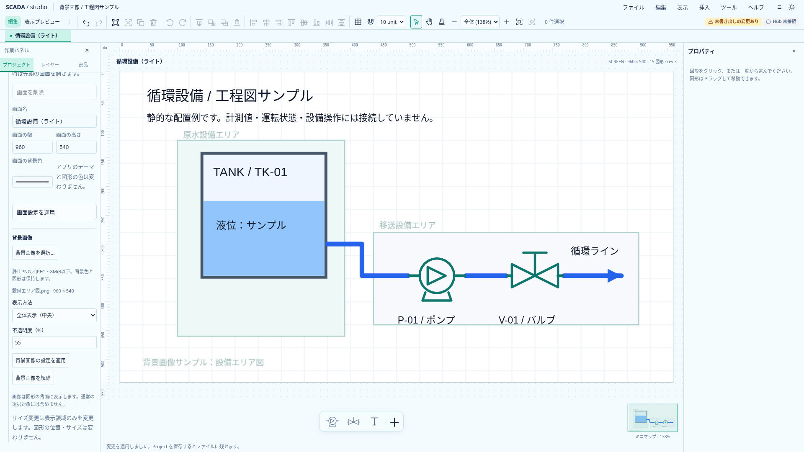

[ダーク](assets/frontend-ux/background-image-dark.png)・[撮影スクリプト](../scripts/capture-background-image.mjs)。画像は独自生成した設備エリアの静的サンプルで、外部リポジトリの画面・素材を取り込んでいない。

## 不変画像Storeの基礎（2026-10-20・日本時間）

Astraレビューを[画像保存基盤の設計](image-assets-design.md)へ具体化し、ProjectとUndoのJSONへ原本を複製しないAssetStoreを先行実装した。原バイトのhash共有・Blob／URLキャッシュ・内容と実decode・寸法／容量・APNG拒否・宣言一致を検証し、現在／履歴の保持集合と非同期I/Oのpinから安全に回収できるAPIを用意した。破棄済みStoreへ遅れて登録しない。

TypeScript442件と型チェック（エラー・警告なし）が成功。新規5件で不正内容・decode失敗・宣言不一致・方向による寸法交換・原本共有・metadataの防御コピー・pinとURL解放・処理中disposeを確認した。ブラウザ1件では実PNG／JPEGを生成してdecode・原本往復・PNGのα128・共有URLと回収を確認した。本番ビルドも成功し、既存のJSサイズ警告は継続。Project／履歴の保持集合・package入出力・背景画像UIへの接続は次工程。この時点で背景画像・Image配置の完成とはしない。

## 単色と枠線のα（2026-10-20・日本時間）

Astraの読取専用レビューを反映し、[仕様](color-alpha-design.md)に従ってProject 0.15.0へcolorAlphaとstroke.alphaを追加した。どちらも省略1・有限な0〜1。配置opacityを保持したまま塗り／文字／線／Symbol単色と枠線を別々に調整する。旧0.14.0は自動移行しない。

単一配置の色αは数値のEnter／フォーカス移動で確定し、枠線αは既存paintの明示適用を使う。塗りなし・Symbol定義色では保存αを表示して無効化し、再び有効にしたとき復帰する。既存RGB一括編集はαを保持。Symbol単色への切替は保存αも有効になると案内する。

描画は矩形／楕円のfillとstrokeを独立させ、線本体＋矢印と単色Symbolは合成後へ一度だけ適用する。Editor・プレビュー・ミニマップ・サムネイルと共用し、編集hit・選択枠・ハンドルを透過しない。gradient／pattern・α一括編集は後続。

検証: TypeScript437件・Rust25件・Clippyが成功。新規α6件と既存Symbol配色11件のブラウザ計17件が全件成功。別の実行で配置opacity4件・paint10件・共通色6件・線種8件も成功し、計45ケースの成功を確認した（単一の45件実行ではない）。型チェック（エラー・警告なし）・本番ビルド・両テーマ撮影も成功。初期JSは503.93kB（gzip 151.83kB）で既存のサイズ警告が継続する。線と矢印の透明hitは実座標のクリックで選択を確認し、Symbolの重なりはSVGをcanvasへ描画して非重複部と重複部のαが全て51/255になることを検証した。旧Symbol配色テストはText計測用ノードまで集計していたため、表示文字を対象に直し再検証した。

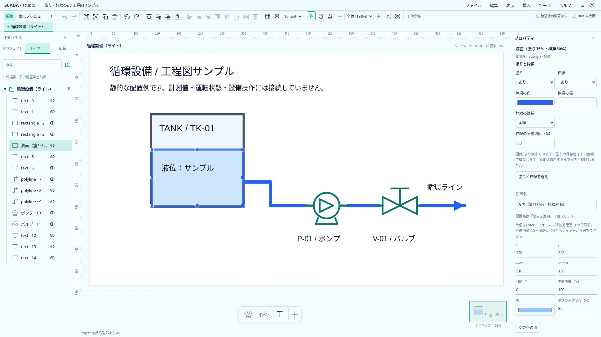

[ダーク](assets/frontend-ux/color-alpha-dark.png)・[撮影スクリプト](../scripts/capture-color-alpha.mjs)。

## 配置全体の不透明度（2026-10-20・日本時間）

[仕様](opacity-design.md)に従い、Project 0.14.0へ任意のopacity（省略1・有限な0〜1）を追加した。矩形／楕円・Text・Polyline・Symbol配置と共有定義内部に適用し、既存の寸法・色・paint・visible・lockを保持する。旧0.13.0は自動移行しない。

単一選択で百分率をEnter／フォーカス移動で確定、Escで取消。未適用の名称等を保持し、0%も透明hit領域とレイヤーから選べる。Symbolは合成後に一度適用し、子のopacity・両色モードと共用する。選択枠・操作ハンドルは不透明を維持。Undo／Redo・JSON・clipboardも保持する。一括編集とpaintごとの色αは後続。

検証: TypeScript434件、Rust24件とClippyが成功。関連ブラウザ22件（不透明度4件・数値10件・clipboard8件）が全件成功。先行実行で線種8件も成功し、新規Symbol検証のselect対象をformから実際のselectへ修正した。配置opacityの仕様変更による既存操作の変更はない。型チェック（エラー・警告なし）・本番ビルドと両テーマ撮影も成功。初期JSは501.55kB（gzip 151.35kB）で既存のサイズ警告は継続し、初期読込の分割を後続とする。

[ダーク](assets/frontend-ux/opacity-dark.png)・[撮影スクリプト](../scripts/capture-opacity.mjs)。選択したポンプを45%にし、静的な工程図で見え方を確認する。

## 実線・破線・点線（2026-10-20・日本時間）

[仕様](line-style-design.md)に従い、Polylineと矩形／楕円の枠線へ共通の任意lineStyleを追加し、Project／最小Runtimeを0.13.0へ更新した。省略は実線で、0.12.0は自動移行しない。Rust／TypeScript／schema／現行サンプル・生成経路・版の検証を同期した。描画用のdash配列は保存せず、破線は線幅の4／2倍・butt、点線は0／2倍・roundから求める。矢印は実線、hit領域は連続したままで、線種だけではboundsを変更しない。

単一の線はオブジェクトフォーム、枠線はpaintフォームで明示適用する。複数選択は現在の共通／混在と「変更なし」を区別し、指定した項目だけを変更して1回のUndoにする。幅・色だけの更新では線種を保持し、無枠を含む新設は既存の「あり」と色・幅の明示規則を維持する。なしと線種の矛盾・ロック混在・異種選択は全体を拒否する。Astraのレビューを受け、JSONの明示solidを単独paintで無変更適用しても履歴を増やさないようにした。

検証: TypeScript431件・Rust23件・Clippy・型チェック（エラー・警告なし）・本番ビルドが成功。新規ブラウザ8件で両テーマの単独適用・幅に比例する間隔・矢印・Undo／Redo／JSON・ミニマップ／表示プレビュー、明示solidの無変更、枠線プリセット、一括・非表示・無枠新設・指定解除、入力保護・ロック、点線の隙間、色・回転・両Symbol色モードを確認した。

既存65件を含む73件の実行では72件が成功し、残る1件は現在線種を加えた表示文言の期待値だった。アプリを変えず期待値を更新し、そのファイル8件の再実行が成功した。未適用線種を保った線幅だけのEnter確定も新規テストへ追記し、該当1件を再検証した。α・gradient／pattern・画像はこの区切りへ混ぜていない。

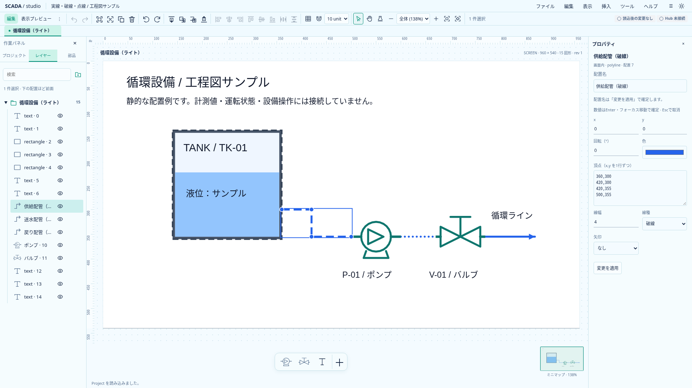

[ダークの実画面](assets/frontend-ux/line-style-dark.png)。配管3本とタンク枠の線種を表示する静的サンプル。[撮影スクリプト](../scripts/capture-line-style.mjs)を使用した。Astraが両テーマの線種・矢印・ハンドル・入力欄を確認し、重大なUI問題はなかった。

ビルドは成功したが、初期JS chunkが500.84kB（gzip 151.12kB）となり、既定500kB超のサイズ警告が出た。警告の上限を上げて隠さず、初期読込の分割・性能評価を後続へ記録する。

## 追加要望の用語確認を反映（2026-10-20・日本時間）

ユーザー回答により、画面取込は「別画面を現在の画面内へ埋込表示」、メッシュは「斜線・網掛け・点の繰返しパターン」、子ウィンドウは「監視画面内の小窓」と確定した。[拡張設計](scada-graphics-runtime-extension-design.md)・基準設計書・READMEを同期した。以下の前日記録の確認待ちは、この回答で解消している。

埋込Viewは同一Projectの画面参照・viewport・循環／使用先検証、Popupは通常の非モーダル詳細と確認Modalの区別を設計へ追加した。初期の読み取り表示を提案し、設備context／正式Runtimeの完成とは区別する。自由メッシュグラデーション・他製品converter・OS別窓を今回の対象から外し、線種・α→画像資産／背景・Image→gradient／pattern・画像貼付→埋込View／画面内Popupの順を具体化した。アプリ・schemaは変更していない。

## 画像・描画表現・運用画面の追加検討（2026-10-19・同日後続）

ユーザーの「切りの良いところで検討」の指示に従い、フォルダードラッグを84022d5で保存した後、[拡張検討案](scada-graphics-runtime-extension-design.md)を作成した。背景画像・画像取込／貼付、塗り／gradient／mesh、線種、透過色／α、Faceplate、画面取込、子ウィンドウ、kioskをAstraと照合し、実現方法・相対コスト・依存関係・受入条件を記載した。

追加機能は未実装。paint・線種・α→AssetStoreと持ち運べる保存→背景／Image→画像clipboard・gradient→画面／設備context・Runtimeの順を提案する。自由メッシュ・他製品converter・OS別窓／本番kioskは、初期の描画拡張より大きい工程として分ける。画面取込・メッシュ・子ウィンドウの意味はユーザーへ質問済みで、方式は未確定のまま比較する。今回の検討で認証を再開したり、正式package／Runtimeの完成扱いにしたりしない。Astraの最終レビューを受け、単色Symbolの配置色αを合成後のグループへ一度だけ適用する規則も提案へ追記した。

## フォルダー自身のドラッグによる親変更（2026-10-19・同日後続）

Astraのレビューに従い、[仕様](folder-drag-design.md)のフォルダー名／アイコンから親を変更する操作を実装した。配置dragと判別型のセッション・token・scopeを共用し、既存move-folderへ接続する。保存する変更は対象フォルダーのparentIdだけで、配下の所属ID・座標・描画順・表示／ロックと配置選択を保持する。展開記号・操作ボタンは移動元にせず、終了後のclickで開閉しない。

自己・子孫・部分木の高さを含む16段超過をhoverから禁止し、moveカーソル・強調を出さない。移動元と配下の件数・非表示数、移動先／禁止理由を別行で案内し、長い文の後ろに理由が隠れないようにした。現在の親へは履歴なし、ルート解除・入力確認・Undo／Redoを既存経路で扱う。元親も開始時に固定し、確認後に変わっていたら中止する。

検索・対象自身の開閉を保持し、成功時は移動先の祖先を展開する。Astraの追加レビューにより、各スクロールframeで対象の存在・元親・世代／所有先・編集可否も確認する。深さの全件計算はframeへ入れず、sourceとdestinationの検証を分離した。Project 0.12.0・Rust・schemaは変更していない。Astraが両テーマの案内・移動先枠を確認し、重大なUI問題はなかった。

検証: TypeScript427件、型チェック（エラー・警告なし）、本番ビルドが成功。新規ブラウザ9件で両テーマのnative drag、locked／非表示配下と選択・開閉・座標の保持、自己／子孫／深さ・ルート／同値、Undo／Redo／JSON、入力確認・取消・不正値、検索条件外への移動、共有定義・世代変更、Undoによる元親変更での自動スクロール停止を確認した。既存の配置drag10件、フォルダーUI／保存16件、部品配置8件も成功した。

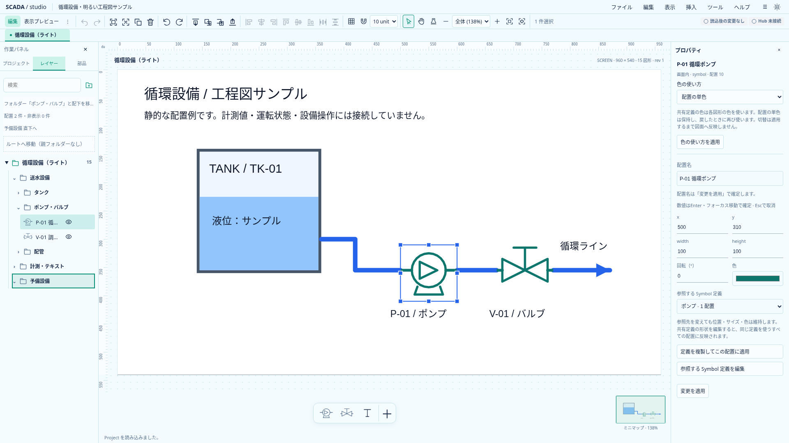

[ダークの実画面](assets/frontend-ux/folder-drag-dark.png)。配置選択を保ったまま、フォルダーと配下の親を変更する案内状態。[撮影スクリプト](../scripts/capture-folder-drag.mjs)を使用した。

## Textの書式と枠内表示（2026-10-19・同日後続）

Astraの提案に従い、[仕様](text-style-design.md)の単一Text書式と枠内レイアウトを実装した。Project／最小Runtimeを0.12.0にし、必須style（文字サイズ・標準／太字・左／中央／右）をRust／TypeScript／schema／生成経路／現行サンプルへ同期した。サイズは枠のリサイズから独立する。1行の文字列だけを保存し、改行の貼付を黙って削除しない。

文字サイズは既存の数値確定・Esc・IME保護、太さ・揃えは既存の明示適用を使い、他の未適用入力・Undoを維持する。実SVG外形と1.2倍行高で枠内を判定し、上下中央・左右余白2 unitで描画する。静的文字は書記素を保って末尾省略し、数値と取得状態は一部の桁を残さず全体を###へ置換する。さらに小さい枠はベクター警告、空文字は空表示にする。全文と枠不足の理由は編集用hit領域にも渡す。Quality／解決状態・Projectの元文字列・文字サイズは変更しない。

Astraのレビューを受け、非表示中の計測失敗をパネル表示復帰で再試行し、フォント完了／失敗にも追従するようにした。値・書式・枠寸法のkeyを追跡し、無関係な配置編集・選択・回転・ズームでは再計測しない。共通Primitiveにより表示プレビュー／ミニマップ／共有Symbol・サムネイルでも同じ表示契約を使う。フォント選択・同梱、複数行・縁取り・一括書式は後続。

検証: 書式・1行境界の共通fixtureをRust／TypeScriptで確認。新規ブラウザ9件と既存タグ表示3件が成功し、両テーマの書式・Undo／Redo／JSON、枠寸法と独立した文字サイズ、日本語・絵文字の省略と外形、数値状態の全体置換、極小枠・空文字、入力保護、回転と共有Symbol、非表示計測失敗からの復帰、フォント更新と余分な再計測の抑制を確認した。関連ブラウザ66件、TypeScript425件・Rust22件・Clippy・型チェック（エラー・警告なし）・本番ビルドが成功した。旧形式の大きなTextは枠寸法を保持して既定文字サイズを上限512へ収め、その境界をRust／TypeScriptで追加確認し、旧形式を含む工程図ブラウザ2件も再実行した。

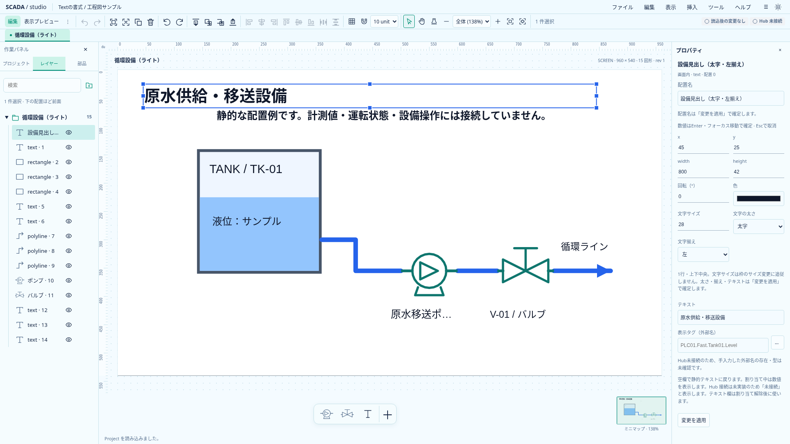

[ダークの実画面](assets/frontend-ux/text-style-dark.png)。見出しの太字・左揃え、説明文の中央揃えとポンプ名の省略を示す静的サンプル。[撮影スクリプト](../scripts/capture-text-style.mjs)を使い、保存された元文字列は省略しない。Astraが両テーマの実画面を確認し、文字書式の操作・確定案内・省略表示に重大な問題はなかった。

## 編集途中の履歴変更に対する中断（2026-10-19・同日後続）

移動・サイズ変更・配管頂点のドラッグ開始時に、その画面または共有定義のモデル参照を保持する。Undo／Redo・削除などで同じIDの所有先が別のモデルへ切り替わった場合も、古い開始値から確定せず、プレビューとpointer captureを解除する。表示プレビューへの切替とEscも同じ中断処理を使う。

開始時の数値入力保護が同期確定した後で参照を保持するため、未適用の数値を確定してから始める通常のドラッグは継続する。画面・共有定義のIDだけで判定せず、Svelteの深いProxy化を避けた参照比較を使う。effectに加えpointer move／upの入口でも再確認し、更新とイベントの順番による古い編集を防ぐ。Project 0.11.0・保存契約・Rustは変更していない。

検証: 新規ブラウザ15件が成功。回転33°の配置について、3種類のドラッグそれぞれでUndo・Redo・削除・表示プレビュー切替後に古い編集が残らないこと、例外が発生しないこと、数値の同期確定直後でもドラッグと独立したUndoが機能することを確認した。既存の移動・数値確定・サイズ変更・回転・スナップ・範囲選択の関連ブラウザ36件、TypeScript421件、型チェック（エラー・警告なし）、本番ビルドも成功した。

## 配置の回転（2026-10-19・同日後続）

[仕様](object-rotation-design.md)に従い、Project・最小Runtime・ローカルパッケージを0.11.0へ更新した。全配置に必須rotationを追加し、保存JSONは0以上360未満の有限角だけを受け付ける。UI／コマンドでは負角・360°以上を正規化する。同値・整数回転だけの違いは履歴を増やさない。旧0.10.0は自動移行せず拒否し、既存0.1.0の移行は角度0を補う。Rust／TypeScript／schema／現行サンプル・組込部品と生成経路を同期した。

単一選択のInspectorで角度をEnter／フォーカス移動により確定する。Esc取消、IME、十進数検証、他のdraft・ロック・非表示の既存規則へ接続した。共通の左右90°はツールバーと編集メニューへ置き、共有定義・他配置・位置・寸法を保持する。画面や定義内の矩形・楕円・Text・Polyline・Symbol配置を同じ契約で扱う。回転ハンドル、任意pivot、共通中心の複数回転は後続。

Editor／表示プレビュー／ミニマップ・定義サムネイルで回転を描画し、Symbol配置と定義内の回転を合成する。pivotはDOMではなくlocal layout／幾何bounds／宣言viewportの中心から決める。回転後の保守的な描画外接範囲を選択・整列・範囲選択・方向キー・貼付・選択fitへ共用する。選択外接枠の空白角はクリック領域にせず、回転した本体側のhit領域で背後の配置を遮らない。

サイズ変更は回転した本体辺へdeltaを逆変換し、反対辺を固定するorigin補正を行う。角は画面上の点をスナップし、辺は法線に射影して主成分軸でスナップする。PolyLineの頂点編集はpivot変化を補正し、未操作頂点を保持する。プレビュー・確定に同じ計算を使い、回転0の丸め・不動域・スナップは従来と揃える。リサイズカーソルも実際の向きへ合わせる。

Astraが保存契約・生成経路・描画合成・頂点補正・0°互換をレビューし、透明hit領域の修正を反映した。検証: TypeScript421件・Rust21件・Clippy・型チェック・本番ビルドが成功。新規ブラウザ13件で両テーマの描画経路、数値／90°・正規化／同値・Undo／Redo・JSON、サイズ／頂点の固定点、共有定義と非正方形Symbol、lock／hidden・IME／draft、狭幅、範囲選択／整列／選択fit、空白角のクリックと右クリックの共通グループを確認した。

全体ブラウザ369件を実行し、342件が成功した。残り27件は旧形式に補う角度0の期待値、新しい描画グループへのセレクター追従、小さいSymbol viewportでのCSS寸法量子化の判定に整理できた。アプリを変更せずテストを現行契約へ更新し、その27件を含む5ファイル42件の再実行が成功した。倍率の許容は固定小数桁からSVG寸法の1/64 CSS pxへ換算する判定にし、実際の描画精度を検証する。Astraが両テーマの実画面を確認し、角度入力・選択枠・ハンドル・操作密度に重大な表示問題はなかった。

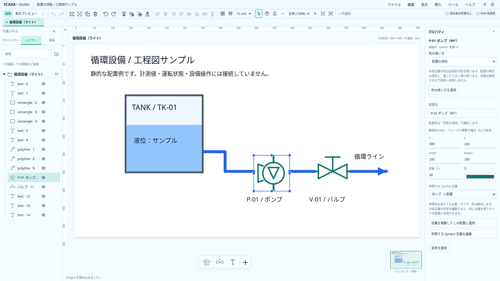

[ダークの実画面](assets/frontend-ux/rotation-dark.png)。共有定義・ラベル・配管を変更せず、配置の角度を90°としている。配管の自動接続は行わない。[撮影スクリプト](../scripts/capture-rotation.mjs)を使用した。

## 配置回転の計算基盤（2026-10-19・同日後続）

Astraの提案に従い、次の工程を[配置の回転](object-rotation-design.md)とした。現時点では**座標計算の基盤だけで、回転の保存・UI・Rendererへの接続は未実装**。Projectは0.10.0を維持する。

有限角の正規化・正確な直角変換・local／所有先座標変換・描画外接範囲、反対辺を固定する回転後リサイズ、未操作頂点を固定する暗黙pivot補正を独立した関数にした。角は画面上の点、辺は法線への射影と主成分軸でスナップする。既存リサイズの丸めは既定で維持し、新しい計算では吸着後の二重丸めを避ける。Astraレビューにより、微小な負角が360へ丸まる境界を修正し、頂点pointerの不動域・delta丸め・両軸吸着を既存関数と比較した。方向キーはpointerの前処理とは分離する。

検証: 新規19件を含むTypeScript416件・型チェックが成功。既存のサイズ変更ブラウザ2件と本番ビルドも成功し、現在のアプリ操作を維持している。次に保存モデル・描画経路・数値UI・既存操作への接続を行い、そこで回転機能の完了を判定する。

## レイヤー配置のドラッグによる所属変更（2026-10-19・同日後続）

[仕様](layer-drag-design.md)に従い、配置の名称／アイコンからフォルダーへドロップして所属を変えられるようにした。選択済みの行からは選択全件、未選択行からはその1件を対象にし、選択自体は変えない。フォルダー行全体を移動先として強調し、挿入線や描画順変更には使わない。ドラッグ中は対象・非表示件数・移動先パスと、ルートへ外す領域を表示する。案内を一行に固定し、移動先の長さによる行位置の変化を防ぐ。開始時のnative dragを妨げないよう、案内は最初のdragoverから表示する。

既存のset-folderとdraft guardを共用し、ドロップ前に対象ID・所有先・世代、ドロップ時に移動先を固定する。確認後に存在・ロック・所有先・移動先を再検証する。非表示配置を含めて明示移動し、ロック混在は全体を拒否する。専用MIMEのセッショントークンを使い、外部・部品パレット・取消済み・旧世代のドロップを編集しない。配置行・目・錠・操作ボタン・フォルダー自身を誤った移動先／移動元にしない。

座標・サイズ・描画順・表示・選択を保持し、複数所属変更を1回のUndoにまとめ、同値では履歴を増やさない。成功時は移動先を展開し、検索を保持する。長い一覧では端でスクロールし、取消・タブ／所有先切替でも停止する。Astraの読取レビューを受け、スクロールの各frameでもセッションの有効性を確認するようにした。Project 0.10.0・Rust・schemaは変更していない。

検証: 型チェックはエラー・警告なし、TypeScript397件、本番ビルドが成功。新規ブラウザ10件で両テーマの実マウス操作、単独／複数・未選択行・非表示・ロック、閉じた移動先、ルート解除、同値、Undo／Redo／JSON、入力取消／不正値／適用、native dragendを挟む保留、外部token・取消・タブ・世代、長い一覧の自動スクロールと停止、共有定義の所有先を確認した。既存のフォルダー操作と部品ドラッグ配置の関連ブラウザ21件も成功した。

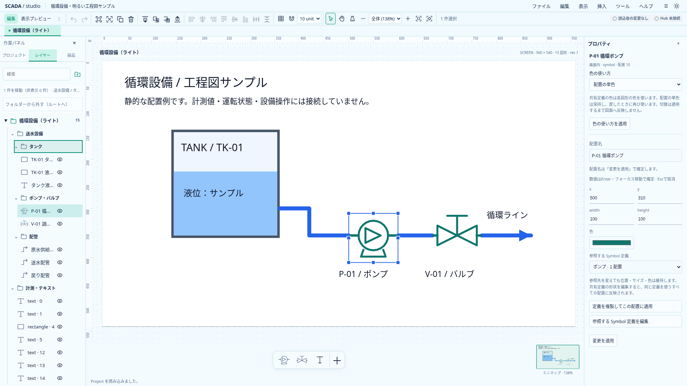

[ダークの実画面](assets/frontend-ux/layer-drag-dark.png)。撮影は所属変更前の案内状態で、移動先の直下へ入ることを示している。[撮影スクリプト](../scripts/capture-layer-drag.mjs)を使用した。

## 選択範囲の表示（2026-10-19・同日後続）

[仕様](selection-view-design.md)に従い、ツールバーの全体表示の隣と表示メニューへ「選択範囲を表示」を追加した。キャンバス／レイヤーの配置行では修飾キーなしFも使える。1回だけ表示中心と倍率を合わせ、以後の選択やモデル変更へ自動追従しない。Project 0.10.0・Rust・Schemaは変更していない。

対象は枠線・線／配管・矢印を含む描画外形で、Symbolは既存のviewportを使う。各配置を画面の表示領域と交差させてから外接範囲を求め、画面外の配置同士だけで空の範囲が対象になることを防ぐ。非表示を含む場合は全体を無効にし、黙って除外しない。選択なし・参照切れ・全件画面外も理由付きで無効とする。visibleなlocked配置は許可する。部分的に画面外なら表示可能部分へ合わせ、完全に画面外の件数を通知し、選択と座標を維持する。

ルーラー・スクロールバーを除く実寸から各辺32 CSS pxの余白を取り、初回のバー出現時には実寸を再計算する。手動倍率の25〜400%を優先し、25%でも入らない対象は全体が収まると保証しない。極端な値のoverflowを拒否する。表示は画面別の既存viewへ保存し、「全体表示」でfitへ戻せる。

ツールバーのポインタ操作ではフォーカスを奪わず、有効／不正な数値のdraftも保持する。Project・選択・revision・Undoを変更しない。Tabやメニューを開くための通常のフォーカス移動では、既存の数値blur確定の規則を維持する。Fは入力・IME／229・repeat・修飾キー・メニュー・Modal・タグ選択中、連続配置と図形／サイズ／頂点・範囲選択・パンの途中には使わない。

検証: 型チェック（エラー・警告なし）・TypeScript393件・本番ビルドが成功。新規ブラウザ10件で両テーマの倍率・中心と一回表示、JSON／履歴不変、単独／複数、メニュー、数値draft保持、Fの境界とドラッグ、locked／hidden・画面外、1280×720・共有定義、25／400%を確認した。既存の倍率・ホイール・ミニマップ・数値確定・メニューとの関連ブラウザ34件も成功した。 Astraが両テーマの実画面と仕様を確認し、重大な追加修正はなかった。

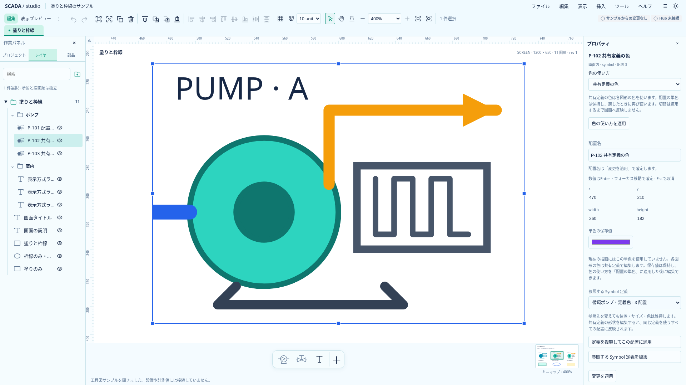

[ダークの実画面](assets/frontend-ux/selection-view-dark.png)。共有定義の色で表示する配置を選び、表示だけを変更している。[撮影スクリプト](../scripts/capture-selection-view.mjs)で撮影した。

## 矩形・楕円の枠線一括編集（2026-10-19・同日後続）

[仕様](selection-outline-design.md)に従い、矩形・楕円だけの複数選択へ枠線の有無／色／幅を追加した。Project 0.10.0のpaintを使い、schemaは変更していない。現在の枠線あり／なし件数を示し、色・幅は枠線ありの対象だけで共通値／混在を集計する。全件なしでは現在の色・幅も「なし」と表示する。

変更指定は、枠線「変更なし」・色未指定・幅空欄から始める。既存枠線は色だけ／幅だけを変更でき、未指定属性と塗りを保持する。枠線なしを含む場合は「あり」と色・幅の両方を明示する。指定値は新設対象だけでなく選択全体へ適用する。「なし」と色・幅の同時指定はフォーム・コマンドの両方で拒否する。指定解除ボタンは値と未適用入力の保護状態を解除する。

共通set-outline-styleコマンドが、patch・型・ID・重複・色・幅・新設時の必要属性・ロックを事前検証する。非対応型を含む場合は対象を暗黙抽出せず全体拒否する。非表示対象は件数を示して編集でき、表示へ戻さない。同値・HEXの大文字／小文字だけの違いでは履歴を増やさず、明示適用を1回のUndoへまとめる。座標・本体寸法・塗り・所属・順を保持する。

フォームは世代／所有先／選択IDを固定し、独立draft・通常Enter／IME・全フォームの一括事前検証へ接続する。blurでは適用しない。共有定義の明示編集中は内部図形だけを変更し、親配置のモード・色・寸法を保持する。Symbolの単色描画では既存の単色指定を使い、定義色の配置では定義の枠線色を使う。

検証: 型チェック（エラー・警告なし）・TypeScript386件・本番ビルドが成功。新規ブラウザ10件で、部分指定・同値・Undo／Redo／JSON、枠線新設・明示解除・混在集計、指定解除とdraft保護、他フォーム不正時の一部適用なし、ロック・非表示・IME、混在型、両テーマの1280×720と共有定義を確認した。新規10件を含む、既存の共通色・線／配管・塗りと枠線・複数選択との関連ブラウザ35件が成功した。Astraが両テーマの実画面とフォームを確認し、最終コミットを妨げる重大なUX問題はなかった。

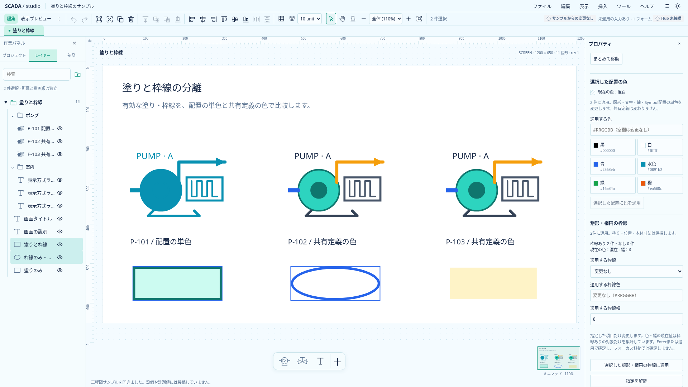

[ダークの実画面](assets/frontend-ux/selection-outline-dark.png)。現在の線幅は6で、幅8は未適用入力として表示している。[撮影スクリプト](../scripts/capture-selection-outline.mjs)で撮影した。

## 矩形・楕円の塗りと枠線（2026-10-19・同日後続）

[仕様](shape-paint-design.md)に従い、Project・最小Runtime・ローカルパッケージを0.10.0へ更新した。矩形・楕円のshapeに必須paintを追加し、塗りの有無と枠線の有無／色／幅を分離した。旧0.9.0は自動移行せず拒否する。既存0.1.0の移行は塗りあり・枠線なしを補い、ID・幾何・revisionを保持する。

単一選択のInspectorに独立した明示適用フォームを追加した。塗りなしでも保存色を保持し、無効時は下の色欄を無効にして説明する。枠線なしはnullとし、再有効化時に前の線色／幅を復元する保証はしない。枠線の詳細は有効時だけ表示し、0より大きく64以下の幅を検証する。未適用入力・通常Enter／IME・複数フォームの事前検証・ロック・Undo／Redoへ接続した。

共通色は有効な塗りと枠線を変え、無効な項目を有効化しない。両方無効の形状を含む場合はフォームとコマンドの両方で全体拒否する。現在の共通色も有効な描画色から求める。非表示の配置は既存の明示編集を維持する。

本体寸法と枠線込みの描画外形を分け、幅／高さ・サイズハンドルは本体、選択枠・範囲選択・整列・中心配置・貼付は描画外形を使う。Symbolの単色は有効な塗り／枠線色だけを上書きし、線幅と有無を保持する。定義viewportは自動拡張せず、枠線が領域外へ出る場合は編集画面で案内する。テーマで図形の色を書き換えない。

ファイルメニューへ独自の塗り・枠線サンプルを追加した。複数選択の枠線一括編集、Textの縁取り・破線・角丸、回転・幾何グループ・動的状態は未実装。

検証: TypeScript380件・Rust20件・型チェック・Clippy・本番ビルドが成功。新規ブラウザ8件で両テーマの描画とミニマップ／プレビュー、明示適用・入力取消・一括事前検証、共通色、ロック・IME、Undo／Redo／JSON、狭幅、Symbolの単色／定義色と切れの案内を確認した。全体ブラウザ325件が成功した。数値入力を既存の十進数規則へ揃え、HEX色の大文字／小文字だけの差で共通色の履歴を増やさない調整後、新規9件を含む関連26件・TypeScript380件・型チェック・本番ビルドも成功した。Astraが両テーマの実画面をレビューし、重大な追加修正はなかった。

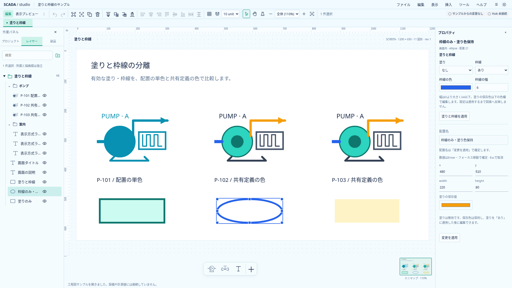

[ダークの実画面](assets/frontend-ux/shape-paint-dark.png)。枠線のみの楕円を選択し、保存中のpaintと同じ値を表示している。[撮影スクリプト](../scripts/capture-shape-paint.mjs)で撮影した。

## Symbolの静的な配色（2026-10-19・同日後続）

[配色の仕様](symbol-color-design.md)に従い、Project・最小Runtime・ローカルパッケージを0.9.0へ更新した。Symbol配置に必須のcolorModeを追加し、Rust／TypeScript／Schema／サンプル・新規生成を同期した。0.8.0は自動移行せず拒否する。新規配置は配置の単色を使い、プロパティの「色の使い方」で共有定義の色へ明示切替できる。定義色の使用中も単色の保存値を保持し、切替で再利用する。

定義内の矩形・楕円・文字・線・矢印の静的配色を、Editor・表示プレビュー・ミニマップで共用する。定義の配色更新は定義色の配置へ反映し、単色の配置色を保持する。非表示の内部図形を表示へ戻さない。レイヤー／部品の小さなアイコンは種類表示を維持し、実配色のプレビューとして扱わない。

共通色で定義色のSymbolを含む場合は対象件数を示し、「配置単色へ切り替える」の明示チェックを必要とする。初期OFFで色だけの入力では適用できない。共通コマンドも確認フラグ・型・ID・ロックを検証し、全体を1回のUndoにまとめる。共有定義や配置の幾何・所属を変更しない。モードの未適用入力は独立フォームと既存の入力保護へ接続し、数値の確定と混同しない。

ファイルメニューに独自作成の「Symbol配色サンプルを開く」を追加した。既存のファイル置換・入力保護を共用する。状態別表示・タグ連動・型付きslot・Equipment／Faceplateは未実装。

検証: 型チェック・TypeScript339件・Rust19件・Clippy・本番ビルドが成功。新規ブラウザ11件で両テーマのEditor／preview／minimap、定義更新、モードと他フォームの入力保護、明示単色化、ロック・非表示、Undo／Redo、複製と別Projectへの貼付、サンプル読込と狭幅を確認した。全体ブラウザ317件が成功した。Astraの実画面レビュー後、単色の保存値と描画色を区別するラベル・説明の全幅化を調整し、関連ブラウザ18件・型チェック・本番ビルドも成功した。

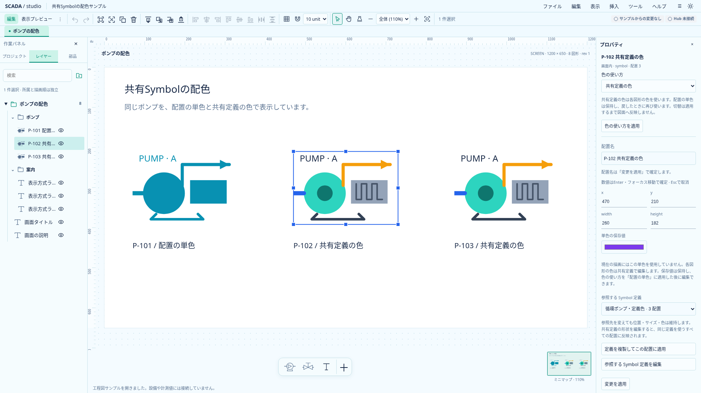

[ダークの実画面](assets/frontend-ux/symbol-colors-dark.png)。同じ共有定義の3配置で、配置単色と定義色を比較している。

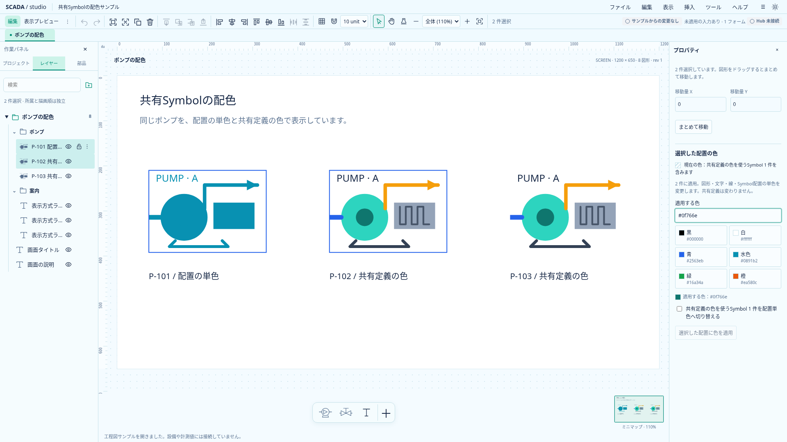

[ダークの単色化フォーム](assets/frontend-ux/symbol-color-conversion-dark.png)。色コードは未適用・単色化チェックはOFFで、図面へ変更済みの状態ではない。[撮影スクリプト](../scripts/capture-symbol-colors.mjs)で撮影した。

## 線・配管の一括スタイル編集（2026-10-19・同日後続）

Astraレビューに従い、複数選択のInspectorへ線・配管の線幅／終端矢印を追加した。現在値（共通値／混在）と適用する指定を分け、線幅は空欄、矢印は「変更なし」から始める。線幅だけなら既存の矢印を、矢印だけなら各線幅を保持する。矢印の「なし」は明示的な解除で、「終端」は最後の頂点と示す。数値は0より大きく64以下とし、0・不正文字・非有限値は空欄と区別して拒否する。

明示適用／通常Enterで、指定した項目だけを1回のUndoへまとめる。blurでは一括変更しない。入力を空へ戻すと変更指定を解除し、IME変換中のEnterを適用しない。同じ値への適用は履歴・revisionを増やさず、適用後は未指定へ戻す。図形・文字・Symbolを含む混在選択では線だけを暗黙抽出せず、線・配管だけの選択が必要と案内する。Symbol配置から内部の線は変更しない。

共通set-line-styleコマンドが全ID・重複・型・patch・ロックを事前検証する。ロック混在は全体拒否。非表示の線は対象件数を示して明示変更でき、表示へ戻さない。位置・頂点・色・所属・描画順・選択・表示中心を保持する。共有定義の明示編集中なら内部の線だけを変え、親配置は保持する。既存のPolyline属性を使い、schema 0.8.0は変更しない。

フォームは読込世代・所有先・選択IDを固定し、色・移動量など他の未適用入力と共存する。全フォームを事前検証してから適用し、不正入力で一部だけ確定しない。選択変更・モード切替・ファイル操作の既存draft guardを共用する。

検証: 型チェックはエラー・警告なし、TypeScript305件・本番ビルドが成功。新規ブラウザ8件で、部分指定・明示解除・同値・Undo／Redo／JSON、不正値と他フォームの事前検証、混在型・非表示・ロック、IME、共有定義、倍率・スクロール・選択、両テーマの1280×720を確認した。既存の共通色・数値確定・Inspector・範囲選択・共有Symbolの関連32件も成功した。長いInspectorをスクロールしても見出しと閉じるボタンを上端に残す調整後、両テーマの狭幅と既存Inspectorの関連9件が成功した。変更ファイルの整形・差分・相対リンクを確認した。

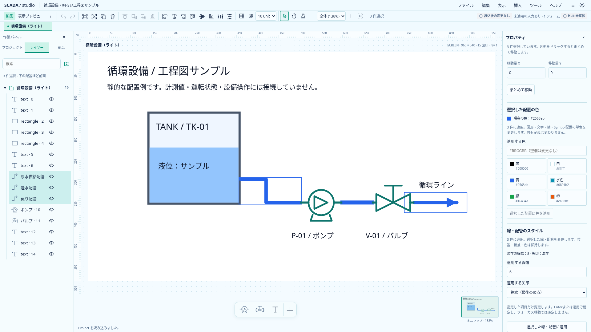

[ダークの実画面](assets/frontend-ux/selection-line-dark.png)。`scripts/capture-selection-line.mjs`で撮影。線幅6・終端矢印は未適用入力で、図面へ確定済みの値とは区別する。

## レイヤーフォルダーの階層UI（2026-10-19・同日後続）

[詳細仕様](layer-folders-design.md)に従い、左のレイヤーを整理フォルダーの階層表示へ接続した。検索欄は1行を保ち、ルート作成アイコンを隣へ追加する。フォルダー行は開閉とフォーカスのみ。配置選択・Inspector・未適用入力を保持し、フォルダーを幾何グループとして扱わない。各階層でフォルダー順と配置の描画order順を使い、所属と描画順が独立すると明示した。

右クリック・操作ボタン・Shift+F10／Context Menuキーから子作成・改名・親変更・空削除へ進む。F2はフォーカス中のフォルダーを改名し、Deleteは空削除の確認を開く。以前の配置を誤って複製・削除・切り取らない。非空なら配置・子フォルダーの件数を示し、再帰削除や暗黙移動をしない。

配置の右クリック「配置の所属を変更」は単一／複数選択に対応し、所有先・対象名・非表示件数・現在の所属と移動先を表示する。現在値が共通なら同値確定は無効。混在なら未選択で、ルートを含めて明示選択が必要。Astraレビューに従い、開いてEnterを押すだけの誤解除を防いだ。同名フォルダーはフルパスとorderの補助表示で識別する。親変更では自己・子孫を除外し、子孫を含む16段上限を超える候補を無効にする。実行時もモデルで再検証する。

フォルダーパス・配置名等を横断検索し、一致した祖先と配下を一時展開する。空フォルダーも検索し、検索解除で通常の開閉へ戻す。検索外の選択とInspector入力を保持する。キャンバスから条件内の配置を選ぶと祖先を開き、通常の移動確定後も移動先を辿れる。表示中心は動かさない。

各ダイアログは確定までモデルを変えず、既存draft guardを通してから所有先・対象ID・読込世代を固定する。取消で起点へフォーカスを戻す。IME、背景の保存・Undo・複製、ネイティブUndoが背景の入力へ届く境界も保護した。確定ボタンはBantoのsolid／on-solidを使い、両テーマの通常・hoverで4.5:1以上を検証した。

検証: 型チェックはエラー・警告なし、TypeScript300件・本番ビルドが成功。新規ブラウザ13件で作成・改名・空削除・所属・親変更・Undo／JSON、ロック・非表示、検索・開閉・入力保持、canvasからの祖先展開、共有定義内部、再読込世代、両テーマ・1280×720・キーボード・IME・文字コントラストを確認した。全体ブラウザ298件が成功した（8.7分）。同じcanvas選択の再クリックでも祖先を開く調整後、フォルダー・Binding・共有定義使用先の関連21件を再確認して成功した。両テーマの実画面、整形・差分・相対リンクも確認した。

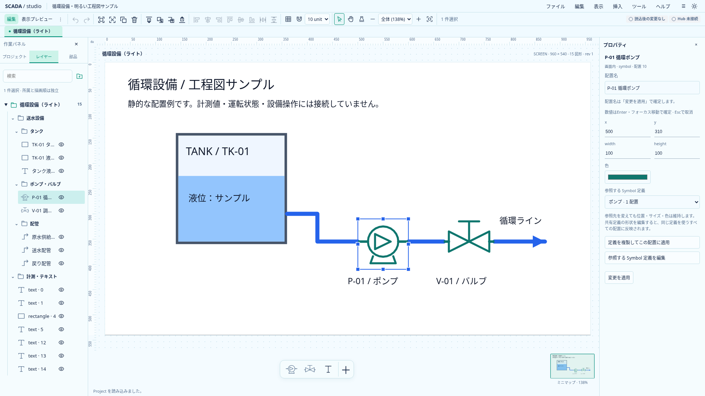

[ダーク](assets/frontend-ux/layer-folders-dark.png)、所属変更ダイアログの[ライト](assets/frontend-ux/layer-folder-target-light.png)／[ダーク](assets/frontend-ux/layer-folder-target-dark.png)。`scripts/capture-layer-folders.mjs`で撮影した実画面。工程図は静的な編集サンプルで、Hub値や運転状態とは接続していない。

## レイヤーフォルダーの保存契約（2026-10-19・同日後続）

[フォルダー設計](layer-folders-design.md)に従い、Project・最小Runtime・ローカルパッケージを0.8.0へ更新した。画面／共有Symbol定義に必須のfolders配列、配置に任意のfolderIdを追加し、Rust・TypeScript・Schema・現行サンプル・新規生成・組込Symbolを同期した。旧0.7.0の自動移行は追加せず拒否する。既存0.1.0移行は空のfoldersを補う。

UUIDの全体一意性、同じ所有先の親と所属、循環・自己参照、256件／16段の上限、名前・orderを検証する。作成・改名・親変更・所属変更／解除・空削除のコマンドを追加した。所属変更はロック混在で全体拒否、非表示配置も明示対象へ含める。フォルダー自身の整理は配下ロックを継承しない。座標・描画順・共有参照・表示を変えず、同値は履歴を増やさない。

画面・定義の複製と独立コピーはfolder ID・parentId・folderIdも再発行する。配置の同一所有先での複製は所属を保持する。clipboard断片の最上位配置は所属を外し、貼付先は常に直下。依存定義は階層を保ち、別Projectへ取り込む場合はIDを再発行する。同一Projectでは現存定義を再利用する。

この区切りは保存契約と共通編集処理のみ。左の階層表示・フォルダーのメニュー・移動先ダイアログ・パス検索は次の工程で、現在の平坦な一覧から操作はできない。

検証: 型チェックはエラー・警告なし、TypeScript単体296件、Rust18件、clippy、本番ビルドが成功。共有35ケースを画面／定義それぞれで確認し、全図形・Unicode・上限・不正参照を検証した。新規ブラウザ3件でメタデータ追加前後の図面画素一致、プロパティ変更と保存、画面／定義の複製、OS clipboardによる別Projectへの貼付を確認した。全体ブラウザ285件では282件が成功し、既存テスト3件の旧移行期待値・保存キー一覧・上限定義fixtureへfoldersを補った。修正後の対象3件を再確認して成功した。

## 標準固定レイアウトへの復元（2026-10-19・同日後続）

Astraのレビューに従い、「表示」と常設メニューに「標準レイアウトに戻す」を追加した。起動時と復元時の既定値を共通定義にし、左右幅240px／288px・タグ参照高さ240px、左／プロパティ／タグ参照、メニューバー・ミニマップ・ルーラーを標準へ戻す。狭幅や利用可能な高さの制約による表示時のclampは維持する。タグ参照がない場合は空のパネルを無理に描画せず、表示設定だけを戻す。

作業中のアクティブタブ・ツリーの開閉・タグ参照の展開と検索・部品検索・レイヤー検索・部品表示形式・選択・未適用入力・テーマ・お気に入り内容は保持する。フォームを再生成せず、draftを適用／破棄せず、確認ダイアログも追加しない。Project・revision・Undo／Redo・schema 0.7.0を変更しない。浮動／再ドッキング・名前付き配置保存は未実装。

一括非表示の旧復帰状態を解除し、以後の表示切替が復元前の構成を復活させないようにした。寸法と表示をまとめて反映し、手動倍率と図面の表示中心を保持する。fitはfitのまま再計算する。パネルのリサイズ中なら操作を取り消し、その後のポインター移動で標準寸法が上書きされないようにする。結果を短い通知で知らせ、常設メニューへフォーカスを戻す。

幅・高さ・メニュー／ミニマップ／ルーラーの設定は既存のBanto UI設定へ保存する。保存できない項目があっても画面上の復元は維持し、警告を1件にまとめる。テーマ・お気に入り等の保存キーは変更しない。左右／下部の表示は従来どおりタブ内の表示状態で、任意の構成を名前付きで保存する機能は追加しない。

検証: 型チェックはエラー・警告なし、TypeScript単体215件・本番ビルドが成功した。新規ブラウザ10件で複数draft・タブ／ツリー／検索／テーマ／お気に入り・JSONの保持、一括非表示の復帰解除、再読込、参照高さ・展開・検索、25%／100%／400%／fit、保存失敗の警告1件、進行中のリサイズ取消、両テーマの狭幅を確認した。全体ブラウザ282件では281件が成功した（7.8分）。既存ツールバーのEnd／左端からの折返しが「下揃え」を末尾とする固定期待値で失敗したため、新しく追加した垂直の等間隔配置へ更新した。末尾の狭幅表示も確認に追加し、アプリコードを変更せずツールバー5件が成功した。相対リンク・整形・差分も確認した。

## 中心の等間隔配置（2026-10-19・同日後続）

Astraのレビューに従い、ツールバー・編集メニュー・複数選択の右クリックへ「中心を水平方向に等間隔」「中心を垂直方向に等間隔」を追加した。3件以上で有効になり、既存boundsの中心で並べて両端を固定し、中間だけを移動する。図形間の隙間を均等にする機能とは区別して、操作名とガイドへ明記した。異なるサイズの図形では重なりが残る場合がある。

操作軸以外の座標・サイズ・形状・表示順・名前・Binding・共有参照を保持する。同じ中心座標なら既存orderで順序を安定させ、両端が同じ中心なら変更しない。スナップは適用せず小数座標を保持する。浮動小数点の丸めだけの差は変更しない。同値再適用ではrevision・履歴を増やさず、全体の変更はUndo1回にまとめる。

共通コマンドで件数・IDの存在と重複・方向・有限な中心座標を検証する。ロックが含まれる場合は全体を拒否し、非表示の配置は件数を示した明示操作の対象へ含めて表示状態を保持する。未適用の色等は既存draft guardで事前検証し、入力の適用と配置の変更を別々にUndoできる。共有定義を明示編集中なら内部図形が対象になり、親の配置データを変更しない。schema 0.7.0を維持する。

検証: 型チェックはエラー・警告なし、TypeScript単体215件・本番ビルドが成功した。新規ブラウザ6件で両方向、両端固定・同値適用・Undo／Redo・JSON、スナップON、色draftの事前検証、ロック・非表示、共有定義、両テーマ・狭幅・キーボードを確認した。関連する既存操作を含む回帰52件も成功した。複数選択の既存2件とF1ガイド1件も成功し、今回の関連検証は55件。ライト／ダークの実画面、図面の画素一致、相対リンク・差分も確認した。直前の共通色編集では全体266件が成功しており、今回の変更後は影響する領域の回帰検証を行った。

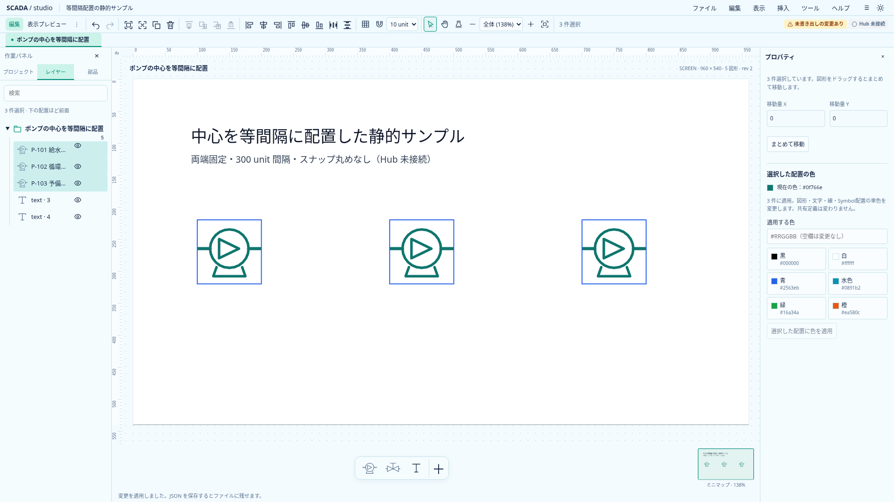

[ダークの実画面](assets/frontend-ux/distribute-dark.png)。`scripts/capture-distribute.mjs`は静的サンプルの3台を実際のコマンドで等間隔にして撮影する。Hubや設備操作には接続しない。

## 複数選択の色編集（2026-10-19・同日後続）

Astraのレビューに従い、Inspectorの複数選択へ「選択した配置の色」を追加した。「現在の色」と「適用する色」を分け、混在色は中立の斜線チップで示す。適用する色の欄は常に未指定から始め、空欄では変更しない。色コード（#RRGGBB）と色名・コード付きの6候補を用意し、候補クリックは入力だけを更新する。黒を暗黙に指定せず、設備状態を示す色名にも置き換えない。任意色はコードで指定でき、独自／ネイティブの色ピッカーは今回追加しない。

候補のキーボード操作、部分入力・不正値の保持、妥当な値だけの入力プレビュー、IME中のsubmit抑止に対応する。色を空欄へ戻すとdraftも解除する。blurでは適用せず、適用／通常Enterで全対象へ反映する。適用後は色の指定欄を未指定に戻す。同色への適用は大文字・小文字を区別せず履歴・revisionを増やさない。

共通set-colorコマンドが、対象IDの存在・空／重複・色の形式・ロックを適用直前に検証する。一部だけを変更せず、全体を1回のUndoへまとめる。配置の座標・名前・表示・Binding・Symbol参照を保持する。画面内では単色Symbolの配置色だけを変え、共有定義を変更しない。共有定義を明示編集中なら内部図形の色を変え、配置による単色指定は維持する。色以外の共通スタイル・状態別表示・透明度・線幅の一括編集は未実装。

対象件数と非表示件数を明示し、非表示の未ロック配置は再表示せずに変更できる。ロックを含む選択はフォームを閲覧専用にする。入力は読込世代・画面／共有定義・選択IDで区切り、適用先を再検証する。選択変更・画面切替・読込は既存draft guardを使い、移動量等と同時にdirtyなら全フォームを事前検証してから適用する。schema 0.7.0を維持する。

検証: 型チェックはエラー・警告なし、TypeScript単体209件・本番ビルドが成功した。新規ブラウザ6件で混在・未指定・取消・不正入力・同値適用・Undo／Redo・JSON、移動量との事前検証、ロック・非表示、共有定義、両テーマ・狭幅・キーボード・IMEを確認した。全体ブラウザ266件も成功した。両テーマの実画面・図面の画素一致・相対リンク・差分も確認した。

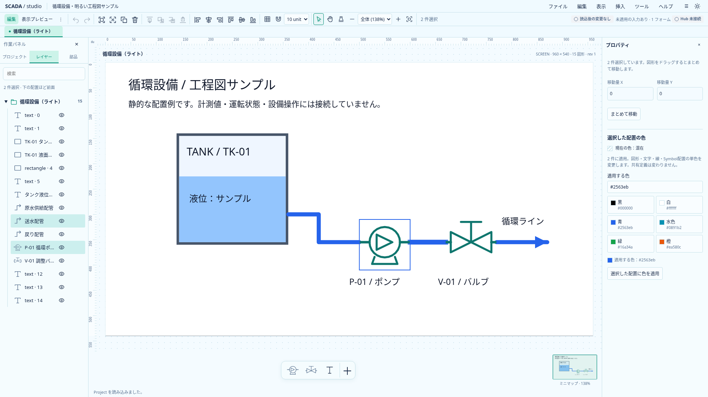

[ダークの実画面](assets/frontend-ux/selection-color-dark.png)。`scripts/capture-selection-color.mjs`で撮影した。画像の色指定は未適用入力で、図面へ確定した状態とは区別する。

## Project名とF2／F1（2026-10-19・同日後続）

「ファイル」→「プロジェクト名を変更」で左のプロジェクト設定を開き、名前欄へフォーカス・全選択する。フォームは未適用入力として保持し、適用ボタン／通常のEnterで共通コマンドへ渡す。blurでは確定せず、IME変換中のEnterやsubmitでは変更しない。前後空白をtrimし、空白だけ・契約の上限を超える名前を拒否する。正規化後の同値適用は履歴を追加しない。

Project名の変更は既存manifest.nameだけを使い、UUID・画面・配置・共有定義・タグ参照・schema 0.7.0を変えない。ヘッダーとプロジェクトの根へ反映し、Undo／Redo・JSON読込／書出し・未書き出し判定へ含める。ダウンロードのファイル名や保存先を変更する機能ではない。フォームは読込世代とProject IDで区切り、別の操作によるモデル更新でも未適用の文字列を上書きしない。別のフォームもdirtyなら既存の入力保護を使う。

F2は、フォーカス中の画面タブ／画面一覧行ならその画面名、レイヤーの配置行ならその配置名へ移動する。キャンバス本体では単一選択の配置名へ進む。同じ対象の未適用入力は保持し、別の対象へ移る場合はdraft guardで取消・適用・破棄を選べる。非表示の配置はレイヤーから明示して編集でき、ロック中やキャンバスの複数選択では名前欄へ移動しない。入力欄・メニュー・ダイアログ・表示プレビュー・IME・リピート・修飾キー併用ではF2による移動を行わない。右クリックにも「配置名を変更」を追加した。

F1は既存の操作ガイドを開く。他のダイアログや処理中には重ねず、閉じると起点へフォーカスを戻す。画面名・Project名のフォームにもIME中の誤submit防止を適用した。

検証: 型チェックはエラー・警告なし、TypeScript単体205件と本番ビルドが成功した。新規ブラウザ6件と既存の画面右クリック・左ツリーを含む14件を確認済み。非表示のプロパティ・折り畳んだ設定の復帰も含め、全体ブラウザ260件が成功した（6.9分）。

## 静的な図面の表示切替（2026-10-19・同日後続）

Astraのレビューに従い、`visible`（省略時true）を全図形と共有定義内部へ追加した。レイヤーの目のアイコンと単一選択の右クリックから変更する。表示プレビューにも反映する静的な設定であるとtitle・操作名・ヘルプに示す。非表示にする操作は対象の選択を解除し、入力は既存draft guardで保護する。再表示は位置・重なり・選択を勝手に変えず、同値設定は履歴を追加しない。入力適用と表示変更は別々にUndoできる。

非表示の配置をエディタ・ミニマップ・表示プレビューの描画、ヒット対象・範囲選択・全選択から外し、サイズ・頂点・選択枠も描画しない。レイヤーには薄い行と目の状態を残し、Inspectorからも再表示できる。共有定義内部の表示変更は全参照配置と部品・管理用サムネイルへ反映する。全図形が非表示でも保存データや定義を削除せず、編集画面に再表示の案内を出す。案内は表示プレビューへ含めない。

非表示は編集権限ではない。レイヤーから選択した配置はInspectorで編集でき、ロック中は既存の閲覧専用を維持するが、表示切替自体は許可する。選択中の非表示件数をツールバー・レイヤー・Inspector・右クリックの対象に明示する。キャンバスからの方向キー移動・非表示混在のドラッグ・Delete・切取は全体を拒否する。レイヤー・明示メニュー・Inspectorからの移動・整列・削除等は許可し、既存のロック制約は維持する。一部だけを黙って変更しない。

コピー・貼付・複製はvisibleとlockedを保持し、非表示の貼付をキャンバスで自動選択しない。タグ参照・Symbol使用先も保持し、一覧に非表示を示して、再表示せずにInspectorへ移動できる。Hubへの読取要求は表示状態から切り離して保持する。編集だけの一時非表示・動的な表示条件・フォルダー単位の切替・グループ継承は後続。

Project・最小Runtime・ローカルパッケージを0.7.0へ更新し、TypeScript・Rust・共有Schema・サンプル・新規生成を同期した。旧0.6.0の自動移行は追加せず拒否する。リリース前の互換性を保証しない方針を維持する。

検証: 型チェックはエラー・警告なし、単体202件・Rust17件（SDKモック接続2件を含む）・本番ビルドが成功し、Rust Clippyも警告なし。新規ブラウザ9件で工程図／ミニマップ／表示プレビュー、非表示選択の編集・再表示・履歴、全非表示の復帰とロック併用、入力の取消と適用、キャンバスと明示操作の分離、コピー・貼付・JSON、共有定義・サムネイル、タグ使用先、両テーマ・狭幅・キーボードを確認した。全体ブラウザ254件では253件が成功した（6.7分）。既存のパネル切替テスト1件は、表示ボタンのaria-pressedも選択件数へ含めたため失敗した。図形選択ボタンへ検証対象を限定し、同じケースを3回再確認した。アプリの変更は不要だった。長い配置名が目のアイコンへ重ならないよう行の余白を調整し、両テーマのブラウザ境界検証・実画面・相対リンクも確認した。

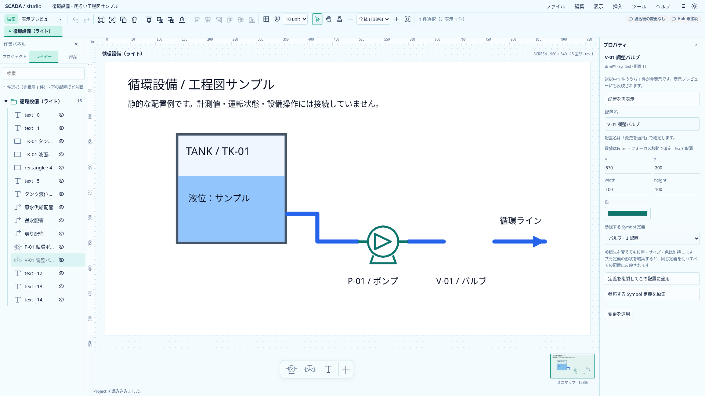

[ダークの実画面](assets/frontend-ux/visibility-dark.png)。`scripts/capture-visibility.mjs`で撮影した。

## 配置の編集ロック（2026-10-19・同日後続）

Astraのレビューに従い、静的な表示切替と分けて編集ロックを実装した。全図形と共有定義内部へ任意のboolean `locked`（省略時false）を保存し、単一配置のロック専用コマンドを使う。レイヤーの錠アイコンと単一選択の右クリックから変更でき、ロック中はレイヤーで選択してInspectorからも解除できる。入力があれば既存のdraft guardを通し、取消・無効入力ではロックしない。入力の適用とロックは別々にUndoでき、同値設定は履歴を追加しない。

ロックしても図面・ミニマップ・表示プレビューに描画する。キャンバスのヒット対象・範囲選択・全選択から外し、レイヤーからは選択可能にする。選択枠は表示するが、サイズ・頂点ハンドルは表示しない。Inspectorはロック中の配置を含む場合に閲覧専用となり、変更不能の理由を表示する。解除・共有定義への移動は閲覧専用フォーム外に残す。錠アイコンには名前付きラベルと状態を付け、通常はホバー／フォーカス時、ロック中は常時表示する。

共通コマンドでも適用直前に検証し、名前・座標・サイズ・文字・Binding・参照先・独立コピー化・移動・整列・重なり順・削除・直接の複製を拒否する。ロックを含む複数選択は一部だけを変更しない。別の非ロック配置の並べ替えに伴うorder再採番は許容する。コピーは読取操作として許可し、切り取りはクリップボード書込前に拒否する。貼り付け・画面や共有定義全体の複製はロック属性を保持し、貼り付けたロック配置をキャンバスで自動選択しない。

これは権限や共有状態の固定ではない。Symbol配置をロックしても参照する定義の変更は反映し、定義内部のロックも内部配置の直接編集だけを防ぐ。Undo／Redo・Project置換・画面全体の管理操作もロック状態ごと扱う。静的な表示切替・編集時だけの非表示・動的な表示条件・グループ継承・ロック権限は未実装。

Project・最小Runtime・ローカルパッケージを0.6.0へ更新し、TypeScript・Rust・共有Schema・サンプル・新規生成を同期した。旧0.5.0の自動移行は追加せず拒否する。ロックはHubの読取投影やタグ参照を変更せず、認証延期とPLC直結禁止を維持する。

検証: 型チェックはエラー・警告なし、単体190件・Rust16件（SDKモック接続2件を含む）・本番ビルドに成功し、Rust Clippyも警告なし。新規ブラウザ7件でキャンバス／範囲／全選択の除外、Inspectorと解除・履歴、混在選択の原子的拒否、入力取消・適用・不正数値、OSクリップボード書込前の切取拒否とコピー／貼付・JSON往復、共有定義の移動・内部頂点、両テーマ・狭幅・キーボードを確認した。全体ブラウザ245件では243件成功、既存のパネル高さ100%と補助パネル復元の2件がタイムアウトした。後者は起動直後の編集ボタンの安定待ちで、前者は表示中心の待ちで停止した。アプリ・テストコードを変更せず、同じ2件を各3回（計6回）再実行し成功した。整形・相対リンク・差分・両テーマの図面画素一致も確認した。

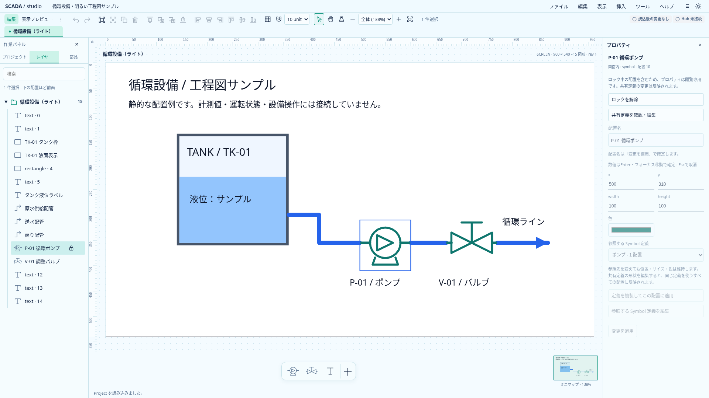

[ダークの実画面](assets/frontend-ux/edit-lock-dark.png)。`scripts/capture-edit-lock.mjs`で撮影した。

## 配置名とレイヤー・使用先検索（2026-10-19・同日後続）

Astraのレビューに従い、表示／ロック／グループと切り離して任意の配置名を追加した。画面の基本図形・Text・折れ線／配管・Symbol配置と、共有定義内部の図形へ適用する。Inspectorの単一選択フォームで入力し、既存の適用・draft guard・Undo／Redoを使う。名前は最大200コードポイントの単一行、制御文字や前後空白を保存しない。フォームの入力上限は既存UIと同じ200 UTF-16単位。入力時の前後空白をtrimし、空欄はname属性自体を削除する。同値適用は履歴を追加しない。

名前がない場合は従来の種類・表示順（Symbolは共有定義名）へフォールバックする。重複名を許容し、識別・参照解決はUUIDで行う。複製・OSクリップボード・別Projectへの貼付でも名前を保持し、自動連番・一括改名は追加しない。画面上に名前を自動描画せず、Text文字列・タグ外部名・Symbolの共有定義名も変更しない。定義内部の名前はその定義の変更として扱う。

レイヤーは配置名・種類・従来の表示・ID・Text／外部名で検索する。改名で検索条件から外れても選択とInspectorを保持し、条件外の選択があることを一覧に表示する。検索は図面上の可視性を変更しない。長い名前は省略表示と全文titleを使う。Symbol使用先・タグ参照一覧も配置名で検索し、UUIDによる既存の移動・入力保護を維持する。

Project・最小Runtime・ローカルパッケージを0.5.0へ更新し、共通JSON Schema・TypeScript・Rust・サンプル・新規Project生成・現行検証を揃えた。旧0.4.0を自動移行せず拒否し、既存の0.1.0読込経路だけ現行形式へ更新する。クリップボードの外枠v1は維持するが、内部Projectは現行schemaで検証するため、旧0.4.0の断片も拒否する。リリース前の後方互換性を保証しない方針を維持する。

検証: 型チェックはエラー・警告なし、本番ビルドとTypeScript単体178件・Rust15件（SDKモック接続2件を含む）が成功。共有fixtureで各図形と定義内部の名前をRust／TypeScriptの両方で検証した。新規ブラウザ5件で検索条件外の選択保持、入力の取消／破棄・IME・同値適用、重複名とJSON往復・解除、共有定義内部、同名Symbol／Textの使用先から正しいIDへの移動が成功した。Unicode空白・区切り・末尾改行を含む共通fixtureを追加して、単体178件とRust15件を最終確認した。Rust Clippyも警告なし。ライト／ダークの実画面を撮影・確認した。全体ブラウザ238件も同じコードで成功した（6.7分）。

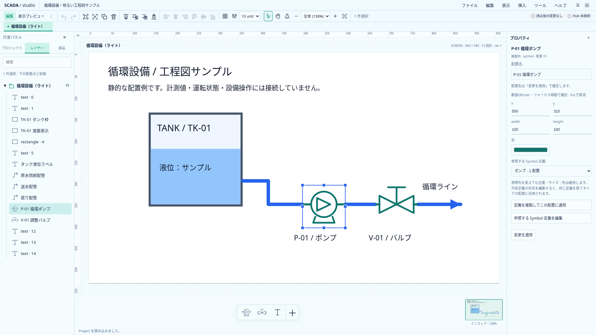

[ダークの実画面](assets/frontend-ux/placement-names-dark.png)。`scripts/capture-placement-names.mjs`で撮影した。工程図の内容と色は両テーマで同じ。

## 新しいProjectと標準ファイルキー（2026-10-19・同日後続）

「ファイル」と常設メニューに「新しいProject」を追加した。新しいProject／画面には個別のUUID v7を発行し、白い960×540の「画面1」だけを持つschema 0.4.0として編集モードで始める。履歴・選択・定義編集・読込世代をリセットする。空の初期内容は「新しいProject・未書き出し」と表示し、内容変更がなければ離脱確認を出さない。編集後は未書き出し表示となり、Undoで空の基準へ戻ると確認不要に戻る。

Ctrl／Command＋Nは新規作成、OはJSONのファイル選択、S／Shift＋Sは既存のJSONダウンロード。Shift＋Sは名前付き保存・保存先選択・既存ファイル上書きを実装したという意味ではない。ブラウザの予約キーが優先される環境ではメニューを使う。N／OはShift併用・IME・リピート・処理中・確認ダイアログ中に実行せず、タグ選択中はブラウザの新規ウィンドウ／開く／保存も抑止する。

新規作成は既存のdraft guard→内容変更確認を共用する。キャンセルではProject・選択・入力・履歴を保ち、適用して続行で内容が変われば、その後にProject置換の確認へ進む。開く操作はファイル選択とschema検証が成功してから入力の確認へ進むため、選択取消・不正ファイルではdraftに触れない。ファイル読込request・読込世代・input要素の接続を再確認し、古い非同期読込や以前のファイル選択先から現在のProjectを上書きしない。

検証: 型チェックはエラー・警告なし、単体150件（独立ID・現行契約の往復・初回編集Undoの2件を追加）・本番ビルドが成功した。新規ブラウザ5件で空の新規作成・編集モード・離脱基準・JSON往復・独立ID、入力／内容の取消と適用、Ctrl＋Oの選択取消・不正ファイル、Modal／IME／repeatの境界、古い非同期読込の拒否を確認した。全体ブラウザ233件も同じコードで成功した（6.1分）。

## 数値Textへのサンプルタグ選択（2026-10-19・同日後続）

改訂Cのfixture UXとして、プロパティの外部名入力横からBanto Modalでタグ選択を開けるようにした。割付先の画面・Text配置・フィールドと要求型を表示する。候補は静的metadataの6件で、サンプル候補・Hub未接続・実在や接続成功は未確認と常設表示する。現在値は表示しない。数値8型を互換対象にし、「互換タグのみ」を外すとbit／stringも不適合の理由付きで閲覧できるが、割付できない。既存SymbolへのBOOL割付を追加したものではない。

階層はconnection／groupに相当する明示的なparent metadataから作り、externalNameのドットから推測しない。名称・外部名・型・単位・説明・階層名で検索し、一致階層は一時展開する。単クリック・ツリーの上下左右／Home／Endは候補と詳細の確認、フォルダーのEnterは開閉に限る。タグ行のEnter・ダブルクリック・「選択して入力」だけが外部名を返す。検索Enter・IMEの確定キーでは選ばず、非表示候補・不適合・フォルダーでは確定できない。

返却先はInspectorの未適用入力だけで、選択時にはProject・revision・Undoを変更しない。他の未適用項目と同じ「変更を適用」→JSON保存を使う。キャンセル・Esc・閉じるでは元の入力を保持し、起点へフォーカスを戻す。Projectのローカル読込世代・画面／配置・入力要素・catalog参照／世代・型を返却直前に確認する。対象変更や同じIDのファイル再読込でも古い候補を書き戻さない。手入力と空欄による割付解除は残し、存在・型が未確認であると表示する。

ダイアログ内では共通保存・Undo等を編集画面へ渡さない。入力欄以外のCtrl／Command＋Z・Yはブラウザの既定Undoも抑止し、背景の入力へ影響しないようにする。検索欄の文字編集は標準操作を使う。数値Textの保存契約とProject schema 0.4.0は変更しない。

実catalogやSDK／Hostとの接続、取得中／失敗・切断時の取得状態、catalog更新の実配信、大規模catalogの性能評価は後続。上流SDK契約は実接続の工程で再確認し、今回独自の購読やPLC直結を追加しない。catalogの世代拒否はmetadata helperの契約検証、Project再読込は実ブラウザで確認する。

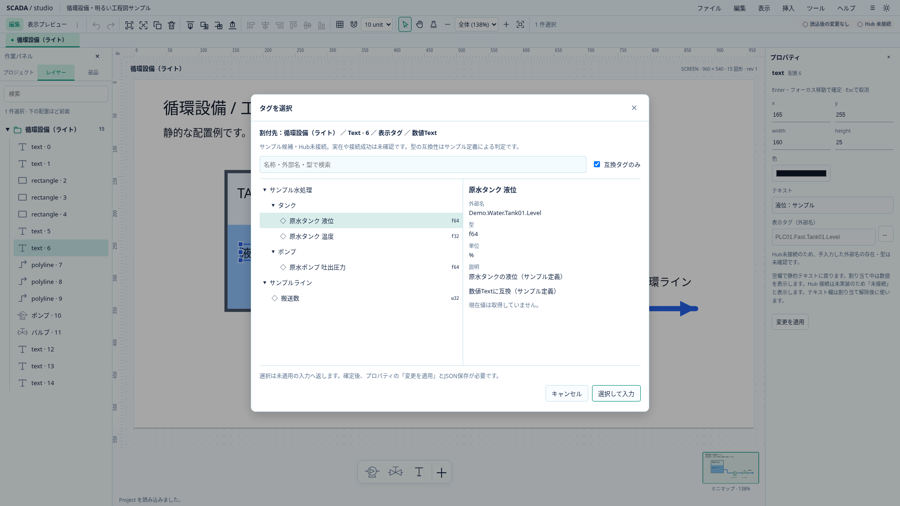

[ダークの実画面](assets/frontend-ux/tag-picker-dark.png)。`scripts/capture-tag-picker.mjs` で撮影した。

検証: 型チェックはエラー・警告なし、単体148件（metadataの階層・型・世代・不透明な外部名の契約2件を追加）・本番ビルドが成功した。新規ブラウザ6件で候補確認→draft→適用→Undo、他の入力保持、検索・型フィルタ・非表示候補・IME、ツリーキー・Enter／ダブルクリック、ダイアログ内のショートカット境界、同じIDのProject再読込、両テーマ・狭幅を確認し、全体226件が成功した。追加のフォルダーダブルクリック・検索中の親移動・catalog世代の監視を調整し、検索欄の履歴が空の場合も背景へネイティブUndoが届くケースを検出した。ダイアログ外へのhistoryUndo／historyRedoのbeforeinputを取り消し、検索欄の通常Undo／Redoを保った最終関連29件（タグ選択8件・数値入力10件・保存8件・割付3件）が成功した。画像・整形・相対リンク・差分も確認した。

## 選択配置の方向キー移動（2026-10-19・同日後続）

キャンバス本体にフォーカスがあるとき、方向キーで選択した配置を1 design unit、Shift併用で10 unit動かす。倍率によらず同じ設計座標の移動量を使う。スナップONでは選択全体の左端X／上端Y（配管の線幅・矢印を含むbounds）を基準に操作軸の次のグリッド線へ進み、Shiftは10段階進める。全図形へ同じdeltaを適用して相対位置を保ち、負座標も許容する。境界の浮動小数誤差で同じ線に止まらないよう補正する。

既存move-manyとdraft guardを共用し、確認後も選択・編集対象・読込世代・モードを再確認する。キャンセルは入力・図形を保持し、確認中のキーを蓄積しない。レイヤーの矢印はツリー操作用に残し、入力・IME・Ctrl／Meta／Alt・サイズ／頂点ハンドル・パン・連続配置・プレビューのキー動作を横取りしない。未選択時の矢印は標準スクロールを使う。移動時の自動パンは行わない。1 keydownを1回のUndoとし、長押しは既存の最大50履歴を消費する。キーを押してから離すまでを1履歴へまとめる方式は後続。Project schemaは0.4.0を維持する。

検証: 型チェックはエラー・警告なし、単体146件（移動量とグリッド境界2件を追加）・本番ビルドが成功した。新規ブラウザ7件で3倍率の移動量・表示位置の維持・Undo、複数選択の相対位置とスナップ、入力の取消／適用・IME、入力欄・専用ハンドル・レイヤー・パン・プレビューとの分離、共有定義と連続配置を確認した。関連11件では既存スナップ／サイズ変更と新規5件が成功し、新規1件の入力欄の期待値を実際のtext型数値入力に合わせた。後続の関連21件では19件成功、新規2件のテスト操作（プレビュー復帰後の再選択、組込定義のpolyline選択）を現行UIに合わせ、同じアプリコードで新規7件を最終再実行して成功した。整形・差分・相対リンクも確認した。

## 図面の原点・倍率に追従するルーラー（2026-10-19・同日後続）

編集キャンバスの上・左に22pxの固定帯を予約し、design unitのルーラーを追加した。帯は図面を覆わず、表示中の目盛りだけを生成する。大目盛りは倍率に応じた1／2／5系列で約64px以上の間隔を取り、小目盛り・負座標・ゼロを表示する。文字と線の太さは図面倍率で拡大しない。図面の範囲を背景で示し、画面・共有定義の寸法と実際の原点・スクロール・枠線へ追従する。グリッド表示やスナップとは独立した表示補助で、ガイド作成は今回の対象外。

「表示」および常設メニューから隠す／表示でき、BantoのUI設定 `scada.designer.rulers` に保存する。保存不能時もタブ内では切り替えを継続して通知する。手動倍率では切替前の表示中心を保ち、全体表示では領域からfitを再計算する。プレビューでは帯ごと隠し、編集へ戻ると設定を復元する。目盛りを読み上げ対象にせず、帯からの配置・範囲選択・パンは開始しない。選択・未適用入力・Project schema 0.4.0・revision・履歴は変更しない。

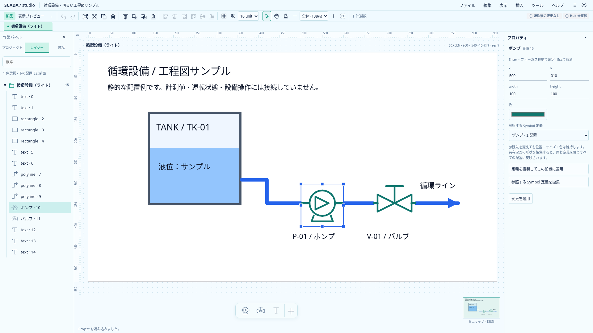

[ダークの実画面](assets/frontend-ux/rulers-dark.png)。`scripts/capture-rulers.mjs` で撮影した。

検証: 型チェックはエラー・警告なし、単体144件（目盛り生成2件を追加）・本番ビルドが成功した。新規ブラウザ9件で25%／100%／400%／fitと縦横スクロール時の座標一致、表示中心・入力・選択保持、保存とプレビュー復帰、共有定義、両テーマ・狭幅・CSS 200%拡大、帯での連続配置抑止、設定保存失敗を確認した。CSS拡大の検証で固定の1px余白によるずれを検出し、実際のviewport境界へ合わせて9件を再検証した。調整前の関連18件（倍率・パン・ホイール）は成功、範囲選択・連続配置・パネル幅を含む追加34件は31件成功で、新規側の3件を位置補正とテストの操作ラベル修正後の9件に含めて成功を確認した。実画面の確認で画面情報と目盛りの重なりも調整し、ルーラー・Studio shellの最終12件を再検証して成功した。実ブラウザのページ倍率200%を試したという意味ではなく、CSS拡大の検証である。両テーマの実画面・整形・差分を確認した。

## OSクリップボードとDeleteによる編集（2026-10-19・同日後続）

編集メニューとキャンバス／レイヤー配置の右クリックにコピー・切り取り・貼り付けを追加した。配置一覧またはキャンバスにフォーカスがあるときはCtrl／Command＋C・X・VとDeleteを使える。入力欄の文字編集、IME、プロジェクトツリー、メニュー・ダイアログ、表示プレビューは横取りしない。キー連打によるDeleteは無視する。メニュー操作はClipboard API、標準キーはネイティブClipboardEventを使う。ブラウザの許可やセキュアコンテキストが必要な場合があり、失敗は通知する。古い内部コピーへ黙って代替しない。

コピー形式は4MiB上限の専用JSON（`banto-scada.objects` version 1）。形式・キー・Project検証を通し、通常テキストは図形化しない。配置の相対位置・重なり順・タグ参照と必要な共有定義をスナップショットに含める。同じタブの同じProject読込世代では現行共有定義を参照し、別タブ・別ファイル・再読込後では定義と内部図形も新しいIDで取り込む。貼り付けは表示中央へ置き、同じ内容・対象・表示範囲で繰り返すと20 design unitずつずらす。1回の貼り付け・切り取りは各1回のUndoで戻る。共有定義への入れ子Symbol・タグ付きTextの貼り付けは全体を拒否する。Project schemaは0.4.0を維持する。

未適用入力は既存の適用・破棄・キャンセルで解決してから実行する。切り取りは削除可能性を先に検証し、OSへのコピー成功後に削除する。非同期待機中にProject・読込世代・編集先・選択・未適用入力が変われば元を残し、コピー済み／切り取り中止と通知する。定義の最後の図形を切り取る場合はOSクリップボードも変更しない。

検証: 型チェックはエラー・警告なし、単体142件・本番ビルド・新規ブラウザ8件が成功した。全体204件の実行は203件成功、既存の配管頂点テスト1件がファイル再読込後のタブ待機で30秒を超過した。同じコードでスナップ関連3件を単独再実行し、すべて成功した。新規ケースはOSコピー／貼付・繰返し位置・Undo・Delete、通常テキスト拒否、書込拒否、非同期待機中の選択変更、入力欄の標準編集・未適用入力の取消／破棄、共有定義の読込世代境界、プレビュー／対象外領域、全定義図形の切取拒否を確認する。整形・相対リンク・差分も確認した。

## Windows標準に合わせたホイール操作（2026-10-19・同日後続）

ユーザー指示により、編集キャンバスにCtrl＋ホイールのポインタ基準ズームと、Shift＋ホイールの横スクロールを追加した。通常の縦スクロール・トラックパッドの横方向入力はネイティブ動作を維持する。ピクセル・行・ページ単位のwheelを正規化し、Shift操作では縦へ同時移動しない。Ctrl＋ShiftはCtrlのズームを優先し、Alt／Meta付きイベントは横取りしない。

Ctrlの上回転で拡大、下回転で縮小する。100px相当で倍率を1.1倍に変え、細かな入力も反映する。範囲は25〜400%。大きな図面の全体表示が25%未満なら、縮小指示で倍率を25%へ引き上げない。連続倍率はツールバーに現在値として表示し、既存の倍率選択・全体表示へも戻せる。仮想余白と既存のzoomAtを使い、ポインタ下の設計座標を可能なスクロール範囲内で保つ。

wheelはキャンバスのローカルリスナーで処理し、Ctrl操作を倍率の上下限でも消費してブラウザのページズームへ漏らさない。入力欄をフォーカス解除せず、選択・未適用入力・Project・履歴を変えない。途中の図形移動／サイズ／頂点操作、範囲選択、パンのプレビューは取り消してから表示を動かし、古い座標をmouseupで確定しない。連続配置の部品選択は保持し、古い配置ポインタだけを消す。

図面ズームを優先するのは編集キャンバス上のCtrl付きwheelのみ。ブラウザが同じ形式で送るピンチも含む。その他の領域、全体表示に固定している表示プレビュー、Ctrl＋`+`／`-`／`0`のキー操作はブラウザ標準を維持する。既存の保存・Undo／Redo・全選択・複製ショートカットは継続する。コピー／切り取り／貼り付け等、Windows標準操作の全項目が実装済みになったことは意味しない。

Project schemaは0.4.0を維持する。検証: 型チェック（エラー・警告なし）、単体138件（wheel単位・倍率計算の2件を追加）と本番ビルドが成功した。新規ブラウザ7件で縦／横の実ホイール、ポインタ下の座標保持、連続イベント、可変倍率表示、入力フォーカスとdraft保持、領域外・プレビューとの境界、上下限、図形移動取消、行／ページ単位、25%未満のfit、範囲選択と連続配置を確認した。viewport・ミニマップ・数値入力・範囲選択・連続配置と合わせた45件では44件が成功し、ホイールを使わない400%連続配置の固定座標クリックが1件失敗した。座標取得をレイアウト反映後に行うようテストの待機を調整し、連続配置9件＋ホイール7件の再実行は全16件成功した。整形・相対リンク・差分も確認した。

## 空白ドラッグによる範囲選択（2026-10-19・同日後続）

選択ツールで図面の空白から左ドラッグし、枠に完全に収まった配置をまとめて選択できるようにした。5 CSS px以上動かしてから枠を表示し、ポインタを放した時点で確定する。左右どちらから囲んでも同じ判定を使う。ドラッグ開始時のShiftは既存選択との和集合、通常ドラッグは選択を置き換える。小さな移動は従来の空白クリックとして選択解除、Shift付きなら既存選択を保持する。枠だけが触れる部分的な包含は選ばない。

倍率・スクロールを逆変換したdesign座標で判定し、グリッド／スナップは範囲の境界に適用しない。四角形・楕円・Text・共有Symbolの配置寸法と、配管の線幅・矢印を含む既存の選択境界を使う。Symbol配置は一つの配置として選び、定義編集時はその内部図形を対象とする。図面外へ出るポインタ位置は画面端へ制限するため、描画境界が画面からはみ出す図形はレイヤー／全選択から選ぶ。自動スクロールは追加していない。

選択候補の計算中は既存の選択とProjectを保持し、確定は既存のdraft保護を通す。座標欄からフォーカスを移す場合は数値のblur確定と描画更新を先に完了し、更新直後の最初のドラッグも継続できるようにする。数値変更と選択を履歴へ混在させず、不正数値は既存の確認・取消で保持し、IME変換中は選択を適用しない。取消では以前の選択と入力を保持する。確認を待つ操作は編集対象・Project読込世代と配置の存在を再検証する。Esc・pointer cancel・ウィンドウ非アクティブ・スクロール・ズーム／領域変更・編集対象／モデル／操作モード変更で途中の範囲を取り消し、後から古い選択を適用しない。Spaceや編集ショートカットへ移る場合も範囲を取り消す。パン・連続配置・プレビューでは開始せず、既存図形からの移動・ハンドル操作と分ける。

範囲選択だけではrevision・履歴・保存内容を変更せず、その後の複製・移動等は既存の複数選択コマンドを使う。Project schemaは0.4.0を維持する。選択ツールのツールチップと操作ガイドに操作を追記した。

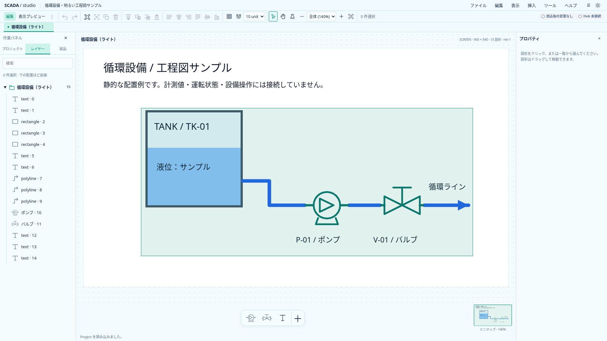

[確定後・ライト](assets/frontend-ux/range-selected-light.png)、ダークの[ドラッグ中](assets/frontend-ux/range-selecting-dark.png)／[確定後](assets/frontend-ux/range-selected-dark.png)。`scripts/capture-range.mjs` で実アプリを撮影した。

検証: 型チェックはエラー・警告なし、単体136件（範囲の包含判定3件を追加）・全体ブラウザ188件が成功した。新規7件で25%／100%／400%、逆向き・Shift・空白クリック・Esc、未適用入力の取消／破棄、pointer cancel・スクロール、パン／連続配置／プレビューとの分離、共有定義内の選択と履歴非混入を確認した。さらに数値入力の追加1件で最初の範囲が取り消される問題を検出し、blur時のモデル反映を先に完了するよう修正した。調整後、追加ケース・範囲選択・数値入力・連続配置・複数選択の関連29件が成功した。不正数値の確認ダイアログは既存契約と揃え、取消後の入力保持とIME変換中の選択抑止も確認した。本番ビルド・両テーマの実画面・整形・相対リンク・差分を確認した。

## Projectファイル操作をメニューへ集約（2026-10-19・同日後続）

メニューバーに読み込み・保存が揃ったため、左下に常設していたProject JSONの読み込み欄・保存ボタンと、プロジェクトタブ内のサンプル読み込みを削除した。左パネルをツリー・部品の作業領域として下端まで使う。ファイル選択用inputはパネル外に非表示で保持し、「ファイル」メニューから既存の読み込み処理を呼び出す。

メニューバーを隠した状態でも操作を失わないよう、常設の「☰」メニューへ同じファイル操作を追加した。保存のCtrl+S、読み込みの検証・置換確認、保存時の未適用入力・数値入力保護は既存処理を共用する。保存状態は引き続きツールバーに表示する。Project schemaや保存形式は変更しない。

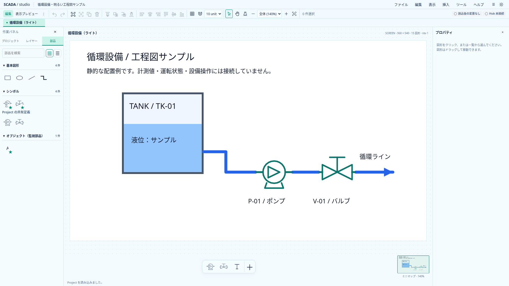

[ダーク](assets/frontend-ux/file-menu-dark.png)、ファイルメニューを開いた[ライト](assets/frontend-ux/file-menu-open-light.png)／[ダーク](assets/frontend-ux/file-menu-open-dark.png)。`scripts/capture-file-menu.mjs` で撮影した。

検証: 型チェックはエラー・警告なし、本番ビルドと最終ブラウザ全181件が成功した。新規1件で左パネルの重複操作がないこと、ファイル選択ダイアログ経由の読込、メニューバー・左パネル非表示時のファイル操作、未適用入力の読込取消と保存時の破棄を確認した。既存の読込・保存テストはユーザーと同じメニュー操作へ移行し、期待する保存内容と入力保護は維持した。新規テストの保存後メッセージの期待値を修正して全体を通した。両テーマの実画面、整形・リンク・差分も確認した。

## 工程図のミニマップ（2026-10-19・同日後続）

操作試作の右下のミニマップを、図面を覆わない下端の帯にお気に入りドックと並べた。現行Rendererを閲覧用として再利用し、実際の保存済み背景色・図形・共有定義を描画する。縮小図はアクセシビリティツリーから除き、主キャンバスと読み上げを重複させない。現在の表示範囲は図面内へ切り取った枠で表示し、手動倍率ではクリック／ドラッグで指した位置を中心へ移動する。端は既存スクロール可能範囲へ制限する。矢印キーは表示幅／高さの1/5ずつ移動し、Enter／Spaceは全体表示、ドラッグ中のEsc・pointer cancel・ウィンドウ非アクティブは開始位置へ戻す。全体表示中はクリックしても倍率と表示位置を維持する。

画面と共有定義それぞれの編集に追従し、編集対象・Project読込世代の変更では操作対象を作り直して古いドラッグを持ち越さない。表示移動は図形選択・Project・履歴・文字などの未適用入力を変更しない。数値欄のフォーカス移動での確定は既存契約を維持する。連続配置中にミニマップを操作しても部品を配置せず、ツールは継続する。

「表示」メニューで非表示／再表示でき、Banto UI設定 `scada.designer.minimap` にブラウザ内の表示選択だけを保存する。保存できなければ警告してタブ内で継続する。表示プレビューと補助パネル一括非表示では隠し、一括非表示から戻せば選択した表示状態を使う。Project schemaは0.4.0を維持する。浮動化や正式Runtimeの機能を追加したわけではない。縮小描画を追加しているため、大規模Projectでの性能評価・最適化は後続とする。

ライト・全体表示の実画面:

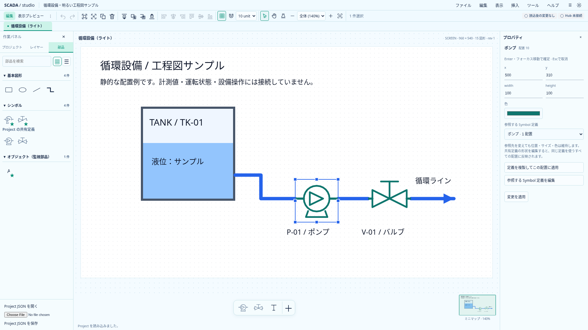

[ダーク・全体表示](assets/frontend-ux/minimap-fit-dark.png)、200%表示の[ライト](assets/frontend-ux/minimap-zoom-light.png)／[ダーク](assets/frontend-ux/minimap-zoom-dark.png)、1280×720の[ライト](assets/frontend-ux/minimap-small-light.png)／[ダーク](assets/frontend-ux/minimap-small-dark.png)。`scripts/capture-minimap.mjs` で起動済みアプリの実画面を撮影した。

既存テストでページ全体からタグ・背景・共有定義の描画を検索していた箇所を、主キャンバスに限定した。縮小図にも同じ描画があるためで、Projectや表示内容の期待値は維持した。下部参照パネルの開閉は、summaryクリック直後ではなくネイティブdetailsのtoggleとSvelteの高さ更新を経てから表示中心の保持を終えるようにし、25%の表示で中心がずれるタイミングを修正した。

検証: 型チェックはエラー・警告なし、単体133件、本番ビルド、最終ブラウザ全180件が成功した。新規5件で表示位置と枠の追従・クリック／矢印キー・ドラッグ取消・全体表示・未適用入力・連続配置・表示設定の保存／復元・プレビュー非表示・画面／共有定義切替を確認した。参照パネルの中心保持の修正後、関連23件も成功した。ライト／ダークの全体・200%表示と1280×720の実画面、変更ファイルの整形・相対リンク・差分を確認した。

## クリック位置への連続配置（2026-10-19・同日後続）

操作試作の「部品を選んでからキャンバスへ置く」手順を、明示的な連続配置ツールとして追加した。通常の部品クリックは従来どおり表示中心への即時配置、ドラッグは従来どおりドロップ位置への配置を維持する。共通ツールバーの「連続配置」をONにして部品パネル／お気に入りの部品を選ぶか、部品の右クリックの「クリック位置へ連続配置」から開始する。部品を選ぶだけではProjectや図形選択・未適用入力を変更しない。部品を選ぶ前の待機中も、キャンバスで既存図形を動かさない。明示的な「現在の画面へ配置」のメニューは即時配置を使う。

選択中の部品はパレットとドックで表示し、下部に部品名・操作案内・終了ボタンを出す。ポインタには画面内だけ十字カーソルと＋を表示する。図面内のクリック位置を部品の中心として配置し、続けてクリックすれば同じ部品を追加できる。倍率・スクロールを設計座標へ変換し、スナップがONなら中心をスナップ、Altで一時解除する。画面外の余白・ドラッグと判定する5px以上の移動・pointer cancelでは配置しない。配置中は既存図形をクリックしても移動／リサイズを開始しない。

1回の配置は既存のコマンド1回でUndo／Redoできる。配置時に未適用の文字・タグ・色などがあれば既存の確認を通し、取消では入力と選択を保つ。無効な数値やIME変換中は配置しない。確認を待つ間の座標・部品・Project世代・編集対象・配置ツールの世代を捕捉し、終了や対象変更後に古い配置を再開しない。数値のEnter／blur確定や既存の入力保護は継続する。

Esc・終了ボタン・選択／パンツールで終了できる。キャンバス上の右クリック／操作キーも配置を終了し、その回は操作メニューを開かない。部品選択と配置成功後はキャンバスへフォーカスを渡し、続けてSpaceやEnterを使える。キャンバスにフォーカスしたEnterは画面内の表示中心へ配置する。Space／中ボタンは一時パンとして配置を中断し、解除後に継続できる。入力欄でのEscやIME、メニュー／確認ダイアログのEscは既存の責務を優先する。

画面・共有定義の編集対象、モード、Project読込世代が変わったら終了する。共有定義を対象に選んでいた場合、その定義がUndoなどで消えても終了する。共有定義の編集中は基本図形だけを使い、入れ子配置は作らない。単なる図形選択／revisionの変化では終了しない。ツール状態とポインタ位置はProject・Undo・ブラウザの保存設定に含めない。Project schemaは0.4.0を維持する。

実画面: [ライト](assets/frontend-ux/continuous-placement-light.png)／[ダーク](assets/frontend-ux/continuous-placement-dark.png)、[1280×720・ライト](assets/frontend-ux/continuous-placement-small-light.png)／[ダーク](assets/frontend-ux/continuous-placement-small-dark.png)。

検証: 型チェック（エラー・警告なし）、単体133件、本番ビルドに成功。全体実行では173件成功・余白クリックの新規テスト1件が失敗し、パネル幅の境界ハンドルに当たっていたテスト座標を画面外の余白内へ修正した。部品選択前の待機を加えた関連17件が成功し、フォーカス受渡しの調整後も数値入力を含む関連19件が成功した（全175ケースの成功を再実行を含めて確認）。新規9件で25%／100%／400%、スナップとAlt、一件ずつのUndoとEsc、未適用入力・無効数値・IME、既存図形の保護、右クリックとドック、Enterと一時パン、対象切替・同一Project読込・定義編集、画面外余白・pointer cancel・ドラッグ、共有定義が消えた場合の終了、選択前の待機・狭い画面の非overflowと終了時フォーカスを確認した。両テーマ・2サイズの実画面、整形・相対リンク・差分も確認した。

## お気に入り部品ドック（2026-10-19・同日後続）

操作試作の下部ドックに対応する最初の実装として、編集時の作業領域下端にお気に入り部品を置いた。初期登録は組込ポンプ・バルブ・Text。部品パレットの各カードに独立した☆／★ボタンを付け、基本図形・組込シンボル・Projectの共有定義を登録／解除できる。登録は配置や共有定義作成を伴わず、検索・未適用の文字／タグ・図形選択・Project revision・Undoへ混入しない。数値入力からフォーカスが移る場合の通常の確定契約は継続する。

お気に入りはBantoのブラウザUI設定 `scada.designer.favorites` へ保存する。空の一覧も保存し、不正な設定形式は既定値へ戻し、未知の登録は無視する。登録順を維持し、上限は64件。基本図形と組込部品はProject共通、共有定義は表示名に「共有定義」を添えて組込部品と区別し、Project IDと定義IDの組で登録し、他Projectに同名／同IDの定義があっても表示しない。現在のProjectで削除された定義は表示せず、名前変更は現在の定義へ追従する。共有定義の編集中は基本図形だけを出し、入れ子配置を防ぐ。設定の保存に失敗してもタブ内の登録と編集を継続する。「表示」メニューの「お気に入りを標準に戻す」で、他Project向けの登録も含めた設定を初期化できる。

ドックのクリックは表示中キャンバスの中心へ配置し、ドラッグはドロップ位置へ配置する。いずれも既存の配置処理・入力保護・Project世代と編集対象の再確認・Undo／Redoを共用し、確認後に別画面へ置き直さない。右クリック／操作メニューから配置と登録解除ができ、解除後は残る部品か＋へフォーカスを戻す。＋は左パネルの部品タブを開く。登録のない場合も＋と短い案内を残し、復帰できる。

ドックは浮動パネルではなく、図面を覆わない下端の領域を予約する。部品が多ければドック内を横スクロールし、ページ全体を横に広げない。左パネルだけを隠しても利用でき、補助パネルの一括非表示ではドックも隠す。プレビューには出さない。連続配置や常設の最近使った部品、カメラなど未実装オブジェクトは追加していない。Project schemaは0.4.0のまま。

実画面: [ライト](assets/frontend-ux/favorites-dock-light.png)／[ダーク](assets/frontend-ux/favorites-dock-dark.png)、[1280×720・ライト](assets/frontend-ux/favorites-dock-small-light.png)／[ダーク](assets/frontend-ux/favorites-dock-small-dark.png)。

検証: 型チェック（エラー・警告なし）、単体133件、全E2E166件、本番ビルドに成功。共有定義の表示名の区別と標準復元を追加後、関連9ケースを再確認した（中心位置を画面の整数寸法とSVGの小数寸法で比較する確認は、1CSS px未満の許容差へ揃えて対象4ケースを再実行し成功）。新規の単体2件では設定形式・上限・重複・未知登録・Project分離・定義削除・入れ子防止を検証した。新規E2E4件では入力保持・登録時の非変更・確認取消／破棄・中心配置・Undo・設定再読込・Project非混入・左パネルの再表示、共有定義の名前追従・Project分離・定義編集、ドラッグ・登録解除後のフォーカス・両テーマ・狭い表示・プレビュー、保存失敗・全解除・標準復元を確認した。実画面・整形・相対リンク・差分も確認した。

## 操作試作を基準にした Studio 外観の適用（2026-10-19・同日後続）

ユーザー指定の `/workspace/scratch/scada-ux-prototype/preview-1920x1080.png` を画面全体の外観基準にし、ヘッダー・ツールバー・画面タブ・作業領域・左右パネルをまとめて調整した。以前の一覧のフラット化だけでは全体の配置・密度・色合いが反映できていなかったため、専用の `studio.css` にDesignerの外観を分離した。

ヘッダーはブランド・Project名・既存6メニュー・常設メニュー・テーマを1行にまとめ、下に小さな共通ツールバーと画面タブを配置する。狭い幅ではメニューを次行へ退避する。画面タブは保存済みの全画面を表示し、クリックは既存の入力保護を通す。左右／Home／Endはフォーカス移動だけ、Enterで切替。選択中画面とキーボードの移動先だけ横スクロールで見えるようにし、図面やページ全体の位置を動かさない。編集時は既存の画面操作メニューも利用できる。表示プレビューでは画面切替だけを残す。

明るい青白色／濃い青灰色の外枠と青緑のアクセントを、Bantoが解決したlight／darkへ連動させる。OS連動と既存テーマ設定の保存は維持する。左右固定を標準とするユーザー回答に従い、図面を覆う浮動パネルへは変えていない。パネルの境界調整、表示切替、下部参照一覧も維持した。プロパティには選択対象の種別／共有定義名と配置順を表示し、数値入力を中心に余白と文字密度を揃える。

作業領域とグリッドはドット表示とし、用紙の影と作業領域の囲い枠を外した。SVG内のドットは既存のグリッド表示切替と間隔設定に従う。Projectに保存された背景・図形色はテーマ変更で上書きしない。実画面の白い用紙は既存の明るい工程図サンプルが保存する背景であり、外枠の色と別に扱う。

これは外観と画面切替の適用で、試作の機能全体を移植したものではない。多色・立体的な設備シンボル、画面内の浮動／ドッキング、お気に入りドック、ミニマップ、連続配置、タグ選択・実catalogは後続。Project schemaは0.4.0を維持し、データ・履歴・入力保護の契約を置き換えない。試作の原本と外部リポジトリの画面・アセットは取り込んでいない。

実画面: [1920×1080・ライト](assets/frontend-ux/studio-shell-light.png)／[ダーク](assets/frontend-ux/studio-shell-dark.png)、[1280×720・ライト](assets/frontend-ux/studio-shell-small-light.png)／[ダーク](assets/frontend-ux/studio-shell-small-dark.png)。既存の明るい工程図サンプルと部品パレットを使い、グリッドを有効にして撮影する。

検証: 型チェック（エラー・警告なし）、単体131件、本番ビルドに成功。全E2E実行は158件成功・4件失敗で、旧グリッドのpath／strokeへの期待値、旧外枠の高さを前提にした低背時の分岐、SVG座標変換後の幅の文字列完全一致を確認した。ドットのcircle／fill、新しい作業領域でも高さ制約が働く550px、小数点以下8桁の許容差を使う数値比較へ更新後、対象4件を含む関連20件が成功し、全162ケースの成功を確認した。新規3件では画面タブの入力確認・取消／適用・名前変更・手動キーボード切替、左右パネルを隠した切替・プレビュー・両テーマとProject背景の非変更、多数画面の横スクロールとページの非overflowを検証した。ドットの濃さを調整後も型チェック・本番ビルドを再実行し、両テーマ・2サイズの実画面を確認した。

## ツリー行をフラットなデザインへ調整（2026-10-19・同日後続）

ユーザーの「カードに入れず参考デザインへ寄せる」という指示に従い、画面・レイヤー・共有シンボルの各行から常時の枠・背景・大きな余白を除いた。行が連続するツリーとし、hoverと選択時だけ淡い背景を付ける。プロジェクトは青、レイヤーは青緑の選択背景を使い、キーボードフォーカスは別の内側リングで識別する。行の操作ボタンも枠を外し、hover／focus時に表示する既存操作を維持した。

左パネルの余白・枝の間隔・件数表示を整理し、重複した画面名を含むレイヤー説明は短くした。共有シンボルも縮小アイコン付きの行へ揃え、サンプル／タグ参照への移動と下部ファイル操作の外枠も除いた。検索欄と設定用入力は操作欄として残す。Projectモデル・選択・入力保護・右クリックの契約は変更しない。

実画面はツリー表示の[ライト](assets/frontend-ux/project-tree-light.png)／[ダーク](assets/frontend-ux/project-tree-dark.png)、レイヤー検索の[ライト](assets/frontend-ux/layer-tree-light.png)／[ダーク](assets/frontend-ux/layer-tree-dark.png)を更新した。

検証: `pnpm check`（エラー・警告なし）、関連E2E28件、本番ビルドに成功。画面／レイヤー／共有定義の選択・右クリック・入力保護・キーボード操作、両テーマ・小画面を確認し、実画面を撮り直した。見た目の調整のためモデルの単体テストやschemaは変更していない。

## プロジェクト・レイヤーのツリー表示（2026-10-19・同日後続）

ユーザーの添付イメージをもとに、プロジェクトを「画面／タグ参照／シンボル／プロジェクト設定」の開閉できる枝へ整理した。Project 名・画面数・参照タグ数・共有定義数を表示し、画面行の選択・右クリック、共有定義の管理と使用先確認は既存コマンドを使う。タグ参照の枝から既存の下部参照一覧を展開・再表示できる。Hub catalog を示すものではない。設定には従来の画面管理・画面／定義の設定を収め、Project全体の新しい設定項目は追加していない。

レイヤーには1行の検索欄、開閉できる現在画面の枝、図形種別のアイコンと共有定義の縮小表示を追加した。検索対象は従来の配置ラベル・配置ID・保存済みの静的テキスト・外部タグ名。検索中も重なり順を維持し、タブ切替で検索文字を保持する。Project読込時には検索を初期化する。検索で配置を隠しても選択・図面・未適用入力は変更しない。下の配置ほど前面で、従来のShiftによる複数選択・右クリックを共用する。

開閉ではフォームを破棄しない。閉じた設定内の不正入力を適用しようとしたときと、画面の右クリックから名前変更するときは、設定の枝を自動で開いて入力欄へ戻す。開閉と検索はProject・revision・Undoに記録せず、schemaは0.4.0を維持する。階層の操作は標準のdetails/summaryと通常のボタンで提供し、未完成のARIA treeを付与しない。

**今回の範囲はツリーの外観と既存操作の整理。** ユーザー作成グループ、配置名の保存、目のアイコンによる表示切替、ドラッグによる階層変更、ロック、ピン留め、浮動は未実装。配置名・グループと保存契約、グループ順と全体の重なり順の関係は次のモデル変更で具体化する。種別ごとの自動分類をユーザー作成グループに見せかけない。

実画面: [プロジェクト・ライト](assets/frontend-ux/project-tree-light.png) / [ダーク](assets/frontend-ux/project-tree-dark.png)、[レイヤー検索・ライト](assets/frontend-ux/layer-tree-light.png) / [ダーク](assets/frontend-ux/layer-tree-dark.png)。

検証: 型チェック（エラー・警告なし）、単体131件、E2E全159件、本番ビルドに成功。検索欄のスタイル調整後も型チェックと関連E2E11件・本番ビルドを再確認した。新規E2E3件では閉じた設定内の未適用／不正入力・再展開・名前変更、検索時の選択／入力／順序／右クリック／タブ状態、タグ参照一覧への接続、タグ名検索、テーマとプレビューを確認した。両テーマの実画面は `scripts/capture-sidebar-tree.mjs` で撮影し、整形・相対リンク・差分も確認した。

## プロパティ数値のEnter／フォーカス移動での確定（2026-10-19・同日後続）

試作レビューへのユーザー回答に沿い、単一図形の x / y / width / height と線幅を、Enterまたはフォーカス移動で1項目ずつ確定するよう変更した。数値欄は下線表示とし、有限の十進数・指数表記を受け付ける。空欄・途中入力・非数・モデルが拒否する値は原文とエラーを保持し、Escでその欄だけを最後の確定値へ戻す。Enter後のblurや同値で履歴を重複させない。1項目の確定と後続の図形操作は別のUndoになる。

Inspectorのフォームkeyを revision 依存から Project 読込世代・編集対象・配置IDへ変更した。入力保護にモデル値のbaseline更新と1欄だけの確定を加え、revision更新でも他欄のタグ・文字・不正入力を保持する。色・文字・タグ・参照先などの明示適用、適用／破棄／キャンセルと全フォームの事前検証は維持する。これは同じDOMを維持する入力管理の改善であり、浮動／ドッキングに必要なDOMから独立したdraft管理全体の完了ではない。

IME中のEnterでフォーム全体をsubmitせず、composition終了前のblurは保留する。入力開始時の読込世代・画面／定義・配置を捕捉し、古い対象へ遅れて発生したイベントで別Projectを変更しない。保存時にもフォーカス中の数値だけを確定し、他のdraftがあれば従来の確認を通す。

Astraとのイベント順序の確認で、Canvasのpointerdownはblurに先行し、preventDefaultでblurが来ない場合もあることを確認した。編集・対象切替・保存の入力保護の前処理で、フォーカス中の数値を同期確定し、モデル・baseline・Rendererのpropsを反映してからgeometryを読む。IME中はこの境界で編集開始を止め、他のdraftや不正数値は従来の保護へ渡す。キーボードのリサイズと頂点操作も、保護通過後にIDから最新geometryを取得する。

対象は単一選択の数値プロパティ。画面／定義のサイズ設定、複数選択の相対移動は引き続き明示適用。Project schemaは0.4.0のまま、Banto・認証・Hub・設備操作は変更していない。

実画面: [ライト](assets/frontend-ux/numeric-properties-light.png) / [ダーク](assets/frontend-ux/numeric-properties-dark.png)。未適用のタグを残したまま数値だけを確定した例。検証: `pnpm check`（エラー・警告なし）、単体131件、E2E 全156件、本番ビルドに成功した。新規の単体2件と E2E 10件で十進数の検証、Enter／blurの単独確定と重複防止、同値、Undo／Redo、タグと文字のdraft保持、不正入力とEsc、モデル拒否、対象切替・同IDの再読込、IME中のsubmit抑止と遅れたblur、Ctrl+S、Canvasのドラッグ・リサイズ前の確定とgeometry、他draft・不正入力・IMEがある場合の編集開始保護を確認した。新規E2Eは1920×1080、既存の小画面と両テーマの検証も成功した。従来の数値を未適用のまま残す想定だった入力保護テストは、明示適用を継続する色へfixtureを移し、数値1項目ごとのrevision／Undoを期待値に反映した。両テーマの実画面、変更ファイルの整形・差分・相対リンクを確認した。

## サイドチャットの操作試作レビュー（2026-10-19・同日後続）

ユーザー提供の `/workspace/scratch/scada-ux-prototype` を Astra がレビューし、[試作デザインの適用レビュー](prototype-design-review.md)へ記録した。現行 `2e3fde6` と設計書・ソースを照合し、外観は適用可能、全面置換は非推奨と評価。浮動／ドッキングの入力保持、多色・状態別 Symbol、回転・接続、実タグ・Host 接続を高コストまたは別工程として分けた。試作の自動確定・未適用タグの破棄・固定BOOLカタログ・移動禁止のピンを、そのまま本体契約として採用しない。

原本を変更せず `/tmp` のコピーで分割ソースと配布用 `standalone.html` を再検証し、双方で代表操作31項目成功・ブラウザ実行エラー0。ライト／ダーク・125%相当・タグ選択の原本画像をレビュー文書へ収録した。任意図面の重なり、大量データ、実機高倍率・タッチ、低性能GPUでのグラス性能は未検証。文書の整形・差分・画像参照・相対リンクを確認した。アプリ・Projectモデル・依存は変更していない。ユーザー回答により、左右固定を標準として浮動へ切替可能、数値入力はEnter／フォーカス移動で確定、フルHD以上・マウス中心を方針として確認した。数値即時確定はタグdraft・不正な別フィールドを保持し、既存の revision に伴うフォーム再作成、Undoの単位、Esc・IME・対象切替との統合が必要。これらの方針確認は試作全体の採用や本体実装の完了を示さない。

## 下部タグ参照パネルの高さ調整（2026-10-19・同日後続）

固定パネルの幅調整に続き、下部の「Project のタグ参照」を展開中、上端の境界で高さを調整できるようにした。1100px以上で中央の作業領域が500px以上あるときだけ提供する。標準240px、保存範囲160〜400px。表示時は作業領域の40%以内、かつキャンバス・状態表示に340px以上を残すよう上限を制限する。狭い配置では高さ指定と境界操作を解除し、既存の自然な配置へ戻す。保存した希望の高さは上書きせず、広げれば復元する。参照なし・折りたたみ・非表示・プレビューでは高さ指定や境界操作を出さない。

境界のドラッグ、上下キー8px／Shift併用32px、Home / End、Enter・ダブルクリックでの標準復元、Esc・pointer cancel・操作中の狭い配置への移行による取消に対応した。画面縮小直後はレイアウトの破棄と pointer up の順序が前後し得るため、ドラッグ確定時にも実際の画面幅と作業高を照合する。左右の境界にも同じ確定前チェックを適用した。横方向で使っている separator を水平境界にも拡張し、名前・操作先・現在値・上下限を提供する。「表示」と常設メニューにも「タグ参照パネルの高さを標準に戻す」を追加した。

確定した高さを Banto UI 設定 `scada.designer.reference-height` へ保存し、不正値は標準へ戻す。保存失敗でもセッション内の調整は継続できる。パネル内のスクロールで長い参照一覧を扱い、検索・開閉・未適用入力・選択・履歴はリサイズで変えない。Project の読み替えでは検索と開閉をリセットし、保存した高さだけを引き継ぐ。手動倍率では連続変更と取消・折りたたみでも設計座標の表示中心を保持する。全体表示では残りの領域へ合わせる。Project schema は0.4.0のままで、Hub catalog・実測値・設備操作・浮動／ドッキングは追加していない。

実画面: [ライト](assets/frontend-ux/panel-height-light.png) / [ダーク](assets/frontend-ux/panel-height-dark.png)。本リポジトリの明るい工程図へ表示タグを割り当てた撮影用データで、値は未接続のまま。検証: `pnpm check`（エラー・警告なし）、単体129件、E2E 全146件、本番ビルドに成功した。新規の単体2件と E2E 8件で保存値の検証、ドラッグ・キーボード・取消・標準復元、未適用入力と検索・履歴の保持、JSONへの非混入、再読込での復元、倍率25%／100%／400%の表示中心、両テーマと狭い配置、保存失敗、長い参照一覧のスクロールと使用箇所への移動を確認した。画面縮小直後のドラッグ取消は修正後に5回繰り返して成功し、全体検証でも成功した。Project 読み替え時の検索・開閉の初期化も既存テストで確認した。両テーマの実画面、変更ファイルの整形・差分・相対リンクを確認した。

## 固定パネルの幅調整と保存（2026-10-19・同日後続）

1100px以上の編集画面で、左パネルとプロパティの境界をドラッグして幅を調整できる。キーボードは左右キーで8px、Shift併用で32px、Home / Endで最小／最大、Enterまたはダブルクリックでそのパネルの標準幅へ戻す。「表示」と常設メニューの「パネルの幅を標準に戻す」で両方を復元する。フォーカス可能な separator に対象名・操作先・現在値・上下限を持たせる。

標準幅は左240px・右288px、保存できる範囲は左200〜400px・右240〜440px。表示幅はウィンドウに応じてさらに制限し、中央の編集領域を確保する。狭くなっても保存値は書き換えず、広げれば希望幅へ戻る。1100px未満では既存のレスポンシブ配置を使い、境界操作を隠す。非表示パネルと表示プレビューにも境界操作を出さない。

確定した幅だけを Banto の `uiSettings`（`scada.designer.panel-widths`）へ保存し、再起動時に復元する。不正な保存値は標準幅へ戻し、読込・保存失敗でもセッション中の編集を継続する。ドラッグ中の Esc・pointer cancel・狭い配置への移行は変更を取り消し、未確定の幅を保存しない。表示切替・テーマ・Project の切替と幅の設定を分ける。

リサイズではフォームを unmount せず、未適用入力・検索・図形選択・Project revision と履歴を変えない。手動倍率では連続した幅変更の間も元の設計座標の中心を保持し、終了時に表示領域のサイズ反映を待って確定する。全体表示では変更後の領域に合わせて倍率を再計算する。Project schema は0.4.0のまま。

これは固定配置の幅保存までの実装。パネル全体の配置保存、浮動／ドッキング、下部パネルの高さ調整、DOM に依存しない draft 管理への移行は後続。Banto の既存 UI 設定 API を使い、共有パッケージや認証の変更は不要だった。

実画面: [ライト](assets/frontend-ux/panel-widths-light.png) / [ダーク](assets/frontend-ux/panel-widths-dark.png)。検証: `pnpm check`（エラー・警告なし）、単体127件、E2E 全138件、本番ビルドに成功。新規の単体2件と E2E 9件で保存値の検証、ドラッグ・キーボード・取消、未適用入力と履歴の保持、JSONへの非混入、再読込での復元、手動倍率25%／100%／400%の表示中心、両テーマと狭い配置、保存失敗時の継続、ドラッグ中の狭い配置への移行を確認した。両テーマの実画面、変更ファイルの整形・差分・相対リンクも確認した。

## 画面背景色の保存と描画（2026-10-19・同日後続）

Project と最小 Runtime を `0.4.0` に更新し、各画面へ必須の `background`（`#RRGGBB`）を追加した。Rust / TypeScript が同じ JSON Schema で検証し、任意 CSS・透過色・欠落を拒否する。共有 Symbol 定義には背景属性を追加せず、配置先の画面が透ける。旧 `0.3.0` の自動移行は追加しない。既存の `0.1.0` 読込経路だけは、従来の背景 `#0b1220` を補って現行形式へ移す。

画面設定の「画面の背景色」で入力し、適用時に既存の更新コマンドで保存する。未適用入力の保護、内容比較による保存状態、Undo / Redo、画面複製、JSON 往復と表示プレビューに対応した。新規画面は白背景、既存のサンプルは従来の暗色を明示する。背景やアプリテーマを変えても既存図形の色・形・参照先は変えない。新規に追加する図形・文字・Symbol の初期色は配置先の背景に合わせ、既存配置へ遡って色を適用しない。

Renderer の固定 CSS 背景を画面背景の SVG 矩形へ変更し、Symbol 内の入れ子 SVG へ暗色が付く問題も解消した。グリッド・選択枠・操作ハンドルの色は Project の背景から決め、アプリのテーマで変えない。共有定義の編集用キャンバスは従来の暗色を使い、その色を配置へ持ち込まない。

明るい工程図の例は [process-light.project.json](../examples/process-light.project.json)。本リポジトリの工程図サンプルから作り、同じ配置と ID を保って背景・図形色を明示的に設定した。外部リポジトリの画面・アセットは取り込んでいない。

実画面: [ライト](assets/frontend-ux/screen-background-light.png) / [ダーク](assets/frontend-ux/screen-background-dark.png)。検証: `pnpm check`（警告なし）、単体125件、本番ビルド、Rust の単体／SDK接続14件、Clippy（warnings拒否）と fmt に成功した。CLI で全5サンプルを検証済み。E2E 全体では126件が成功し、旧形式の背景補完と保存フィールドの期待値2件を更新後、開始時クリックのタイムアウト1件を含む3件を再実行して成功した（全129ケースの成功を確認）。新規4件では未適用入力の取消／適用／破棄、Undo / Redo、JSON往復、プレビュー、テーマ非依存、Symbol の透過、新規画面・新規配置の初期色、背景と形式の不正入力拒否、明るいサンプルと複製を確認した。共通契約に色・必須項目・旧Runtime拒否のケースを追加し、既存図形を再配色しないことも検証した。両テーマの実画面、変更ファイルの整形・差分・相対リンクを確認した。

## 共有定義の使用先一覧と配置への移動（2026-10-19・同日後続）

Symbol ライブラリの選択対象向けボタンと各行の操作メニューに「使用先を確認」を追加した。左パネル内に定義名・全配置数／画面数・画面名／配置順／座標を表示し、画面名・画面 ID・配置 ID・配置順で検索できる。検索欄は1行とし、未使用と検索結果なしを区別する。開閉と検索ではキャンバス・未適用入力・Project revision を変更しない。閉じると確認対象の定義行へ戻す。

一覧は現在の Project の直接参照から毎回算出し、保存された画面順・各画面内の重なり順で表示する。定義 ID の完全一致で参照を集め、同名の独立コピーを混ぜない。索引・検索・開閉状態を Project や Undo 履歴へ追加しない。図形削除・Undo / Redo・参照先変更に追従し、タブ切替では検索を保つ。同じ ID / revision の再読込でも一覧を閉じ、定義が消えた場合も閉じる。プレビューには出さない。

配置を選ぶと既存の適用／破棄／キャンセルを通し、対象画面を開いてその Symbol 配置を選ぶ。定義編集中からも通常画面へ戻れる。入力適用後に参照先が変わっていたら旧対象への移動を中止し、その旨を表示する。Project 読込世代・配置 ID・定義 ID を再検証し、表示待ちの間に対象が変わった場合も後からフォーカスを奪わない。

移動先の倍率とプロパティの表示状態を保ち、キャンバスへフォーカスする。定義編集からの復帰時は領域サイズの反映を待ち、現在の描画範囲から必要な分だけスクロールする。選択ハンドル用の余白を取り、対象が表示領域より大きい場合は左上側から表示する。移動自体は履歴に追加しない。フローティング・ドッキングやタグ catalog 接続は別工程。

実画面: [ライト](assets/frontend-ux/symbol-usages-light.png) / [ダーク](assets/frontend-ux/symbol-usages-dark.png)。検証: `pnpm check`（警告なし）、単体114件、E2E 全125件、本番ビルドに成功。新規の単体3件で画面順／重なり順・ID一致・非破壊の集計・独立コピーと削除を確認した。新規E2E5件では未適用入力を残した確認／検索、閉じた後のフォーカス、定義編集からの取消／適用、400%での配置表示、画面をまたぐ移動、削除と Undo、タブ切替時の検索保持、入力適用で参照先が変わった場合の中止、未使用表示、同じ Project の再読込、プレビューを確認した。両テーマの実画面、変更ファイルの整形・差分・相対リンクも確認した。

## プロジェクト共有定義行の右クリック操作（2026-10-19・同日後続）

Symbol ライブラリの選択欄を共有定義の行一覧へ変更し、定義名・配置数・選択中状態を表示した。通常クリックはライブラリ内の操作対象を選び、キャンバスや未適用入力を変更しない。各行の右クリック・操作ボタン・Shift+F10 / Context Menu キーから、全参照配置へ反映する定義編集・定義複製・現在の画面への配置・未使用定義の削除へ進める。右クリックだけではライブラリの選択対象も変えない。従来の選択対象向けボタンも同じコマンドへ接続する。

使用中の定義の削除、100定義での複製、定義編集中の Symbol 入れ子配置を無効化する。配置は表示中のキャンバスの中心を使い、複製は新しい定義を開く。既存配置の参照先は変えない。削除には対象名付きの確認を残し、別の未使用定義を削除してもキャンバスの図形選択を維持する。削除後のフォーカスは有効な選択行、定義がなくなれば作成ボタンへ戻す。

編集・配置・複製・削除は既存の入力保護を使い、確認後も Project の読込世代と定義の存在を照合する。配置先の画面が変わったり定義編集へ移った場合は保留中の配置を実行しない。Project / revision・編集対象・図形選択・ライブラリ選択・左パネル・モード・確認状態の変化で古いメニューを閉じる。プレビューにはライブラリを出さない。配置数は Project から算出し、使用先への移動 UI は後続。可動パネルやフォルダー／空白のメニューも未実装。

実画面: [ライト](assets/frontend-ux/symbol-context-light.png) / [ダーク](assets/frontend-ux/symbol-context-dark.png)。検証: `pnpm check`（警告なし）、単体111件、E2E 全120件、本番ビルドに成功。新規6件では開閉だけで無変更、入力確認の取消／適用／破棄、別の定義への操作、削除確認と選択／フォーカスの保持、参照先を変えない複製と JSON、パン・倍率変更後の表示中心への配置と Undo / Redo、使用中定義・入れ子・100定義の制約、同じ ID / revision の再読込、キーボード・操作ボタン、1280×720 の両テーマ、プレビューを確認した。実画面・整形・差分・相対リンクも確認した。

## プロジェクト画面行の右クリック操作（2026-10-19・同日後続）

プロジェクトの画面行に、開く・名前変更・複製・上下移動・削除のメニューを追加した。右クリックや Shift+F10 / Context Menu キー、行の操作ボタンから開ける。開くだけでは画面・図形選択・未適用入力・Project revision を変更しない。名前変更は対象画面を開いて既存の画面名入力へフォーカスし、適用ボタンで確定する。

各操作は対象の画面 ID を捕捉し、既存の適用／破棄／キャンセルと編集コマンドを使う。別画面の上下移動や削除では編集中の画面と図形選択を維持する。複製時は従来どおり新しい画面を開き、編集中の画面を削除したときだけ先頭へ戻る。削除は対象名付きの確認を継続し、最後の画面の削除、上端／下端の移動、100画面での複製を無効化する。

Project 読込世代・revision・編集対象・選択・左パネルの表示・モード・確認中状態の変化でメニューを閉じ、入力確認後にも読込世代と対象の存在を照合する。同じ ID / revision の再読込も旧メニューの対象として扱わない。プレビューでは画面切替だけを残し、編集メニューを表示しない。共有定義のプロジェクト行と可動パネルのメニューは後続。

実画面: [ライト](assets/frontend-ux/screen-context-light.png) / [ダーク](assets/frontend-ux/screen-context-dark.png)。検証: `pnpm check`（警告なし）、単体111件、本番ビルドに成功。E2E 全体では113件が成功し、上限確認用 fixture の UUID v7 形式を修正後、対象5件を再実行してすべて成功した（全114ケースの成功を確認）。右クリックで無変更、取消／適用／破棄、非アクティブ画面への操作、図形選択の保持、確認取消、Undo、名前欄へのフォーカス、キーボード、最後の画面・上下端・100画面の制約、同じ ID / revision の再読込、入力欄の標準右クリック、プレビューを検証した。両テーマの実画面、整形・差分・相対リンクも確認した。

## キャンバス・レイヤーの右クリック操作（2026-10-19・同日後続）

部品パレットに続き、キャンバスの図形・空白、レイヤーの配置行へコンテキストメニューを追加した。図形と配置行は同じ選択・共通ツールバーの複製／削除／重なり順／整列を使い、プロパティの再表示も提供する。単一選択の重なり順と複数選択の整列を区別する。Symbol には共有定義の編集と「定義を複製してこの配置に適用」を既存コマンドへ接続した。

選択済みの図形／配置行を右クリックしても複数選択を維持する。未選択なら、その図形へ移る前に既存の適用／破棄／キャンセルで入力を解決し、キャンセル時は選択と入力を変えない。解決を待つ間に Project のローカル世代や編集対象が変わればメニューを開かない。メニューを開くだけでは Project revision や履歴を作らず、右ボタンから移動・パンを開始しない。レイヤー行は ID をキーにして、順序変更後も行の identity を保つ。

空白を右クリックしても選択を解除しない。描画面内では基本図形・Text・線・配管をその位置へ挿入し、座標は viewport から設計座標へ変換する。スナップを有効にしたときはグリッドへ合わせ、Alt で一時解除する。描画面外の余白には挿入項目を出さない。キーボードと上部「キャンバスの操作」ボタンからの挿入は表示領域の中央を使う。配置先と座標は入力確認の前に捕捉し、未適用入力の解決後も別の位置へ変更しない。挿入1回は既存のコマンド1回として Undo / Redo できる。

Shift+F10 / Context Menu キー、レイヤーの操作ボタン、上部の名前付き操作ボタンを用意した。キャンバスのキーボード起点で選択があれば選択図形の操作、なければ空白の操作を開く。Esc で有効な起点へフォーカスを戻し、プロパティの再表示や定義編集は実行先へ移る。プレビューでは編集メニューを出さず、ブラウザ標準の右クリックを維持する。

既存 `ContextActions` に固定アンカーから開く入口を追加し、Banto Menu の Popup・キーボード・light dismiss を共用する。Banto の非同期 toggle が完了してから次の対象を開き、縦の画面端は app 側で収める。Project 読込世代・revision・編集対象・選択・左パネル表示・プロパティ表示・グリッド条件・入力確認状態等の変更で閉じ、実行時にも世代を照合する。連続した開く要求にも番号を付け、描画待ちが重なっても最後の要求だけを使う。任意の式・設備操作・保存レイヤーのロック等は追加していない。

実画面: [キャンバス・ライト](assets/frontend-ux/selection-context-light.png) / [レイヤー・ダーク](assets/frontend-ux/layer-context-dark.png)。プロジェクトの画面／共有定義行、可動パネルの右クリックは引き続き後続。認証・Project schema・Runtime の接続は変更していない。

検証: 単体111件と E2E 全体108件に成功。連続要求の世代管理を補強後、新規1件を含む関連12件を再実行して成功した。最終コードの `pnpm check`（警告なし）と本番ビルド、変更ファイルの整形・差分・相対リンクも確認した。検証範囲は複数選択、未適用入力の取消／適用、25 / 100 / 400% の座標変換・スナップ・Alt、キーボード／操作ボタン、フォーカス復帰、対象切替・連続要求、Symbol 固有操作、両テーマの画面端、プレビューの標準右クリック。

## ツールバー統合と薄いヘッダー（2026-10-19・同日後続）

ユーザー指定に従い、グリッド表示／スナップ／間隔、選択・パン、倍率／拡大縮小／全体表示、編集／表示プレビュー切替、保存状態を上部の共通ツールバーへ集約した。グリッド・選択／パン・全体表示は名称を持つアイコン、間隔と倍率はコンパクトな select とした。ツールバーはパネルとは独立し、プレビューでもモード切替と保存状態を表示する。プレビュー時のキャンバスは従来どおり全体表示で、編集用操作群を出さない。

アプリヘッダーは40pxの Project 名・常設メニュー・テーマアイコンに絞り、サブタイトルを削除した。テーマのアイコンは light / dark / system に応じた太陽・月・モニターで、Banto Menu から3モードを選ぶ。設定保存・OS 追従・保存失敗時のセッション内継続は既存の Banto API を使う。ネイティブ select を置いていた画面・検証・撮影スクリプトもアイコンメニューへ合わせた。

保存状態を左ペインからツールバーへ移し、パネルをすべて隠しても未書き出しの変更・未適用入力の件数を確認できる。最終書き出し要求の時刻は tooltip と accessible text に残す。「書き出し要求」はファイルへの永続保存を検証した意味へ変更しない。モード切替は既存の draft guard を通す。

`CanvasControls` は操作 UI、`CanvasWorkspace` は画面／共有定義ごとの倍率・パン・表示中心と座標変換を担当する。ツールバーから公開した操作へ委譲し、描画側の状態を通知して表示する。Project や履歴へ表示状態を追加しない。デスクトップでは中央を縦の flex 配置にし、ツール類を外した高さもキャンバスへ戻した。小画面ではツールのグループ単位で折り返し、横にはみ出さないようにする。編集ボタン群の左右／Home／End と、select 等の標準キー操作は分けて維持する。

実画面: [ライト](assets/frontend-ux/compact-shell-light.png) / [ダーク](assets/frontend-ux/compact-shell-dark.png)。共有基盤や Project schema、認証方針は変更していない。

検証: `pnpm check`（警告なし）、単体111件、E2E97件、本番ビルドに成功。ヘッダーの高さ・サブタイトル削除・各操作のツールバー内配置・グリッド／パン／倍率・モードと入力保護・パネル非表示中の保存状態・テーマのアイコンとキーボード・両テーマと390pxから1440pxの幅を確認した。変更ファイルの整形・差分・相対リンクも確認した。

## 部品パレットの右クリック操作（2026-10-19・同日後続）

右クリックの最初の対象として、左の部品カードと分類見出しへ操作メニューを追加した。部品カードのクリック／Enter・ドラッグ配置は維持する。右クリック、Shift+F10 / Context Menu キー、ホバー／フォーカスで現れる小さな操作ボタンから開く。タッチ端末では操作ボタンを常時表示する。メニューには対象名を表示し、組込シンボルと Project の共有定義を区別する。

基本図形・Text・組込シンボルは「現在の画面へ配置」「部品情報」を提供する。共有定義には、すべての参照配置へ影響することを明記した定義編集と、既存配置の参照先を変えない定義複製も追加した。複製は既存の上限と編集後の定義表示を使う。組込テンプレートの編集／削除や、部品カードに対する配置単位の独立コピーは出さない。定義内の Symbol 入れ子禁止も維持する。

メニューを開く／閉じる、部品情報を見るだけでは選択・Project revision・Undo・未適用入力を変更しない。配置は右クリックした左ペイン上の座標を使わず、既存コマンドを通じてキャンバスの表示中心へ追加する。配置・定義編集／複製は従来の適用／破棄／キャンセルへ戻し、履歴・JSON 保存を共用する。分類メニューでは単独または全分類を展開／折りたたみ、検索中は開閉を無効にして検索前の状態を維持する。

Banto v6.7.0 の Menu / MenuGroup / MenuItem / Modal を再利用する。アプリの薄い `ContextActions` adapter は起点ボタン・右クリック／キーの入口・フォーカス復帰・対象変更時の閉鎖を担当し、popup 配置・端の補正・上下移動・Home / End・Esc・外側クリックは Banto へ任せる。公開された trigger snippet のハンドラーを通常の操作ボタンから呼び、共有パッケージを変更／複製していない。部品情報の Modal へ移る場合は可視の起点へ先にフォーカスし、閉じた後も戻れるようにする。

Project 読込のローカル世代、revision、編集対象、選択、左タブ／表示状態、検索・表示形式の変更でメニューを閉じる。実行時にも開いた世代と現在の世代を照合し、古い対象に操作しない。同じ ID / revision の再読込も対象変更として扱う。検索入力等のブラウザ標準右クリックは抑止しない。表示プレビューでは部品パレット自体を出さない。

実画面: [組込部品・ライト](assets/frontend-ux/palette-context-light.png) / [共有定義・ダーク](assets/frontend-ux/palette-context-dark.png)。キャンバス・レイヤー行・プロジェクト行・可動パネルの右クリックは後続。この段階で全領域のコンテキストメニューが完成したとは扱わない。

検証: `pnpm check`（警告なし）、単体111件、E2E93件、本番ビルドに成功。メニューを開くだけで無変更、未適用入力とフォーカスの保持、25 / 100 / 400% の中央配置と Undo / Redo、分類の開閉／検索、共有定義の編集／複製、同じ ID / revision の再読込時の閉鎖、入力欄の標準右クリック、両テーマと小画面を確認した。変更ファイルの整形・差分・相対リンクも確認した。

## 共通編集操作のツールバー集約（2026-10-19・同日後続）

ユーザーの確認を受け、共通操作をプロパティから独立した `EditToolbar` へ移した。メニューバー直下の横幅全体に配置し、左右や下部の補助パネルを隠しても使える。履歴、選択／複製／削除、重なり順、整列の4グループにまとめ、アイコン・名称ツールチップ・accessible name と選択数を表示する。狭い画面ではグループ単位で折り返す。

単一選択では複製・削除・重なり順、複数選択では複製・削除・整列を有効にする。重なり順の複数選択への拡張や新しい編集コマンドは追加していない。編集メニューもツールバーと同じ操作定義・可否判定を参照し、履歴・未適用入力保護・共有定義編集の既存経路を使う。

プロパティは位置・サイズ・色・文字・Binding・Symbol 参照等の入力と適用を担当する。複数選択の数値移動フォーム、Symbol 固有の定義編集／独立コピーも残す。共通の複製・削除・整列・重なり順ボタンは重複配置しない。表示プレビューでは編集ツールバーを表示しない。

ツールバーは Tab の入口を1つにし、左右キー・Home / End で使用可能なボタン間を移動、Enter / Space で実行する。入力欄やメニューバーのキー操作へ干渉しない。実画面: [ライト](assets/frontend-ux/edit-toolbar-light.png) / [ダーク](assets/frontend-ux/edit-toolbar-dark.png)。

検証: `pnpm check`（警告なし）、単体111件、E2E83件、本番ビルドに成功。選択数による可否、補助パネル非表示中の操作、入力の取消／破棄、メニューとの共用、Undo、キーボード、両テーマと小画面を確認した。変更ファイルの整形・相対リンク・差分も確認した。

## 補助パネルの個別・一括表示切替（2026-10-19・同日後続）

固定配置の左パネル・プロパティ・タグ参照一覧を「表示」メニューと常設「メニュー」から個別に隠す／再表示できるようにした。左パネルには閉じるボタン、展開したタグ参照一覧には非表示ボタンを追加した。左パネルを隠した幅は中央へ戻し、プロパティだけ表示する組合せや左右とも非表示の配置にも対応する。下部は既存の Project 内タグ参照一覧で、正式なタグ管理・検証パネルや Hub catalog ではない。

「補助パネルをすべて隠す」は直前の3領域の表示状態を一時保存し、「補助パネルを元の表示に戻す」でその組合せへ戻す。初めから隠れていた領域を勝手に開かない。個別の表示切替（検証エラー等による自動再表示を含む）は一括非表示を終了し、その時点の表示状態を使う。個別操作ですべて隠した場合は「補助パネルをすべて表示」からも復帰できる。

DOM を維持するため、タブ・部品の検索／表示形式／分類の開閉・タグ参照の検索／展開・選択・未適用入力を保持する。パネル切替は draft 確認・Project revision・Undo を作らない。手動倍率の表示中心は既存の設計座標保持を共用し、全体表示は新しい幅へフィットする。非表示時は常設メニューへ、個別再表示時は対象パネルへフォーカスする。不正な画面設定は左パネルとプロジェクトタブを再表示して入力へ戻す。共有定義の編集も設定を確認できるよう左パネルを再表示する。

表示プレビューでは画面選択用の左パネルを表示し、編集用の表示切替は無効にする。編集へ戻ると編集 session の状態へ戻す。再起動時は3領域とも表示から始める。フローティング・再ドッキング・配置の永続保存・ドラフトの DOM からの独立は未実装。

実画面: [ライト](assets/frontend-ux/panels-hidden-light.png) / [ダーク](assets/frontend-ux/panels-hidden-dark.png)。撮影スクリプトに一括非表示・復帰を追加した。

検証: `pnpm check`（警告なし）、単体111件、E2E78件、本番ビルドに成功。個別操作ですべて隠した後の一括表示も関連 E2E の再実行で確認した。変更ファイルの整形・差分・相対リンクを確認した。

## プロパティの分離・表示切替（2026-10-19・同日後続）

段階 A のプロパティ領域を `InspectorPanel` へ分離し、固定配置で表示・非表示を切り替えられるようにした。見出しの閉じるボタンと「表示 → プロパティを隠す／表示」、常設「メニュー」の表示グループから操作する。隠した幅は中央へ戻し、再表示時は既存の単一選択・複数選択・Symbol／折れ線／Text Binding の入力と操作を使う。見出しと余白をコンパクトにし、Banto のテーマを共用する。

非表示は `hidden` で扱い、フォームと draft guard の登録を保持する。Project、選択、未適用入力、Undo、revision を変更しない。閉じた場合は常設メニューへフォーカスを戻す。隠れたフォームがネイティブ／モデル検証に失敗した場合は、プロパティを開いて修正できるようにする。タグの使用箇所から編集を開く場合も再表示して割付欄へフォーカスする。プレビューでは編集用パネルを表示しない。

手動倍率で開閉する前に表示中心を設計座標として捕捉し、レイアウト確定後に同じ位置へ戻す。用紙が表示領域より小さくても中心を保てるよう、対象ごとの一時的な仮想余白を用意する。倍率変更もこの余白を考慮し、全体表示では新しい領域へフィットする。図形の設計座標は変更しない。

表示状態は現在の編集 session に保持し、次回起動時は表示から始める。配置の明示保存・フローティング・再ドッキング・フォームの unmount / remount を越える draft store は B 段階に残る。今回の分離はこれらの完了を意味しない。

実画面: [表示](assets/frontend-ux/inspector-visible-light.png) / [非表示で広げたキャンバス](assets/frontend-ux/inspector-hidden-light.png)。検証は入力・選択・履歴の保持、常設メニューからの復元、不正入力とタグ参照からの再表示、25 / 100 / 400% の中心維持、両テーマと 1280×720 / 1440×900 を対象にする。

検証: `pnpm check`（警告なし）、単体111件、E2E70件、本番ビルド、変更ファイルの整形・差分チェックに成功。

## 部品パレットの密度・表示形式・ドラッグ配置（2026-10-19・同日後続）

ユーザーの Draw.io 参考画像に合わせ、部品をコンパクトなアイコンのグリッドに変更した。「アイコン一覧／名称一覧」を検索欄横の小さな切替で選べる。名称一覧は小さなアイコンと名前を1行に並べる。検索領域は1行の入力欄と切替のみとし、検索見出し・全体件数・操作説明の常設行を取り除いた。名称はタイトルと accessible name に残し、分類見出しの件数と横断検索・検索解除時の開閉復元は共通に使う。

表示形式は Banto の `uiSettings`（`scada.designer.palette-view`、`icons` / `names`）へ保存する。未設定・未知値はアイコン一覧、保存失敗時は現在のセッションで継続して通知する。切替で検索・開閉・未適用入力・選択・Project revision を変更しない。Project schema は `0.3.0` のまま。

どちらの表示形式からも、基本図形・組込 Symbol・Project の共有定義を工程図へドラッグして配置できる。クリック／Enter は従来どおり現在の表示領域中央へ配置する。ドロップは SVG の変換行列で設計座標へ戻し、部品の中心を指定する。スナップ有効時は中心をグリッドへ合わせ、Alt で一時解除する。画面の外側へのドロップは受け付けず、中心の丸めも画面寸法内に収める。配置予定の中心はマーカーで示す。ドロップ1回は既存の追加コマンド1回に対応し、Undo / Redo・共有定義の identity・JSON 保存を共用する。

ドラッグの部品情報は編集 session に保持し、DataTransfer は不透明な token のみを渡す。対象の画面／共有定義、Project 読込世代、編集 mode を検証し、対象変更・ドラッグ取消・プレビュー・外部からの未知データでは追加しない。未適用入力がある場合は、配置先と設計座標を捕捉したうえで既存の適用／破棄／キャンセルへ戻す。共有定義内で入れ子 Symbol を配置しない制約も維持する。

実画面: [アイコン一覧・ライト](assets/frontend-ux/palette-icons-light.png) / [名称一覧・ダーク](assets/frontend-ux/palette-names-dark.png)。撮影スクリプトは両表示形式を再現する。新規 E2E は表示形式の保存・検索・入力保持、25 / 100 / 400% とパン後の native drag、組込／共有 Symbol の JSON 往復、スナップと Alt、取消・古い対象・プレビュー、未適用入力の確認を扱う。

検証: `pnpm check`（警告なし）、単体109件、E2E63件、本番ビルド、変更ファイルの整形・差分チェックに成功。

## 左3タブと部品分類の実装（2026-10-19）

段階 A の続きとして、左ペインを「プロジェクト／レイヤー／部品」に分離した。プロジェクトは画面・共有 Symbol の管理、レイヤーは現在の画面／定義の配置一覧、部品は検索と配置を担当する。レイヤーは既存の重なり順と選択の一覧で、永続レイヤー・グループ・ロックを追加したものではない。JSON 読込・保存と書出し状態はタブ外に残す。

各パネルの DOM とフォーム登録を維持し、`hidden` によって表示を切り替える。タブ切替では draft guard の確認を出さず、未適用入力・選択・倍率・部品検索・分類の開閉を保持し、Project revision や Undo を変更しない。各パネルは独立してスクロールする。左右／Home／End はタブのフォーカス移動、Enter／Space は選択確定。プレビューではプロジェクトのみ表示し、編集用タブは無効にする。共有定義を開くとプロジェクト側の設定を表示する。

隠れた画面設定の適用も既存コマンドへ戻す。ネイティブ検証に失敗した場合は該当パネルを表示してから不正な入力へフォーカスし、モデル検証の失敗も画面設定を再表示する。タブ切替だけで入力を破棄・自動適用しない。これは固定配置の切替であり、フォームを unmount / remount するドッキング用の draft store が完成した意味ではない。

部品は「基本図形／シンボル／オブジェクト（監視部品）」に分類し、Text は第3分類へ一度だけ掲載する。分類は複数展開でき、閉じた分類も横断検索する。検索中は一致分類を一時展開し、見出しの開閉は固定してその理由を提示する。検索解除で検索前の開閉状態へ戻す。共有定義内での入れ子 Symbol 禁止は維持し、未実装の監視部品は追加していない。

検証: `pnpm check`（警告なし）、単体109件、本番ビルドに成功。E2E は新規6件と既存49件を確認し、旧来の図形一覧への直接アクセス2か所をタブ操作へ更新後、関連2ファイルの10件を再実行して成功した。新規検証はキーボード操作、隠れた入力の保持・適用・不正時の復帰、閉じた分類の検索・復元、両テーマと 1280×720 / 1440×900 を扱う。

実画面: [部品・ライト](assets/frontend-ux/sidebar-parts-light.png) / [レイヤー・ダーク](assets/frontend-ux/sidebar-layers-dark.png)。撮影スクリプトも新しいタブ操作とテーマ指定に対応した。可動パネル・保存配置、画面一覧の新しい中央 UI、Project 背景の変更、プロパティ領域の独立化と外枠全体の整理は引き続き後続とする。

## Designer メニューバーの実装（2026-10-18・統合設計採用後）

段階 A の最初の実装として、ファイル／編集／表示／挿入／ツール／ヘルプの6分類を追加した。既存の JSON 読込・書出し、サンプル、Undo / Redo、選択・複製・削除、基本図形・組込 Symbol、テーマ、グリッド／スナップへ接続する。未実装の操作・接続・パネル配置は項目に追加していない。プレビューでは編集・挿入を無効にし、操作は既存コマンドと draft guard を通す。

常設「メニュー」の表示グループからメニューバーを隠す／復元できる。非表示ではその行を取り除き、作業領域へ高さを戻す。フォームを unmount せず、選択・未適用入力・Project revision を変更しない。表示設定は Banto の `uiSettings`（`scada.designer.menubar`）に保存し、失敗時はセッション内で継続して通知する。レイアウト全体の保存やドッキングは未実装。

Banto v6.7.0 の Menu / MenuItem が popup 配置・上下移動・Home / End・Esc・外側クリックを担当し、Designer 側は左右キーの分類移動と roving tabindex を追加した。固定版 Menu では初期フォーカスの処理が visibility 反映より先に走るため、popup の初回描画後にフォーカスを補う薄い adapter を置いた。共有パッケージは変更・複製していない。将来の Banto 更新時にこの補正の必要性を再確認する。

受入検証はメニューのキーボード移動、非表示・復元・再読込、未適用入力を伴う Undo と取消、プレビューでの編集禁止、両テーマと 1280×720 / 1440×900。左3タブ・分類アコーディオン・外枠全体の整理は段階 A の残りとして継続する。

実画面: [ライト](assets/frontend-ux/menubar-light.png) / [ダーク](assets/frontend-ux/menubar-dark.png)。工程図サンプルと既存のプロパティを使った撮影であり、設計コンセプトの完成形ではない。

検証: `pnpm check`（警告なし）、`pnpm test`（109件）、`pnpm exec playwright test --workers=2`（49件）、`pnpm build`、変更ファイルの Prettier / 差分チェックに成功。

## 開発画面・監視部品・外部連携の統合（2026-10-18・同日後続）

サイドチャットで検討した内容を [SCADA 開発アプリの統合設計](scada-integrated-design.md) に整理し、2026-10-18 のユーザー確認により今後の設計・実装の基準設計書として採用した。既存の UI 改訂、上流の Equipment / Action / Alarm / History / Project 契約、現行の `0.3.0` と照合し、実装済み・要望／提案・後続機能を区別する。

追加内容は、ライト／ダーク／OS 連動を前提とする開発画面5種類の生成コンセプト、部品パレットの監視ウィジェット分類、アラーム／イベント一覧・トレンド・カメラ、外部 API／プログラム呼出の設定、設備テンプレート・一括編集・検証・模擬試験・復旧・配布管理。生成画像は実装やライブ接続の証拠とは扱わない。

実装段階は既存を維持する。固定 shell A、可動パネル B、fixture によるタグ選択 C、共有 SDK／Host の実接続 D を分離する。Equipment / Faceplate・基本 Action・package は Core v1 の構想、S9b（scada-server core + host 1）は Core v1 の server 基盤とし、その上に Alarm / Historical Trend / 常時 Event・Action を v1.1 で追加する。追加 host は上流 S12b の段階に従い、HTTP / Program は後続 Extension。イベント一覧の保存契約とカメラの提供版は未決とする。

カメラは保存済み上流文書にある `banto-rtsp` を再利用候補にするが、SCADA 組込み・配布・実機検証の完了を意味しない。履歴は ChronoGazer と共有する SCADA server 側、HH/H/L/LL のしきい値警報も上流 §11.2 の新しい決定に従い SCADA 側で判定する。Hub の責務や SDK の状態機械を複製しない。

ユーザー確認による RTSP 映像表示の先行実績を記録する。案件名・非公開リポジトリの識別情報・非公開資料は収録せず、公開共通層と SCADA の接続条件を根拠に具体化する。先行実績をこのリポジトリの機能実装済みという意味に読み替えない。

今回の更新は設計文書と画像のみ。認証延期、MES 後続、リリース前の互換性方針、industrial への戻し方を維持する。追加提案をすべて直近の必須実装へ変更したものではない。

## Designer UI の改訂提案（2026-10-18・同日後続）

ユーザーのサイドチャット案を Astra とレビューし、[Designer UI 改訂提案](designer-ui-revision.md) を追加した。明るいデスクトップ型の専用 shell、左3タブ、部品アコーディオン、同一画面内の浮動／再ドッキングと配置保存、専用タグ選択ツリー、6分類のメニューバーを採用候補として具体化する。既存の [UX 設計](frontend-ux-design.md) も整合させた。

追加要望として、プロパティも可動・表示切替の対象とし、非表示時は中央へ幅を戻す。補助パネルの一括非表示／直前配置への復帰では、選択・倍率・未適用入力を保持する案を記録した。

右クリックメニューも追加提案として整理した。 左パネルの画面・共有定義・レイヤー・部品・分類見出しも個別に設計し、開くだけでは画面切替や配置を行わない。対象別の項目、複数選択と未適用入力の保持、キーボード経路、入力欄の標準メニュー、プレビューでの編集不可を受入条件に含める。

今回の変更は設計文書のみ。Banto 基盤を維持し、外観を標準管理画面に固定しない。可動パネルを独立した段階 B とし、従来の固定配置先行から入力状態の分離を経て進める。別 OS ウィンドウ、白い Project 背景、回転・多色・設備操作は別のモデル／Host工程とする。共有基盤の具体的不足が確定するまでは新規 Issue を増やさず、SDK は既存 industrial #682 を参照する。

## 機能優先とリリース前の形式変更（2026-10-18・初期方針）

ユーザー確認: 大枠の画面配置は UX 設計の方向で進め、細部の調整は後から行う。サイド / 下部パネルのフローティングとドッキングは後続とする。まず固定の操作領域をコンポーネントとして分離し、部品検索・配置とズーム / パン、タグ割付と値・状態表示を優先する。初期方針ではドッキングライブラリや任意配置レイアウトの保存を先行させないとした。同日の改訂提案で、その完成形と独立した実装段階を追加した。

リリース前の Project ファイルは後方互換性を保証しない。必要な破壊的モデル変更を優先し、旧形式の読込・自動変換・migration の実装を必須条件にしない。以下に残る過去の移行対応は実装履歴であり、今後の互換性保証ではない。現行形式のバージョンを識別できること、Rust / TypeScript とサンプル・共通検証が一致すること、無効なデータで編集中の Project を壊さないことは維持する。正式リリースへ向けた互換性ポリシーは、モデルが固まった段階で別途決定する。

直近は UI の責務分離と基本編集操作の改善、その後に Hub の読み取り Binding を進める。細かな装飾や可動パネルを、その前提にはしない。認証は industrial の修正完了後、MES は後続とする既存方針を維持する。

## 参照元

- repository: https://github.com/tyaro/banto-industrial
- branch: main（取得時点）
- commit: `c4a61bc08ddf6d03fa56974bf1fcad08d12cbb5a`
- [SCADA 設計書](upstream/industrial/scada-design.md)
- [ドキュメント索引](upstream/industrial/README.md)
- [Hub client SDK](upstream/industrial/banto-tagclient-design.md)
- [実装時の注意点](upstream/industrial/implementation-checklist.md)

`docs/upstream/industrial` は出典コミットの `docs/` 全体をそのままコピーした参照用スナップショットです。文書間のリンクを保つため全体を保存しています。リポジトリ外やコードへの相対リンクは元の GitHub の同コミットを参照してください。上流の「実装済み」は industrial 側の状態を指します。§20 の monorepo 配置の決定は維持し、ここでの独立開発を一時的な例外として扱います。コピーした原文は編集せず、この文書に独立開発上の差分を記録します。

## 最初の実装時点の機能（2026-10-18・履歴）

この節は初期実装の記録。現在の対応範囲・schema・未実装事項は冒頭の「現在の実装状況」を参照する。

- 共通 JSON Schema による Project の検証。UUID v7、未知フィールド拒否、サイズ・図形・色の検証。
- ID の Project 内一意性、画面内 `order` 一意性の確認。
- Rust CLI でサンプルを検証し、ライブラリで JSON の読込・シリアライズを往復。
- ブラウザで静的 SVG 表示、画面切替、JSON ダウンロード・ファイル読込。不正な読込は元の Project を保持。
- Rust と TypeScript が同じサンプル・不正データのケースを使用。ブラウザ E2E で保存・再読込も確認。

図形の追加・選択・ドラッグ移動・座標 / サイズ / 色 / 文字列の編集・削除に対応しました。変更は frontend の共通編集コマンドを通し、コピー上で検証した後に反映します。ID を保持し、成功した操作ごとに revision を増やします。ブラウザ E2E で、編集・ドラッグ・保存・再読込後の表示一致を検証します。表示プレビューは編集用の枠や操作を外して同じ描画部品を使います。

Editor / Runtime の正式な起動時 mode や Rust 側の権限境界はまだ実装していません。PLC 書込みや式評価、アクション実行への経路もありません。ダウンロードは現在の Project の JSON 保存です。revision は編集時に増加し、内容を変えずにダウンロードするときは増加させません。contentHash、外部変更の競合判定、正式 package の設計は後続です。初期 JSON 0.1.0 から 0.2.0 への読込移行には対応しました。

## 最小工程図の実装（2026-10-18）

- 線・配管は共通の `polyline`。頂点は object-local の design unit とし、全体の位置、頂点列、線幅、色、終点の矢印を編集できる。選択枠は負の頂点座標、線幅・矢印の外形を含める。回転は未対応。頂点の直接ドラッグには後続の「グリッド / スナップ・頂点編集」で対応した。
- ポンプ・バルブは Project の `symbols` 内の共有定義を指す `symbol` インスタンスとして配置する。ポンプ等を専用 ObjectType に増やさず、定義の viewport と基本図形を使って描画する。定義は UUID v7 を持ち、インスタンスは別の UUID v7 を持つ。インスタンスの表示サイズと色を変更しても定義や他の配置は変えない。
- 最初の Symbol ライブラリはこのリポジトリで独自に作成。Project に定義ごと保存するので、別のファイルへ保存・読込しても表示に外部ファイルを要求しない。同じ SymbolId は同じ定義を参照し、既存の定義をライブラリの内容で勝手に上書きしない。
- JSON schema / アプリバージョンを 0.2.0 に更新。旧 0.1.0 は旧 schema で先に検証し、形状・ID・revision を変えずに新形式へ移す。画面と Symbol 内の ID の衝突、定義内の order 重複、参照切れ、退化した線、未対応の入れ子 Symbol を検証する。Rust / TypeScript は共通の不正データケースを実行する。
- 「工程図サンプルを開く」と examples/process.project.json を追加。槽・配管・ポンプ・バルブの静的表示を、ブラウザで編集・保存・再読込して再現する。実データや設備への接続ではない。

Symbol 定義の編集・複製 / 取り込みの競合解決、Equipment / Tag Binding、配管の接続判定、端点の自動追従は後続。認証連携は引き続き industrial の修正完了後とする。

## 編集履歴・配置操作（2026-10-18）

元に戻す / やり直すを最大 50 操作で実装。Project の内容は JSON snapshot で保持し、Svelte の可変状態を履歴と共有しない。新規編集で redo を消し、Project / サンプルの読み込みで全履歴をリセットする。失敗した編集や内容の変わらない操作は履歴・revision を進めない。Undo / Redo の復元時も revision は増やし、保存世代を過去へ巻き戻さない。表示プレビューでの履歴操作は拒否する。

配置インスタンスの複製、最前面 / 最背面 / 1 段の移動に対応した。複製は新しい UUID v7 と位置の offset を持ち、Symbol 定義は共有、配管の頂点列は独立する。これは Symbol 定義そのものを deep clone する機能ではない。重なり順は同一画面の明示的な order を再採番し、ID を保持する。

ブラウザで複製・Undo / Redo・重なり順・JSON 往復を検証する。キーボード操作は編集時のみに限定し、input / textarea / select / contenteditable や IME 入力中には適用しない。グループ化、Symbol 定義の複製、履歴の永続化は未実装。schema 0.2.0 のデータ形式は変更していない。

## 複数選択と整列（2026-10-18）

Shift + クリックによる選択の追加 / 解除、一覧からの単一選択、全選択・選択解除に対応。選択は編集 UI の一時状態であり、Project には保存しない。画面・Project・表示 mode の切替で選択を解除する。選択済み図形をドラッグした場合は他の選択を維持し、画面の拡大率を考慮した同一 delta でまとめて移動する。

複数配置の移動・複製・削除と、選択外枠に対する 6 方向の整列を共通の編集コマンドへ追加した。全てをコピー上で検証してから反映し、1 回の操作で revision と履歴を 1 つ進める。空の選択、重複 ID、参照切れ、非有限の移動量は拒否する。一部の図形だけを変更する状態を作らない。内容が変わらない操作は履歴を進めない。

複製は選択元の明示的な order 順を維持して前面へ追加し、新しい UUID v7 を発行する。Symbol 定義を共有し、頂点配列等の配置データは独立させる。整列は Symbol の表示領域と配管の選択枠（負の local 座標、線幅・矢印を含む）を用い、非選択の図形と Symbol 定義は変更しない。schema 0.2.0 の保存形式は変更していない。

ブラウザで Shift 選択、グループ移動、整列、複製・削除の Undo / Redo と JSON 往復を確認する。永続グループ、範囲選択、均等配置、複数図形の一括サイズ変更は未実装。認証連携は引き続き保留する。

## グリッド / スナップ・頂点編集（2026-10-18）

編集時のグリッド表示とスナップを独立した UI 設定として追加。初期値は無効、間隔は 5 / 10 / 20 / 50 design unit とする。Project の意味論や座標の保存精度を固定するための schema 属性ではなく、保存されない編集補助である。

全体ドラッグは、つかんだ配置の原点を基準として画面のグリッドに吸着する。複数選択では 1 つの delta を全体に適用し、相対位置を保つ。単一選択の polyline に頂点ハンドルを表示し、画面上で snap した値を object-local 座標に変換して既存の points へ保存する。負の local 座標やグリッドからずれた配置原点も扱う。方向キーで頂点を移動でき、snap 時は操作した軸の次のグリッド線へ進める。

ドラッグ途中の状態は Renderer にだけ保持し、pointer up で 1 コマンドとして検証・確定する。Esc / pointer cancel では状態を破棄し、revision と履歴を変えない。Alt を押してドラッグすると snap を一時解除する。完全につぶれた矢印線等もドラッグ途中は描画を維持し、確定時の検証で拒否する。表示プレビューには編集補助を表示しない。

旧来の数値・テキスト編集や整列の値は自動で snap しない。schema 0.2.0 は変更していない。機器との接続・端点の追従・自動配管は未実装。認証連携は引き続き保留する。

## 参考画面から整理した対象（2026-10-18）

ユーザー提供の塗装ラインの参考画面を、作成したい画面の種類・情報量・操作の参考とする。色、固定レイアウト、工程名や機器番号を製品仕様として固定しない。目標は、これらの画面を Project として作る汎用エディタと、その Project を実行するランタイムである。

優先するのは設備監視の画面を作る基盤:

- 工程フロー図: 配管、ダクト、槽、搬送経路、流れの方向、設備の接続を表現する。
- 再利用できる設備シンボル: ポンプ、ファン、バルブ、ダンパー、ヒーター、ロボット等。設備ごとの値・状態を割り付け、定義を複数箇所で使う。
- 動的表示: 数値・単位・桁数、実測値 / 設定値、運転 / 停止 / 異常、色・表示条件、通信断や値の Quality を扱う。
- 画面構成: 複数画面、階層ナビゲーション、状態カード、設備一覧、詳細パネル / Faceplate、機器を選んだときの画面遷移を定義する。
- 編集操作: 部品配置、選択・移動・リサイズ、整列・グループ化、プロパティ編集、タグ割付、保存とプレビューを段階的に用意する。

画像にはプロセス図と一覧・カード・グラフが組み合わされている。工程図は SVG を基本とし、表や入力・グラフ等の widget を組み合わせられる境界を設計する。全ての widget の描画方式を SVG に固定するかどうかは未決とする。

参考画面のトレンド・Alarm は引き続き v1.1。設備監視の基盤を先に作り、履歴・警報エンジンの実装を今回の参考画像だけで前倒ししない。電力集計や保全管理も、集計・記録・業務処理が必要な部分は後続とする。

MES 寄りの生産計画、マスタ編集、生産・検査実績、トレーサビリティ、作業指示、在席ワーク管理、稼働ガント等は後回しとする。工程名や位置を表示する共通の描画部品と、ワーク追跡・業務データを管理する機能を分ける。

最初の代表画面は、前処理のような「槽・配管・ポンプ・計測値」を含む小さな工程図を候補とする。これを部品として配置・編集・保存し、同じ Project をランタイムで再現できることを先に検証する。初期の模擬値は実機の状態と区別して表示し、その後 Hub の値に接続する。この候補は実装済み機能やユーザー指定の確定レイアウトではない。

## Banto への統合（2026-10-18）

ユーザー指定により Banto をアプリ基盤とする。industrial と同じ `v6.7.0`（`1ffe507da973ca5103ede93b5ca438cda7c28d4e`）の `@banto/admin-core` / `@banto/theme` / `@banto/ui` を git サブディレクトリ依存として導入した。lockfile に解決コミットを保存し、上流の画面をコピーせず公開 API で組み込む。

`initBanto` の通知とローカル UI 設定を利用し、見出し・プロパティカード・状態表示・通知を共有部品へ移行した。テーマ切替・復元・OS 追従を検証する。上流の ADR-0007 に従い、ソース配布の `.svelte.ts` を含むパッケージは Vite の `optimizeDeps.exclude` に指定する。クラウドの pnpm データ・キャッシュ用ディレクトリは `/workspace` 配下に明示する。

現在の起動対象はローカルファイル編集に限定する。ログインプロバイダは認証済みセッションを発行せず、`resolve` は常に `none` とする。Banto の空のメモリ DataProvider は起動基盤の登録のみで、Project の保存先ではない。Banto のバックエンド・アカウント管理・Tauri の接続は後続とし、サーバー接続失敗をログイン不要な運転状態に読み替えない。

[運用・ログイン方針](access-policy.md) に、開発・初期設定中のログイン省略、運用開始時のユーザー管理、再起動後の匿名閲覧を記録した。これは正式な運用モードの実装ではない。

## 複数画面の管理（2026-10-18）

空画面の追加、名前・viewport サイズの変更、画面全体の複製・削除を編集コマンドへ追加。既存の schema 0.2.0 の screens 配列を使い、保存形式は変更しない。画面数は 1〜100、空白だけの名前を拒否し、サイズ変更で図形の座標・サイズを変換しない。複製時は画面と配置の UUID v7 を再発行して配管等のデータを独立させる。Symbol 定義は共有し、画面削除時も定義を自動削除しない。

各変更を 1 操作として履歴に記録し、追加・複製後は新しい画面を選ぶ。削除には確認を表示し、最後の画面の削除は禁止する。削除や履歴操作で現在の画面がなくなった場合は先頭へ戻す。画面切替時に Renderer を作り直して、進行中のドラッグ状態を別画面へ持ち越さない。選択状態や起動画面は保存せず、JSON 読込時は先頭画面を表示する。

契約テストとブラウザで画面管理、履歴の復元、画面ごとの図形と共有定義の JSON 往復を検証する。画面順の変更、画面遷移 Action、起動画面の指定は後続。認証は引き続き延期する。

## 配置サイズの直接変更（2026-10-18）

単一選択した Rectangle / Ellipse / Text / Symbol の四隅と各辺にリサイズハンドルを追加。SVG の画面変換を逆変換して design 座標で処理し、対辺を固定する。変更する辺だけを画面グリッドに吸着し、Alt で吸着を解除できる。幅・高さの最小値は 1 unit、反転は行わない。方向キー操作と Shift による移動量の切替にも対応。

ドラッグ中の表示は Renderer 内の一時状態とし、pointer up で既存の update コマンドを通して座標・サイズをまとめて確定する。Esc / pointer cancel では破棄する。失敗・無変更は履歴と revision を増やさない。Symbol 定義・他インスタンスは変更せず、縦横比を保った viewport 内表示を維持する。Text は従来の描画仕様どおり高さに応じて文字サイズも変え、幅による自動折返しは行わない。schema 0.2.0 の変更はない。

契約テストで全 8 方向、対辺の固定、吸着、最小値を確認し、ブラウザで取消・Alt 解除・キーボード・Undo / Redo・JSON 往復・Symbol の共有維持を検証する。複数配置の一括リサイズ、縦横比固定、回転は後続。認証は引き続き延期する。

## Symbol ライブラリ・定義編集（2026-10-18）

Project 内の Symbol 定義を作成・編集・複製・削除し、現在の画面へ配置できる。定義の編集対象を明示して既存の図形編集コマンドを再利用し、全 Project をコピー上で検証する。履歴は通常画面と定義で共通の 50 操作とし、Undo / Redo も revision を増やす。定義の編集を終了しても変更は保持し、ファイルへの永続化は JSON 保存で行う。

既存の schema 0.2.0 に合わせ、定義は最大 100、内部図形は 1 つ以上。新規定義は Rectangle 1 つを初期配置する。定義へ追加する図形の初期サイズは表示領域に収める。入れ子は禁止し、画面から参照される定義は削除できない。配置数を編集 UI に示し、形状を分岐するときは定義複製を使う。複製は定義・内部図形の ID を全て再発行し、既存配置の参照先を変えない。

変更は全画面の参照配置へ反映するが、配置の位置・サイズ・色は変えない。配置描画は従来の単色仕様を保ち、定義内の色を優先しない。別定義への差替え、外部定義の取り込みは後続。認証は引き続き延期する。契約テストと E2E で共有・独立複製・参照保護・履歴・JSON 往復を検証する。

## 編集ワークスペース（2026-10-18）

幅 1100px 以上の編集表示は左の Project / 部品ライブラリ、中央のキャンバス、右のプロパティの 3 列とする。個別のスクロール領域を設け、左右の設定操作がキャンバスの位置を変えないようにした。中間サイズは 2 列、小画面は縦積みとし、表示プレビューでは右パネルを非表示にする。Symbol 定義のキャンバスは viewport の高さに合わせて大きさを抑える。頂点・リサイズハンドルとグリッド線の表示サイズは SVG の拡大率から補正し、小さな定義を大きく表示しても編集用表示が形状を隠さないようにする。これは編集 UI の配置で、Project のデータ形式には影響しない。

デスクトップでのキャンバス保持、小画面での横方向のはみ出し防止をブラウザで確認する。scripts/capture-ui.mjs は静的工程図の編集・Symbol 編集・表示プレビューを UI 操作で撮影する。生成画像は Git 管理外の成果物とし、ems-apps からの画像取り込みや合成は行わない。

## フロントエンド UX 設計（2026-10-18）

ユーザー提示の SCADA Designer 画面を参考に、Astra に UX 設計を依頼した。[フロントエンド UX 設計](frontend-ux-design.md) に、現状と提案を区別した画面構成・操作フロー・段階的な受入基準を記録する。Project ツリーと Symbol パレット、キャンバス、Inspector、必要時に開くタグ / 診断ドックを中心とする。画像は現状の実画面と未実装の構成ワイヤーフレームを同梱する。

この区切りでは設計文書のみを追加し、アプリ・Project schema・上流参照スナップショットを変更しない。認証の延期、Hub 経由の接続、MES 後回し、ems-apps の画面・コード・アセットを取り込まない制約を維持する。

## 部品検索とパレットの分離（2026-10-18）

PartPalette / SymbolLibrary / SymbolThumbnail を独立コンポーネントに分け、配置操作と共有定義の管理を分離した。パレットは NFKC 正規化した日本語・英語キーワードで基本図形・標準 Symbol・Project 内の定義を検索し、サムネイルから既存コマンドで配置する。定義編集中は基本図形だけを出し、入れ子を作る入口を表示しない。検索は一時的な UI 状態で revision と履歴を変えない。

Banto の色・フォーカストークンと既存の描画部品を使い、外部リポジトリの画面や画像は取り込まない。Project schema は変更していない。ブラウザで検索・配置・共有・履歴・キーボード入力の分離を確認する。フローティングとドッキングは引き続き後続とする。

## キャンバスのズーム・パン（2026-10-18）

CanvasWorkspace を描画・入力と Project 編集の間へ追加し、表示用の倍率・スクロールを画面 / Symbol 定義ごとに保持する。初期は全体表示、手動倍率は 25〜400%、100% は 1 design unit = 1 CSS px。大きい設計領域の全体表示は 25% 未満を許す。表示変換は Project の座標を変えず、Renderer の逆変換と既存の編集コマンドをそのまま使う。

ズーム時に viewport 中央の design 座標を保ち、端ではスクロール可能範囲へ制限する。パンツール・Space 併用・中ボタンに対応し、Esc / pointer cancel で戻せる。表示確認は全体表示、編集へ戻ると以前の状態を復元する。JSON / サンプル読込で表示状態をリセットし、履歴・revision・書出しデータへ入れない。表示領域はキーボードでもスクロールできるフォーカス先を持つ。

追加コマンドへ任意の中心座標を渡せるようにし、ブラウザからは見えている領域の中央へ新規配置する。図形の外枠を基準に位置を決め、Symbol は定義を共有し、追加全体を 1 操作で確定する。schema は変更していない。

単体テストで fit と中心座標の保持、領域の制限、不正値の拒否を確認する。ブラウザでは 25 / 100 / 400% の移動・サイズ・頂点編集、パン取消、画面別復元、JSON の表示状態非混入と再読込を検証する。ルーラー・範囲選択・表示状態の永続化は未実装。

## 保存状態と未適用入力の保護（2026-10-18）

適用済みの Project は読み込み / ダウンロード要求時の内容と比較する。revision と UI 状態は比較から除き、Undo / Redo で基準内容へ戻れば変更表示も戻す。初期サンプルも比較基準にするが、ファイルに保存済みとは表示しない。書き出し失敗では基準を更新せず、成功時も実ファイルの保存完了ではなく要求時刻を表示する。

画面・共有定義と図形・複数移動フォームの未適用入力を追跡し、対象切替・編集・履歴・モード変更・書き出し前に適用 / 破棄 / キャンセルを選べる。複数フォームは HTML 制約とコピー上の編集コマンドを全件検証してから適用する。不正値では入力と対象を保持し、先行フォームの部分適用を防ぐ。履歴は成功したフォームごとの操作を維持する。キャンバス操作の途中に確認した場合、解決後にジェスチャーを再実行する。

ファイルは先に読み込み・検証し、その後に入力の解決と Project 置換確認を行う。置換確認から書き出しても自動で置き換えない。ページ離脱の確認は補助であり、自動保存・再起動復旧は未実装。schema は変更していない。単体テストで内容比較、ブラウザで複数フォーム・検証失敗・Undo・書き出し失敗・置換取消・ショートカット・離脱確認を検証する。

## 読み取りタグ割り当ての基礎（2026-10-18）

上流 §8.4 / §9 と SDK の外部名・Quality 契約を確認し、画面 Text の `shape.binding.externalName` を導入した。共有定義内の直接 Binding は拒否し、Equipment slot 導入前に共有定義へ現場固有の参照を混入させない。割り当ての変更・解除は既存の編集コマンド・履歴・未適用入力保護を使う。同じタグを複数の Text に表示でき、複製・JSON 往復で参照を保持する。

Project と最小 Runtime のバージョンを `0.3.0` に更新し、共通 schema・Rust / TS・サンプルと検証を揃えた。旧 `0.2.0` の自動移行は追加しない。既存の `0.1.0` 読込経路は移行先を `0.3.0` に更新しただけで、互換性保証は行わない。

現在は Hub 未接続を明記し、割り当て済み Text を `-- · 未接続` と表示する。将来の host が SDK の値を渡すための表示専用 DTO と SVG 描画経路を用意し、Good の有限数だけを数値表示、Stale / Bad / 未解決 / 無効値は状態付きの欠測表示にする。値・接続状態は Project と履歴へ保存しない。実際の接続や SDK 状態機械・式評価の複製は作っていない。

詳細は [タグ Binding](tag-binding.md)。次は固定コミットの SDK の公開 API と host の接続方法を確認し、catalog の存在・型照合と購読、切断・再接続・再解決を実装する。認証は industrial 側の変更完了まで延期を継続する。

## Project 内タグ参照一覧（2026-10-18）

タグ割り当てがある場合だけ、編集キャンバス下に折りたたみの参照一覧を表示する。全画面の直接 Binding を外部名の完全一致で集約し、各使用箇所への移動と、外部名・画面名・静的テキストの検索を実装した。検索にだけ文字幅・大文字小文字の正規化を使い、Binding の同一性は変更しない。

使用箇所への移動は未適用入力の保護を通し、画面と Text を選んで割り当て欄へフォーカスする。共有定義からも通常画面へ戻れる。一覧は Project から算出して Undo / Redo に追従し、索引や検索・開閉状態を JSON / 履歴に含めない。Project 置換で検索をリセットする。Hub の Tag Browser、存在・型照合、値取得とは区別し、未接続と表示する。

## SDK の読み取り投影境界（2026-10-18）

`crates/scada-runtime` を追加し、`banto-tagclient` を参照元の `c4a61bc08ddf6d03fa56974bf1fcad08d12cbb5a` に固定した。検証済み Project の Text 参照を外部名で集約し、SDK の Live current と同じ世代の catalog を表示用 DTO へ投影する。値・品質・型・source・世代が成立しない場合は正常値として公開せず、非 Live 状態は旧値を消す。値の provenance と Project の対応情報を保持するが、Project JSON は変更しない。

実 SDK を loopback のモック Hub へ接続し、初回値・WS 更新・Bad 化・切断時の値消去・shutdown を検証した。一方、SDK の worker は未解決名が 1 件あると全要求の current を止め、public state は対応 catalog を同じ更新で取得できないことも再現した。

Astra の設計レビューにより、SCADA 側で要求の絞り込みやタグごとの handle を管理する恒久回避策は作らず、共有契約の拡張を [industrial #682](https://github.com/tyaro/banto-industrial/issues/682) に起票した。正式 Host は SDK の部分解決と同世代 metadata 公開を先行させる。今回の完了範囲は adapter と実 SDK のプロトコル検証であり、ブラウザのライブ接続・正式 Runtime mode・認証の実装ではない。[詳細](runtime-sdk.md)。

## 保存される画面順の並べ替え（2026-10-18）

画面管理の「画面を上へ / 下へ」で `screens` 配列の順番を変更できる。移動時は画面と図形の ID・内容、選択対象、共有定義を保持し、1 操作として履歴に記録する。先頭 / 末尾での移動は履歴・revision を増やさない。未適用入力は既存の適用 / 破棄 / キャンセルを通す。

並び順は JSON に保存し、読込時は従来どおり先頭の画面を表示する。配列先頭と別の起動画面指定や画面遷移 Action を追加したものではない。schema は変更せず、単体とブラウザで対象保持・Undo / Redo・JSON 往復・読込先頭を検証する。

## Symbol 配置の参照先変更と独立コピー（2026-10-18）

画面上の Symbol 配置の参照先を Inspector で変更し、既存の適用・未適用入力保護を通して確定できる。配置 ID・位置・サイズ・色・order は維持し、他の配置や定義を書き換えない。表示サイズに対する定義 viewport の描画は既存の `xMidYMid meet` を使う。

「定義を複製してこの配置に適用」は、定義と内部図形を新しい UUID v7 へ deep clone し、選択配置の参照先だけを複製定義へ変更する。全体を 1 回の履歴操作にし、成功時は複製定義の編集へ進む。複製定義の形状編集は元の共有定義や他の配置へ波及しない。

schema 0.3.0 は変更しない。未存在の定義・Symbol 以外の配置・定義内の入れ子・表示プレビューからの変更を拒否し、失敗時は元の Project を保持する。単体とブラウザで参照先変更・原子的 Undo / Redo・別画面への非波及・JSON 往復を検証する。

## 次の実装順

[Image配置の最小設計](image-placement-design.md)へAstraレビューを反映し、背景との原本共有・画像枠・contain・比率復帰・画像混在clipboardの明示拒否を0.17.0で実装した（[記録](#image-placement-progress)）。OS画像貼付も追加した（[記録](#image-paste-progress)）。図形と画像の同時clipboardも追加した（[記録](#asset-clipboard-progress)）。[線形グラデーション](linear-gradient-design.md)のpaint再編と共通描画も0.18.0で追加した（[記録](#linear-gradient-progress)）。[繰返しpattern](pattern-paint-design.md)も0.19.0で追加した（[記録](#pattern-paint-progress)）。[埋込View](embedded-screen-design.md)は0.20.0で同一Project・1段の読取表示を接続した。画像差替え・トリミング、Viewのclipboard・画面内Popupは後続。

[レイヤーフォルダーの設計](layer-folders-design.md)に、整理用フォルダーを幾何グループから分離した保存契約・操作・受入条件を具体化した。保存契約・検証・編集コマンドは0.8.0で実装した（[記録](#layer-folder-model-progress)）。階層UI・検索・所属変更も後続で実装した（[記録](#layer-folder-ui-progress)）。幾何グループの完了は意味しない。

直近の編集UXは、基準設計の段階Aの外枠・共通操作に加え、お気に入り・連続配置・ミニマップ・範囲選択・ホイール操作・クリップボード・ルーラー・方向キー移動・空のProject新規作成と標準ファイルキーに対応した。改訂Cの数値Text向けサンプルタグ選択も、浮動パネルと独立して実装した。A〜D全体の完了ではなく、上記の進捗表で対応範囲を管理する。配置名は0.5.0で実装し、編集ロックは0.6.0で実装し、静的表示切替は0.7.0で実装し、Project名・F2／F1と複数選択の共通色編集も追加した。中心の等間隔配置も既存整列へ追加し、固定レイアウトの標準復元も追加した。フォルダー契約を左の階層UI・検索・所属変更へ接続した。幾何グループ・継承表示・再帰削除・ドラッグ変更は後続。実Tag Browserへの接続、浮動／再ドッキング、レイアウト全体の保存はそれぞれ独立した工程として残す。

実catalogとHost接続に着手するときは、industrial #682など上流の最新SDK契約を確認する。現在はSDK投影・モックHubの検証までで、ブラウザの実接続や正式Runtimeが完成した状態ではない。認証・ユーザー管理・運用への移行はindustrial側の修正中につき延期を維持し、ログイン不要のローカル編集を継続する。再起動後にログインなしで閲覧専用の監視画面へ入る要望も維持する。

Core v1へ向けた技術工程は以下を維持する。直近のUI実装済み機能と、今後の基盤実装を区別する。

1. S0 / S1 を拡張: Design Domain、正式 Project layout、型・参照整合性・revision / contentHash の規則を固める。
2. S2 を拡張: オブジェクトの配置・選択・移動・プロパティ編集を Design Domain 経由で実装。
3. S3: `banto-tagclient` で Hub 接続、`external_name` によるライブ値・Quality の表示。Hub 停止と再接続を検証。
4. S4: `.bantoscada` directory / ZIP と import preview。リリース前の旧形式 migration は必須にしない。
5. 基本 Editor、Tag Browser、Equipment / Symbol、基本 Action と mode の分離を段階的に追加。

v1.1 の recorder / History / Alarm と Windows サービス化、および後続 Extension は今は作りません。Design Domain は Core v1 に含めますが、Design API の REST / OpenAPI 公開は後続です（上流 §3）。

## 外部の参考実装の取り扱い

`https://github.com/tyaro/ems-apps` は操作感や情報構成の参考に限る。ユーザー指示（2026-10-18）に従い、画面・コンポーネント・画像等のコードやアセットをこのリポジトリへ取り込まない。SCADA のエディタとランタイムはこちらの設計に沿って独立実装する。

## 共有部品の扱い

SCADA は PLC に直接接続しません。Hub を独立した外部サービスとして利用し、SCADA 側に PLC ドライバをコピーしません。式評価を TypeScript で再実装しません。

`banto-tagclient` / `banto-expr` が必要になった時点で、industrial の動作確認済みコミットを `git + rev` に固定して依存に追加します。最初の参照候補は上記コミットです。`banto-tagclient` は今回の投影境界で利用を開始しました。`banto-expr` は式機能がまだないため依存に追加していません。SDK の変更が必要になったら industrial 側で共有契約を変更してから参照を更新します。

## 戻す手順

- `apps/banto-scada` / `crates/scada-*` と固有のサンプル・テストを元の配置へ移す。
- 共有 crate の `git + rev` 参照を industrial workspace の既存 `path` 参照に変更する。
- frontend / Rust の workspace、必要な依存、lockfile を industrial 側で統合する。この一時 repo のルート設定で上流の設定全体を置換しない。
- industrial の CI にある SCADA 追加手順に従い、path-aware CI と frontend / E2E の対象に追加する。
- SCADA の検証と、影響した Hub / 共有 crate の回帰検証を実行する。
- この repo の独立開発上の決定を上流設計書に反映する。参照元コミットと再統合時の upstream 差分をレビューする。

## 次の共有Symbol工程（2026-10-19）

[静的な配色の仕様](symbol-color-design.md)へAstraレビューを反映し、0.9.0で配置ごとの単色／定義色を実装した（[記録](#symbol-color-progress)）。新規は単色を既定とし、定義色のSymbolへ共通色を適用する際は、明示チェック付きでモードと色を一括変更する。状態別表示・Binding・slotは後続に残す。

## 次の図形スタイル工程（2026-10-19）

Astraの読取専用レビューに従い、[矩形・楕円の塗りと枠線](shape-paint-design.md)を次の工程にした。必須paint・共通色の適用規則・本体寸法と描画外形・Symbol viewportの維持を具体化し、0.10.0で実装した（[記録](#shape-paint-progress)）。状態別表示・回転・幾何グループを含めない。

## 次の枠線スタイル工程（2026-10-19）

Astraレビューを[矩形・楕円の枠線一括編集](selection-outline-design.md)へ反映した。既存の枠線の部分変更と新設を分け、混在時の明示指定・共通値の集計対象・矛盾指定の拒否を具体化し、実装した（[記録](#selection-outline-progress)）。Project 0.10.0のpaintを使い、schemaは変更していない。
