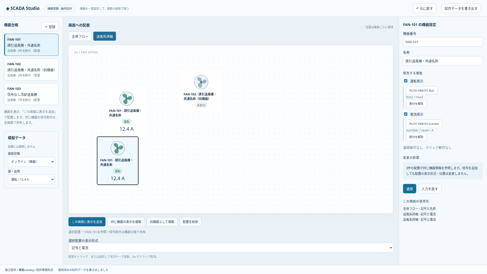

# 機器登録・図面からの機器化・画面再利用の詳細検討

文書の位置付け: **追加提案・独立試作。Equipmentの製品実装・採用済みschemaではない。** 現在の対応範囲と保存契約は[実装状況](implementation-status.md)を正とする。

本書はサイドチャットでの詳細設計案。実装指示・採用済みschema・Runtime完成を示さない。[追加検討とレビュー](scada-authoring-plant-operations-proposal.md)の§3・15・16を具体化する。基準は[統合設計](scada-integrated-design.md)、概念の出典は[上流設計 §7](upstream/industrial/scada-design.md#7-equipment--symbol--faceplate--dialog)。実装済みの1段・読取専用埋込Viewの範囲や保存契約を変更しない。

## 1. 初期案の中心

「運転信号だけの送風機を図面から登録し、同じ機器を別画面へ配置し、後から電流を追加してトレンドに選ぶ」を最初の一連の操作とする。実機接続前でも、未割付と模擬値で検証できる。

- 最初に必要なのは名称と表示。信号なしでも下書き・配置を作れる。
- 使う機能を増やしたときだけ、対応する信号と設定を求める。
- 信号の割付は機器に一度設定し、表示・Faceplate・共通画面から参照する。
- 機器番号の変更と機器の同一性は分離する。参照は安定したIDで持つ。
- 一つの登録画面に全機能を展開せず、概要・信号・表示とクリック動作・使用先へ整理する。

## 2. 用語と情報の所有者

| 概念                         | 所有する情報                                                       | 所有しない情報                   |
| ---------------------------- | ------------------------------------------------------------------ | -------------------------------- |
| 機器種別／EquipmentType      | slotの役割・型・方向、任意機能、標準の表示候補                     | 個々の実タグ割付                 |
| 登録プリセット               | 種別と推奨機能・表示の初期値                                       | 自動継承する別の型階層           |
| 登録機器／EquipmentInstance  | 安定ID、機器番号・名称・所属、採用機能、slot割付、標準クリック動作 | 画面ごとの座標                   |
| Symbol定義                   | 形状、公開した表示項目、slot参照による状態表現                     | 機器ごとの実タグの重複設定       |
| 画面上の配置                 | 機器参照、表示定義、位置・寸法・向き、明示した外観差分             | 独立した機器信号台帳             |
| Faceplate／共通画面          | 型付きcontext、表示と操作の定義                                    | 呼出元から暗黙に推測した操作対象 |
| 独立作成用の画面テンプレート | 作成元の構成、割付に必要な役割、依存定義                           | 作成後の画面への自動更新         |

「機器テンプレート」という画面上の呼称はEquipmentTypeと登録プリセットの組合せとして整理し、同じ責務の第3の機器モデルを増やさない。永続化の具体的な構造は実装前にRust／TS／schemaで揃える。

誘引・押込・冷却・減温は、初期は送風機の用途情報と登録プリセットを候補とする。実際の信号・操作契約が異なる場合に種別を分け、用途名だけで制御方式を決めない。

## 3. 信号と機能の状態

| 設定・実行状態             | 作成画面                         | Runtime表示の原則                                  |
| -------------------------- | -------------------------------- | -------------------------------------------------- |
| 機能を採用していない       | 追加可能な機能として表示         | 対応要素を設けない。故障監視なしを正常と表現しない |
| 採用済み、未割付           | 未割付として修正先を示す         | 未設定。操作は実行できない                         |
| 割付済み、catalog未確認    | オフライン未確認                 | 接続時に検証。未確認を正常値にしない               |
| 型・方向等の不一致         | 確定エラーと理由                 | 不正Bindingの操作を拒否                            |
| 割付正常、値がBad／Stale等 | 設定正常と取得状態を別表示       | 品質不明。ゼロや停止へ置換しない                   |
| 割付正常、良好な値         | 必要なら模擬・実値を区別して表示 | 定義した設備状態を表示                             |

下書き保存と本番での実行可否は別判定。構造上の不正参照は確定しないが、未割付の機器を編集保存できる設計を候補とする。Project全体を一律に起動不能にする条件は追加せず、不成立の表示・Actionの扱いを局所的に定める。

slotの型は上流契約を使う（例：抽象boolとHubのbitを対応）。read/writeのmetadataだけでは起動・停止の手順は決まらない。保持ビット、パルス、要求と応答等の操作方式はHost／PLCの契約があるものだけ選択できるようにする。

## 4. 操作A：運転信号だけの送風機を先に登録

1. 機器一覧の「追加」で送風機を選ぶ。用途は任意とする。
2. 機器番号 `FAN-101`、名称「誘引送風機1号」、所属を入力する。
3. 初期候補は静的表示。「運転表示」を追加すると運転slotの1行が現れる。
4. Hubタグ選択で型・説明・単位等を確認し、運転slotへ割り付ける。オフラインなら未割付のまま保存できる。
5. クリック動作は「なし」を初期候補とする。遠隔操作やFaceplateを自動追加しない。
6. 停止・運転・取得不明の表示見本を確認して登録する。
7. 機器一覧から図面へドラッグし、配置位置を確定する。既に登録済みなので新しい機器を作らない。

概要には「運転表示あり／故障監視なし／遠隔操作なし／クリック動作なし」と表示する。設定項目を省略した理由がわかり、後から機能を追加できる。

機器番号の重複は、初期案ではProject内で検出して明示する。禁止範囲をProject全体・所属内のどちらにするかは未決で、内部IDによる同一性とは分ける。

### 4.1 同じ機器を別画面にも表示

既存機器を選んでドロップする。表示形式は「記号のみ／名称付き／計測値付き」等、定義済みの候補から選ぶ。機器の割付は共用する。配置選択時には「FAN-101／この機器の使用先2件」と示す。

通常の図形コピーで同じ機器参照を持つ配置を複製する場合は、メニューや完了表示で「同じ機器の表示を複製」と説明する。別機器を作る入口は「別の機器として複製」に分ける。

## 5. 操作B：後から電流信号を追加

1. 図面のFAN-101から「機器設定」を開く。編集対象が配置ではなく登録機器であることを見出しに示す。
2. 「電流表示」を追加し、電流slotへタグを選択する。
3. 単位・桁数は取得可能なmetadataを候補にし、ない場合は明示入力する。Hubの工学値を重ねてスケーリングしない。
4. 適用前に、機器情報を共有する配置と、電流表示に対応する表示定義を一覧にする。
5. 登録機器の設定を一度更新する。単純記号の配置へ電流Textを勝手に追加しない。電流表示を持つ定義は新しい割付を利用する。
6. 必要な配置で「計測値付き」へ表示形式を変更する。既存の位置を保持し、外形寸法の変更は見本で確認する。
7. 「関連トレンドへ追加」で電流を選ぶ。未記録なら記録設定への導線を示し、表示ペンの追加と本番の記録開始を区別する。

機能を取り除くときは表示・Faceplate・Action・記録設定の使用先を表示する。ペンや履歴を自動削除しない。使用中slotの削除は、参照の解消または明示した再割付と一括で検証する。

## 6. 操作C：図面から機器として登録

### 6.1 初期の変換対象

初期は単一画面の選択図形と、その図形が直接持つ対応可能なBindingを対象とする。画像・入れ子の共有定義・複雑な式・Action等は、対応範囲を実装時に明示する。対応不能な内容を落として成功にしない。線や配管を自動で含めず、選択プレビューで含む／除くを指定する。

登録UIでは次を順に確認する。

| 段階 | 確認すること                                           |
| ---- | ------------------------------------------------------ |
| 対象 | どの図形・ラベルを機器の外観に含めるか                 |
| 機器 | 新しい機器か既存機器との関連付けか                     |
| 信号 | 既存Bindingを運転・故障・電流等のslotへ明示対応付け    |
| 表示 | 固定文字か機器名の表示か、共通にする色と配置固有の外観 |
| 影響 | 生成・参照する定義、除外物、既存の使用先、残る未割付   |

名前の似たタグを自動確定しない。複数の候補が同じslotへ競合する場合は選択を求める。既存機器との関連付けでは、その機器の割付を図面側のタグで上書きしない。差異を表示し、機器側の割付を使うか、別機器にするかを選ぶ。

### 6.2 見た目を保つための条件

変換は機器・外観定義・配置置換を一つの編集トランザクションにする。取消・失敗では変更なし、Undoで全体を戻す。ロック対象は既存の編集ロック規則に従う。

位置・回転・外形と描画順を検証する。選択図形の間に未選択図形が挟まる場合、単一Symbolへまとめると重なりが変わり得る。初期は見た目を保てない構成を理由付きで止め、選択の見直しを案内する。非一様拡縮、文字、透明度も変換前後で比較する。

「テンプレートとして保存」は機器登録と別操作とする。実タグを共通定義へ焼き込まず、役割と型へ置き換える。固定参照が必要な例外は明示し、初期から任意の抽出・一般化を約束しない。

## 7. 画面再利用とcontext

| 入口                   | 共有するもの                                 | 個別に設定するもの     |
| ---------------------- | -------------------------------------------- | ---------------------- |
| 既存画面を埋め込む     | 同じ画面実体と、その画面の参照機器           | 外枠の位置・寸法等     |
| 共通画面を配置する     | 型付きslotで書かれた表示・動作定義           | 対象機器、外枠         |
| この画面から新規作成   | 初期構成をコピー。依存定義は選んだ方針で共有 | 新しい画面と機器対応   |
| テンプレートとして登録 | 繰り返し独立作成するためのひな型             | 適用時の機器・タグ対応 |

[初期埋込View](embedded-screen-design.md)の非対話描画に、共通画面の機器差替えや設備操作を混ぜない。共通画面の保存形式はScreen／Faceplate／Symbolとの重複を避けて別途決める。

### 7.1 共通画面の対象機器

初期検討は一つの明示的なEquipment contextに限定する。送風機詳細を配置するとき、1号機または2号機を指定する。定義側のslot適合を検証し、任意の電流slotがない場合は定義した非表示／未採用表示を使う。必須slot不足と取得不明を混同しない。

画面の選択変更や別のFaceplate表示で、既に開いている画面の対象が変わらないことを原則とする。複数表示ではタイトルに機器番号を常時表示する。対象変更時には未送信入力の確認と再検証を行い、旧機器への入力を新機器へ送信しない。

### 7.2 独立画面を作るときの対応表

機器ごとに「同じ機器／別機器へ割付／新規機器／未割付」を選ぶ。共用ユーティリティと新規ライン設備を混在させられる。別機器・新規機器では、操作対象の割付を明示確認する。コピーした座標や色が正しくても割付完了とは扱わない。

画面は独立しても共有Symbol・参照画面・登録機器は共有され得る。作成確認で「独立するもの／共有を続けるもの」を表示する。初期は依存関係の全自動複製・テンプレート更新の自動マージを含めない。

## 8. 共通定義の更新と差分

既存の参照定義を編集すれば使用先へ影響することと、配布された新しいテンプレートを採用することを分ける。

- Project内の共通定義編集：使用先を確認して確定。同じ定義IDを参照する対象へ反映する。
- ライブラリ等からの新しい定義の取込：更新候補を確認し、明示的に適用する。既存のImport設計へ接続する。
- 独立作成済み画面：元テンプレートの変更を自動適用しない。
- 本番：編集Projectの確定と、本番配布・稼働版への適用は別段階。

| 差分                       | 確認・適用の原則                                         |
| -------------------------- | -------------------------------------------------------- |
| 共通の形・標準色           | 使用先と見本を表示。明示した配置側の上書きを保持         |
| 任意slotの追加             | 既存機器に割付を強制しない。既定は未採用                 |
| 必須slot追加、型・方向変更 | 影響機器を列挙し、整合する移行案なしに一部だけ更新しない |
| slot削除                   | 表示・Action・条件等の参照を確認し、孤立参照を残さない   |
| 機器の実タグ変更           | その機器の全使用先と操作対象への影響を示す               |
| 外観の個別変更             | 共通値／個別値の由来を表示し、「共通値へ戻す」を用意     |

外観の初期優先順位案は「明示した配置差分→共通表示定義」。機器単位の外観上書きという第3層は必要性が出てから検討する。共通更新は保存済み定義との比較を使い、単なる表示名の一致で対応付けない。

## 9. UI案と入力保護

機器一覧は番号・名称・種別・所属・未割付件数を持つ平坦な一覧を基本にし、検索と所属の絞込みを用意する。詳細は固定ペインで編集し、図面との行き来で位置を動かさない。

- 概要：名称・所属・使用する機能。機能を追加する入口。
- 信号：役割／型・方向／割付先／確認状態の表。行から共通タグ選択を開く。
- 表示と動作：表示形式、状態見本、クリック動作、必要なFaceplate。
- 使用先：画面・表示・条件・記録等への参照。対象へ移動。

複数行の機器設定・割付は「適用」で一括確定する案。図形座標のEnter／blur確定を実タグ割付や設備操作へ流用しない。選択変更・画面移動には既存の入力保護を接続し、検索やタブ切替で入力を捨てない。

ドックには機器と登録プリセットを見分ける名称・補助表示を付ける。既存機器のドロップは表示追加、プリセットのドロップは機器登録の入口とする。ドロップだけで同名機器や有効な操作割付を量産しない。キーボードからも同じ操作を使えるようにする。

## 10. 受入シナリオ

| ケース                         | 確認する結果                                           |
| ------------------------------ | ------------------------------------------------------ |
| 信号なし→運転だけ→電流を追加   | 必要な項目だけ増え、不要なFaceplate・操作を要求しない  |
| 同じ機器を2画面へ配置          | 割付は一度。機器名変更は両方、配置移動は片方だけに反映 |
| 別機器として複製               | 元の操作先を無確認で引き継がず、対応表で確認できる     |
| 図面からの登録                 | 変換前後の見た目を保持し、失敗・取消・Undoで元へ戻る   |
| 重なりを保持できない図形集合   | 変換を止め、見た目を変えて成功にしない                 |
| 電流のない機器に共通画面を配置 | 未採用と未割付と取得不明を区別する                     |
| 共通画面を2機器で同時表示      | 表示・入力・操作のcontextが混ざらない                  |
| 共通色更新と個別色             | 共通値だけ更新し、個別値の由来と復帰方法がわかる       |
| 必須slot変更                   | 全使用先の影響がわかり、不整合な部分適用をしない       |
| 独立画面と共有依存             | レイアウトの独立とSymbol等の共有を区別できる           |
| 電流をトレンドへ追加           | 記録と表示の操作を分け、元タグを再入力しない           |
| オフライン編集                 | 未確認を表示し、再接続時の再検証で誤割付を検出する     |

これらは今後の試験設計であり、試験済みの記録ではない。最初の試作では所要時間だけでなく、再入力回数、対象取り違え、未割付の発見、影響先を説明できるかを確認する。

## 11. 次に確定する判断

1. 登録機器の番号の一意性と所属階層の範囲。
2. 初期の送風機・計器slotセット、任意機能の依存、型・単位の検証契約。
3. 機能の採用状態と未割付を永続化する最小モデル。
4. 図面から変換できる図形・Bindingと、描画順を保つための制限。
5. 表示定義の公開項目、機器の標準クリック動作と配置側で許す差分。
6. 共通画面の型付きcontextと既存Faceplate・Screenモデルとの対応。
7. 定義更新・Import時のIDと版の扱い、原子的な移行とUndoの範囲。
8. テンプレートの初期保存場所。初期候補はProject内とし、共有ライブラリ配布は別工程。

初期検討では、送風機と単一計器、単一機器context、既定機能、明示的な割付を優先する。設備ユニット、多段継承、複数context、自由なブロック合成は、この操作検証から必要性を判断する。

## 12. 初期の登録画面と信号セット

以下は§11の論点を具体化した推奨案。試作で確認する初期値であり、採用済みの永続schemaや実機操作仕様ではない。

### 12.1 登録の最短経路

通常の登録は一つの編集画面で完結させる。別ダイアログはタグ選択と影響確認が必要な場合に限定し、毎回多段ウィザードを通さない。

```text
機器を追加                                  [取消] [登録]
種類       送風機 ▾        用途     誘引 ▾
機器番号   FAN-101          名称     誘引送風機1号
所属       第1ライン / 排ガス系統

使用する機能                 信号の割付
☑ 運転表示                   運転状態   [タグを選択]  未割付
☐ 故障表示
☐ 電流表示
☐ 周波数表示                 表示見本 [停止][運転][不明]
☐ 遠隔操作

クリック動作  なし ▾
未割付 1件  —  登録後も設定できます
```

新規登録の初期値は静的表示とし、上図は利用者が運転表示を選んだ状態。用途別プリセットを選んだ場合は、選ばれた機能を明示する。登録後は同じ編集領域に概要・信号・表示と動作・使用先を表示する。

「登録」は機器台帳へ作成する。図面からの入口には「登録して配置」または「選択図形を機器化」と結果が分かるラベルを使う。登録しただけで画面へ自動配置しない。設定した表示見本は模擬であることを示し、Runtimeの状態値に保存しない。

### 12.2 送風機の初期slot候補

| 機能             | 役割名の例 | 型・方向      | 選択時に必要な設定                         |
| ---------------- | ---------- | ------------- | ------------------------------------------ |
| 運転表示         | running    | bool / read   | 参照タグ、trueの意味                       |
| 故障表示         | fault      | bool / read   | 参照タグ、故障を表す極性                   |
| 電流表示         | current    | number / read | 参照タグ、単位、表示桁数                   |
| 周波数表示       | frequency  | number / read | 参照タグ、単位、表示桁数                   |
| 現場／遠隔の表示 | remoteMode | bool / read   | 各値の意味。実設備が多値なら別の対応定義   |
| 起動・停止操作   | 契約に従う | 契約に従う    | 要求・応答・許可条件・時間制限等の操作契約 |

running等は意味を示す例であり、既存のspeed等との重複・対応をEquipmentType設計時に整理する。周波数と回転速度は同じ量として扱わず、名称だけで換算しない。

現場／遠隔信号があることと、SCADAから操作できることは別。遠隔モードだけで起動許可を保証しない。故障がないことも起動許可の代替にしない。起動・停止操作は任意のBOOLを選べば完成する設定にせず、成立した操作契約を持つプリセットから構成する。

### 12.3 計器の初期slot候補

初期は単一の測定値を持つ温度・圧力・流量・液位計を対象とする。

| 機能         | 設定                   | 初期の扱い                                               |
| ------------ | ---------------------- | -------------------------------------------------------- |
| 測定値       | value: number / read   | 動的表示を採用した場合の中心slot                         |
| 単位・桁数   | metadata候補＋明示設定 | 信号の工学値を保持し、装飾用の表記変更と数値換算を分ける |
| 表示レンジ   | 最小・最大             | ゲージの目盛り。警報しきい値や書込み上限に流用しない     |
| センサー異常 | 任意のbool / read      | 測定値の通信品質と別に表示                               |
| 設定値変更   | 後続の操作契約         | 測定値表示に付随して自動追加しない                       |

単位metadataがないときは単位未確認とする。矛盾する単位を文字の付け替えだけで解決しない。実タグが同じ機器で複数用途に使われることは許容し、重複参照を一律エラーにしない。

## 13. 編集状態と最小の保存概念

機能は「未採用／採用」の宣言、slotは「未割付／外部名への参照」を持つ案とする。catalogでの確認結果・現在値・品質・模擬値は定義の正当性を保証する固定フラグとして保存しない。接続・catalog更新・タグ変更時に再検証する。

未採用機能の不要なslot行を通常表示しない。機能を外すときに割付がある場合は、削除される割付と使用先を示す。初期案は取消で全保持、適用で割付も解除とし、不可視の有効操作を残さない。Undoでは機能と割付をまとめて戻す。表示を隠すだけの操作とは区別する。

機器番号は初期案としてProject内で一意とし、重複は登録時に説明する。複数ラインで同じ番号を使う案件への対応は、所属込みの一意キーを導入するか再検討する。名称は重複可能とし、IDと機器番号を使い分ける。所属は既存の分類と接続し、機器登録のためだけに新しい階層管理基盤を作らない。

初期のクリック動作は登録機器の標準値を使い、配置側では「標準に従う／動作なし」を候補にする。別機器を操作する上書きは設けない。別画面への遷移等が必要な場合の扱いは、共通Action設計と合わせて追加する。

### 13.1 書込みのない作成作業と実操作

Designerで登録・割付・模擬表示を行っても、設備への要求は送らない。Runtimeの設定値入力は現在値・入力値・対象機器・単位を示して明示送信する。要求受付と動作完了は別状態として表示し、結果不明を成功にしない。

保存時の検証は構造・型付き参照・実タグmetadataとの整合を区別する。Project構造の破損は拒否し、未割付や外部タグ不成立は上流§8.4の局所的な表示・操作拒否へ接続する。未確認を確定済みと扱うことも、オフラインという理由だけで編集保存を一律拒否することもしない。

## 14. 確認を出す箇所と表示内容

通常の可逆な編集には毎回確認ダイアログを出さない。影響表は編集ペイン内で確認できる形を優先し、確認内容を読めない一律の「よろしいですか」にしない。

| 操作                               | 確認に出す情報                                 | 取消・失敗時           |
| ---------------------------------- | ---------------------------------------------- | ---------------------- |
| 同じ機器の表示を追加               | 対象番号を配置プレビューに表示                 | 新しい配置を作らない   |
| 別機器として複製                   | 新番号、共有する定義、未割付にする信号、操作先 | 元機器を変更しない     |
| 既存機器へ図形を関連付け           | 図形側と機器側の割付差、表示変更               | 図形も機器も変更しない |
| 使用中の信号割付を変更             | 旧／新外部名、型・単位、影響画面・Action       | 全使用先の割付を保持   |
| 機能を外す                         | 消える表示・割付と残る履歴・参照               | 機能と割付を保持       |
| 共通定義を更新                     | 共通変更、個別差分、型変更等の不整合           | 旧定義を保持           |
| 未送信入力のある共通画面で対象変更 | 現対象と変更先、捨てる入力                     | 元対象と入力を保持     |

別機器複製は初期案として実タグを未割付にする。同型機器の候補割付を提示しても、確認前に有効化しない。「同じ機器の別表示」なら割付はそのまま共有する。この二つを短い操作名とプレビューで見分けられるようにする。

## 15. 具体例での机上確認と次の試作

以下は設計上の机上確認で、ブラウザや実機の試験結果ではない。

| 題材            | 初期構成              | 作成者の操作             | 確認する結果                                   |
| --------------- | --------------------- | ------------------------ | ---------------------------------------------- |
| 誘引送風機1号   | 運転だけ、現場操作    | 電流を後から追加         | 電流slotを1回割付。既存の単純記号はそのまま    |
| 押込送風機2号   | 運転・故障、遠隔なし  | 監視詳細を選択           | 操作ボタンのない詳細を開ける                   |
| 冷却送風機3号   | 信号なし              | 静的配置→後で運転追加    | 機器ID・配置位置を保って増やせる               |
| 減温送風機4号   | 周波数あり            | 電流付き共通画面を使用   | 周波数を電流へ誤割付せず、不足する役割を示す   |
| 圧力計          | 測定値、単位不明      | Hub候補を割付            | 数値は確認できても単位を未確認として示す       |
| 第2ラインの画面 | 第1ラインから独立作成 | 共用設備は共有、他は新規 | 共用設備だけ旧機器を参照し、新規機器は明示割付 |

次の試作は、登録ペイン、タグ選択、割付の影響表、既存機器とプリセットを区別した配置入口の四つを対象とする。最初は模擬catalogを使い、正常・未割付・型不一致・任意信号なし・操作契約なしを切り替えて確認する。

試作の採否は、登録に必要な入力数、別機器複製後の未割付の見つけやすさ、使用先の説明の理解、戻る・取消で入力が残ることから判断する。色・寸法・アニメーションの最終値は、これらの操作を実寸表示で確認して決める。

## 16. 現行契約との差と保存モデルの推奨案

2026-10-20（日本時間）・`871920b`時点のコード照合では、[TSのProject](../apps/banto-scada/src/lib/project.ts)は0.20.0で、assets・screens・symbolsを持つ。TextのBindingはexternalNameの直接参照で、Symbol内のBindingは拒否される。[共通schema](../crates/scada-model/schema/project.schema.json)と[RustのProject](../crates/scada-model/src/lib.rs)にもEquipmentType／EquipmentInstanceはない。以下は追加設計であり、現在のファイルへ書き込める形式ではない。

その後、画像トリミングでProject0.21.0へ更新した。Equipmentが未実装である点と、以下の追加設計との区別は変わらない。

### 16.1 最小の所有関係

| 保存先               | 初期に持たせる情報                                             | 規則                                                                                 |
| -------------------- | -------------------------------------------------------------- | ------------------------------------------------------------------------------------ |
| EquipmentType        | ID、名前、機能とslotの定義、使用可能な表示定義                 | slotのIDは表示名から分離。機能が要求するslotは型内で一意に定義する                   |
| EquipmentInstance    | ID、種別ID、機器番号、名称、採用機能、slotごとの割付、標準表示 | 外部名を保存するのはここ。配置へ実タグを展開コピーしない                             |
| Symbol定義の公開契約 | 対応する種別、使用するslot、機器名等の表示項目                 | 同じSymbolの静的な既存利用と区別し、任意の親contextを暗黙に拾わない                  |
| 画面の機器配置       | 機器ID、Symbol定義ID、既存の位置・寸法・回転・表示設定         | 新しい機器台帳を配置内に入れない。Symbol配置の拡張か専用判別型かは契約実装前に決める |
| 編集中のdraft        | 未確定の入力、選択候補、影響確認                               | Project外。取消で破棄し、適用前は描画・保存へ流さない                                |

所属は任意の分類として扱い、画面のレイヤーフォルダーIDは流用しない。レイヤーフォルダーは画面／Symbolごとに所有されるため、機器の所属と寿命が異なる。初期は新しい所属ツリーを作らず、所属未指定でも登録できる。

初期の採用機能は重複のないID集合とし、採用機能が要求するslotだけを有効にする。採用slotの未割付は明示したnull等の一つの表現に統一する。未採用slotの割付は保存せず、未知の機能ID・slot ID、要求slotの欠落、種別との不整合は構造エラーとして拒否する。具体的なキー名とnull表現はschema実装時に確定する。

例えばFAN-101は「運転表示を採用、runningは未割付」で下書き保存できる。運転タグを選んだ後は、同じ機器のrunningに外部名が一つだけ保存される。電流表示を追加するとcurrentが未割付で増え、既存のrunningと各画面の配置は変わらない。

同じ概念を「機能の有効フラグ」「slotの有効フラグ」「表示の有効フラグ」に重複保存しない。表示形式が電流を使わないことと、機器が電流機能を採用していないことは区別する。定義が使う任意slotには、未採用時の扱いを明記する。

### 16.2 Bindingの解決と検証

将来のBindingは、直接タグ参照と機器slot参照を判別できる形にする案とする。一つのBindingにexternalNameとslot参照を同居させず、両方指定された際の優先順位も設けない。既存の直接参照は通常のText用として残し、機器表示へ変換するときだけ明示的にslot参照へ置換する。

解決順は「配置の機器ID → 機器種別 → 採用機能 → slot割付 → catalog検証 → 値・品質」。機器名表示は機器metadata参照とし、信号slotや実タグとして登録しない。Symbol内部のslot参照は明示した機器contextから解決し、画面の選択対象や最後に開いた機器を参照しない。

| 判定段階 | 結果                                   | 表示・確定の扱い                               |
| -------- | -------------------------------------- | ---------------------------------------------- |
| 構造     | 機器・種別・表示定義が欠損、slotが未知 | 編集の確定と読込を拒否し、参照元を案内         |
| 採用状態 | 任意機能が未採用                       | 定義した非表示／未採用表示。正常値を合成しない |
| 割付     | 採用slotが未割付                       | 下書き保存可能。表示は未設定                   |
| catalog  | オフライン・未取得                     | 未確認。前回検証の成功を固定して信頼しない     |
| catalog  | 型・方向・確認可能な単位の不一致       | 理由を表示し、このslotを利用不可にする         |
| 値       | 未受信・Bad・Stale等                   | 品質不明。0、false、正常色へ代入しない         |
| 値       | 利用可能                               | slotの意味と極性に従って表示                   |

catalog不一致の扱いは、保存済み割付が後から不適合になった場合と、新規割付の適用を区別する。既知の不適合候補は新規適用を拒否し、保存済み設定は原因確認・再割付のために保持する。単位不明は既知の不一致とは別に案内し、数値型の一致だけで単位確認済みとしない。

contextが未指定のslot参照を含むSymbolは、通常の静的部品として配置できない。初期の機器用Symbolは入れ子を対象外とし、内側の機器context継承・差替えを後続へ分ける。ミニマップ・埋込View・小窓も同じ読取解決結果を使い、別々の割付台帳を持たない。

### 16.3 変更・削除とUndo

機器更新は台帳の1件と参照整合性を検証して確定する。参照する配置ごとに外部名を書き換える処理は不要にする。非同期catalog選択の開始時にはProject世代・対象機器・draft世代を固定し、対象変更後の遅延結果を別の機器へ適用しない。

機器の削除は、初期は配置を含む使用先があれば拒否し、使用先へ案内する。最後の配置を削除しても機器台帳を自動削除しない。共有SymbolとEquipmentTypeも参照中は削除しない。未使用機器の削除、機能と割付の変更、機器作成と配置を伴う操作は、それぞれUndo1回で元の整合した状態へ戻す。

Undo用のProject snapshotへ実値・catalog・通信状態を入れない。Undo後の参照は現在のcatalogと値で再解決する。過去の画面に戻す操作が、過去の設備状態を再現したように見えないようにする。

## 17. 初期実装を小さく区切る案

各段階は設計提案であり、メインチャットの実装順を変更する指示ではない。最初から遠隔操作・Faceplate・共通画面の保存契約を一括導入せず、次の順で中核の作業を確認する。

| 段階                        | 提供するもの                                                            | この段階の完了条件                                                               |
| --------------------------- | ----------------------------------------------------------------------- | -------------------------------------------------------------------------------- |
| A：独立した操作試作         | 模擬catalog、機器登録、同じ機器の表示追加、別機器複製、電流追加の影響表 | 登録→2画面で同一機器→電流追加を再入力なしで試せる。実アプリの保存形式を使わない  |
| B：台帳・読取契約           | 種別・機器・採用機能・未割付、登録UI、保存／読込／Undo                  | Rust・TS・schema・サンプルで同じ正常／不正データを判定し、静的な機器を登録できる |
| C：読取表示                 | 運転表示と数値計器、機器名表示、機器context付きSymbol配置               | 模擬値で運転・停止・不明を確認。同じ機器を複数表示しても割付が一つ               |
| D：限定した図面からの機器化 | 対応図形と単純な読取Bindingの明示対応、原子的置換                       | 見た目・順序・座標を保持。未対応は理由付き拒否、取消／Undoで全体復元             |
| E：共通画面・監視詳細       | 単一機器context、読取詳細、任意slotの扱い                               | 複数機器を同時表示して対象が混ざらず、既存埋込Viewと区別できる                   |

遠隔書込みはHost／PLCの操作契約が成立してから追加する。初期のUIに利用不能な起動・停止ボタンを置くことで実装済みに見せない。トレンドへの追加は記録／表示モデルを確定した工程へ接続し、先行試作では選択と受渡しの見本までにする。

図面からの機器化は、台帳・読取contextを先に通してから実装する。初期候補は矩形・楕円・Text・Polylineと、対応可能なText直接参照。画像・screenView・入れ子Symbol・回転や重なりを保持できない選択は範囲外と明示し、対応図形だけを抜き出して無断変換しない。

### 17.1 最初の試作で比較する操作

1. FAN-101を信号なしで登録し、運転表示を追加して未割付のまま閉じ、再度開く。
2. 模擬catalogからrunningを割り付け、同じ機器を2画面へ置く。片方を動かし、機器名を変更する。
3. currentを追加し、単純記号は変えず、片方だけ計測値付きに切り替える。
4. 「同じ機器の表示を複製」と「別機器として複製」を続けて使い、参照先と未割付を見分ける。
5. 未確定入力を持ったまま対象変更・取消を行い、遅延したタグ選択結果が別機器へ流れないことを確かめる。

成功時間だけでなく、実タグの再入力数、操作対象の回答、未割付の発見、取消後の復元を記録する。試作で迷いが出た場合は、機能追加より先に入口の名前と対象表示を修正する。

## 18. 実装前に残す判断

§11のうち番号一意性・機能状態・クリック動作は§13の推奨案まで進んだ。次は以下を決める必要がある。いずれも本書への追記だけで採用確定とはしない。

- 機器配置を既存Symbol配置の拡張にするか専用の判別型にするか。contextのない通常Symbolとの検証を単純に保てる方を選ぶ。
- 機能・slot・表示定義のIDと、Project内の参照契約。表示名の変更で参照を切らず、Import時の再対応にも使えるようにする。
- 読取slotのbool極性と数値metadataの所有先。型共通の意味と、機器固有の割付差を重複保存しない。
- 台帳件数・slot数・機器表示の展開予算。既存の埋込表示・小窓の上限との集計方法を契約化する。
- 新しいschemaVersion・minRuntimeVersionと現行サンプルの更新範囲。旧形式の移行を初期実装の必須条件にしないというリポジトリ方針に従う。

この節までの作業は文書と現行コードの照合であり、機器機能の実装・ブラウザ試験・実機試験は行っていない。

## 19. 独立した操作試作（2026-10-20・日本時間）

段階Aの操作確認用に、[単体HTML](prototypes/equipment-authoring/standalone.html)と[操作手順・検証記録](prototypes/equipment-authoring/README.md)を作成した。本体アプリ・Project契約・実機接続には変更を加えていない。

送風機の静的登録、運転・電流の任意採用と模擬catalog割付、2画面での共有参照、配置ごとの位置・表示形式、同機器の表示複製と別機器の未割付複製を操作できる。入力保護・型／単位不一致の拒否・Undo・試作専用JSON書出しも接続した。再読込で初期化するため、必要な結果は書き出す。

Chromiumで39項目が成功。未採用／未割付／catalog未確認／Staleの識別、共有参照と個別位置、機能追加時の表示形式保持、複製、入力の継続と破棄、番号重複、ドラッグ・Esc・キーボード、Undo、出力内容を確認した。1536×864（125%相当のCSS表示領域）と760×900で横はみ出しがなく、固定プロパティがキャンバスを覆わないことも確認した。

これは独立試作の検証であり、本体機器機能の実装完了・実機試験・利用者による操作速度の評価ではない。非同期catalog応答・本体への保存復元・図面からの機器化・共通画面・設備操作は未実装。次の判断は、この試作で機器と配置の違いが分かりやすいかを確認し、§18の保存契約を確定すること。


