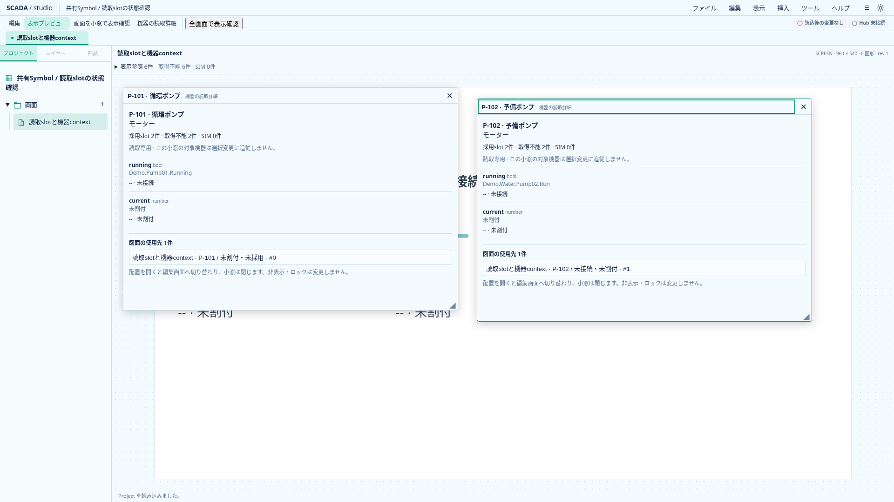
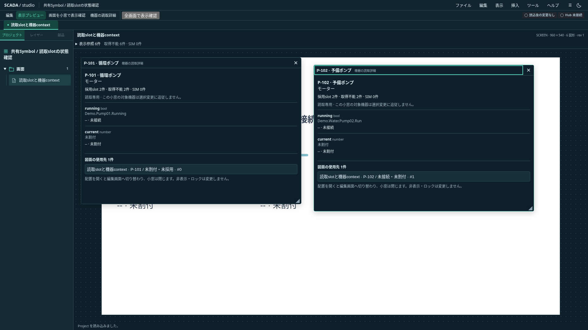

# 機器の読取詳細

2026-10-20。Project 0.27.0のまま、表示プレビューに読取専用の機器小窓を追加する。正式なFaceplate定義・機器context付き共通画面・操作機能の完成を意味しない。通常Designerは実Hub未接続であり、値・Quality更新の検証にはテスト入力を使用する。

## 入口と表示

「表示プレビュー」→ツールバー「機器の読取詳細」から、機器番号・名前で検索し、小窓を開く。タイトルに機器番号と名前を常時表示する。対象は開いた時点の機器IDに固定し、別の機器を開いても既存窓の対象を変えない。同じ機器を選ぶと、位置とサイズを維持して既存窓を前面へ出す。

機器種別の宣言順で、採用した読取slotを列挙する。図面が使うslotだけには限定しない。未割付のnull bindingも行として残す。採用なしは空一覧であることを明示する。未採用slotを架空の値で埋めない。

各行にrole名・型・外部名・値または取得不能状態・Quality・理由・SIM・来歴を表示する。Goodのfalseと0を値として扱い、Bad／Staleでは以前の値を表示しない。世代・Project一致の検査は既存のReadSlot sessionに委ねる。20件ずつのページ切替で、最大でも1窓20行をDOMに置く。

## 小窓と状態の所有

画面小窓と同じ領域・前後関係・移動／resize・Esc・フォーカス復帰を使う。合計4件まで。機器小窓はSVG描画を増やさず、画面小窓の展開配置20,000件上限は維持する。開くためのpickerはBanto Modalを再利用する。

位置や開閉は保存・Undoに含めない。画面切替・編集復帰・Project交換で閉じる。同じIDを持つ別ファイルの読込でも小窓を引き継がない。小窓管理へ渡されたProjectから対象が消えた場合も閉じる。通常の更新では現在の機器情報・読取contextを使う。

小窓識別は一時的な`kind + targetId`。`preview-popups.ts`が件数・位置・順序を管理し、`PreviewPopups.svelte`がpickerと寿命、`PreviewWindow.svelte`が枠と操作、`EquipmentReadDetails.svelte`が機器内容を持つ。機器の保存宣言と割付確認を`resolveEquipmentSlot`へ分離し、既存Symbol側も同じ関数へ委譲する。架空のSymbol定義や独自のQuality判定は作らない。

## 検証と後続

TSで共通ReadSlot fixtureの全状態、false／0、採用順・未割付・採用なし・世代失効・同ID別Projectを確認する。小窓の種類をまたぐ同対象の識別・前面・上限・位置保持も検証する。ブラウザでは両テーマで機器二窓と画面窓の前後関係、Escと復帰、保存内容不変、編集復帰／同IDファイル交換での破棄を確認する。同一mountの主画面／埋込／Popup試験に機器詳細二件を加え、同じframeからの更新・失効を確認する。

独自Faceplateレイアウト、型付き共通画面、操作Actionと認可、実Hub接続は後続。industrial #682の共有SDK契約を満たさず購読ライフサイクルを独自実装することはしない。

以下は実アプリの撮影。未接続と未割付を表示するため、撮影用Projectの機器割付にDemo外部名とnullを設定した。実機の運転値ではない。

## 選択Symbolからの直接起動

編集時にSymbolを一つ選ぶと、プロパティの「関連機器の読取詳細を開く」から表示プレビューへ切り替えて対象機器の小窓を直接開ける。ロック中でも読取確認は可能。機器未関連付けでは理由を表示し無効にする。

未適用入力は適用／破棄／キャンセルで解決する。入力の適用後に配置の機器IDを読み直し、適用なら新しい機器、破棄なら元の機器を開く。適用によって関連付けがなくなった場合は編集画面に残る。プレビュー切替と小窓を開く処理は履歴を増やさず、元のInspector DOMをフォーカス復帰先に保持しない。非同期の起動前にProject世代・画面・modeを照合する。

## 読取詳細から図面の使用先へ移動

機器小窓の「図面の使用先」に、同じ機器を参照する直接Symbol配置を全画面から列挙する。画面名・配置名・描画順と非表示状態を確認し、20件ずつ切り替える。採用slotのページとは独立する。配置がない場合は空であることを明示する。埋込画面内の同じ配置を別使用先として重複列挙しない。

配置を選ぶと編集画面へ切り替わり、小窓はすべて閉じる。該当画面・レイヤー・プロパティへ移動し、幾何グループに属する配置は既存のグループ全体の選択を維持する。非表示やロックを自動解除せず、保存内容・Undoは変更しない。移動前後でProject世代・mode・配置とSymbol／機器参照を照合し、遅延表示の古い対象へ移動しない。

`e2e/equipment-usage-navigation.spec.ts`で両テーマの別画面・非表示／ロック・グループ・24使用先のページ切替と保存内容不変を確認する。実装は既存の`openSymbolUsage`へプレビューからの入口を追加し、選択・表示移動を重複実装しない。
