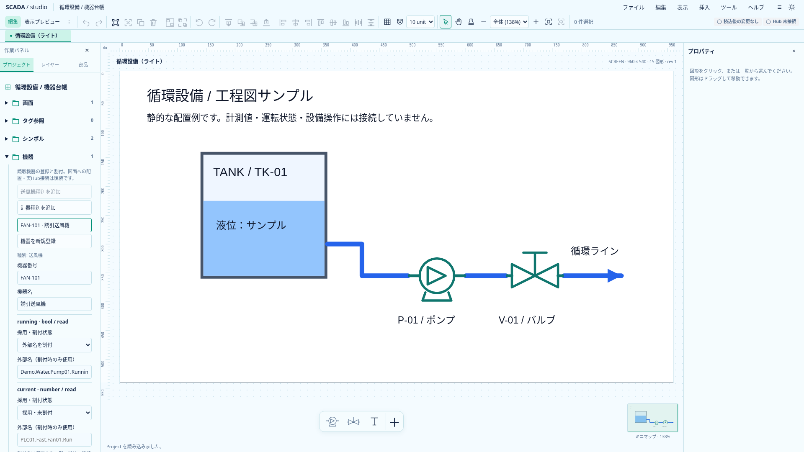
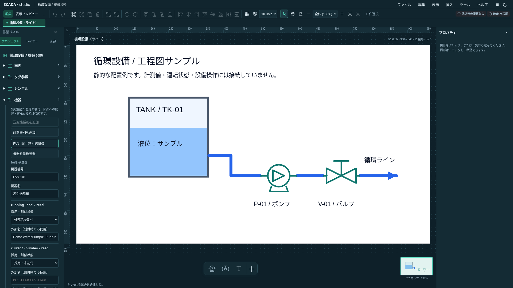

# Equipmentの保存契約と初期台帳

状態: **Project 0.23.0の保存・検証・CRUDと、プロジェクトツリー内の初期台帳を実装。** 2026-10-20。機器と図面の関連付け、動的Symbol、実Hub接続、Faceplate、書込みは後続。[統合設計](scada-integrated-design.md)を基準に、[追加検討](equipment-authoring-detail-proposal.md)から読取機器の最小範囲を具体化した。

本文は0.23.0の区切りを記録する。0.24.0で[Symbol配置の機器参照と使用先](equipment-symbol-association.md)を追加し、使用中機器の削除も保護した。現在の対応範囲は実装状況を参照する。

## 所有者と保存形式

Projectへ省略可能な`equipmentTypes`（最大100）と`equipment`（最大1000）を追加する。未使用の既存サンプルへ空配列を勝手に補完しない。Type・InstanceのIDは他の配置・画面等と同じProject全体のUUIDv7一意性を使う。機器番号や表示名でIDを置き換えない。

| 保存項目          | 内容                                                                    |
| ----------------- | ----------------------------------------------------------------------- |
| EquipmentType     | `id`、`name`、`slots`。名前は200文字まで、slotは最大64                  |
| slot宣言          | `name`、`type: bool / number`、`direction: read`。型内で名前は一意      |
| EquipmentInstance | `id`、`typeId`、`code`、`name`、`bindings`。座標・現在値を持たない      |
| 採用slotのbinding | `slotName`と`externalName: string / null`。最大64、同じ役割の重複を拒否 |

slot名はASCII英字またはunderscoreから始まる英数字／underscoreの1〜64文字。機器番号はASCII英数字から始まる英数字と`._:/-`の1〜64文字とし、Project全体で大文字小文字を区別して一意にする。日本語の名称は別の`name`に設定できる。CRUDでは番号・名称の前後空白を除き、ファイル読込時の非正規形番号は拒否する。許可文字以外を明示拒否し、JSの`$`が末尾改行直前にも一致する差を避ける。

binding行なしは**未採用**、行があり外部名nullは**採用・未割付**、文字列は**割付済み**。外部名をtrim・推測変換せず、複数機器・slotで同じ外部名を使える。空欄・空白だけの外部名は拒否する。Unicode空白の集合はschemaとRuntime planで明示的に揃え、U+0085・U+1680・FEFF等を共通fixtureで検証する。

Project内に値・Quality・接続先・認証情報を保存しない。0.1.0の既存読込経路は0.23.0へ移行するが、0.2.0〜0.22.0の移行は追加しない。リリース前の互換性保証はしない。TS／Rust／schema／現行サンプルとバージョン表示を揃えた。

## 原子的な編集

`create/update/remove-equipment-type`と`create/update/remove-equipment`を既存のProjectコマンド分類へ追加し、`equipment-handler.ts`へ分離した。入力Projectの検証、候補上の編集、全体検証、revision更新とUndoの境界は既存経路に保つ。失敗では現在のProjectと履歴を変更せず、同値はno-opになる。

採用中slotは外部名nullでも、削除・改名・型変更を拒否する。外部名を一度消すだけでは未採用にならないため、明示的にbinding行を除く必要がある。未採用slotの変更は可能。使用中Typeの削除を拒否し、Instanceの種別変更コマンドは初回には提供しない。別種別の同名slotへ暗黙移行しない。

Instanceの削除は可能。現段階では図面から機器への参照自体がないためであり、配置参照を追加する段階で使用中削除保護も追加する。画面の複製で機器を量産せず、Projectの機器台帳を共有したままにする。今回の図形clipboardは機器を取り込まない。

## 初期UI

編集モードの「プロジェクト」→「機器」で、送風機（running／current）と計器（value）の読取種別を追加できる。同じ初期定義がある場合は追加ボタンを無効化する。機器番号・名称・種別を選んで登録し、成功後は作成機器を選択して割付を続ける。

機器を選ぶと番号・名称と、各slotの「未採用／採用・未割付／外部名を割付」を編集できる。外部名欄は「外部名を割付」の場合だけ保存に使う。登録・適用は明示ボタンで一括確定する。実catalog未確認であり、割付を保存しても型・単位・接続の正常性が確認済みとは表示しない。

既存draft guardへ全フォーム項目の確定基準値を渡し、機器選択・新規登録・画面切替・Undo等で未適用入力を保護する。IME中のEnter／submitを適用へ使わない。遅延適用ではworkspace世代とProject ID、接続済みのformと機器IDを検査する。プレビューには編集UIを出さない。

これは小規模台帳の初期導線。種別の汎用編集・削除UI、大量機器の検索／一覧workspace、複製、タグ選択ダイアログ、図面からの機器化は後続とする。

## 読取adapterとの接続

`Project::equipment_read_bindings()`が採用slotだけを返し、`ReadSlotPlan::from_project()`で機器IDと役割を型付きcontextへ変換する。未採用は含まず、未割付はNoneを保持する。plan構築は`Result`で返し、検証済み入力からでもpanicへ落とさない。

[先行した読取adapter](typed-read-slots-design.md)と固定SDKの境界を維持する。SDK #682、session世代管理、Host・認証の前提を迂回せず、ブラウザからの実設備要求は追加しない。今回新しいBanto／industrialの変更要求は発生していない。

## 検証とレビュー

- TS715件、型チェックはエラー／警告なし。
- Rust43件（model25、runtime15、SDK統合3）、Clippy、buildが成功。
- TS／Rust共通の保存ケース35件。参照欠損・ID／番号／slot重複・write拒否・改行12ケース・特殊空白5ケースを含む。
- 関連ブラウザ24件が成功。両テーマの登録／割付／保存、入力保護とUndo、重複番号、未入力でのmode切替、IME、旧版拒否、既存group／folder drag／画面／viewportを確認。

Astraレビューで、未入力の種別selectがdraft扱いになる問題と、改行／Unicode空白の解釈差を修正した。初回ブラウザは前者で3件失敗。次の2件の失敗はselectのラベルlocatorに起因し、roleで対象を指定して解消した。最終24件は全て成功し、テストの無効化やassert緩和はしていない。修正後の静的再レビューでも追加の必須修正なしと確認した。

## 実画面

`scripts/capture-equipment.mjs`で1920×1080、両テーマを撮影。中央は独立した静的な工程図サンプルで、左の機器と図面の配置はまだ関連付けていない。背景は画面設定の色を保持する。台帳の下部項目は左パネル内をスクロールして操作する。

撮影後の説明文整理も機器UIの5件で再確認し、全成功した。全体整形と変更文書のローカルリンクを確認してコミットする。最終差分の全体CIはPush後に確認する。

## 台帳の検索とページ表示

機器一覧には検索欄を一つ置き、機器番号・名前・種別名を絞り込む。全角英数字と英字の大小を吸収し、保存値は変更しない。登録順を保って20件ずつ表示し、検索条件を変えると最初のページへ戻る。

検索やページ切替だけでは編集対象を変えない。結果外になった機器も入力を保持し、その機器番号を表示する。別機器の選択時には既存の未適用入力確認を使う。検索・ページはProject／履歴へ保存せず、別ファイルの読込で初期化する。55件の台帳でページ境界、全角検索、種別名検索、結果なし、入力保持・破棄・保存不変を実ブラウザで確認する。
