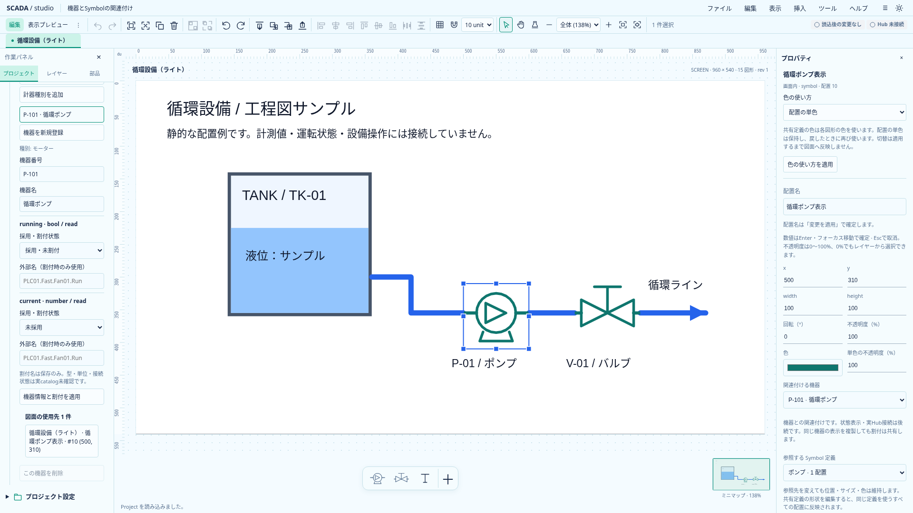
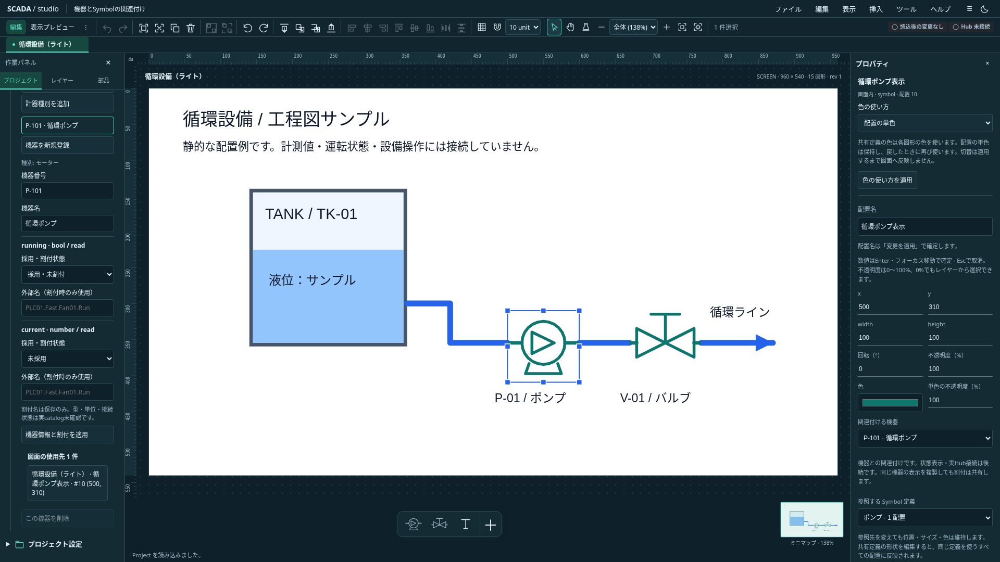

# Symbol配置と機器の関連付け

状態: **Project 0.24.0の保存契約・編集・使用先・削除保護を実装。** 2026-10-20。[初期機器台帳](equipment-register-design.md)に、図面の静的Symbol配置から登録機器を参照する最小範囲を追加した。型付きslotを使う動的表示・実値表示・機器からの自動作図は後続。

## 保存と責務

画面上のSymbolの`shape`に省略可能な`equipmentId`を追加した。同一Projectの登録機器IDを参照し、欠損参照・null・不正IDはTS／Rustで拒否する。関連付け解除は項目の省略。共有Symbol定義内や他の図形には持ち込まない。

機器の番号・名称・slot割付は台帳、形状は共有Symbol定義、座標・関連付けは画面上の配置が所有する。機器番号の変更で関連付け先を推測変更しない。任意の静的Symbolと機器を関連付けられるが、slot型の適合・状態表示の成立を保証する設定ではない。

0.24.0へTS／Rust／schema／現行サンプルを揃え、0.1.0の既存読込経路は現行へ移行する。0.2.0〜0.23.0からの移行は追加しない。リリース前の互換性を保証しない。

## 操作

1. 画面に既存の方法でSymbolを配置し、一つ選択する。
2. プロパティの「関連付ける機器」で台帳の機器を選ぶ。
3. 「変更を適用」で確定する。解除する場合は「関連付けなし」を選ぶ。
4. プロジェクト→機器で対象機器を選ぶと、全画面の使用先を確認できる。

関連付けは既存objectフォームのdraft保護・編集ロック・原子的な適用・Undoへ接続する。グループ内の部分編集は既存規則で拒否し、解除後に個別編集する。

使用先は画面名・配置名・order・座標で示し、titleに配置IDを持つ。非表示も一覧と削除保護から除外しない。使用先を開くと対象画面の配置を選択し、必要ならグループ全体へ展開してrevealする。機器／SymbolのIDとworkspace世代・編集モードを開始時と遅延reveal直前に再照合し、入力の適用・Undo・対象切替で古い使用先へ移動しないようにする。

## 複製・削除・clipboard

配置の複製と画面の複製は、同じ登録機器を参照する表示を増やす。機器Instanceや割付を複製しない。「Symbolを独立コピー」にしても関連付けは外側の配置に残し、生成する共有定義へ機器を入れない。

機器を参照する配置が一つでもあれば、その機器の削除を拒否する。全画面の非表示・ロック中配置も対象。配置自体の削除や関連付けの解除は可能で、最後の参照を解消すると機器を削除できる。

機器付きSymbolを含むclipboardは初回には非対応とし、選択全体を理由付きで拒否する。静的部分だけを黙ってコピーせず、OS clipboard更新・切取元の削除より前に判定する。貼付parserも機器の参照・台帳・種別を含むfragmentを拒否し、別Projectからの暗黙の割付持込みを防ぐ。関連付けのない図形は、機器台帳のあるProjectでも従来どおりコピーできる。

別Projectへの機器コピーでは番号衝突・既存機器への対応付け・slot割付の確認が必要になるため、後続のimport previewへ分離する。現段階は配置／画面の複製またはProject全体の保存を使う。

## 検証

TS728件、Rust44件（model26、runtime15、SDK統合3）、型チェック（エラー／警告なし）・Clippy・buildが成功した。TS／Rust共通の参照ケース10件、使用先と非表示・ロック、複製／独立定義化、削除拒否と原子性、解除・Undo、clipboard拒否を検証する。

新UI3件を含む関連ブラウザ23件が成功。両テーマの関連付け・解除・保存・Undoと削除ボタンの状態、native clipboardを保持したcut拒否、複製、既存のSymbol使用先・clipboard・機器台帳を確認した。

最初の共通ケースは「2つのSymbol」の対象indexにTextを指定して1件失敗した。正しいSymbolへ修正してTS／Rustを再実行した。初回の関連ブラウザ10件は成功。レビュー後の対象再照合の編集で関数を壊したため、その実行は2失敗・2中断・12成功で停止し、関数を修正して型チェック後に最終23件を全実行した。これらを最終成功と混同せず、assertの緩和やテストの無効化はしていない。

Astraの契約レビューでは追加の必須修正なし。UXレビューの遅延再照合と行の識別情報を追加し、再レビューでも修正を確認した。共有SDK・Banto基盤・認証・CI構成に変更はなく、新しい上流Issueは不要だった。

## 実画面

`scripts/capture-equipment.mjs`に`SCADA_CAPTURE_ASSOCIATIONS=1`を渡して両テーマ1920×1080で撮影する。選択したSymbolの機器参照と台帳の使用先を表示する。図形の色・文字は引き続き静的なサンプルで、機器の実値を描画したものではない。

## 図面から機器台帳を開く

単一Symbol配置のプロパティに「関連機器の台帳設定を開く」を追加した。読取詳細の小窓とは別の編集導線であり、編集モードを維持して左の機器台帳へ移動する。種別表示中でも機器一覧へ戻り、閉じていた機器ツリーや非表示の左パネルも開く。検索条件を保持し、対象が検索結果外ならその旨を示したまま編集できる。

配置がロック中でも利用できる。台帳は全画面で共有する機器情報であり、配置のロックとは別に編集することを入口で案内する。未関連付けでは無効にする。未適用入力は既存の適用／破棄／キャンセルへ通し、適用後の配置の機器IDを再取得する。適用で関連付けを解除した場合は移動せず理由を示す。台帳側に別の未適用入力がある場合も同じ保護を使う。

移動自体はProjectと履歴を変更しない。非同期のfocus前に世代・画面・mode・機器台帳component・formの接続と対象機器IDを照合する。`e2e/equipment-settings-entry.spec.ts`で両テーマの隠れたパネルと閉じたツリーからの復帰、種別表示からの復帰、検索維持、対象再取得、入力保護、保存不変を確認する。
