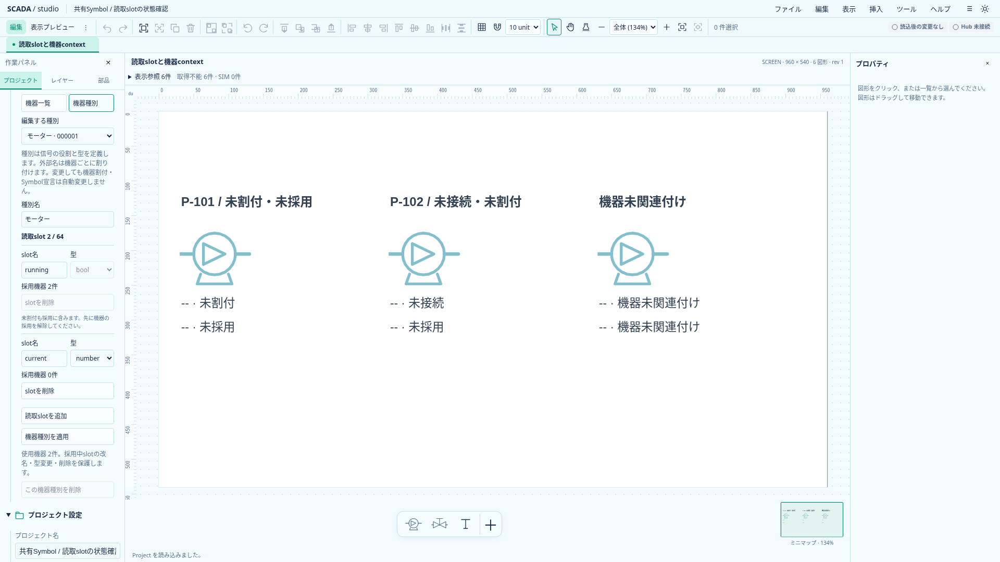
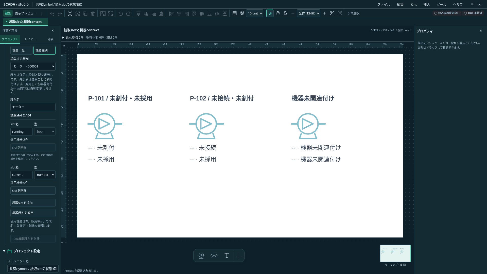

# 機器種別と任意の読取slotの編集

2026-10-20。Project 0.27.0で既存の機器種別コマンドをDesignerへ接続する。任意のbool／numberの役割を作り、機器登録・採用と割付・Symbol関連付け・読取詳細へつなぐ。正式な設備テンプレートやFaceplate定義の導入ではない。

## 操作

左の「プロジェクト」→「機器」で「機器一覧／機器種別」を切り替える。切替前に未適用入力を解決する。機器割付と種別構成のフォームは同時に編集させず、構造変更による未適用の割付入力の消失を防ぐ。送風機・計器の固定プリセットも機器一覧側で引き続き利用できる。

機器種別では、新規または既存の種別を選び、名前と読取slotを編集する。slotは英字または`_`で始まる英数字と`_`の64文字以内、型はbool／number、最大64件。重複名は拒否する。slotなしの種別も作れる。種別名と全slot構成は一回で適用し、一回のUndoで戻す。種別は100件まで。

各slotの採用機器数を表示する。`externalName:null`の未割付も採用に含め、採用中のslotは改名・型変更・削除を制限する。種別を使う機器が一件でもあれば種別は削除できない。UIを通さない場合も既存ドメインが拒否する。未採用slotは変更できるが、機器割付やSymbolの同名宣言を自動変更しない。その結果、図面が「機器種別にslotなし／slot型不一致」となる場合がある。

作成後は新しい種別を選択する。機器一覧に戻ると、その種別で機器を登録できる。採用したslotの外部名は機器ごとに割り付ける。通常Designerは実Hub未接続で、実値を代用して表示しない。

## 未適用入力と責務

構成行の追加・削除もdirtyとして扱う。可視行は構成の編集を担当し、フォームでは名前と全slot構成のJSONを追跡する。行をDOMから取り除いたことだけで変更を判断しない。破棄時は保存された構成から行を復元し、キャンセル時は入力を保持する。無効な名前・重複・採用保護の失敗でも入力を保持する。

フォームはProject世代・Project ID・種別IDを照合する。IME確定前のEnterでは適用しない。種別の作成・更新・削除は既存EquipmentCommandとProjectの最終検証を使用し、保存schemaやRust契約は変更しない。

`EquipmentTypes.svelte`が表示と構造draft、`forms/equipment-type.ts`が対象と入力の検査、`equipment-handler.ts`が既存の参照保護と変更を担当する。機器一覧との切替は`EquipmentLibrary.svelte`、フォームの適用・Undo・draft事前検証はAppの既存経路を使う。

## 検証

純粋なフォーム検証では世代・対象・行形式・型・重複・禁止文字・64件上限と、採用中の変更拒否の原子性を確認する。ブラウザでは両テーマで任意種別作成から機器登録・採用・Symbol関連付け・読取詳細までを通す。構造draftのキャンセル／破棄／適用、無効入力保持、Undo／Redo、未割付を含む採用保護を確認する。既存の機器登録・プリセット・使用先・割付の試験も維持する。

以下は実アプリの撮影。採用済み／未採用の違いを示すため、撮影用Projectはrunningだけを採用し、currentを未採用にした。

