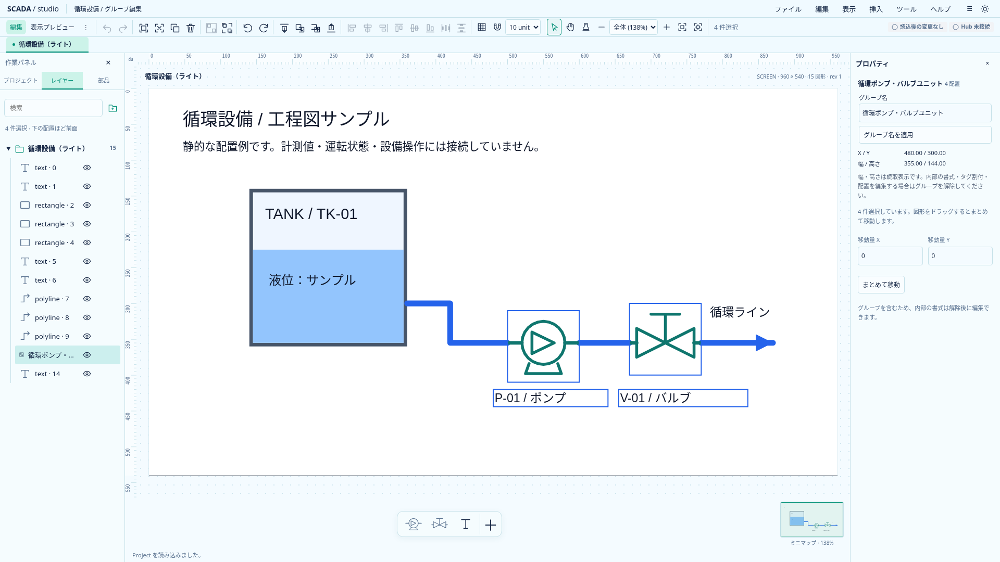
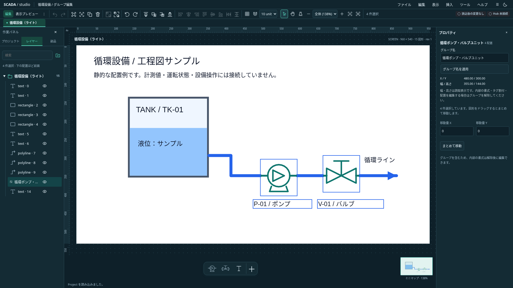

# 幾何グループ：初回の実装設計

状態: **G1／G2の保存・ドメイン・再利用とG3 Designer接続を実装。G4全体検証と実画面確認も完了。** Project 0.22.0へ保存項目を追加した。本書の初回範囲まで対応し、任意拡縮・入れ子等は後続とする。現行機能は[実装状況](implementation-status.md)を正とする。2026-10-20（日本時間）、[開発計画](development-plan.md)の次工程をAstraの静的レビューとともに具体化した。

## 目的と範囲

タンク・配管・ラベル等の既存配置を、見た目を変えずに一つの選択・操作単位へまとめる。グループ化／解除・一括移動・左右90度回転・複製・削除・描画順変更を最初の縦切りとする。整理用フォルダー、共有Symbol、登録機器とは別の役割を持つ。

初回は子座標系を導入しない。配置は従来の`objects`に残し、座標・角度・描画順・Binding・crop・個別の色とαを保持する。グループは所属情報だけを所有する。幅・高さは内容から求める読取表示とし、拡縮ハンドルを出さない。

[作成支援の追加検討](scada-authoring-plant-operations-proposal.md#4-図形合成部品作成作図補助)にある一括拡縮は後続に残す。回転済み配置の非一様拡縮はせん断の表現、文字サイズ、線幅、pattern間隔、解除後の形状まで設計が必要。任意のアフィン変換を持つコンテナが必要になった場合は、その時点で保存モデルを見直す。リリース前の旧形式互換性は保証しない。

## 保存モデル

初回案はScreenだけに必須の`groups: GeometricGroup[]`を追加し、新規画面には空配列を入れる。Symbol定義内のグループとグループの入れ子は対象外。Symbol配置をメンバーに含めても、共有定義の参照は維持する。

```ts
interface GeometricGroup {
  id: string;
  name?: string;
  memberIds: string[];
}
```

契約を変更する区切りでschemaVersion／minRuntimeVersion、TS／Rust／JSON Schema／サンプル／新規生成／ファイル・clipboardを同時に揃える。将来の版番号をこの文書だけで現行へ変更しない。

保存・読み込み・コマンド確定時に、次を共通検証する。

- IDは現行UUID規則に従い、配置・画面・Symbol・資産・フォルダーを含むProject内で重複しない。
- 名前は省略可。指定時は既存配置名と同じ200文字上限・空白だけは禁止。表示用の既定名を永続値として毎回生成しない。
- メンバーは同じ画面の配置IDを2〜1,000件。欠損・重複・別画面参照・複数グループへの所属を禁止する。group IDをメンバーにできない。
- メンバーは全て同じ整理用フォルダーに所属する。全て未所属も可。
- 画面全体を`order`昇順で並べたとき、全メンバーが連続する。orderの数値が連番である必要はない。`memberIds`もその順に揃える。
- 1画面あたり最大500グループ。現行1,000配置上限を増やさず、グループを配置数の迂回に使わない。

初回の連続順・同一フォルダーという制約は、レイヤーで一つの行として表し、描画順・所属変更をブロックとして扱うために設ける。選択の間に未選択配置があっても自動で前後へ移動しない。理由付きでグループ化を拒否し、選択・描画順の見直しを案内する。

## 操作と選択

| 入口・操作                 | 初回の動作                                                                                                      |
| -------------------------- | --------------------------------------------------------------------------------------------------------------- |
| グループ化                 | 同じ画面の独立した2件以上をまとめる。既存グループを含む場合は解除を案内する。配置自体は変更しない               |
| 解除                       | 所属情報だけを削除し、元メンバーを複数選択する                                                                  |
| キャンバスのメンバーを選択 | グループ全体へ選択を展開する。Shift選択・範囲選択でも部分選択を残さない                                         |
| レイヤー                   | フォルダーと異なるアイコン・名前・件数を持つ1行で表示する。配下の名前確認はできるが、子の直接編集は解除後とする |
| 名前変更                   | グループの表示名だけを変える。配置名や機器番号を上書きしない                                                    |
| 移動・方向キー             | 全メンバーへ同じdx／dyを適用する。ドラッグ終了をUndo1回にする                                                   |
| 整列・均等配置             | グループを一単位のboundsとして扱う。内部の配置間隔は変えない                                                    |
| 左右90度回転               | 共通pivotで全メンバーの中心位置と既存rotationを更新する                                                         |
| 前後移動                   | 全メンバーの相対順を保持した連続ブロックで動かす。他のグループも分断しない                                      |
| フォルダー所属変更         | 全メンバーを同時に変更する。子1件だけの所属変更は拒否する                                                       |
| 複製・削除                 | 全メンバーと所属情報をまとめて処理する。複製では配置ID・グループIDを再採番する                                  |

「編集」メニュー・選択の右クリックメニューにグループ化／解除を設け、Ctrl／Command＋G、Ctrl／Command＋Shift＋Gを候補キーとする。入力欄・モーダル・IME変換中の通常入力を奪わず、現行のショートカット所有範囲へ接続する。キャンバスのダブルクリックで内部編集する別モードは初回に増やさない。

プロパティには対象グループの名前・件数・位置・幅高さの読取値と、対応する操作を示す。子1件のプロパティをグループ全体のものとして表示しない。内部の書式変更は初回は解除後とし、共通色・線幅・opacityの入力をグループへ自動適用しない。

選択正規化は純粋関数へ集約する。UIで部分選択を全体に展開し、ドメインコマンドでは不完全なgroupメンバー指定を拒否する。APIの入力を暗黙に広げ、呼出側が指定しなかった配置まで変更しない。

ただし範囲選択は、展開前にグループ全体のboundsを完全包含するか判定する。子1件を囲んだだけで全体を選ばない。ロック混在グループはキャンバスクリック・範囲選択・Ctrl／Command＋Aから単位全体を除外する。レイヤー経由の選択と明示的なロック解除は維持する。Shiftによる追加／解除もグループ単位とし、既存の完全包含・ロック対象除外の契約に揃える。

## 幾何と外観の不変条件

グループ化・解除では各配置のJSON値を保持し、描画結果を変えない。rendererへ新しい親transformやclipを追加しないので、個別のopacity・グラデーション・pattern・文字・crop画像の合成を維持する。

boundsは非表示を含む全メンバーの既存boundsの和集合から求める。非表示変更でpivotや位置が飛ばない。90度回転では、共通pivotをこのboundsの中心とし、各配置のworld pivotを回してからx／yを更新する。既存の配置ごとのpivotと`normalizeRotation`を使い、Polylineも同じ規則に従う。幅・高さ・点列・文字サイズ・crop・線幅を変更しない。4回の右回転で元の幾何へ戻ることを許容誤差付きで確認する。

任意角度のグループ回転・拡縮・グループ合成opacity・内部編集モード・入れ子は後続とする。単なる所属モデルではグループ全体のopacityを子のαへ書き込んで同等と扱えない。

## ロック・表示と既存操作

- ロックされたメンバーが1件でもあれば、グループ化・解除・移動・回転・削除・cut・所属変更等を全体拒否する。ロック状態を迂回する子操作を設けない。
- グループのロック／解除はメンバーの既存フラグを原子的に揃える。継承ロックを追加せず、ロック中でも明示的に解除できる経路を維持する。混在時の表示も区別する。
- visibleは個別状態を保存する。非表示混在のキャンバス幾何操作は現行どおり拒否する。レイヤー／Inspectorの明示操作で扱う場合は非表示の件数を示し、勝手に表示へ戻さない。
- 表示切替をグループ全体に適用する入口は全メンバーへ一括適用し、混在状態を表示する。内部の個別状態を変更せず選択だけする操作と混同しない。
- レイヤーの検索・タグ使用先から子へ移動した場合も所属グループがわかるようにする。子のBinding等を編集する場合は解除を案内し、誤って別の子へ入力を適用しない。
- 共有Symbolの定義編集は共有定義の操作として維持する。グループ化で定義をコピーしたり機器を登録したりしない。

## コピー・ファイル・画面再利用

clipboardは選択をグループ全体へ正規化し、所属情報を含む形式を明示的にversion更新する。現行v1／v2へ所属項目を黙って追加しない。画像原本・hash照合・容量上限・書込み成功後だけcutする既存保証を維持する。group情報を捨てて通常の複数配置として貼り付けない。

貼付時は配置とgroupのID対応表を一つのトランザクションで作る。同一ProjectのSymbol定義再利用、別Projectの依存取り込み、画像assetの再採番とcrop保持は現行規則を使う。screenViewを含む選択のclipboardは現行どおり全体拒否する。

画面複製では全配置とgroupのIDを再採番する。画像同梱保存／再読込、別画面への貼付でも参照整合性を確認する。グループは描画用コンテナではないため、埋込View／プレビューではメンバーを従来どおり描く。タグ使用先・画像回収・Symbol使用数も元の配置を数え、groupを重複カウントしない。

## 実装の分け方

公開UIだけ先に追加して、既存コマンドから所属を分断できる状態にはしない。次の依存順で開発し、各段階の完了範囲を記録する。後段までつながる前に「グループ対応済み」と記載しない。

1. **契約・ドメイン**：schema／Rust／TSの保存項目と制約、所属・選択単位・bounds・回転の純粋関数、group化／解除／名前変更。全ての既存配置コマンドについて、全体単位へ対応するか理由付き拒否するかを明示する。
2. **再利用と参照**：複製・削除・描画順・フォルダー変更・clipboard・画面複製・ファイル往復を対応し、ID再採番と原子性を確認する。
3. **Designer接続**：選択・ドラッグ・方向キー・回転・整列・レイヤー・Inspector・メニュー・右クリック・キー操作を接続する。未適用入力保護・フォーカス復帰を維持する。
4. **全体検証と画像**：全単体・Rust・関連／全体E2Eとライト／ダークの実画面を確認し、保存・Push・CIを記録する。

主な変更入口は`lib/project.ts`／`crates/scada-model`、`lib/editor/commands.ts`と各handler、`lib/clipboard.ts`、`lib/designer/controllers/designer-actions.ts`、`LayerTree.svelte`／`InspectorPanel.svelte`／`CanvasWorkspace.svelte`、`App.svelte`の選択とキー操作。R5で分けた責務を維持し、全処理をAppへ戻さない。

## 受入条件

| 観点         | 確認内容                                                                                                |
| ------------ | ------------------------------------------------------------------------------------------------------- |
| 外観保持     | グループ化／解除の前後で座標・回転・描画順・Binding・cropを保持し、画像が一致する                       |
| 拒否と原子性 | 欠損／重複／別画面／二重所属／不連続／別フォルダー／ロック／不完全選択を拒否し、Projectと履歴を保持する |
| 幾何         | 回転済みText・Polyline・crop画像・Symbolを移動／90度回転でき、内部サイズを保持する                      |
| 選択と入力   | Shift・範囲選択・検索・タグ使用先で部分編集せず、入力中の対象切替・メニュー・Undoを保護する             |
| ブロック操作 | 前後移動・整列・フォルダーdragで内部順と所属を維持し、他groupを分断しない                               |
| 状態         | lock／visible混在を誤表示せず、拒否と明示的な解除・表示復帰の経路を検証する                             |
| 再利用       | 複製・clipboard・画面複製でgroup／配置IDを再採番し、画像・共有Symbolの参照を保持する                    |
| 履歴・保存   | 各確定がUndo1回、Undo／RedoとJSON／画像同梱ファイル往復で所属と外観を再現する                           |

アプリ基盤・共有SDKの変更はこの初回範囲では不要と見込む。実装中に共有契約への要求が判明した場合は、その具体的な差分をBanto／industrialのIssueへ切り出す。認証・正式Runtime・設備遠隔操作はこの工程へ追加しない。

## G1／G2の保存区切り

0.22.0の保存契約とドメイン・再利用を実装した。TS671件、Rust31件、型（エラー／警告なし）、Clippy、関連ブラウザ23件が成功。native clipboard v3の所属保持・ID再採番・保存／Undoと不正読込時の保持を実ブラウザで確認した。初回の新E2EはNode24のJSON import属性不足で収集時に停止したため、readFileSyncへ修正して全23件を実行した。Astraのレビューで見つかったProxy snapshot、明示default状態のno-op、Unicode名の文字数差は修正・回帰確認した。Designer接続はG3に残す。

### G1／G2 CIで見つかったfixtureの追従漏れ

`bde0411`の[CI](https://github.com/tyaro/temp-scada/actions/runs/39344061119)はブラウザ511件中505成功・6失敗だった。追加Screen fixtureのgroups不足（画像crop・Popup・View）、ScreenからSymbol定義を作るfixtureに継承した不要なgroups、legacy移行後と保存key一覧の期待値が原因。schemaや拒否条件は緩めず、fixtureと新契約の期待値を揃えた。同じ6ケースを現行の専用サーバー・2並列で再実行し全成功した。途中まで実行したG3全体検証は停止まで81件成功し、修正後の全体結果と区別する。fixtureを揃えた`2b14889`の[CI](https://github.com/tyaro/temp-scada/actions/runs/39345995181)は全511件と型・TS671件・Rust31件・Clippy・ビルド・整形・CLI検証を通過した。G3の最終全体検証は改めて実施する。

## G3 Designer接続とG4の確認

レイヤーの1行表示・子名とグループ名の検索、グループ単位のクリック／Shift／範囲／全選択、移動／方向キー、90度回転、重なり順と所属drag、toolbar／メニュー／右クリックとCtrl／Command＋G・Shift＋Gへ接続した。プロパティはグループ名と外形を示し、内部の書式フォームを出さない。F2と右クリック改名も全メンバー選択を維持する。

名前は確定値を既存draft guardへ渡し、世代・画面・group IDを照合する。改名Undo後の未適用入力とcomposition中のEnterを保護する。Symbol使用先へ移動するときも完全な単位を保持して対象をrevealし、グループ非表示では全メンバーの選択を解除する。これらはAstraの静的レビューで指摘された経路を修正し、新E2Eへ加えた。修正後の再レビューで、追加で止める具体的な懸念なしと確認した。

型はエラー／警告なし、TS676件が成功。画像原本を共有するv3 clipboard、回転済みText／Polyline／crop画像／Symbolの4回回転、選択単位・検索、遅延改名対象を単体で検証した。新機能のブラウザ12件も成功。初回のdrag＋方向キー検証1件はレイヤーへフォーカスしたままキーを送っていたためUndoがdragまで戻り失敗した。既存のキャンバスフォーカス条件へ揃え、移動量が0より大きいassertを加えたうえで全12件が成功した。最終の全体521件は専用サーバー・2並列の一度の実行ですべて成功した（22.4分）。

撮影は`scripts/capture-geometric-groups.mjs`を使う。両テーマの1920×1080でグループ編集を撮り、同じ配置をグループ化した場合と独立配置の場合の読取プレビューも画像比較する。E2Eと同時には実行しない。

<a id="geometric-groups-screenshots"></a>

## 実画面と画像比較

ライト／ダーク各1920×1080で、ポンプ・バルブとその名称の4配置をひとつのグループとして選択した実画面。画面は静的サンプルで、設備には接続していない。図面の背景色は画面の設定を保持し、shellのテーマと分離している。





同じ配置・同じ編集→プレビューの操作経路で、グループ情報あり／なしのSVG撮影画像を比較し、両テーマで画素完全一致した。初回は読込通知の重なりと描画経路の差によるTextのラスタ差が出たため、通知をUI操作で閉じ、同じモード遷移を経て比較する手順へ揃えた。画像を加工して一致させてはいない。

撮影で確認したグループ名入力の外観は既存Inspectorの色・余白・フォーカス表示へ揃えた。最終の関連12件、型（エラー／警告なし）・buildと全体整形も成功し、変更文書のローカルリンク284件も確認した。文書・画像とともにコミット・Pushする。G3を含む最終差分のリモートCIはPush後に別途確認する。
