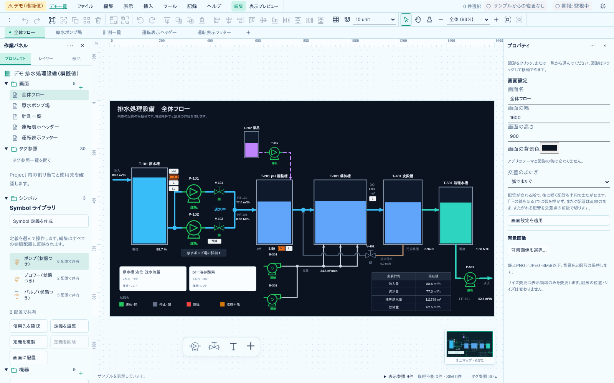
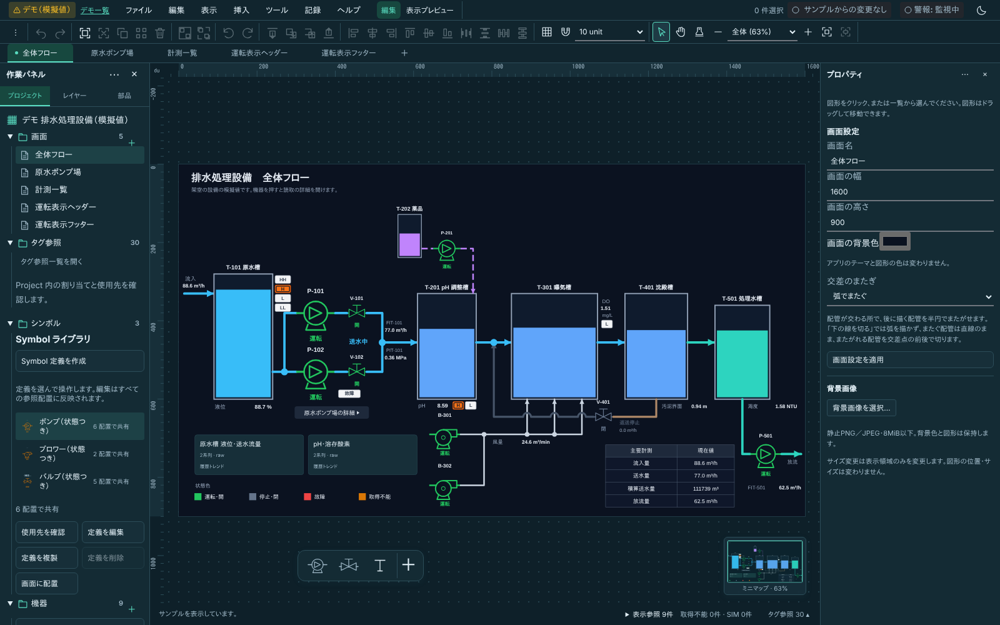
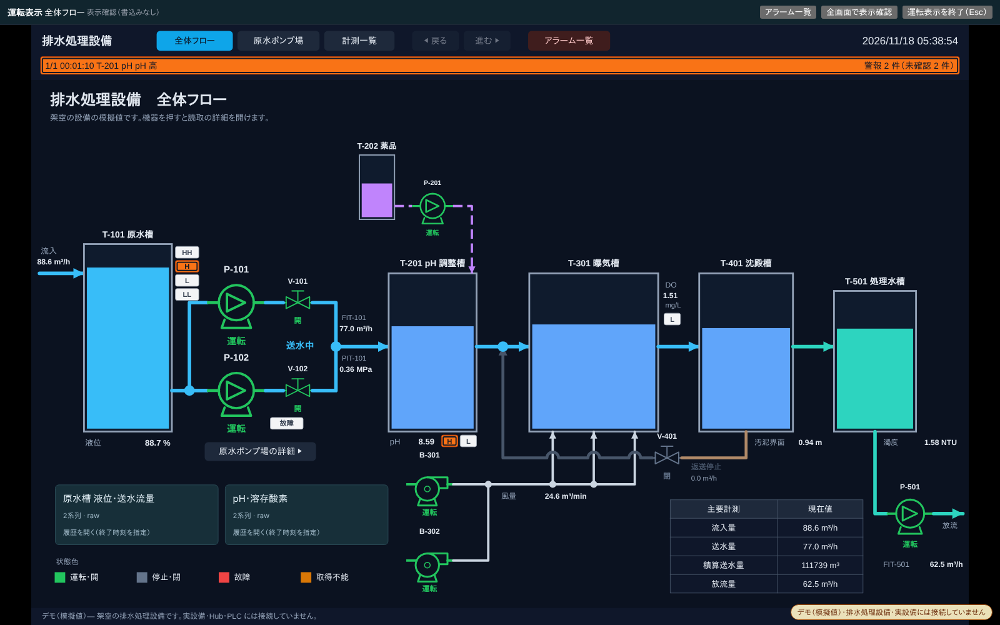
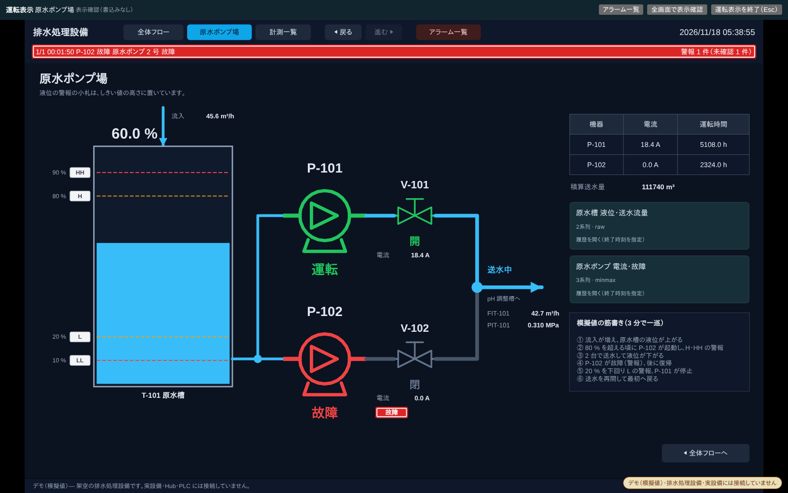
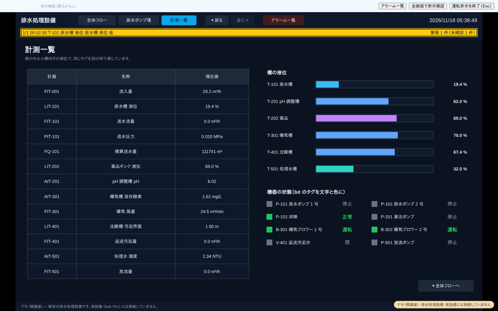

# GitHub Pages のデモ（模擬値）

作成: 2026-11-18（日本時間）。状態: **題材 1（排水処理設備）を提供**。題材 2（搬送）・題材 3（プレス工場の生産進捗）は後続の PR で足す。

公開先は `https://tyaro.github.io/temp-scada/`（`work` へのマージ後、[配信の workflow](../../.github/workflows/pages.yml)が出す）。ブラウザだけで、工程図エディタと運転表示を試せる。値はすべてブラウザの中で作る模擬値で、実設備・Hub・PLC には接続しない。

## 守ること

- 題材は架空の工程にする。オーナー提供の実プラントの参照画面には寄せず、その画像・配置・名称をリポジトリへ入れない。
- ems-apps の画面・コード・アセットは取り込まない。
- 画面に「デモ（模擬値）」と示す。ヘッダーの表示（編集・表示プレビュー）、運転表示の間の注記、Project のフッター画面の 3 か所。
- 新しい部品は足さない。製品にある部品と表現だけで組む。

## 入口

| ページ                                      | 役割                                                                 |
| ------------------------------------------- | -------------------------------------------------------------------- |
| `index.html`                                | トップページ。題材ごとに「運転表示で見る」「編集モードで開く」を出す |
| `demo.html?demo=<題材>&view=<表示>&at=<秒>` | デモ本体。製品の `App` に模擬値の読取・警報・履歴を渡して起動する    |

- `demo`: 題材の名前（`water`）。無い名前はトップページへ戻す。
- `view`: `operator`（運転表示。既定）・`edit`（編集モード）・`preview`（表示プレビュー）。
- `at`: 模擬値の筋書きを止める秒（0 以上、周期未満）。検証と画面写真に使う。省くと実時間で進む。

開発サーバー（`pnpm dev`）では `http://127.0.0.1:5173/pages/index.html` で開く。

## 仕組み

製品の入口（`apps/banto-scada/index.html`・`src/main.ts`）とは別の入口を持ち、製品のコード（`src/lib`・`App.svelte`）はデモのコードを import しない。

| 置き場所                                       | 中身                                                                                                  |
| ---------------------------------------------- | ----------------------------------------------------------------------------------------------------- |
| `apps/banto-scada/pages/`                      | Pages 用の `index.html`・`demo.html`                                                                  |
| `apps/banto-scada/src/demo/registry.ts`        | 題材の一覧（トップページと入口が共有）と URL の読み方                                                 |
| `apps/banto-scada/src/demo/scenario.ts`        | 筋書きの型（時刻だけで決まる値）・時計（`at` で止める）・版つきの JSON の筋書きからの変換             |
| `apps/banto-scada/src/demo/scenarios/`         | 題材ごとの筋書き（[筋書きの形](../design/runtime/scenario-format.md)の JSON）                         |
| `apps/banto-scada/src/demo/read-source.ts`     | 模擬値の読取 source。Project が読むタグ・slot を筋書きの値で満たし、製品の表示 DTO で渡す             |
| `apps/banto-scada/src/demo/alarm-feed.ts`      | 模擬の警報 feed。Project の警報の定義を筋書きの値で評価し、発生・復帰・確認と履歴をブラウザの中で持つ |
| `apps/banto-scada/src/demo/history-service.ts` | 模擬の履歴 service。保存トレンドの pen を系列にし、筋書きを過去の時刻で評価して応答を作る             |
| `apps/banto-scada/src/demo/DemoApp.svelte`     | `App` へ props（`readSource`・`alarmFeed`・`historyService`・`startup`・ヘッダーの表示）を渡す        |
| `apps/banto-scada/vite.pages.config.ts`        | Pages 向けのビルド（`pnpm build:pages`、出力は `apps/banto-scada/dist-pages`）                        |
| `examples/demo-*.project.json`                 | デモ用 Project（現行の schema 0.37.0）                                                                |
| `scripts/demo-projects/`                       | デモ用 Project の生成スクリプト                                                                       |

- `App` には起動時の Project と表示を受ける prop `startup` を足した（`{ project, view }`。起動時に一度だけ読む）。無いときは従来どおり最小サンプルを表示プレビューで開く。
- 筋書きは時刻（UNIX 秒）だけで値が決まる。形は版つきの JSON（[筋書きの形](../design/runtime/scenario-format.md)）で、評価部は TypeScript と Rust の両方にあり、同じ時刻には同じ値を出す。現在値・警報・履歴トレンドが同じ筋書きを共有し、どの時刻の履歴も作れる。
- 値の出所は `internal` にしている（Hub・PLC の値ではない）。`simulation` にすると製品の表示が全部の値に「SIM ·」を前置し、書式の見え方を確かめにくいため。模擬値であることは上記の 3 か所で示す。
- 筋書きに無いタグは「未解決」のままにし、値を作らない。編集モードで足したタグ結合は「-- · 未解決」と出る。
- 警報の遅延（onDelay・offDelay）は評価しない。ブザーは鳴らさない。警報の定義を編集しても、模擬の評価は起動時の定義のまま（製品の「適用」に当たる操作が無い）。
- 履歴は「いまを終了にする」→「取得」で出す（製品の履歴トレンドの窓の操作そのまま）。現在より先は欠測にする。

### デスクトップ版だけの機能

記録（Historian の記録 DB・記録管理状態・記録計画の操作）、ログインとユーザー管理、実 Hub への接続、ファイルへの上書き保存、警報の端末設定・ブザーは、デスクトップ版（Tauri）だけにある。ブラウザ版の製品はもともと理由を示す（記録の窓は「記録管理サービスは未接続です」、ファイルメニューは「警報の端末設定…（デスクトップ版のみ）」、アラーム一覧は「端末設定はデスクトップ版だけで扱えます」）。デモはこの表示をそのまま使い、トップページにも書いている。

## 題材 1 排水処理設備（`water`）

Project は [`examples/demo-water.project.json`](../../examples/demo-water.project.json)、筋書きは `apps/banto-scada/src/demo/scenarios/water.scenario.json`。

- 画面: 全体フロー・原水ポンプ場・計測一覧と、運転表示のヘッダー（画面切替ボタン・時計・最新の警報の帯）・フッター。
- 表現: 配管の矢印・分岐の点・交差のまたぎ（返送汚泥が空気の立ち上がりをまたぐ）、破線の薬品配管、槽の液位（縦・横）、数値の書式、機器（ポンプ・ブロワー・バルブ）の多値の状態色と状態の文字、bit のタグで色が変わる配管と文字、しきい値の警報の小札、表、履歴トレンドの札。
- 筋書き（3 分で一巡）:

| 秒       | 起きること                                                                          |
| -------- | ----------------------------------------------------------------------------------- |
| 0〜75    | 流入が増え、原水槽の液位が上がる。60 秒で P-102 が起動。H（80 %）・HH（90 %）の警報 |
| 75〜146  | 2 台で送水して液位が下がる。104〜122 秒は P-102 が故障（bit の警報）                |
| 146〜168 | 液位が L（20 %）を下回り、P-101 が止まる                                            |
| 168〜180 | 送水を再開して最初の液位へ戻る                                                      |

pH は 55〜75 秒ごろに H（8.5）を越え、薬注ポンプが動く。溶存酸素が下がるとブロワー 2 号が動く。

2026-11-24 に筋書きを `water.ts` から JSON へ移した（#389）。揺らぎの波と、薬注・ブロワー 2 号・放流ポンプが切り替わる位相は、旧い式と同じ値を小数まで書いた（`demo.test.ts` が境界の秒と `at=77` の pH 8.49 を固定する）。旧版との差は 2 つだけ。運転時間・積算は起点を `epochSec`（2026-01-01）にしたので数値が変わった。原水槽の液位は丸めの方法（旧は `toFixed`、新は 0.5 を 0 から遠い方へ）の違いで、一巡 3600 点のうち約 1 % で 0.1 ずれる。











画面写真は `e2e/demo-pages.spec.ts` が `at` で筋書きを止めて撮ったもの。値は模擬値で、実機の運転表示ではない。

## Project を作り直す

デモ用 Project は生成スクリプトから作る。配置を変えるときはスクリプトを直して作り直す（Designer で編集して書き出した JSON で置き換えてもよいが、その後はスクリプトと食い違う）。

```sh
node scripts/demo-projects/build.mjs
pnpm exec prettier --write examples/demo-water.project.json
cargo run --locked -p scada-model -- validate examples/demo-water.project.json
```

## 題材を足す

1. `scripts/demo-projects/` に題材の生成スクリプトを足し、`build.mjs` の出力へ加える。
2. `apps/banto-scada/src/demo/scenarios/` に筋書きの JSON を足す。タグ名は Project と合わせる。しきい値をまたぐ機器の状態（例: 液位が下がったらポンプを止める）は、またぐ時刻を出来事に書き下す。
3. `apps/banto-scada/src/demo/registry.ts` の `DEMO_SUBJECTS` へ 1 件加える（トップページに入口が出る）。
4. `apps/banto-scada/src/demo/demo.test.ts` の `SUBJECTS` と、`e2e/demo-pages.spec.ts` に題材の検証を足す。
5. `.github/workflows/ci.yml` の `validate` に Project を足す。

## 検証

- `pnpm test`（`src/demo/demo.test.ts`）: Project が現行の schema で読めること、Project が読む全タグ・警報のタグ・トレンドの系列に筋書きの値があること、模擬値が一巡のあいだ製品の読取表示の検査を通ること、履歴の応答が履歴の契約を通ること、警報の発生・復帰・確認。
- `pnpm e2e e2e/demo-pages.spec.ts`: トップページの入口、編集モードと運転表示（明・暗）、画面切替、警報の小札と帯、アラーム一覧、履歴トレンド。画面写真は `test-results/` に出る。
- `pnpm build:pages`: Pages 向けのビルド。CI の frontend でも実行する。

## 配信

`work` へ push すると `.github/workflows/pages.yml` がビルドして GitHub Pages へ出す。初回は、リポジトリの Settings → Pages で Source を「GitHub Actions」にする。公開先のパスは workflow が `PAGES_BASE` で渡す（手元の既定は `/temp-scada/`）。
