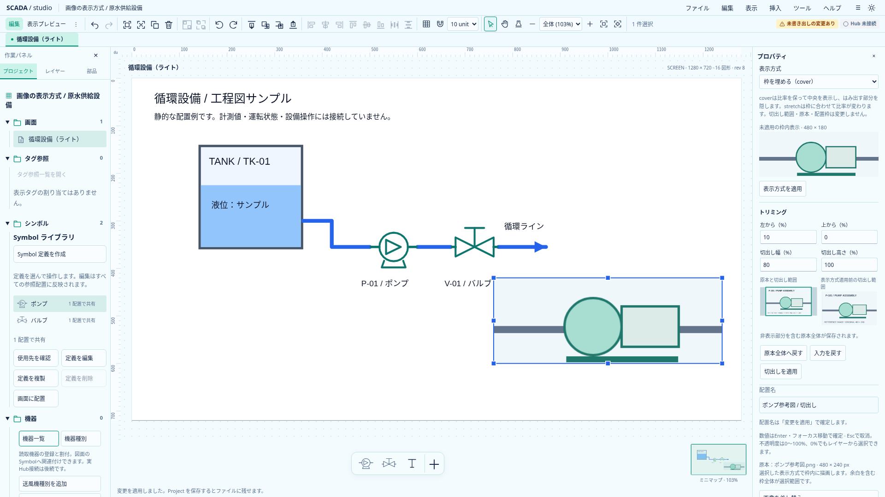
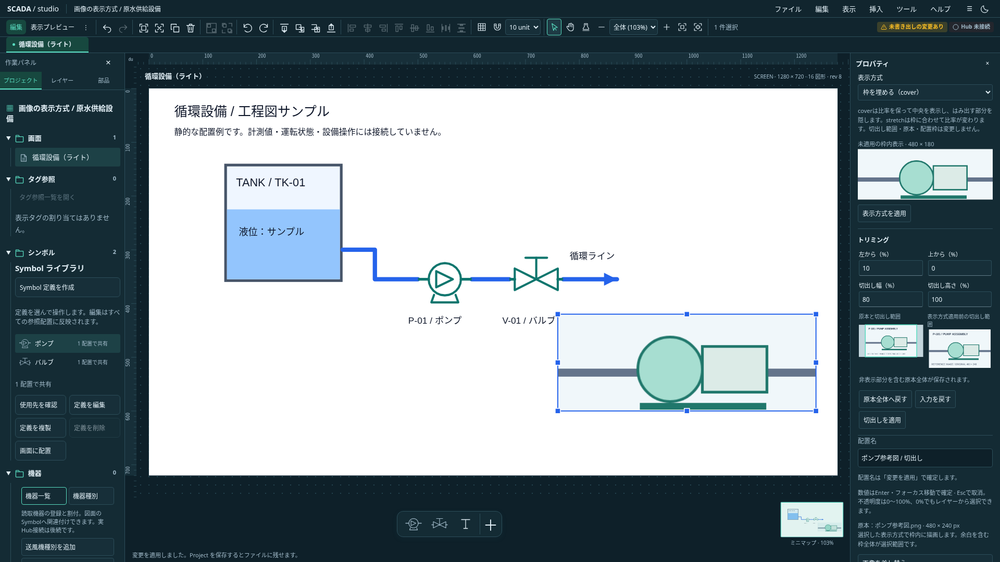

# 配置画像の表示方式

2026-10-20。計画中のcover／stretchを、配置Imageの表示方式として具体化する。背景画像・ScreenView・Symbol内画像は対象に含めない。この文書の追加だけで実装完了とはしない。

ProjectとminRuntimeVersionを0.28.0へ更新し、fitはcontain／cover／stretchの必須値とする。TS・Rust共通schema・現行例を揃え、旧Projectからの移行は追加しない。原本付きpackage／clipboardの包み形式は変更しない。

cropで切り出した元画素範囲を、配置の枠へ中央meet／中央slice／noneで写す。crop矩形と枠viewportを共にclipする。containは余白を許容し、coverは縦横比を維持して枠を埋め、stretchは枠へ伸ばすため比率が変わる。枠・回転・opacity・名前・原本bytesはfit変更で変えない。全描画入口はImagePaintingを共用する。

プロパティの独立フォームで明示的に適用し、一回のUndoとする。未適用の見本は実配置の枠比率で表示する。cropの見本は表示方式適用前の切出し範囲と明示する。別フォームのdirty入力と対象世代・IME・ロックを既存経路で保護する。

異なる原本への差替えはcrop解除、同じhashはcrop維持。fitはどちらでも維持し、decode開始時のfitを書き戻さない。coverでは原本全体が見えるとは限らないため、差替えの案内は「切出しを解除し、表示方式と配置枠は維持」とする。比率復帰は切出し後の比率に幅固定で合わせ、枠中心とfitを維持する。

受入は共通fit正常／不正fixture、原子的コマンドとno-op・Undo、非対称原本の横長／縦長枠×3方式×crop有無の実画素、切出し外の漏れ、回転・α、差替え・比率復帰、原本付きclipboard／package往復と描画入口の一致を確認する。Astraの設計レビューを反映した範囲で、自由原点・背景crop・ドラッグcropは後続。

## 実装と検証

0.28.0の保存契約・既存image handlerの独立コマンド・プロパティ・共通描画へ接続した。全体を収める方式の既存経路は維持し、coverまたはcropで元画素clipとviewport clipを使う。表示方式のフォームは既存draft guardへ接続し、別フォームの未適用入力と対象交換を保護する。

共通9ケースをTS／Rustで確認し、設定の原子的拒否・no-op・Undo／Redo・crop／配置枠／原本保持・差替え・比率復帰を検証した。非対称PNGで両テーマの横長／縦長枠×3方式×crop有無を実画素確認した。原本付きclipboardとpackage往復、回転37度とopacity50%の一回適用も確認する。埋込View・小窓・ミニマップは3方式すべてで共通描画を確認した。

以下は実アプリのcover表示。撮影用の原本はスクリプトで独自生成した参考図で、外部リポジトリの画像を使わない。`SCADA_CAPTURE_IMAGE_FIT=1 node scripts/capture-image-crop.mjs docs/assets/frontend-ux`で再撮影できる。

