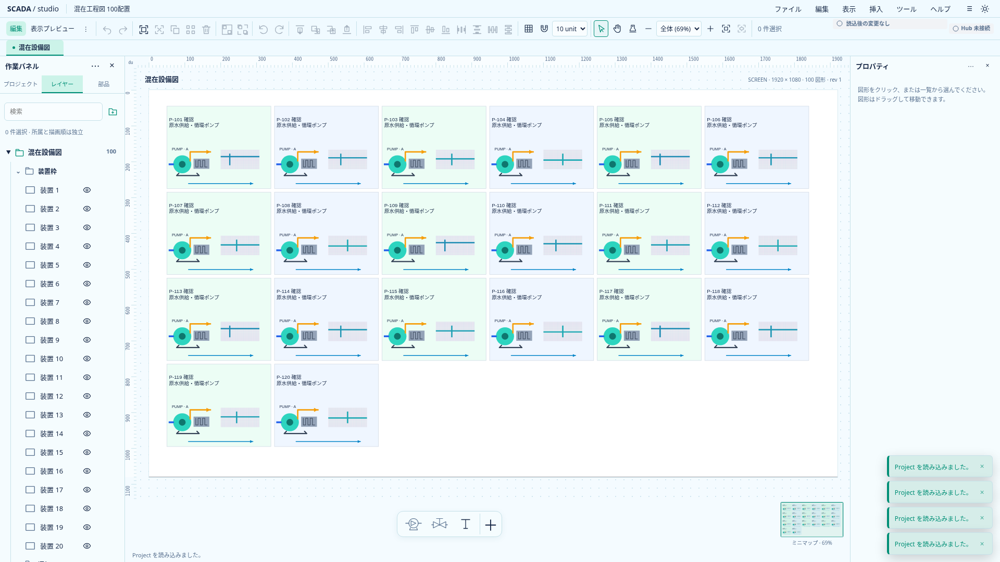
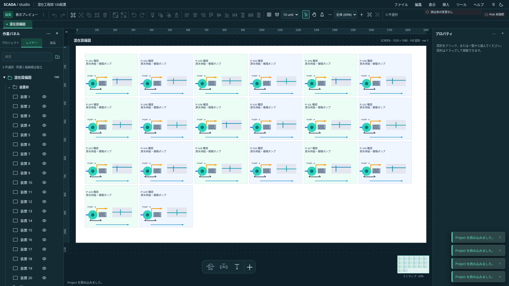

# 混在図面の品質・性能計測（I5）

2026-10-21。状態: **初回計測・限定改善完了。全体CI成功確認済み**。[単体開発計画](upstream-independent-plan.md)のI5。[R6のNodeドメイン計測](editor-performance.md)と区別し、ブラウザで実際の読込・入力・保存・資源寿命を確認する。

## 条件と境界

公開サンプルとプログラムで生成するPNGだけから再現用図面を作る。非公開の実案件図面ではなく、実案件の規模や操作応答を保証しない。1画面100／500／1000配置を、矩形・折返しText・共有Symbol・画像・配管で構成する。同じ画像原本を再利用し、ファイルサイズ・画像寸法・配置内訳・共有定義を記録する。上流SDK・認証・保存形式は更新しない。

本番buildをVite previewで開き、1920×1080・Chromium・マウス／キー操作を使用する。関連試験やbuildと計測を同時実行しない。計測用の本番分岐・検証省略・大域cacheを追加しない。

## 測るもの

- 読込: ファイル指定開始から、主画面の配置数・画像参照と折返し完了を確認し、2回のrequestAnimationFrameを通過するまでのdriver経由経過時間。初回操作を別記し、反復の中央値と最大値を出す。
- キー移動／Undo: 信頼されたキーイベントをcaptureした時点から、対象配置のtransform更新と2回のrequestAnimationFrameまで。実際のディスプレイ描画時刻やハードウェア入力遅延ではない。ウォームアップ後の複数回を記録する。
- 保存: Ctrl+Sからdownload発生までのdriver経由時間。OSファイルpickerやディスク永続化時間は含まない。保存packageを読み戻し、位置・原文・参照・原本bytesを検証する。
- 資源: CDPでGC後のJSヒープ・DOM数を参考値として取得する。画像decode面・GPU・ブラウザ全体のRSSとは異なる。Blob URLの生成／解放とlive bytesを計測専用init scriptで追跡し、元のAPIへ委譲する。画像あり→資産なし図面を繰り返し開き、残留URLがないことを確認する。

計測値は単一環境の少数試行。最大値をp95と表記せず、閾値をCIの成否条件にしない。計測fixtureの検証と操作結果のassertは省かない。

## 判断

操作・Undo・保存で内容が壊れる、URLが解放されない、同条件で遅延が再現する場合は、その箇所を特定し別の保存区切りで改善する。差分Undoや検証cacheへ直ちに置換しない。改善不要の判断も根拠と限界を記録してよい。Windows実機・実OSのIME・実Hub・長時間運転は今回の計測外。

## fixtureと計測入口

`apps/banto-scada/scripts/mixed-editor-fixture.mjs`は5種類を等数配置し、公開ポンプSymbol（内部9配置）を再利用する。1024×512の自作PNG4枚は合計133,898 bytes・2,097,152画素。RGBA展開なら計8MiB相当だが、ブラウザの実decode／GPUメモリ使用量を測った値ではない。Nodeでは読取専用の原本sourceを実際のpackage writerへ渡す。ブラウザのpackage読込では通常のchecksum・寸法・decode検証が走る。

計測runnerは`apps/banto-scada/scripts/benchmark-mixed-editor.mjs`。ファイルinputがクリアされるまで待ち、同じ配置数の再読込を前回のDOMで完了扱いにしない。5秒を超えた500配置の読込を記録したため、計測だけは各待機60秒で打ち切る。CIのtimeout・retryは変更しない。移動はスナップをOFFにし、50回確定後の位置と保存package全体・PNG原本bytesの一致をassertする。

## 初回に確認した負荷

基準アプリ`1bdb624`。500配置の再読込中央値11,532ms、キー移動493.7ms。再読込で約7,800回のLayout／RecalcStyleが発生し、RecalcStyleDurationは約4.9〜7.0秒だった。1000配置の初回読込は約33.7秒、RecalcStyleDuration約22.4秒。複数行Textの適応的`getBBox`計測で図面側のSVGを反復更新する経路を、限定改善の候補とする。

比較候補は複数行Textの計測用probeだけを一時的なCSS contain領域へ複製する。原文・折返し計算・font計測方式・Project・Undo・描画先は維持する。大域cache・計測値の使い回し・数値省略は導入しない。SVGの実寸法一致、非表示時の扱い、成功／失敗時の一時DOM解放を確認し、同じfixtureで比較して採否を決める。

変更前の[生JSON](performance/i5-baseline.json)を保存した。100／500／1000配置の再読込中央値は約1.55／11.53／37.70秒、キー移動は約103／494／815ms。50履歴の移動確定の最大値は1000配置で約5.25秒だった。3規模とも保存内容・PNG原本が一致し、資産なしProjectへの3回の切替後にlive URLは0件。ヒープはGC後の参考値として記録し、初期値との差だけでリークを断定しない。

### 拡縮時の文字寸法の保護

最初の隔離候補では1000配置の原文・行数は一致したが、ベースラインに約0.13図面単位の差があったため、その計測結果を最終採用値にしない。ChromiumのSVG font hintingを保つため、外側SVGの座標変換からCSS側の変換を除き、SVGのviewport・group変換を一時probeへ引き継ぐ。SVGの入れ子、拡縮、回転、縦横別倍率、CSS変換を含む寸法比較を追加した。丸め誤差の上限は0.0001図面単位で、原文・行数・省略結果は完全一致を要求する。

runnerへ`SCADA_BENCHMARK_BASELINE=docs/performance/i5-baseline.json`を渡すと、保存した1000配置の投影と比較し、上限超過や行内容の差を拒否する。初回100／500の記録には投影がないため、この機械比較は1000配置のみ。両テーマの寸法試験で各font・倍率を別途検証する。

変換を引き継いだ本番buildでは、変更前1000配置の200個のTextと原文・行数・省略結果が完全一致し、x／yの最大差は`0.000000476837158203125`図面単位だった。SVG font metricsの浮動小数点丸めの範囲として扱い、完全なbit一致とは表記しない。変換を含む両テーマの寸法試験も成功した。最終の速度・資源・保存往復はこの修正を含むbuildで再計測する。

## 再現手順

別ターミナルで本番previewを起動する。

```sh
source scripts/cloud-env.sh
pnpm build
pnpm --filter banto-scada preview --port 5233 --strictPort
```

本番previewと同じ作業ツリーで、他のbuild・テストを止めて実行する。

```sh
source scripts/cloud-env.sh
SCADA_BENCHMARK_BASELINE=docs/performance/i5-baseline.json node apps/banto-scada/scripts/benchmark-mixed-editor.mjs /tmp/scada-mixed-quality 100 500 1000
```

出力先に自己生成package、各規模のJSONと両テーマPNG、`report.json`を保存する。変更前はアプリ`1bdb624`、最終比較は`8a7cf21`の本番build。Linux x64、Node24.19.0、CPU quota 4コア、メモリ上限32GiB、viewport1920×1080。Chromium版・時刻・SHA・各資産hashは生JSONを参照。待機中のGitHub CIは別のrunnerで動き、このクラウド内では試験・buildを並走させていない。

## 最終比較と採否

[変更前JSON](performance/i5-baseline.json)と[変換保護後のJSON](performance/i5-after-svg-measure.json)。表は中央値、ms。各規模1回のrunで、再読込／保存3回、移動／Undo9回。反復移動は50回。最大値もJSONへ残し、p95や設備規模の保証として扱わない。

| 操作             | 100配置（前→後） | 500配置（前→後） | 1000配置（前→後） |
| ---------------- | ---------------: | ---------------: | ----------------: |
| 再読込           |         1554→935 |       11532→6395 |       37701→17842 |
| キー移動         |           103→69 |          494→399 |           815→691 |
| Undo             |           145→89 |          394→287 |           749→856 |
| 50履歴を積む移動 |            95→84 |          431→461 |           920→806 |
| 保存download開始 |            62→65 |          120→139 |           316→289 |

再読込の中央値は約40／45／53%短縮し、スタイル再計算の費用も下がった。原文・行数・省略結果の一致と一時DOMの解放を確認できたため、この限定改善を採用する。キー移動・Undo・保存の全般改善とは主張しない。1000配置のUndo中央値は増え、キー移動の最大値は約2.16秒、50履歴中の移動最大値も約2.04秒だった。大きな図面の編集・履歴には引き続き費用があり、実運用に十分な性能へ到達したという意味ではない。

### 保持資源と内容

3規模すべてで保存Projectの内容・参照・PNG4枚の原本bytesが一致した。画像原本は50履歴の前後とも4 URL・133,898 bytesで、履歴ごとに原本を複製していない。保存download用のURLは別に一時増加する。資産なし図面への3回の切替ではlive URL／bytesが0になり、計測hostも残らなかった。

GC後JSヒープは50履歴の前→後で、100配置約24.6→30.3MB、500配置約76.2→102.1MB、1000配置約141.3→194.5MB。資産なし図面への切替後の最終値は約11.5／13.4／15.1MBだった。JIT・UI設定・ブラウザ内部cacheの影響も含む値であり、正確な履歴専用メモリ量や画像decode／GPU量ではない。3回の切替だけで長時間のリーク不存在を保証しない。

### 検証と残り

型チェックはエラー・警告なし、全TS単体1104件、文字関連ブラウザ18件、本番build・整形が成功した。変換保護後に同じ18件を再確認し、最終3規模の計測・保存往復・投影比較も成功した。Project0.33.0・Banto・Industrial SDKは不変。実装`8a7cf21`の[全体CI39540132164](https://github.com/tyaro/temp-scada/actions/runs/39540132164)でFrontend・Rust・ブラウザ4分割・集約checkがすべて成功した。

初回のI5としては、計測入口・根拠・限定改善を保存する区切りとする。次は1000配置のキー移動・Undoのドメイン処理／Svelte更新／レイアウトの内訳を別の計測で切り分ける。R6のNode計測をそのままブラウザ時間へ読み替えず、差分Undo・大域cache・検証省略を先行実装しない。Windows実機、実Hub、長時間連続運転、実案件図面は後続。

## 実画面

公開サンプルと自作PNGによる再現用図面。製品の設備テンプレートや実設備監視画面ではない。100配置を両テーマで表示した。1000配置のfit表示は密度確認用で、全要素をFHDで読める保証ではない。





[1000配置の実画面](assets/frontend-ux/mixed-quality-1000-light.png)。必要な拡大表示は既存のツールバー／Ctrl+ホイールで行う。

## I5b：キー移動・Undoの内訳と復元候補

同じ`mixedFixture`をNode側でも計測できるよう、既存の`benchmark-editor.mjs`へ`--mixed`を追加する。既定のR6 fixtureは維持する。Nodeは実ドメイン関数をSSR loaderで呼び、ブラウザ版は本番bundleの実キー操作を使う。両者は別の実行環境なので、Nodeの時間をブラウザ時間から引いてSvelte処理時間とはしない。

ブラウザrunnerではwarmupの移動／Undoに続く各9回についてCDPのScriptDuration・LayoutDuration・RecalcStyleDuration・TaskDurationと回数の差を記録する。期間はドライバーとの通信や待機も含み、キーイベントから2rAFまでの既存指標と厳密に同じ区間ではない。CDP durationの単位は秒で、指標は重なるため合計しない。性能の合否閾値やCI待機時間は変更しない。

Undoの候補変更は、履歴snapshotを検証・正規化したあとrevisionを更新し、候補を`parseProject(JSON.stringify(restored))`で再検証する。旧経路の`parseProject(serializeProject(restored))`はserialize内部と外側で同じ候補を2回検証する。履歴の入口検証、更新後revisionの上限、現在Projectのsnapshot生成時の検証、別Project拒否、独立候補、原子的失敗は残す。履歴の件数・形式・資産寿命・保存モデルは変えない。

```sh
source scripts/cloud-env.sh
node --expose-gc apps/banto-scada/scripts/benchmark-editor.mjs --mixed 100 500 1000 > /tmp/i5b-domain.json
# 本番previewの起動後。Node計測やbuild・テストとは並走させない。
node apps/banto-scada/scripts/benchmark-mixed-editor.mjs /tmp/i5b-browser 100 500 1000
```

復元候補の限定変更を採用する。UI更新全体の高速化とは扱わず、残るScriptDurationは後続のサンプリングprofileで調べる。

### I5bのドメイン比較

[Node生JSON](performance/i5b-domain.json)。基準`de1fe7f`と履歴候補変更、同じ100／500／1000混在配置。各9回の中央値はUndoが6.732→5.129ms、32.856→22.946ms、60.379→42.557msだった。1回ずつのrunであり、ブラウザ応答の短縮率へ読み替えない。最大値と未変更操作の変動もJSONに残す。

[ブラウザ変更前JSON](performance/i5b-browser-before.json)では1000配置のキー移動中央値1118ms、Undo1057ms。CDP ScriptDurationの中央値はそれぞれ1012／953msで、LayoutDurationは約3〜4ms、RecalcStyleDurationは約3msだった。Nodeとは実行環境も区間も違うため差分をSvelte時間と断定できない。スクリプト側を優先して追う根拠とする。50履歴移動の最大は約11.5秒で、このrunには大きなばらつきもある。

### I5bの本番ブラウザ比較と残り

[変更後JSON](performance/i5b-browser-after.json)。アプリ差分は`27f10b9`の履歴候補コピーのみで、Project0.33.0・Banto・Industrial SDKは維持する。beforeは`8a7cf21`のbuild、docs-only HEADは`de1fe7f`。afterも`de1fe7f`上の候補からbuildした同一コードで、`27f10b9`へコミットした。実行時のHEADとbuildの関係をJSONにも記録した。同じクラウド・Chromium・fixtureで、ローカルの重い処理は並走させていない。表は各9回（保存3回、連続移動50回）の中央値、ms。

| 操作             | 100配置（前→後） | 500配置（前→後） | 1000配置（前→後） |
| ---------------- | ---------------: | ---------------: | ----------------: |
| キー移動         |            87→70 |          448→307 |          1118→697 |
| Undo             |           107→60 |          392→277 |          1057→655 |
| 50履歴を積む移動 |            94→74 |          340→325 |           810→709 |
| 保存download開始 |            76→52 |          152→148 |           235→232 |

この比較では未変更の移動・保存にも時間差があり、Undo差分の全部を今回の変更に帰属させない。ホスト負荷・JIT・GC等を制御しきれず、各1runの観測で統計的有意性も評価していない。Node側で候補コピー費用の削減を確認し、検証・正規化・原子的拒否を維持できた範囲で採用する。1000配置の変更後もUndo約655ms、移動約697ms、50履歴移動最大約1.55秒であり、大図面が快適になったという完了判断はしない。

変更後1000配置のScriptDuration中央値は移動約622ms、Undo約576ms。Layout／RecalcStyleDurationは各約2〜3msで、スクリプト側が依然大きい。次はSvelte更新・canonical比較・snapshot等のサンプリングprofileを採り、実際のcall stackを根拠に候補を絞る。Node値からの差し引きでSvelte分を推定しない。差分Undo・大域cache・検証省略は引き続き未採用。

3規模すべてで保存Project・PNG4原本が一致し、変更前後のText投影も完全一致した。資産なし図面への3回の切替後にlive URL／bytesは0、一時文字計測DOMも0。1000配置のGC後ヒープは50履歴の前約141.3MB→後194.5MB、最後の資産なし図面では約15.1MBで、履歴資源の大幅な削減はしていない。画面エラーは0だった。

型チェックはエラー・警告なし、全単体1107件、履歴・キー操作のブラウザ9件、本番build・全体整形が成功した。Undo／Redoの不正snapshot・不正な現在状態・revision上限超過でProject／履歴を保持し、改行正規化・独立した復元候補も単体で確認した。実装`27f10b9`の[全体CI39545209042](https://github.com/tyaro/temp-scada/actions/runs/39545209042)でFrontend・Rust・ブラウザ4分割・集約checkがすべて成功した。I5bは内訳計測と履歴候補の限定改善を保存する区切りで、スクリプト内の詳細切分けは残る。

## I5c：Project snapshotの監視境界

`a17fc96`の1000配置を別のsource map付き本番buildで診断した。移動9回／Undo9回を別々にCPU sampling（1ms間隔）し、生成位置をsource mapで元ファイルへ対応付ける。sampling中はドライバー待機・idle・GCも含むため、通常runnerの入力遅延とは比較しない。inclusiveの集計は祖先を含み重複するので合計しない。source mapの位置は関数開始位置で、個別のhot statementの特定ではない。

移動profileは約10.13秒相当のsamplesで、Svelte task／batchを含むinclusiveが約5.48秒、runtime約5.11秒。Undoは約7.77秒中、task／batch約4.35秒、runtime約4.04秒。`update_reaction`・`remove_reaction`・`mark_reactions`・proxy getがself時間の上位に現れた。これをSvelte内部の不具合とは扱わず、アプリの監視範囲を見直す根拠とする。

現行AppのProject変更入口を確認すると、初期parse、`recordEdit`、`travelHistory`、file／new／sampleの`adopt`が検証済みの独立したProjectを返し、Appがルートを差し替える。数値確定も同じrecordEdit経由で、子コンポーネントは編集通知を返す。UIからProjectの内部を直接書き換えるbindingはない。保存baseline・asset lease・非同期generationの契約は維持する。

採用する限定変更はAppのProjectと確認待ちreplacementを`$state.raw`にする2箇所。replacementはconfirm時にProjectを渡すため、ここだけ深いproxyが残らないよう同じ境界に揃える。rawはimmutableを強制するfreezeではない。今後もProject変更はcommand／history／adoptで独立候補を作ってルート更新し、ネストした直接代入で変更を通知しない実装を追加しない。選択・draft・パネル等のUI state、ドメイン検証、履歴・JSON・保存モデルは変更しない。

### 診断の再現

通常benchmarkで生成した公開fixtureのpackageを使用する。別の出力先にsource map付きbuildを作る。アプリへ診断分岐や計測用APIは追加しない。

```sh
source scripts/cloud-env.sh
pnpm --filter banto-scada exec vite build --sourcemap --outDir /tmp/scada-profile-build
pnpm --filter banto-scada exec vite preview --outDir /tmp/scada-profile-build --port 5234 --strictPort
# 別ターミナル。CPU採取は通常benchmarkやbuild・テストと並走させない。
node apps/banto-scada/scripts/profile-editor.mjs /tmp/scada-mixed-quality/mixed-1000.bantoscada /tmp/scada-profile 1000
node apps/banto-scada/scripts/summarize-editor-profile.mjs /tmp/scada-profile/move.cpuprofile /tmp/scada-profile-build > /tmp/scada-profile/move-summary.json
node apps/banto-scada/scripts/summarize-editor-profile.mjs /tmp/scada-profile/undo.cpuprofile /tmp/scada-profile-build > /tmp/scada-profile/undo-summary.json
```

診断runnerの既定URLは`http://localhost:5234`で、`SCADA_PROFILE_URL`で変更できる。source map readerは固定中のSvelte compilerが既に依存する`source-map-js`をSvelteの解決元から使い、新しい依存は追加しない。Svelte依存更新時はこの診断ツールの解決も再確認する。通常の速度評価はsource mapなし本番buildで既存benchmarkを別途実行する。

### I5cの結果と採用範囲

[profile集計・source hash](performance/i5c-profiles.json)に、前後の生CPU traceへのリンク相当のファイル名とsource map hashを残した。移動9回のSvelte batch inclusiveは約5.48→2.05秒、Undo9回は約4.35→2.20秒になった。ドライバー・GCを含む採取ごとの時間も違うため、この数値を入力応答の短縮率とはしない。深い監視の費用を減らす根拠として、通常benchmarkと別に判断する。

[変更前の通常JSON](performance/i5b-browser-after.json)と[変更後の通常JSON](performance/i5c-browser-after.json)。表は各9回（再読込／保存3回、連続移動50回）の中央値、ms。各1runで、統計的有意性は評価していない。

| 操作             | 100配置（前→後） | 500配置（前→後） | 1000配置（前→後） |
| ---------------- | ---------------: | ---------------: | ----------------: |
| 再読込           |         747→1015 |        5906→5138 |       15872→26973 |
| キー移動         |            70→46 |          307→165 |           697→497 |
| Undo             |            60→36 |          277→166 |           655→410 |
| 50履歴を積む移動 |            74→57 |          325→197 |           709→514 |
| 保存download開始 |            52→60 |           148→82 |           232→161 |

1000配置の再読込増加を採用前に追加確認した。[A/B/B/Aの生JSON](performance/i5c-load-comparison.json)は、各contextで初回読込＋再読込1回を実行した値。再読込は順に変更前29.1秒／変更後24.9秒／変更後21.4秒／変更前16.6秒。各2件の算術平均は変更前約22.8秒、変更後約23.1秒で、通常runの約15.9→27.0秒という増加を一貫して再現したとは判断しない。サンプルが少なく、読込非劣化の保証でもない。大規模図面の読込自体は依然遅く、ここで解決したとは扱わない。

この対照buildは作業ツリーを巻き戻さず、[専用Vite config](performance/i5c-baseline-vite.config.mjs)のloaderで対象2ファイルだけを`a17fc96`から読み出した。他の実行時コードが同じI5c候補ツリー上で使う比較専用であり、任意の将来版全体をa17fc96に復元するものではない。変更前main asset名`index-fjnTrq38.js`は初回profileと一致した。通常buildと別の出力先・portにし、ローカルのbuild・test・profileを比較実行と並走させていない。

```sh
source scripts/cloud-env.sh
pnpm --filter banto-scada exec vite build --config ../../docs/performance/i5c-baseline-vite.config.mjs --outDir /tmp/scada-before-build
pnpm --filter banto-scada exec vite preview --outDir /tmp/scada-before-build --port 5235 --strictPort
# 通常buildのpreview（5233）も起動したうえで別ターミナルから実行。
node apps/banto-scada/scripts/compare-editor-load.mjs /tmp/scada-mixed-quality/mixed-1000.bantoscada /tmp/scada-load-comparison.json http://localhost:5235 http://127.0.0.1:5233 1000
```

通常runの3規模とも保存Project・PNG4原本が一致し、1000配置の文字投影は変更前との許容差0.0001図面単位の比較を通過した。資産なし図面への3回の切替でlive URL／bytesは0、一時文字計測DOMも0。画面エラーは0。内容・資産寿命・履歴形式は維持する。1000配置は変更後も移動約497ms／Undo約410msで、十分な応答性能の完了とはしない。

型チェックはエラー・警告なし、全単体1107件、保存状態・未適用入力・履歴・キー操作のブラウザ17件、本番buildが成功した。確認置換後の編集・Undo／Redoと読込baselineの表示も既存試験へ追加した。root差替え契約を維持できる範囲で採用し、実装`fa595d0`の[全体CI39548196580](https://github.com/tyaro/temp-scada/actions/runs/39548196580)でFrontend・Rust・ブラウザ4分割・集約checkがすべて成功した。Project0.33.0、Banto、Industrial SDK、認証の保留方針は不変。次はI5の読込時のstyle／文字計測費用を再評価し、適応的文字計測の回数やcacheを先行変更せずに対象を絞る。
