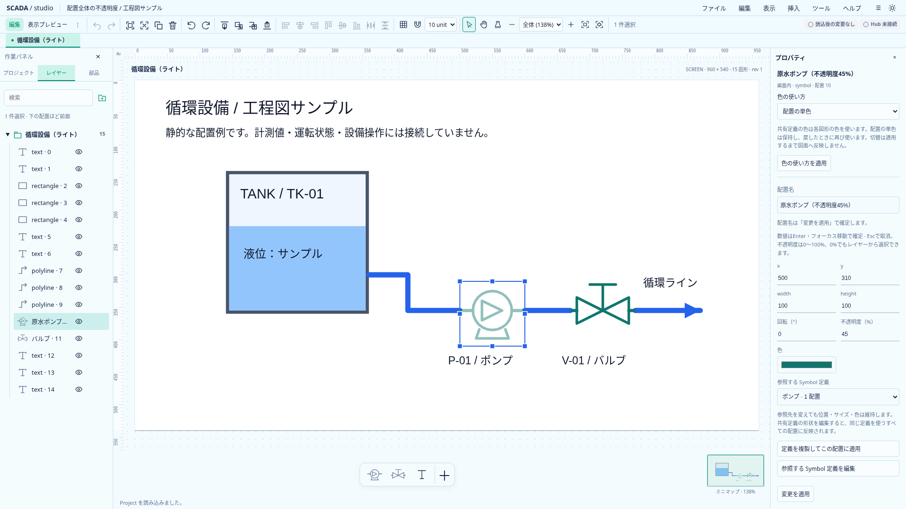

# 配置全体の不透明度

Project 0.14.0で実装。色ごとのα、画像クロマキー、非表示とは別の設定として扱う。[拡張設計](scada-graphics-runtime-extension-design.md)の描画基盤を段階的に実装する。

## 保存と描画

画面配置と共有Symbol内部の全種類に任意の `opacity` を保存する。有限な0〜1のみを受理し、省略は1（完全不透明）。JSONの明示1は保持し、省略された配置に100%を無変更適用しても履歴を作らない。旧0.13.0は自動移行しない。RustとTypeScriptは同じschema・共通fixtureで検証する。

配置の描画全体を合成してからopacityを一度適用する。Symbolの配置には内部SVG全体へ適用し、子のopacityとは独立に乗算する。単色／定義色の両モードで同じ規則。編集時の選択枠・透明hit領域・頂点ハンドルには適用しない。Editor・表示プレビュー・ミニマップ・部品のサムネイルは共通経路を使う。

`opacity=0` は描画を透明にするが、配置・参照・順序・寸法・選択可否を変更しない。`visible=false` は描画対象から除外する別の状態。透明な配置もキャンバスとレイヤーから選択できる。

## 編集

単一選択のプロパティに「不透明度（%）」を置く。0〜100%、Enter／フォーカス移動でそのフィールドだけ確定、Escで取消。数値以外・範囲外は入力を保持してエラーにし、他の未適用入力を勝手に適用しない。読みやすい百分率へ表示し、29%を浮動小数誤差による長い表示にしない。

1確定を1回のUndoとして扱い、Redo・複製・JSON・画面複製・clipboardで保持する。ロック・表示プレビューでは変更しない。共有定義の内部配置を変更した場合は、その定義を使う全配置へ反映する。複数選択の不透明度一括編集は後続。色ごとのαは後続の0.15.0で追加した（[仕様](color-alpha-design.md)）。

## 実画面

[ダーク](assets/frontend-ux/opacity-dark.png)。画像はローカルDesignerの静的表示で、Hub接続や正式Runtimeを示さない。
