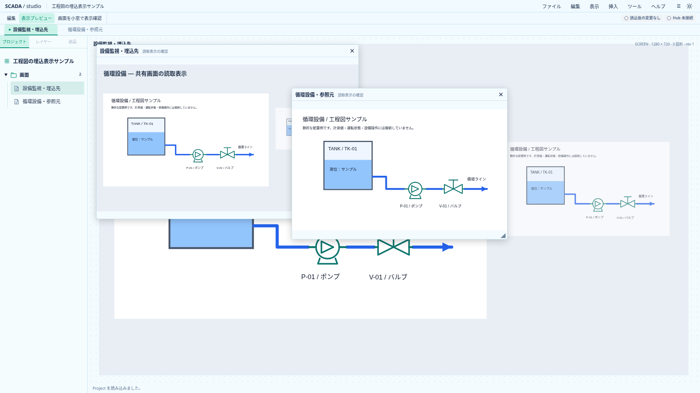
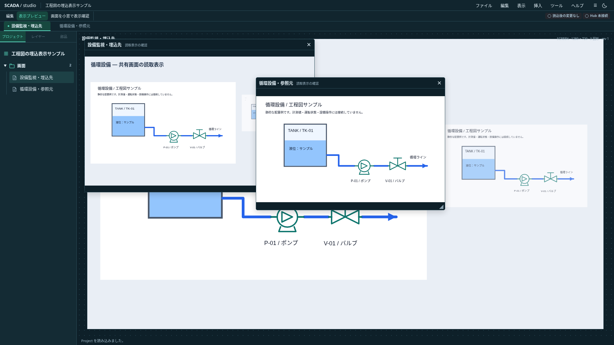

# プレビュー専用の画面内Popup

2026-10-20（日本時間）。[拡張設計](scada-graphics-runtime-extension-design.md#子ウィンドウ監視画面内popupとview-stack)とAstraの読取専用レビューに従う。**プレビュー専用の読取小窓をUIへ接続済み**。Project0.20.0の保存契約を変更せず、正式RuntimeのPopup／Action完成と区別する。

## 初期の境界

表示プレビューの「画面を小窓で表示確認」から、同一Projectの画面を読取表示する。Project・Action・Undo・ブラウザの配置設定へ保存しない、一時的な確認用UIとする。正式Runtime・設備のFaceplate・Equipment context・設備操作・認証には接続しない。

最大4件とし、同じscreenIdを開き直すと位置・サイズを保持して前面化する。5件目は理由を表示して拒否し、既存の小窓を自動で閉じない。外側クリックで閉じない。元画面と同じ背景・画像・Symbol・TagReadingsを使う。

小窓全体の展開配置数は初期20,000件以下とする。通常画面にはProject保存上の20,000件制限がないため、Popup起動時にはSymbol内部と埋込先を含むコストを別途集計する。同じ画面の前面化ではコストを増やさない。これは増幅を制限する暫定値で性能保証ではなく、Text計測・画像・画面内Viewの実測により見直す。

## 位置と操作

小窓は監視図面の表示領域内へ置き、アプリのメニューや画面タブを覆わない。初期位置をずらして重ね、移動・サイズ変更・閉じる・前面化を提供する。幅320・高さ220を最小寸法の目安とするが、領域がさらに狭い場合は領域内への収まりを優先し、見出しと終了操作を残す。

タイトルへフォーカスして方向キーで移動、Shiftで大きく移動できる。サイズハンドルにも方向キーの経路を設ける。マウスのpointer cancel・捕捉喪失・window blurは未確定の移動／サイズを取り消す。領域変更・Modal表示では操作を中断し、ポインタ捕捉を解放する。領域変更後の枠は再clampする。

画面切替・編集復帰・Project世代差替えで、選択Modalと小窓を全閉じする。閉じたものを後着した値で復活させない。最大化・最小化・位置の永続化・独立OS窓・窓内の設備操作は後続。

## フォーカスとView Stack

`role="dialog"`と画面名を付ける。非モーダルなので背景をinertにせず、focus trapも設けない。開く／前面化でタイトルへフォーカスする。閉じる時は、その小窓の中にフォーカスがある場合だけ、開いた元の要素へ戻す。元要素が使えなければ小窓起動ボタンへ戻す。世代が変わった場合は古い復帰先を使わない。

固定Banto v6.7.0の公開layering APIとマーカーを利用する。独自のEscスタックやModalを作らない。Menu・Modalを小窓より上へ置き、同じEscで二重に閉じない。ドラッグ中のEscは移動を取り消し、それ以外はフォーカス中の小窓を閉じる。背景にフォーカスがある時は閉じない。数値入力・確認にはBanto Modalを使う。

## 描画と参照

Popup自体はProjectの参照辺ではなく、保存上の埋込深さを増やさない。埋込Viewを含む画面も表示できるが、検証済みの1段制約を維持して描画し、Rendererを再帰配置しない。図面背景と配置の専用描画を共用し、選択ハンドル・キー編集・窓内のクリックActionを付けない。読取値や画像のStore／Hub接続を窓ごとに作らない。

## 計算基礎と受入

`preview-popups.ts`に一時窓の配列（背面から前面）・同一画面の前面化・4件と合計コストの拒否・位置と寸法のclamp・縮小・終了を実装した。入力を変更しない。単体4件で上限・同一画面の再開・原子的拒否・微小領域・不正数値・前後関係維持を確認する。

UIの受入では、キーボードだけの移動・サイズ変更・終了、ModalとのEsc競合、背面窓を閉じた時のフォーカス維持、狭いviewport、ドラッグ中の切替、背景・clip・共有数値、Project／履歴不変を両テーマのブラウザで確認する。

## UIの接続

プレビューのツールバーから検索付きの画面選択Modalを開く。同じ画面を開き直す場合は既存窓を前面化する。選択不可の画面には4件上限／合計描画予算の理由を表示する。Sceneの非対話描画`ScreenPainting.svelte`を利用し、埋込View入りの画面も1段の契約を保って表示する。

`PreviewWindow.svelte`はタイトルの移動・端のサイズ変更・閉じる操作だけを持つ。前面化ではDOM順を固定し、z-indexだけを変えてポインタ捕捉を維持する。WindowはBantoの`hasVisibleLayerAbove`と`restoreFocus`を使い、Modal／MenuへEscを譲る。領域の寸法はResizeObserverの小数を含むcontentRectを使い、clientHeightの整数丸めによる枠外へのはみ出しを避ける。

同じキー操作でModalと小窓を両方閉じない。非モーダル小窓があるだけでF1・Ctrl／Command＋N／Oを抑止しないよう既存のアプリ判定を修正した。入力中の既存Modalの抑止は維持する。Astraの読取専用レビューを反映した。

## 検証と実画面

TypeScript全593件、型チェック（エラー・警告なし）、本番ビルドが成功した。Popup10件を含むメニュー・新規Project・埋込Viewのブラウザ30件が成功した。全487件の再実行ではない。両テーマの移動／サイズ／Esc終了、4件と重複起動、非表示Symbolの展開予算、端数寸法を含む小領域、取消・capture中の前面化・Modal表示・Project差替え、保存内容の不変、背景ショートカットと条件付きフォーカス復帰を確認した。

初回に見つかったclientHeightの丸めと、非モーダル窓をModalとして扱ったF1・ファイルキー抑止を修正し、該当ケースを追加した。JS575.46kB（gzip173.52kB）、既存500kB超の警告は継続。最大配置数に対する描画速度の保証は行わない。

独自の埋込画面サンプルを、`scripts/capture-preview-popups.mjs`で1920×1080撮影した。小窓は保存されず、背景と小窓の図面は静的サンプルで実設備へ接続していない。
