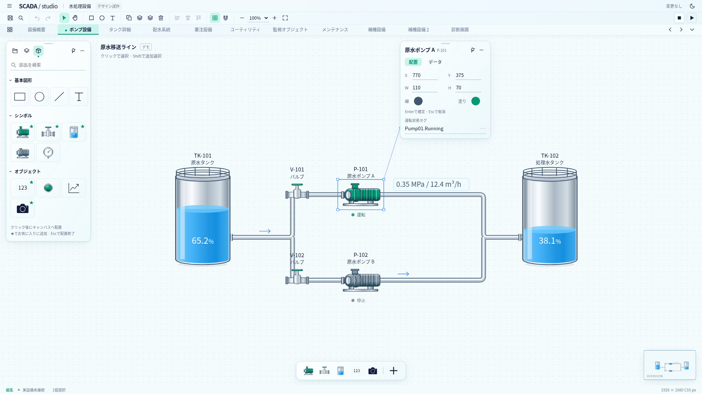
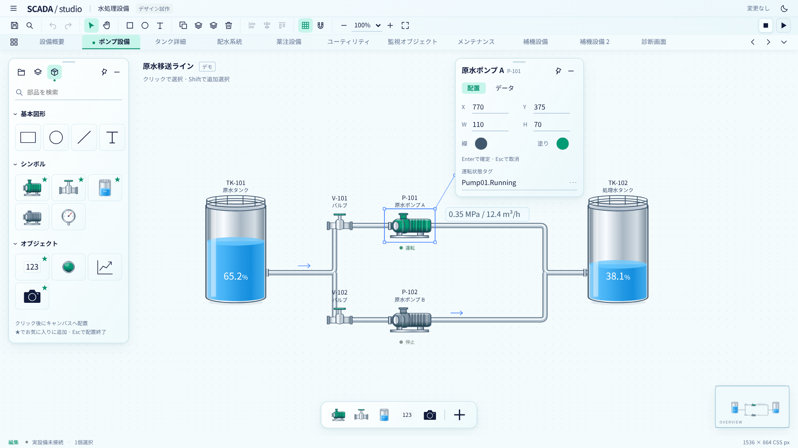

# サイドチャット試作の Designer 適用レビュー

2026-10-19（日本時間）。Astra による設計レビュー。現行本体 `2e3fde6` と `/workspace/scratch/scada-ux-prototype` を照合した。採用決定・アプリ改修・モデル変更の実施を示す文書ではない。

後続の実装状況: [開発・統合方針](development-plan.md)の数値確定の項を参照。単一選択の座標・サイズ・線幅はEnter／フォーカス移動で確定し、他の未適用入力を保持する方式を実装した。以下の評価はレビュー時の本体 `2e3fde6` を対象としており、試作全体の適用完了を示さない。

## 判断

**外観と操作の方向は適用可能。試作全体を置き換える移植は勧めない。** グラス調の外枠、簡潔なツールバー、部品のお気に入り、タグ選択の入口は現在の Banto / Svelte 基盤上で実現できる。費用が増えるのは主として、入力を保持する可動パネル、モデルを伴う多色・状態別設備表現、正式なタグと Runtime 接続である。技術的に不可能と判断した外観はない。

ユーザー回答により、左右固定を標準として浮動へ切替可能にすること、数値をEnterとフォーカス移動で確定すること、フルHD以上・マウス中心を主環境とすることを設計方針として確定した。本体実装や試作全体の採用完了を意味しない。まず現行の固定幅調整・下部高さ保存を土台に見た目と数値確定を評価し、お気に入りとタグ選択を独立して進める案が現実的。浮動化の完成を他の UX 改善の前提にしない。認証・MES は延期を維持し、Banto の初期化・通知・設定・テーマを利用する。ems-apps の画面・コード・アセットを取り込まない。

## 確認範囲

AGENTS.md、README、開発方針、統合設計、UI 改訂提案と、試作 README / HTML / CSS / JavaScript / verify.cjs / verification.json を照合した。ライト・ダーク・125%相当・タグ選択の4画像は実画像を確認した。主要根拠は以下のとおり。

- 試作 `style.css:371`：blur 22px のグラス。`:385`：左232px、プロパティ248px・左57%の初期位置。
- 試作 `app.js:424`：対象ガイド、`:502`：お気に入り、`:607`：選択変更、`:1149`：数値入力、`:1201`：位置保存、`:1394`：タグ選択。
- 本体 `apps/banto-scada/src/lib/designer/drafts.svelte.ts:18`：フォームを基準とする入力保護。`App.svelte:643` 付近の編集入口、`:914` の保存、`lib/editor.ts:153` の `applyCommand`、`lib/history.ts:11` の履歴。
- 本体 `lib/project.ts:8` 以降のモデル、`lib/Renderer.svelte:440` 以降の Symbol 描画、`lib/banto/setup.ts:28` の UI 設定。

原本の保存済み検証は31項目・ブラウザ実行エラー0。レビューでも原本を変更せず `/tmp/scada-prototype-review` へコピーし、ローカルの配信URLと検証出力先だけを変更して再検証した。分割ソースの `index.html` とユーザー指定の配布用 `standalone.html` の双方で、同じ31項目がすべて成功し、ブラウザ実行エラーは0だった。これは試作の代表操作の検証で、本体の受入完了を示さない。125%相当は1536×864 CSS px・deviceScaleFactor 1.25であり、実機OS倍率試験ではない。任意図面・大量タグ・低性能GPU・長時間作業は未検証。

### 参照画像

[ダークテーマ](assets/frontend-ux/prototype-review/preview-dark-1920x1080.png)と[タグ選択](assets/frontend-ux/prototype-review/preview-tag-picker.png)も確認した。いずれも本体ではなく独立試作の画像。

## 要素ごとの採用判断

相対コストの「小」は既存機能への表示・入口追加、「中」は独立した UI 状態・回帰検証、「大」は編集状態や永続モデルを横断する変更を表す。日数の見積りではない。

| 要素                               | 判断・コスト                              | 本体へ適用する条件                                                                                                                      |
| ---------------------------------- | ----------------------------------------- | --------------------------------------------------------------------------------------------------------------------------------------- |
| 青いグラス・ミントの選択・薄い境界 | 可能、小〜中                              | Designer 用 tokens にし、Banto の light / dark / system を維持。工程図色は変えない。blur 無効時の不透明背景を用意して性能と可読性を測る |
| 上部96px・小さなアイコン           | 可能、小〜中                              | 数字を固定目標にせずメニューバー表示時も評価。名前・状態・エラー・フォーカスを削らず、狭幅時の折返し／overflow を設計                   |
| 左232px・プロパティ248px           | 可能、小                                  | 既存の可変幅を保持。長い日本語名、タグ名、配管頂点、共有定義の影響表示で必要幅を検証                                                    |
| 同一画面内の浮動パネル             | 可能、中〜大                              | draft とパネルDOMの寿命を分離するか、確実にDOMを維持する構造を検証。キーボード移動、取消、復帰、前後関係も実装                          |
| 左／右／下への再ドッキング         | 可能、大                                  | 試作のピンは移動禁止だけ。ドック領域、個別パネルID、配置バージョン、再マウントとフォーカスの設計が別途必要                              |
| 対象への細線ガイド                 | 可能、小〜中                              | 補助表示に限定し、対象名を常時表示。パン・倍率・複数選択・画面外・隠しパネルで誤誘導しない                                              |
| 下部のお気に入りドック             | 可能、中                                  | 部品パレットと同じ配置コマンド・可否を使う。下部タグ参照と競合しない場所へ置き、名前・削除済み共有定義・Project切替を扱う               |
| 連続配置                           | 可能、中                                  | 配置モードと解除を明示し、1配置1履歴。定義編集の入れ子禁止、draft、プレビュー禁止、座標変換を共用                                       |
| ツリー式タグ選択                   | fixture では可能、中                      | 数値Text用に型を絞り、候補→draft→適用→保存を維持。Host接続なしでもUXを検証可能                                                          |
| 実タグ・状態表示                   | 上流SDK／Host依存、大                     | #682 の最新契約、同世代metadata/current、型・品質・未解決・切断を検証。試作BOOLは現行Text対象外                                         |
| 金属配管・多色ポンプ・液面         | 静的SVG表示は可能。汎用編集・動的表示は大 | 現行モデルの塗り・Symbol一括色上書きから拡張が必要。多色、gradient、状態slot、液面の意味を個別に設計                                    |
| ミニマップ                         | 閲覧用は可能、中                          | 現行rendererを再利用し、視点矩形・多画面・サイズ・性能を検証。操作用は別のviewport制御を追加                                            |
| 回転・接続点・配管追従             | 可能、大                                  | 試作未実装。モデル、座標変換、選択・resize・整列・Undo・保存・接続参照を横断する別工程                                                  |
| カメラ・トレンド                   | 枠は容易、実機能は別工程                  | カメラはHost/共有RTSP層、History/Trendはv1.1基盤。アイコン配置だけで実装済みにしない                                                    |

数値のEnter／フォーカス移動確定は適用可能で、相対コストは中〜大。見た目だけの入力変更と異なり、既存フォームの再マウントと入力保護を統合する必要がある。以下の自動確定節に具体的な条件を記す。

## UX の所見

画像では工程図が広く、ポンプ・配管・計測値のまとまりを読み取りやすい。下ドックをお気に入り専用にして左一覧と役割を分けた点、プロパティが選択ごとに動かない点、テーマで工程図の色が変わらない点は採用価値がある。

ただし、画像の余白は代表図面の配置による効果も大きい。初期プロパティは `left:57%; top:16px` であり、障害物回避の計算ではない。125%相当の画像では計測値との余裕が減っている。任意の工程図では上部の機器や文字を覆い得る。ユーザー回答に従い左右固定を標準・復帰先とし、浮動へ切り替えた場合の初期位置を作業領域内で制限する。保存済み位置を優先し、選択変更で勝手に動かさない。

ガイド線は `renderSelectionLink` が単一選択に限り、対象右上からパネル左へ結び、距離450px超や対象がパネルの右側にある場合は消している。一般的な最短経路・重なり回避ではない。消えても対象を識別できる見出しを残し、線はクリックを妨げない補助にする。自動追従・自動回避は今回の採用条件にしない。

文字は主に12〜13px、注釈は10〜11px、操作範囲は24〜28px。主環境はフルHD以上・マウス中心と確定したため、この密度をそこで評価する。長時間利用の可読性は未検証で、タッチ最適化は今回の主対象にしない。1920×1080以上で代表操作を評価し、1280×720 / 1440×900は縮小時の退避・復帰・主要操作への到達を確認する。実ブラウザ125%・150%、両テーマ、長い日本語名、エラー・disabled・focus状態の確認も維持する。ヘッダーのコントラスト検証だけで、半透明面の全背景・全状態が合格とはいえない。blurを切っても読める下地を基準にする。

試作の■／▶はプレビュー切替であり、実設備の停止／運転と誤解されないラベル・tooltip・モード表示が必要。現行のメニューバー、常設メニュー、OS連動テーマも残す。試作 `toggleTheme` の二択を丸ごと移すと system の選択肢が失われる。

## そのまま移植してはいけない操作契約

### 自動確定と draft

試作では数値を `change`（Enterによるblur、フォーカス移動）で即時適用する。しかも `mutate` はタグdraftを消し、`setSelection` は通知してタグdraftを破棄、`changePage` は無条件に破棄する。`renderInspector` は数値欄とエラーを現在値へ再構築するため、不正入力の保持も本体同等ではない。保存時に未適用タグを止める代表試験が通っても、選択変更・数値変更・タブ切替を挟む入力保護を保証しない。

本体の既存契約は、フォーム入力を保持し、対象切替や保存前に適用／破棄／キャンセルを解決する。ユーザー回答により、**数値フィールドはEnterとフォーカス移動で確定する方式へ変更する方針**とした。タグの明示適用や他フォームの入力保護まで一括して即時化しない。次の条件を満たす実装を必要とする。

- 編集開始時のProject session・画面／定義・対象ID・フィールドを捕捉し、その対象へだけ確定する。遅れて発生するblurが新しい選択対象や別Projectへ値を適用しない。対象切替前に旧対象の確定を解決し、対象消失時は書き込まない。
- Enterとフォーカス移動は同じ検証・コマンド経路を使う。空欄、非数、範囲外、関連寸法との不整合を共通モデルで検証し、不正な文字列とエラーを保持する。再描画やパネル切替で現在値へ黙って戻さず、未解決入力がある状態での対象切替・保存には従来の保護を適用する。
- Escは当該フィールドを最後の確定値へ戻し、続くblurで再適用や履歴を発生させない。IME変換中のEnterを確定キーとして扱わず、変換中のblurでは未完了文字列をモデルへ渡さない。composition終了とフォーカス移動の順序が違っても、旧対象に検証済みの値を一度だけ確定するか、入力を保持して再確定を待つ。
- 1フィールドの有効な変更を原則1履歴とし、Enter直後のblurを重複記録しない。同値は履歴を作らない。幅とXなどに関係する値は、現在の確定モデルに対して単一変更が成立するか検証し、別欄の未確定値を無断でまとめて適用しない。数値の確定はタグdraftや他欄の不正入力を消さない。
- パネル・タブ・見出し操作は、フォーカスを移す操作と入力フォーカスを維持する操作を明確にする。ボタン等へフォーカスが移れば、元の数値フィールドを上記ルールで確定する。ドラッグ用ハンドルがフォーカスを維持する場合は、その操作だけで確定しない。DOMの再生成を、他の複数フィールドの一括確定の契機にしない。タブ切替・折畳み・移動・再ドッキングでも、捕捉した元フィールドと同じ確定／取消ルールを使う。

受入試験では、Enter→blurの連続、Esc→blur、IME変換中のEnter／パネルクリック、不正入力後の別対象選択、Project置換、タグdraft保持中の数値変更、パネル操作によるフォーカス移動と維持をそれぞれ確認する。これは即時確定を採用するための条件であり、フォーカス移動確定を禁止する提案ではない。

本体 `InspectorPanel.svelte:86` は `{#key project.manifest.projectRevision + selected.id}` でフォームを作り直し、`:87` ではフォーム全体を `properties` へ送る。数値1欄だけを既存updateへ流してもrevisionの更新により他欄のタグdraft・不正入力が失われ得る。単一フィールドの確定とフォーム全体の適用を分離し、revision更新後も対象ごとの未確定文字列を復元する、または確定時に再マウントを起こさない状態構造へ整理する。単にblurハンドラを追加する工数ではなく、入力状態との統合工程として扱う。

本体 `drafts.svelte.ts:67` のdestroyはdirty登録を削除する。現在の固定パネルを表示切替することと、ドッキングライブラリがDOMを作り直すことは異なる。浮動化で最も先に検証すべき箇所である。入力文字列・不正値・選択範囲・フォーカス・対象IDを保持し、別Project読込では古いdraftを別対象へ適用しない。

### タグ選択

試作は `openTagPicker` で画面と対象IDを記録し、`chooseTag` で再検証してdraftへ返す。この分離はよい。一方、catalogは固定BOOL群で、型・単位詳細、Project session、catalog世代、未接続／更新中／取得失敗を扱っていない。`renderTags` はdetailsとボタンのグループ一覧であり、矢印操作を備えた完成したtree widgetではない。タグ行Enterは通常のclick相当で候補選択に留まり、設計上の確定動作とは違う。

本体は `project.ts:24` の数値Text Bindingのみで、ポンプSymbolへ直接BOOLを保存する契約はない。まず数値タグfixtureでダイアログを作り、単クリックでProject無変更、タグ行Enter／ダブルクリック／選択ボタンでdraftへ返す、検索Enterは非確定、Escは元draft保持、とする。候補選択後に検索で候補が非表示・消失した場合も確定対象を再検証する。階層は外部名のドット分割ではなくmetadataを使う。実接続の未成立はこのUX作業を止める理由にはならない。

### ショートカット・配置・保存

試作 `app.js:921` の全体keydownは入力・dialogを避けるが、IME `isComposing` とAltの除外がなく、矢印移動の範囲も広い。本体 `App.svelte:377` の既存保護と共通コマンドへ接続する。V/H/R/T/FやCtrl/Cmd+Kは、メニュー・タブ・リサイズ境界・検索・IMEと競合しない範囲を定める。矢印の長押しをUndo一件にするかも操作設計が必要。

お気に入りは試作では部品type文字列だけ、最大8件。現行のProject共有定義を含めるなら、組込部品IDとProject ID＋定義IDを区別し、削除済み参照を復元しない。設定はProjectではなくBanto UI設定へ保存する。下部参照一覧を展開したときはドックを上へ逃がす／畳むなどの単純な配置を先に決める。

試作の位置保存はx/y・pin・collapseだけで、ピンは移動を禁止する機能。ドラッグのpointercancelも終了保存として扱い、Esc取消は実装していない。再ドッキング、個別の左3パネル切離し、レイアウト版、保存値の型検証、画面縮小からの復帰は別実装が必要。本体の幅・高さ保存は再利用できるが、浮動状態の完成品ではない。

試作の `snapshot/mutate`、`scada-ux-study-1` JSONを本体の履歴・保存に置き換えない。現行Projectの後方互換性はリリース前で必須ではないが、現行schema・Rust・TypeScript・サンプル・描画の整合、無変更時の履歴、Undo後のrevisionなどは維持する。

## 採用順と判定条件

1. **固定shellの外観と数値確定**：左右固定を標準に、色・余白・アイコン・入力外観を評価する。数値のEnter／フォーカス移動確定は、外観変更とは別の操作契約として上記条件を満たす。フルHD以上・マウス中心の代表作業、両テーマ、縮小・表示倍率、長いラベル、保存・Undo・draft・既存メニューの回帰確認で判定。
2. **お気に入りと連続配置**：共通配置コマンドへ接続。通常配置／共有定義編集／プレビュー、ズーム・パン・スナップ、入力保護、Project切替・部品削除・ストレージ失敗を検証。
3. **タグ選択UX**：数値fixtureで明示確定と取消を検証。対象変更・catalog更新・型不一致・大量候補・キーボードを含める。工程2・可動パネルと独立して着手可能。
4. **可動パネル**：先にdraft寿命と再マウントを最小構成で検証。その後、浮動・キーボード操作・ドック先・配置保存を追加。非表示、標準復元、ドラッグ取消、画面縮小、破損設定、メニュー／確認ダイアログの前後関係、手動倍率の中心維持を確認。
5. **モデルと接続**：多色Symbol、状態slot、回転・接続などを個別のモデル工程へ。実タグはSDK/Host成立後。カメラ・History/Trendの提供段階は統合設計を維持。

代表操作の時間・誤操作率も、現行と試作風UIで同じ課題（部品3個配置、移動・整列、タグ割付、修正して保存）を比較する。グラス性能は図形数を増やし、パン／ドラッグ中のフレーム時間を不透明版と比較する。数値上限や対応端末が未確定なので、現時点で性能合格や一律の工数日数は断定しない。

## ユーザー回答と採用条件

2026-10-19（日本時間）の回答により、次の3点を設計方針として確定した。今回の更新はレビュー文書のみで、本体の実装着手・完了や試作全体の採用を表さない。

| 回答                              | 採用する方針と条件                                                                                                                                    |
| --------------------------------- | ----------------------------------------------------------------------------------------------------------------------------------------------------- |
| 左右固定を標準、浮動へ切替可能    | 現行の幅調整・下部高さ保存を維持し、固定配置を復帰先にする。浮動は同一画面内から進め、入力保持・フォーカス・再ドッキングを検証する                    |
| 数値はEnterとフォーカス移動で確定 | 数値に限定して共通モデル検証と編集コマンドへ接続する。不正入力保持、Esc、IME、重複履歴防止、対象捕捉、タグdraft保持を満たす。タグは明示適用を維持する |
| フルHD以上・マウス中心            | この環境で操作密度と作業効率を評価する。小画面やタッチを主対象に広げず、画面縮小からの復帰と表示倍率の検証は残す                                      |

Banto基盤、両テーマ＋system、Project色の独立、お気に入りと全一覧の分離、共通コマンド・履歴・draft保護、タグ選択の明示確定、下部参照との重なり防止を維持する。浮動の自動追従は当面追加しない。Model／Host依存機能を外観改修の必須条件にせず、認証・MES延期とems-apps非流用も維持する。今回の3点について追加の回答待ちはない。

## 後続の Studio 外観実装

2026-10-19 同日後続。ユーザーから試作プレビューを再提示された後、ヘッダー・ツールバー・画面タブ・作業領域・左右固定パネルの外観を本体へ適用した。初期レビュー以降の実装であり、上記の当時の照合を完了済みに読み替えない。[開発計画](development-plan.md)に実画面・検証・未実装範囲を記録する。浮動・多色シンボル・回転と接続などの評価は維持する。
