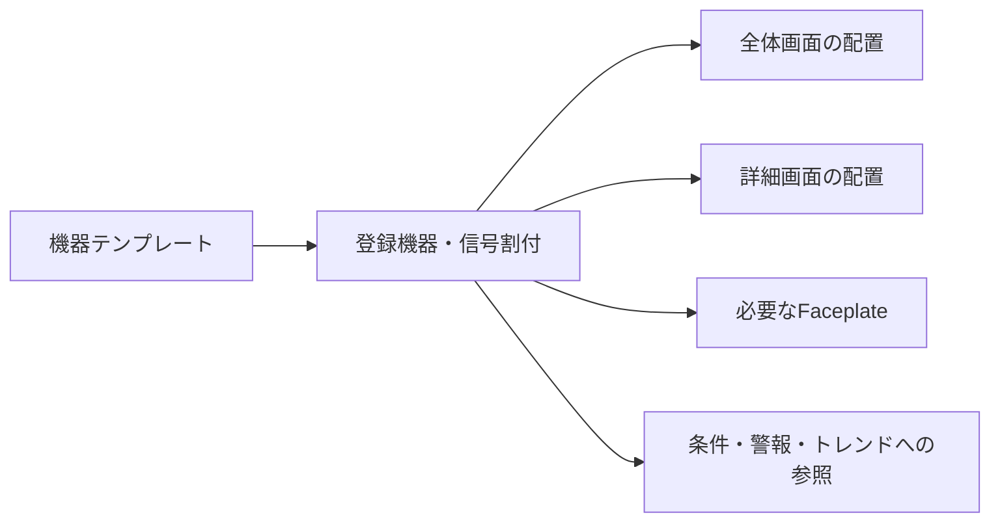
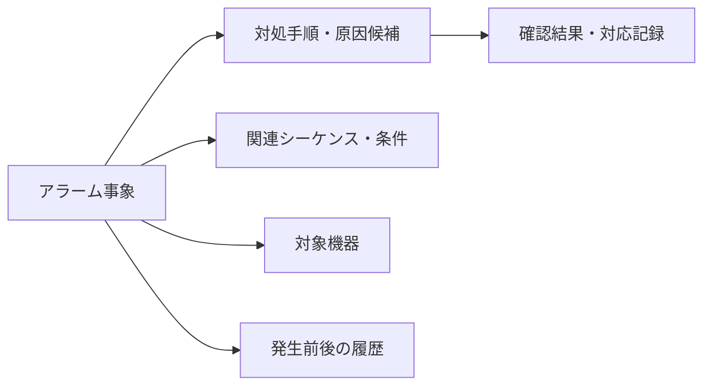
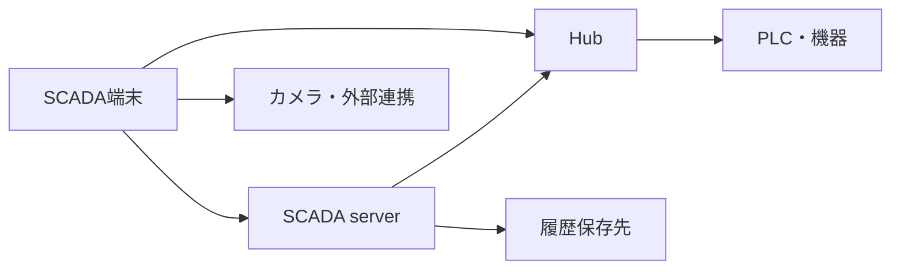

# SCADA 作成支援・機器定義・プラント運用の追加検討

整理日: 2026-10-20（日本時間）。サイドチャットでの機能・操作・外観の検討を、今後の設計に利用できる形で整理した資料。

本書は**ユーザーから挙がった要望と追加提案の記録**であり、全項目の採用・実装完了・提供時期の確定を意味しない。既存の基準設計は[統合設計](scada-integrated-design.md)、現在の実装状況は[開発計画](development-plan.md#implementation-status)を参照する。本書の整理だけで Core v1／v1.1／後続 Extension の範囲を変更しない。

## 1. 検討の目的と既存設計との関係

SCADA画面作成者が、機器・信号・外観・動作を繰り返し設定する負担を減らす。作成した情報を、監視、運転支援、トラブル対応、説明書、試験、引渡しまで利用する。

### 1.1 ユーザーの要望・指摘

| 領域           | 要望・指摘                                                                                                              |
| -------------- | ----------------------------------------------------------------------------------------------------------------------- |
| 機器登録と配置 | 誘引・押込・冷却・減温送風機などを先に登録し、ドロップすると状態表示や必要なFaceplateが設定された配置になる。計器も対象 |
| 機器ごとの差   | 同じ送風機でも信号数、遠隔操作、Faceplateの要否が異なる                                                                 |
| 図面からの登録 | 画面上で作り込んだ配置を、後から機器定義へ取り込める                                                                    |
| 図形合成       | 基本図形を組み合わせ、フロー図や独自部品を作りやすくする                                                                |
| 外観とドック   | 作成者が使いたくなる洗練されたUIとドックランチャー                                                                      |
| 記録・トレンド | 運用後の信号追加に伴う、DB列の手動追加を減らす。表形式の設定補助、ペン選択・グループ分け・色割付を容易にする            |
| 信号の選択元   | 記録対象をHubのタグ一覧から選択する案                                                                                   |
| 作成支援       | 監視用メニュー画面作成、操作説明書・機能仕様書の自動作成                                                                |
| プラント運用   | 自動立上げ・立下げフロー、機器とシーケンスの起動・停止条件、インターロック一覧                                          |
| 異常対応       | アラームとトラブルシューティングの紐付け                                                                                |
| 通信診断       | ネットワーク・接続・システム状態を確認する画面                                                                          |

### 1.2 既存計画への接続

| テーマ                       | 既存計画                                       | 今回の具体化・追加候補                                                 |
| ---------------------------- | ---------------------------------------------- | ---------------------------------------------------------------------- |
| Equipment／Symbol／Faceplate | 型付きslot、機器ごとの割付、共通context        | 機能の増減、Faceplateなし、台帳と図面の双方向の登録手順                |
| 作図                         | 共有Symbol、幾何グループ・配管追従等の後続検討 | 図形演算、選択範囲からの部品化、公開パラメータ、作図補助               |
| Tag Browser                  | catalog由来の階層・検索・型検証                | 記録対象の複数選択、機器からの選択、表形式の編集                       |
| History／Trend               | recorder、tstore／tsquery、Trend UIの共有      | 記録・表示設定の作業分離、保存構成変更の補助、ペン・グループ・自動配色 |
| Alarm／Action                | 状態・ACK／Shelve、実行境界、監査              | 条件・シーケンス・対処手順への参照、異常時情報の収集                   |
| 診断・配布・復旧             | 品質・接続状態、版識別、差分、復旧             | 構成図、影響範囲、運転引継ぎ、復旧支援                                 |
| UI／UX                       | Studio外観、固定パネル、共通操作、入力保護     | 外観の仕上げ、ドックの質感、機器とテンプレートの識別                   |
| 検証・一括編集               | 型・参照検証、CSV、一括設定、模擬試験          | 文書・試験・変更説明書・引渡し資料の生成                               |

主な参照先:

- [統合設計](scada-integrated-design.md)、[Designer UI改訂](designer-ui-revision.md)、[UX設計](frontend-ux-design.md)。
- [上流SCADA設計](upstream/industrial/scada-design.md)の§7〜§13、§16、§19。
- [記録計の保存契約](upstream/industrial/recorder-requirements.md)、[SDK投影境界](runtime-sdk.md)、[運用・ログイン方針](access-policy.md)。
- [図形・画面展開の追加検討](scada-graphics-runtime-extension-design.md)、[整理用フォルダー](layer-folders-design.md)。

上流資料は保存済みスナップショットであり、上流main・Issue・SDKの最新状態を本書作成時に再検証したものではない。接続・実装に着手する際は最新の共有契約を確認する。

## 2. 共通方針と責務

1. 機器・信号・条件・手順を参照で結び、画面ごとの二重設定を減らす。
2. 未確定の仮置き、オフライン編集、後からの割付を許容し、未確認・未設定を表示する。
3. 図面・機器・共通テンプレートの編集対象と影響範囲を明示する。
4. 機器・シーケンスの実際の制御、保護、最終的な実行可否はPLC・安全系の責務。SCADAは監視・説明・許可された操作要求を担う。
5. SCADAはPLCへ直接接続しない。値・通信状態はHubと共有SDK、履歴はSCADA server経由で取得する。
6. Designerの表示確認・模擬試験から実機操作を実行しない。模擬・実データの由来を示す。
7. 設備状態とデータ品質を分ける。未取得・通信断・Bad／Staleをゼロ・停止・正常に置き換えない。
8. Banto、共有SDK、記録・式評価の共通層を再利用する。認証統合の延期方針を維持する。

Projectは設定・参照を所有し、端末設定はテーマ・パネル・ドックの並び等を所有する。選択・draft・模擬値は編集session、現在値・シーケンス状態・履歴・操作記録はRuntime／serverの状態として扱う。保存先を最終確定していない新概念は、詳細設計時に所有者を決める。

## 3. 機器定義・登録・配置

### 3.1 三つの役割

| 概念             | 内容                                                                | 例                            |
| ---------------- | ------------------------------------------------------------------- | ----------------------------- |
| 機器テンプレート | 共通の形状、機能ブロック、型付き信号の役割、状態表示、Faceplate候補 | インバータ付き送風機、圧力計  |
| 登録機器         | 機器番号・名称・所属、採用する機能、実際の外部名割付                | IDF-101／誘引送風機1号        |
| 画面上の配置     | 登録機器の参照、位置・サイズ・向き・表示形式、許容する外観差分      | 全体フローと詳細画面のIDF-101 |

誘引・押込・冷却・減温送風機は、送風機の共通構成と用途別プリセットを候補とする。信号数や機能の組合せごとに別の型を無制限に増やさず、必要な機能を選択できるようにする。計器も、温度・圧力・流量・液位等の役割と単位・範囲・桁数を持つ機器として扱う。

### 3.2 信号・機能・クリック動作を独立して選ぶ

| 機器構成の例           | 表示           | クリック動作の例                    |
| ---------------------- | -------------- | ----------------------------------- |
| 信号なし、現場操作のみ | 固定シンボル   | なし                                |
| 運転信号のみ           | 運転状態       | なし                                |
| 運転・故障・電流       | 状態と電流     | 任意の監視用詳細                    |
| 運転・故障・遠隔操作   | 状態           | 操作用Faceplate                     |
| インバータ付き         | 状態・周波数等 | 必要な設定値ブロックを含むFaceplate |

「現場操作のみ」でも監視詳細は付けられる。Faceplateと遠隔操作はそれぞれ任意とし、機器種別から強制しない。

登録UIは「運転表示」「故障表示」「電流」「周波数」「起動・停止」「設定値」などの機能ブロックを追加する方式を候補とする。採用したブロックだけ必要なslotを要求し、必須・任意を区別する。Faceplateも同じ機能ブロックと登録機器のcontextを参照する。

- 故障信号を持たない機器は、故障監視なし。正常と判定したことにはしない。
- 採用した機能の信号が未割付なら設定不足、割付済みで取得不能ならデータ不明を表示する。
- 遠隔操作機能なしでは操作ボタンを設けず、遠隔操作対応だが現場モード等で不可なら理由を示す。
- 型、単位、read／write、割付先、対象機器を検証する。metadataがなければ未確認とし、名前の類似だけで割付を確定しない。
- Hubの工学値を二重にスケーリングしない。単位の互換性・換算の所有者は詳細設計で定める。

### 3.3 台帳からの配置

機器登録で基本情報、使用する機能、タグ割付、状態表示、必要なクリック動作を確認する。機器一覧からドロップすると、設定済みの表示・動作を持つ配置を生成する。

同じ機器を複数画面に置いても機器情報を共有する。Designerのクリックは選択、正式Runtimeのクリックは設定した動作として扱う。未割付件数や未確認状態を表示し、該当設定へ移動できるようにする。

### 3.4 図面からの機器登録

1. 図形・機器名・数値表示などを選択し、「機器として登録」を開く。
2. 対象のプレビューで、含める図形・ラベルと除外する配管等を調整する。
3. 機器番号・名称を指定し、既存Bindingを運転・故障・電流などの役割へ対応付ける。
4. 外観、機器固有の差分、クリック動作、Faceplateの有無を確認する。
5. 検証後、台帳と機器参照を持つ配置へ一括反映する。

位置・サイズ・見た目を保持し、原図形の二重残置や部分変換を避ける。取消・検証失敗で元を保持し、成功した登録は一つの操作としてUndo可能にする。既存の共有定義を変更する場合は使用先への影響を確認する。

入口は「新しい機器として登録」「既存機器へ関連付け」「機器テンプレートとして保存」を区別する。テンプレート化では具体的なタグ外部名を機器側に残し、共通側には役割・型・表示・動作の定義を持たせる。

### 3.5 再利用・増設

- 仮置き後に機器を関連付けても配置を保持する。
- 「同一機器を別画面にも配置」と「別機器を新規作成」を区別する。
- ライン複製では新規機器と共用機器を選び、機器番号・タグ対応を差分表で確認する。対応不明は未割付にする。
- テンプレート更新では使用機器・画面、個別変更、操作・信号への影響を表示する。
- 表示形式を簡略記号・詳細・数値付きへ変えても機器参照を保持する。
- 送風機・インバータ・ダンパ・計器等をまとめる設備ユニットも追加候補とする。構成機器の個別識別を維持する。

## 4. 図形合成・部品作成・作図補助

| 機能                 | 目的・扱い                                                                         |
| -------------------- | ---------------------------------------------------------------------------------- |
| 幾何グループ化／解除 | 元の子図形を保持して一括移動・回転・拡縮。整理用レイヤーフォルダーとは別           |
| 図形演算             | 結合・型抜き・交差から輪郭を作る。元形状の再編集方法も検討                         |
| 選択範囲を部品登録   | 描いた形を共有Symbolへ変換し、必要なら機器テンプレートに関連付ける                 |
| 部品の公開パラメータ | 変更可能な寸法・文字・色・表示項目を宣言し、内部図形を毎回編集せず使えるようにする |
| 基本図形の拡充       | 円弧・扇形・多角形等。各種類の優先度と保存モデルは別途決定                         |
| スマートガイド       | 他図形の端・中心との一致、吸着を表示。既存グリッドと役割を分ける                   |
| 寸法・配置補助       | 同じ幅／高さ、図形間の隙間の均等化、配列複製・連番                                 |
| 書式コピー           | 色・線・文字等の指定項目を複写。機器・タグ・Actionの複写とは別操作                 |
| 重なり選択           | クリック位置の候補を名前付きで提示。細い配管や背面図形も選べるようにする           |
| 接続口・配管追従     | 吸込・吐出・入口・出口へ吸着し、移動で端点追従。交差と接続を区別                   |
| 機器ラベル追従       | 名称・計測値の相対配置を保持し、独立した位置調整も可能にする                       |
| 下絵作図             | 固定・透過・縮尺合わせ・表示切替によるトレース支援                                 |

図形演算によって機器Bindingや操作対象を暗黙に統合・消失させない。接続口による図面上の接続と、実設備・制御上の接続関係を同一視しない。共通定義と配置ごとの変更は明示する。

一括編集は機器・配置・信号等の表と図面選択を同期し、Excel／CSV等の貼付前後の差分、空欄の「変更なし／解除」、型・参照・ロックを検証する。適用は部分成功を既定にせず、既存の入力保護・Undoへ接続する。

## 5. Studioの外観とドックランチャー

### 5.1 外観の提案

ライトは淡い青灰色とグラス、ダークはグラファイトを候補に、共通の造形・アイコン・文字階層を揃える。ウォームホワイトも比較案として記録する。特定の新配色・寸法を採用済みとはしない。

- ヘッダー・パネル・作業領域を近い色調でつなぎ、フラットな行、余白、薄い色差でまとまりを示す。
- アイコンの線幅・余白・角の形を揃え、部品プレビューにも共通の規則を使う。
- 機器番号・値・単位の整列、数値の桁幅、見出しと補助文字の強弱を整える。
- 入力欄は下線、ホバー、フォーカスで操作範囲を示し、ラベルは入力中も保持する。
- グラスは文字の可読性を確保できる下地を持ち、透け感は周辺・余白を中心に使う。
- 選択・フォーカスと設備状態の色を識別する。状態を文字・記号でも表す。
- パネル・メニューの動きは短くし、数値入力やドラッグの反応を遅らせない。動きを減らす設定に対応する。

主環境は既存方針のフルHD以上・マウス中心。実際のOS表示倍率、長い日本語名、両テーマ、フォーカス・disabled・エラー状態、低性能GPUと大量図形で確認する。既存のコントラスト・キーボード・入力保護要件を継承する。

### 5.2 ドック

左の一覧は検索・分類を含む全体探索、下のドックはお気に入りへの入口とする。小さなライブラリ呼出と登録用「＋」も候補とする。

| 要素 | 提案                                                                            |
| ---- | ------------------------------------------------------------------------------- |
| 外形 | 高さ48〜56px程度を比較用の目安に、薄いグラス・穏やかな角丸・細い縁・柔らかな影  |
| 表示 | 実部品を簡略化したアイコン。テンプレートと登録済み機器を識別する小さな記号      |
| 名称 | ホバー・キーボードフォーカスで種類と名前を表示。IDF-101等の対象を確認可能にする |
| 選択 | 控えめな背景、下線または点。色だけに依存しない                                  |
| 動き | わずかな浮き上がり。隣のアイコン位置を動かさず、ドラッグ中は位置とサイズを固定  |
| 配置 | 完成形の薄いプレビュー、配置位置・吸着ガイドを表示                              |
| 整理 | 並べ替え・登録解除・情報表示。並びは利用者の設定として保存                      |

テンプレートからの新規作成と、登録済み機器を別画面に配置する操作を明示する。既存の即時配置・連続配置・ドラッグとの整合を定める。ドックへの登録・並べ替えは図面の変更・Undoと分ける。

## 6. Hubタグ選択・記録設定・トレンド

### 6.1 信号追加を設定画面で完結させる

Hub catalogを正式な信号選択元とし、機器・エリア・信号の役割からも同じタグへ到達できるようにする。外部名は既存契約どおり不透明な識別子として扱い、ドット分割・類似名による自動再割付はしない。記録可能な型はrecorder契約で確認し、未対応の型を理由付きで示す。

記録設定は「機器／信号／有効／周期／記録方式／保持」の表を候補とする。型・単位・説明等を利用可能なmetadataから補い、欠ける情報は未確認と表示する。周期・変化時記録・保持期間の設定粒度と対応範囲は共通層の契約に合わせる。例示した周期・保持日数を製品の既定値としない。

利用者が信号追加のたびにDB列を手動追加する運用を避ける。[既存保存契約](upstream/industrial/recorder-requirements.md)は日次ファイル＋スキーマ凍結で、タグ構成変更を新構成のファイルへのローテーションで吸収する。独自の保存形式や別の履歴エンジンを新設する提案ではない。

編集では変更案・容量概算・検証結果を確認してProjectに保存し、本番への配布・適用段階で記録構成を切り替える。Editorでチェックを変えた直後に、稼働中recorderへ別系統のselected-tagsを送る方式にはしない。無停止・無欠測の実現可否は共有基盤とHostを含む検証で確認する。

### 6.2 記録と表示の設定

| 設定 | 決めるもの                                     |
| ---- | ---------------------------------------------- |
| 記録 | 何を、どの条件で、どれだけ保存するか           |
| 表示 | どの信号を、どの順番・色・軸・期間で表示するか |

一つの信号を複数グラフへ表示しても記録を重複させない。記録済みの信号は表示ペンの追加だけで使える。未記録の信号には状態を示し、記録設定への導線を設ける。

上流は配布Projectのtrend groupを記録対象の起点としている。記録対象を表示グループから独立して選べるという今回のUX案は、記録対象の導出・重複排除・削除時の扱いを含めたモデル補強が必要であり、その対応方法は未決とする。

追加前の期間は未記録・欠測とし、ゼロで補間しない。記録対象から外しても過去履歴を直ちに削除せず、保持方針に従う。改名・同名再利用・型や単位の変更と履歴の関係を明示する。履歴キーを独自のHub内部IDへ変更しない。

### 6.3 ペン選択と用途グループ

| 領域 | 内容                                           |
| ---- | ---------------------------------------------- |
| 左   | 設備階層、エリア、機器、用途グループ、横断検索 |
| 中央 | 信号・単位・記録状態・追加済み表示。複数選択   |
| 右   | 選択済みペン、表示名・順番・線色・線種・軸     |
| 下   | グラフのプレビュー、選択件数、検証・適用       |

- 検索や機器切替で選択済みペンを保持し、取消では元の設定を保持する。
- 「この絞込結果を追加」は対象・件数を示す。機器やcatalogが変わったら再検証する。
- 設備階層と「起動確認」「全送風機の電流比較」等の用途グループを分け、同じ信号を複数用途で使えるようにする。
- 選んでから用途グループへ保存、グループ複製、対応機器の置換、よく使う・最近使った組合せを候補とする。
- 「この機器と同じ信号構成」で別機器を追加し、不足する信号を表示する。
- 同単位の共通軸、異単位の別軸・上下グラフを提案する。bitの段差表示と軸・値の表記は共通Trend契約に合わせる。

### 6.4 自動配色

追加時に見分けやすいパレットから色を候補設定し、一度決めた色は並べ替え・追加・一時非表示で変更しない。同一信号の既存色は再利用候補とし、グループ固有の変更も明示的に扱う。標準色と個別色の保存先・優先順位は詳細設計で決める。

「未指定だけ自動配色」「全体を配色し直す」、配色セットの一括適用、線種による補助を候補とする。手動指定を暗黙に上書きしない。両テーマ、グラフ背景、色覚差、同時表示本数で識別性を確認する。

### 6.5 運用追加時の確認

記録開始時刻、既存信号への影響、設定反映の成功・失敗、失敗時の旧構成維持／復旧を表示する。容量見積りは概算と実測を区別する。外部SQLへの出力を追加する場合は、表・項目対応、生成SQL、差分・適用・権限を別の接続機能として設計し、既存外部DBを暗黙に変更しない。

## 7. メニュー画面・画面遷移・文書生成

監視用メニュー画面作成ツールでは、全体→工程→設備の階層、表示名、サムネイル、遷移先、ホーム・戻るを設定する。一覧型・サムネイル型等のひな型を候補とし、画面追加時は更新差分を確認する。Designer自身のメニューバーとは別機能である。

共通ヘッダー・凡例・画面移動等のひな型、画面遷移の一覧図、孤立画面・参照切れの検査も候補とする。自動生成後の個別調整と再生成時の差分を保持する。

| 生成・支援機能       | 利用する情報                                                     |
| -------------------- | ---------------------------------------------------------------- |
| 操作説明書           | 画面・機器・操作・権限条件・手順・関連画像                       |
| 機能仕様書           | 信号割付、状態・表示条件、Action、シーケンス参照、条件・警報定義 |
| 試運転チェックシート | 設定した表示・条件・操作に対する期待結果の候補                   |
| 信号追跡表           | 機器・画面・操作・条件・警報・記録の使用先                       |
| 変更説明書           | 基準版との差、追加・変更・削除、影響範囲                         |
| 状態見本             | 運転・停止・故障・通信不明等の模擬表示                           |
| 引渡しパッケージ     | Project、説明書、一覧、試験結果、未確認事項                      |
| 画面内ヘルプ・教材   | 同じ説明情報の該当箇所、模擬データで動く操作デモ                 |

設定から確定できる内容、推定・生成した下書き、人が記入した目的・注意・対処を区別する。再生成で人の記述を失わない。各資料にProject版・生成日時・対象範囲を記載し、参照元の変更で再確認が必要な箇所を示す。

試験項目の生成は合格の自動判定ではない。期待結果を確認したうえで、実際の結果・担当者・日時・証跡を別に記録する。文書に書いていない安全手順や制御動作を生成で補って確定しない。

## 8. 立上げ・立下げシーケンスと条件

### 8.1 用途と画面

手動操作のガイド、PLCシーケンス監視、明示的な操作要求を伴う支援を区別する。立上げ・立下げ・通常停止・異常停止は設備仕様に沿った個別の手順として定義し、立下げを単純な逆順として生成しない。

フロー作成はステップ、順序・分岐・並列・合流、関連機器、条件、説明、手動確認を設定する。PLCステップ番号や状態信号を対応付け、未開始・実行中・完了・保留・異常・対象外に加え、データ不明を識別する。開始・経過・待ち時間・タイムアウトの意味を示す。

SCADAがPLC制御ロジックを代行するフロー実行エンジンを作る、またはこの図から安全制御を自動生成する方針ではない。手動確認とPLC状態による完了を区別し、画面再表示時は取得した実状態から進行位置を表示する。

### 8.2 条件の適用先

| 対象                   | 条件・状態の例                             |
| ---------------------- | ------------------------------------------ |
| 機器の起動             | 起動受付に必要な条件                       |
| 機器の運転継続         | 運転中も維持する条件                       |
| 停止要求               | 通常停止手順を開始する条件                 |
| トリップ               | 保護動作を発生させる条件と影響先           |
| シーケンス全体の開始   | 自動モード、関連設備準備、競合シーケンス等 |
| 各ステップの開始・移行 | 前工程完了、運転確認、温度・圧力等         |
| シーケンスの継続・中断 | 維持条件、保留・中止・異常処理への移行     |
| 復帰・再開・再起動     | 原因復帰、リセット、再開可能位置等         |

起動時だけ必要な条件と、運転中に失われたら停止する条件を区別する。自動／手動、現場／遠隔、立上げ／通常運転／立下げ／保守等の適用範囲を示す。名称だけで条件の論理・極性・動作を推測しない。

条件詳細は対象、期待状態、現在状態・品質、参照信号、遅延、適用モード、成立時／不成立時の意味、仕様の参照を候補とする。説明用定義と実際のPLC判定の対応・版ずれを管理し、UI上の成立だけで操作許可を保証しない。

### 8.3 条件・インターロックの一覧

- 機器Faceplate、該当ステップ、設備全体から同じ条件定義を参照する。
- 「シーケンスを開始できない理由」と「現在ステップが進まない理由」を区別する。
- 原因を行、影響する機器・停止／禁止動作を列にした動作表を用意する。
- 未成立・不明の条件から対象機器、関連警報、手順へ移動する。
- 初発原因はPLC等の保持する情報を利用する。受信順だけで最初の原因を断定しない。
- バイパス等に対応する設備では、対象・理由・期限・操作者・解除状態を表示する。SCADA上のチェックだけで安全条件を無効化しない。
- 停止・原因復帰・ACK・リセット・再起動許可を区別する。

条件定義から一覧、インターロック動作表、仕様書、試験項目を作る案とする。共通手順部品、ステップ実績・待ち時間のレポート、シーケンス間の共用設備・依存関係の表示も候補とする。

## 9. アラームとトラブルシューティング

Alarmの発生・復帰・未確認・ACK／Shelve、SCADA側のしきい値判定、server所有という既存設計を継承する。消音・ACK・PLCリセットを別の操作として設計する。新規発生時の再鳴動、一括操作の対象確認、保留の理由・期限、警報多発時の一覧操作を具体化する。

| 対処定義   | 内容                                          |
| ---------- | --------------------------------------------- |
| 意味・影響 | 対象機器・工程、運転への影響                  |
| 原因候補   | 複数の候補、確認順序・確認方法                |
| 関連情報   | 条件、シーケンス・ステップ、信号、警報、Trend |
| 対処手順   | 注意事項、必要な操作・確認、担当者への連絡    |
| 復旧条件   | 原因復帰、リセット、再開・再起動条件          |
| 対応実績   | 確認済み原因、実施内容、担当者、時刻、証跡    |

アラームと手順の対応は共通手順の再利用・複数参照を考慮する。機器contextを差し込み、関連トレンドは発生時刻の前後へ移動する。戻る際は元の一覧位置・検索を復元する。原因候補と確認済み原因を区別し、自動で根本原因を確定した表現にしない。

共通手順を使った編集ひな型、画面内ヘルプ、トラブルシューティング集への出力を候補とする。運転モードによる警報抑制を導入する場合は適用規則と現在の抑制状態を表示し、操作・変更を追跡可能にする。

## 10. ネットワーク・通信・システム状態

### 10.1 画面構成

全体構成図と詳細一覧を用意し、登録済みの構成から生成した図の名称・配置・エリアを調整できるようにする。接続先ID等の構成参照と端末固有のレイアウトを分ける。実際に導入した構成だけ表示する。

上図は論理接続の例であり、物理ネットワークの自動検出結果ではない。実際のHost構成に合わせて表示する。

| 対象              | 確認する情報                                |
| ----------------- | ------------------------------------------- |
| SCADA端末・server | 接続・稼働状態、版、実行中Project版         |
| Hub               | 接続・認証状態、再接続、現在値の取得状態    |
| PLC・機器         | Hubが報告する接続状態、最終成功時刻、エラー |
| recorder・保存先  | 記録中／停止／失敗、最終成功時刻、容量      |
| カメラ・外部連携  | 接続・応答・映像更新状態、エラー            |
| 冗長構成          | 導入時の各系の役割・状態・切替履歴          |

### 10.2 診断と表示契約

接続可能、データ取得可能、機能稼働中を別に表示する。例えばHub接続済みでもPLC停止、ライブ値更新中でも記録失敗という状態を扱う。最終更新時刻が静止したことだけで接続断を推測せず、共通層の接続・品質・鮮度契約に従う。

構成図の異常箇所から、影響する機器・信号・画面、状態変化の時系列、エラー説明、関連ログ、対処手順へ移動する。通常監視には小さな状態表示を置き、選択すると対象へ絞った診断画面を開く。大量のタグ別トーストで通知しない。

スイッチ・物理配線・ネットワーク機器の監視は対応する情報源・契約を別途必要とし、情報のない区間は不明とする。PLCへの直接接続や独自のStale判定・購読再試行をSCADAに追加しない。診断出力では資格情報・secret・不要な実機設定を除外する。

## 11. 異常解析・復旧・引継ぎ

追加候補:

- 起動指令・実状態・経過時間を比較し、要求受付と設備の動作完了を識別する。
- 異常事象へ発生前後の履歴、条件、シーケンス位置、操作記録、Project版を関連付ける。収集期間・容量・権限を定義する。
- 発生時情報を取得できなかった項目は未取得とし、後日の現在値で置き換えない。
- Trendに操作・警報・シーケンスステップのマーカーを重ねる。時刻の由来・精度・同期状態を区別する。
- 停電・通信断後は実際の設備状態、シーケンス位置、結果不明の要求を確認する。画面復旧を理由に暗黙に操作を再送・再開しない。
- 未復旧警報、保留、バイパス、保守中機器、進行中シーケンス、連絡事項を引継ぎ画面へ集約する。
- Project・環境設定・履歴・監査の復旧範囲と方法を分け、別端末での復元確認・復旧目標を定める。既存の編集snapshotと同一の機能としない。
- 複数操作端末での設定値競合や操作権の扱いを定義し、入力開始後の値変更を確認できるようにする。

設定値入力では対象機器・現在値・変更後・単位を示し、明示送信する。図形座標のEnter／blur確定を、そのまま実機書込みへ流用しない。寸動等を提供する場合はHost・PLC側の操作契約を先に定め、ボタン解放イベントだけに停止を依存させない。

## 12. 作成者の作業を支える横断機能

- コマンド検索、機器・信号・画面・操作の横断検索、関連情報の一覧図。
- 機器・配置・条件に紐付く編集用メモ、未確認事項、レビュー指摘・対応状況。
- 共通用語・客先別表記の管理。画面・説明書・機器名の整合。
- 単体部品の状態切替・数値スライダーによる模擬試験。運転＋故障等の組合せも確認する。
- クリック領域・透明部品による遮り・小さな操作対象・文字切れ・画面外配置・配色の検査。
- 問題一覧から該当箇所と設定欄へ移動し、「次の問題」で連続修正する。
- 変更前後の左右表示・重ね合わせ、テンプレート共通値と個別変更の識別・復帰。
- 仕様・設定変更から文書・画面・試験への影響を抽出し、再確認を記録する。

通常の可逆な図形編集に過剰な確認を挟まず、影響の大きい一括割付・共通定義・実機操作には対象と差分を示す。オフライン未確認と確定エラーを分け、一部の読取Binding不成立でRuntime全体を起動不能にする一律の公開ゲートを追加しない。実Actionは対象・引数・品質・権限が成立する場合だけ実行する。

## 13. 検討順と提供段階

下表は依存関係を踏まえた検討案であり、新たな着手指示・期限・全項目の採用決定ではない。

| 工程                 | 内容                                                       | 既存段階との関係                                                     |
| -------------------- | ---------------------------------------------------------- | -------------------------------------------------------------------- |
| 作図・外観の改善     | グループ、作図補助、書式コピー、重なり選択、ドック、可読性 | 現行Designerから個別に拡張。浮動・ドッキングは独立工程               |
| 機器モデルと作成手順 | 型付きslot、機能選択、台帳から配置／図面から登録、再利用   | Core v1のEquipment／Symbol／Faceplateと接続                          |
| 読取・基本操作基盤   | 実catalog、Host、品質、読み取りFaceplate、Action境界       | 最新SDK・認証等の成立条件に従う。認証の延期を維持                    |
| server基盤           | scada-server core＋host 1                                  | S9bはCore v1の基盤                                                   |
| 記録・監視           | 記録設定、ペン・用途グループ、配色、Alarm・履歴            | S9b上のv1.1。既存共通層を再利用                                      |
| プラント運転支援     | シーケンス・条件・動作表、対処手順、通信状態               | PLC／SDKの公開情報、Alarm・History・Host等の依存ごとに提供範囲を決定 |
| 設計・保守資料       | メニュー作成、文書・試験生成、差分、引渡し                 | 設定・参照モデルを用いて段階導入                                     |
| 後続の拡張           | 高度解析、実績比較、冗長系診断、外部DB等                   | 対応基盤と既定Extensionの段階に従う                                  |

機器の静的配置、模擬状態、文書の下書き等は、実Hub・実機操作がなくても個別に検討・検証できる。画面だけの試作と製品Runtime／serverの完成を区別する。

## 14. 受入観点と未決事項

### 14.1 代表的な受入シナリオ

1. 信号なし／運転のみ／監視詳細あり／遠隔操作ありの送風機を定義し、不要な信号・Faceplateを強制せず配置できる。
2. 図面から機器へ登録し、見た目・位置・割付を確認でき、取消・失敗・Undoで元へ戻せる。同じ機器の別画面表示と別機器作成を混同しない。
3. 型・単位・対象不一致、catalogや対象変更を検出する。未採用・未割付・未取得を区別し、不明を正常扱いしない。
4. 記録対象を追加し、手動DB変更を要求せず、開始時刻・切替結果・既存信号への影響を確認できる。構成の異なる過去履歴を同じ期間検索で参照できる。
5. 検索・グループ切替でペン選択を保持し、重複記録を避け、追加・並べ替えで指定色を変えない。取消で元の設定を保持する。
6. 機器、シーケンス開始、ステップ移行、継続、復帰の条件を参照でき、未成立・不明と実際の制御状態を識別できる。
7. アラームから関連機器・条件・発生時刻の履歴・手順へ移動し、戻ると元の一覧を復元する。候補原因を確定原因に見せない。
8. Hub接続済み／PLC取得不能、値更新中／記録失敗等を別に診断し、情報のない物理区間を正常表示しない。
9. 文書再生成で手動記述を保持し、版・未確認・再試験箇所を追える。生成した試験項目を実施済みにしない。
10. 両テーマ・実際の表示倍率・キーボード・IME・保存失敗・長い名称で操作でき、入力保護を維持する。

### 14.2 詳細設計で決めること

- 任意機能・slot・共通定義と機器固有差分、テンプレート更新・版・個別変更の扱い。
- 図面からの登録対象、共有定義の扱い、型付き機器と幾何グループの保存契約。
- 記録対象と表示グループのモデル対応、保持設定の粒度、配布・稼働中適用と失敗復旧。
- signal外部名の改名・同名再利用・型／単位変更時の履歴の連続性と説明。
- ペン標準色とグループ固有色の所有者、同時表示本数・軸・色覚対応。
- PLCシーケンス・条件・初発原因・保守／バイパス状態を取得する情報源と対応する仕様版。
- トラブルシューティングの承認・更新・共通手順の版、対応記録の保存・権限・保持。
- ネットワーク図の論理／物理区分、診断情報源、時刻同期・鮮度・エラーの共通契約。
- 文書形式、画像取得、生成部分と手動部分の識別、客先様式、証跡・引渡し範囲。
- 図形数・機器数・タグ数・更新周期・履歴量・同時画面数・連続稼働・応答時間の性能目標。

## 15. レビュー：初期範囲と先に詰める設計

サイドチャットでのレビュー結果。要望の中心は妥当であり、作成作業を減らす機能を初期から汎用的な設定・合成基盤へ広げすぎないことを推奨する。以下は設計上の推奨であり、実装済み・提供段階の変更を意味しない。

### 15.1 残す機能と段階化

機器登録と図面からの登録、任意の信号・操作・Faceplate、Hubタグからの記録設定、ペン選択・用途グループ・自動配色、条件の未成立理由、アラームから対処手順への移動は、作成・運用の負担を直接減らす中核として残す。Studioとドックの外観改善も日常操作の品質として並行して進める。

| 項目             | 初期に扱う範囲の推奨                                         | 別工程にする範囲                                       |
| ---------------- | ------------------------------------------------------------ | ------------------------------------------------------ |
| 機器の機能選択   | 運転・故障・計測・遠隔操作等の既定項目と任意slot             | 自由なブロック合成、多段テンプレート継承               |
| 図面からの機器化 | 選択図形と明示したBindingの対応付け                          | 形やタグ名からの意味の自動推定                         |
| 図形合成         | 幾何グループ化、選択範囲のSymbol化                           | 図形演算、自由な寸法パラメータ                         |
| シーケンス支援   | PLCのステップ・条件の表示と関連情報への移動                  | 汎用フロー実行、高度な依存関係解析                     |
| 文書生成         | 機器一覧・割付表・画面画像・設定仕様、人が記述した説明の収録 | 自由編集文書への完全な再生成マージ、高度な試験生成     |
| 通信診断         | 接続・データ品質・記録状態                                   | 物理ネットワーク自動検出、高度な原因解析               |
| ドック           | 安定した位置、お気に入り、検索への入口、配置プレビュー       | 独自の分類管理、操作対象が動く大きな拡大アニメーション |

既存のEquipment／slot／Faceplate、共有Symbol、Tag Browser、記録・Trend基盤へ接続し、同じ目的の別モデルやエンジンを追加しない。DB列の手動追加をなくす要望は、既存の構成変更時ローテーションと設定反映・過去履歴検索の整備で対応する。

### 15.2 手戻りを防ぐための設計判断

- **共通定義の更新**：外観の変更と信号・操作構造の変更を分けて影響を示す。初期は明示的な更新適用と差分確認を推奨し、機器固有の割付・個別変更を暗黙に上書きしない。
- **複製の意味**：同じ機器の別表示と別機器の新規作成を区別する。別機器では元の操作タグを無確認で有効なまま引き継がない。
- **記録と表示**：表示グループ削除で意図せず記録を停止しない所有関係を決める。上流のtrend group起点との対応は§6.2の未決事項として解決する。
- **PLCとの対応**：PLCが公開する総合判定・個別条件を優先し、SCADAの補助計算や説明と区別する。取得できない条件は未取得として段階導入できるようにする。
- **再生成と手編集**：画面・文書の自動生成領域と人の追記領域を識別する。自由編集の完全な自動マージを初期要件にしない。

### 15.3 作成者視点の検証

機器名・単位・信号割付・説明を機器登録、Faceplate、トレンド、手順書で繰り返し入力させないことを共通の受入観点にする。表示上の別名等、意図的な差分は明示して保持する。

代表試作は「運転信号だけの送風機を図面から登録→別画面へ同じ機器を配置→電流信号を追加→トレンドへ選択」とする。再入力回数、操作対象の識別、変更の反映範囲、取消・Undoを確認して中核モデルを評価する。

## 16. 画面の再利用：参照・機器指定・独立テンプレート

ユーザーから、同じ画面を使い続ける場合と、画面をテンプレートとして使う場合の区別が提示された。以下の三つを操作・更新規則として分ける。

| 使い方                             | 例                                       | 元の変更と割付                                     |
| ---------------------------------- | ---------------------------------------- | -------------------------------------------------- |
| 既存画面を参照して埋め込む         | 同じユーティリティ設備を複数画面に表示   | 参照元の変更を全使用先へ反映。同じ設備・信号を表示 |
| 共通画面に機器を指定して使う       | 送風機詳細を1号機・2号機で共用           | 共通レイアウトを共有し、各配置の対象機器は保持     |
| テンプレートから独立した画面を作る | 1号ラインを基に構成の違う2号ラインを作成 | 作成後は独立。元の変更を自動反映しない             |

### 16.1 既存の埋込Viewとの関係

[埋込Viewの具体設計](embedded-screen-design.md)は、同一Project・1段・非対話表示を初期範囲としている。今回の共通画面・テンプレート案は、その初期実装へEquipment contextやActionを追加する指示ではない。参照元の変更の本番反映は既存のProject配布・適用経路に従い、Designerの編集を稼働中画面へ直接反映しない。

共通画面では運転状態・電流・周波数等を型付きslotで宣言し、配置時に登録機器を指定する方式を候補とする。信号の役割と機器割付を再利用し、親画面の選択機器を暗黙に引き継がない。任意信号・Faceplateなし・取得不能の区別を維持する。単一機器から始め、複数機器を含む共通画面のcontext対応は後続で定める。

### 16.2 操作の入口とコピー範囲

- **既存画面を埋め込む**：参照先を選択する。
- **共通画面を配置する**：共通画面と対象機器を選択する。
- **この画面から新規作成**：独立した画面コピーを作成する。
- **テンプレートとして登録**：繰り返し使うひな型を保存する。

独立作成時は機器・タグの対応表で「同じ機器を使う／別の機器へ置き換える／未割付」を確認する。名称の置換だけで操作先を変更した扱いにしない。再利用用テンプレートの具体的な機器・タグ参照は、再利用する役割と固定参照を区別し、適用時に確認できるようにする。

画面コピーの独立性と、配下の共有Symbol・機器・埋込画面の共有は別に説明する。独立画面を作っても共有依存をすべて複製したとは扱わず、共有する対象と新規作成する対象を示す。別Projectへの移送は依存・資産・ID対応を含む別の取込契約に従う。

### 16.3 更新規則・未決事項・受入観点

初期は共通更新が必要なものを参照方式、自由に変更するものを独立作成として扱う。独立後の画面へのテンプレート更新の自動マージ、多段継承、変更の自動取り込みは後続とする。

共通画面とScreen／Symbol／Faceplateの保存上の関係、公開slot、機器不足時の表示、参照変更の影響確認、テンプレートの保存場所・版・依存資産は詳細設計で決める。既存の循環・参照切れ・深さ・描画予算の検証を維持する。

受入観点:

1. 参照元の変更が全使用先へ反映され、独立作成した画面のレイアウトは変わらない。
2. 共通画面を1号機・2号機へ配置しても、表示・操作の対象が混ざらない。
3. 独立作成時に残る共有依存と機器・タグ対応を確認でき、未割付操作を実行できない。
4. 作成・割付変更の取消・失敗・Undoで部分更新を残さない。
5. 元画面・テンプレートの更新と、本番への配布・適用の段階を識別できる。

## 17. 今回の記録範囲

本書と関連文書への参照追加は設計資料の整理であり、アプリ・Project schema・SDK・PLC設定・認証・実行中システムを変更しない。追加提案の採否と提供範囲は、上記の依存関係・既存段階・受入条件を踏まえて決める。

## 18. メイン作業での確認（2026-10-20・日本時間）

Astraの読取レビューで、統合設計の提供段階、S9b、認証延期、Hub／Host境界、現行Projectと追加設計の区別に重大な齟齬がないことを確認した。[機器登録の詳細検討](equipment-authoring-detail-proposal.md)と独立試作を文書の区切りとして保存する。これは全提案の採用決定や着手順の変更ではない。進行中の画像編集の次工程を維持する。

試作はリポジトリ内の[保存用コピー](prototypes/equipment-authoring/README.md)へまとめ、元のscratchに依存しない参照へ更新した。保存用コピーでもChromiumの39項目が成功。本体アプリへの接続・非同期catalog・実機操作は対象外。
