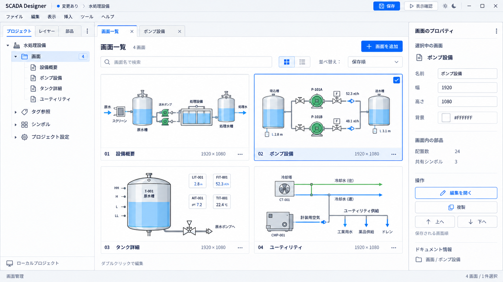
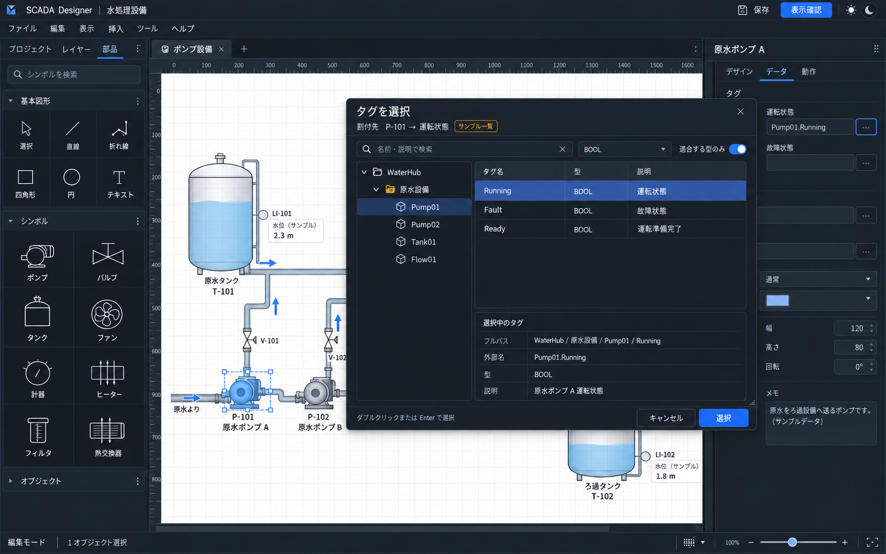
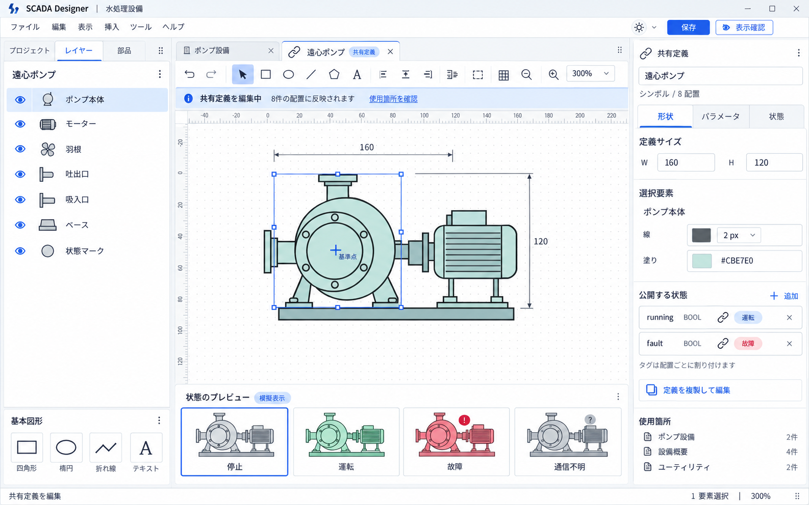
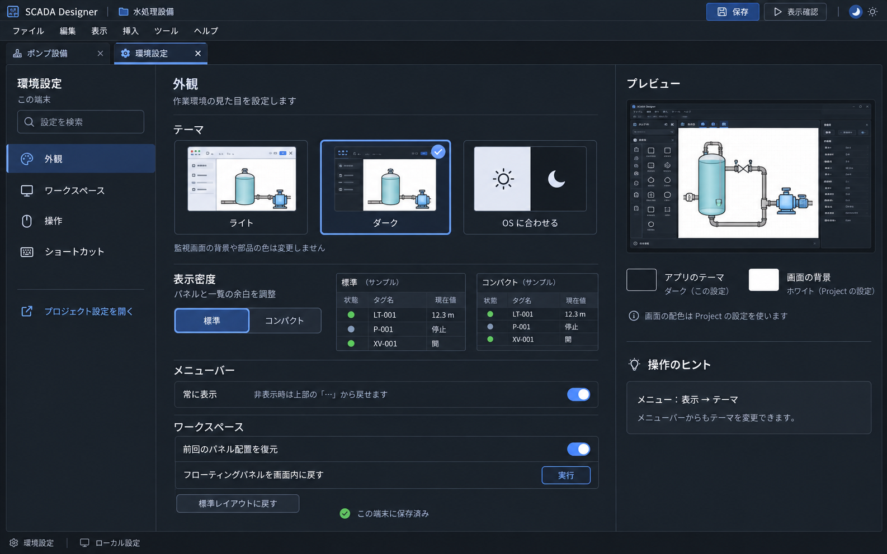
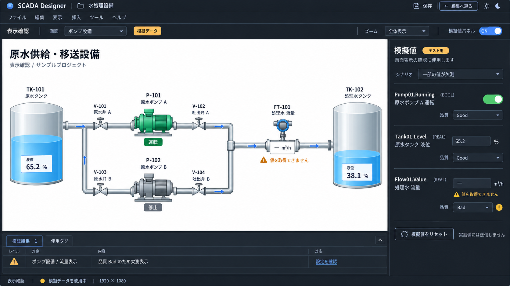

# SCADA 開発アプリの統合設計

2026-10-18（日本時間）。既存設計とサイドチャットの UI・監視部品・外部連携・開発支援の検討を統合した、本リポジトリの基準設計書。2026-10-18 のユーザー確認により、今後の設計・実装の基準として採用した。**設計の採用と機能の実装完了を区別する。未決事項と提供時期は各節に従い、追加機能がすべて直近のリリース対象になったことを意味しない。**

## 1. 参照関係と今回の整理

ローカルの照合基準は `88e6b72`。上流は `tyaro/banto-industrial@c4a61bc08ddf6d03fa56974bf1fcad08d12cbb5a` の保存済みスナップショットを参照した。上流 main や Issue の最新状態を本作業で再検証したものではない。

| 文書                                                                | 担当する内容                                                                      |
| ------------------------------------------------------------------- | --------------------------------------------------------------------------------- |
| 本書                                                                | 製品全体の画面・部品・外部連携・開発支援と段階を定める基準設計書                  |
| [Designer UI 改訂提案](designer-ui-revision.md)                     | 左3パネル、ドッキング、プロパティ、タグ選択、メニュー・右クリックの詳細な操作契約 |
| [フロントエンド UX 設計](frontend-ux-design.md)                     | 元の UX 設計、現状画像、U1〜U5、描画・入力・保存の設計根拠                        |
| [開発・統合方針](development-plan.md)                               | 実装履歴、当面の開発順、industrial への戻し方                                     |
| [タグ Binding](tag-binding.md) / [Runtime SDK 境界](runtime-sdk.md) | 現在の数値 Text Binding、Quality、SDK と Host の成立条件                          |
| [運用・ログイン方針](access-policy.md)                              | 開発時と運用時の認証方針、industrial との統合待ち                                 |
| [上流 SCADA 設計](upstream/industrial/scada-design.md)              | Project、Equipment、Action、Alarm、History、Design Domain、配布の全体契約         |
| [上流 RTSP 設計](upstream/industrial/banto-rtsp-design.md)          | カメラの再利用候補となる共有層と、その実装・検証の範囲                            |

本書の追加要望は以下のように既存設計へ接続する。操作の細部を二重定義せず、UI 改訂提案の draft 保護・確定・再検証を共通に使う。上流スナップショット自体は変更しない。

| 論点                                 | 合わせ込みの結果                                                                                                    |
| ------------------------------------ | ------------------------------------------------------------------------------------------------------------------- |
| Banto に縛られない外観               | Banto 基盤は維持し、Designer 専用のレイアウトと視覚表現を設計する。基盤撤去の要求とは扱わない                       |
| ライト／ダーク切替                   | 両テーマを同等の対象とし、OS 連動も維持。既存利用者の選択を上書きしない                                             |
| パネル・部品分類・タグ選択・メニュー | 既存改訂提案を継承。後続の右クリック、プロパティの可動化、キャンバス拡大も保持                                      |
| アラーム・イベント・トレンド         | 配置可能な監視部品へ追加する設計。Alarm / Historical Trend の v1.1 方針は維持し、イベント一覧の保存契約は別途具体化 |
| カメラ                               | 新しい SCADA 部品の要望。`banto-rtsp` を再利用候補とし、SCADA 組込みと提供時期は未決                                |
| 外部プログラム・API                  | 上流 §10 の LaunchProgram / HttpRequest として具体化。後続 Extension の位置づけを維持                               |
| 設備テンプレート・Faceplate          | 上流 §7 の EquipmentType / EquipmentInstance と共通 Binding context を具体化                                        |
| 動的表示・式                         | 上流 §6.3 / §9.5。Rust の `banto-expr` と宣言的 mapping を使い、別の式言語を作らない                                |
| 保存・復旧・配布                     | 上流 §4 / §5 / §19 の内容・世代・外部変更契約へ接続。現行 JSON 保存が正式 package 完成を意味しない                  |

### 現状と提案の区別

現在の進捗は[開発計画の実装状況一覧](development-plan.md#implementation-status)で管理する（2026-10-19、実装照合 `e6830b0` と後続のホイール操作）。以下の表は統合設計を整理した時点の比較であり、後続の実装状況は一覧と本節の追記を優先する。

| 項目             | 照合時点の現状                                                                               | 今回まとめる完成形                                                    |
| ---------------- | -------------------------------------------------------------------------------------------- | --------------------------------------------------------------------- |
| 工程図・画面管理 | 図形・折れ線・単色 Symbol、複数選択、整列、Undo / Redo、画面順、定義編集、検索、ズーム・パン | 3タブ shell、可動パネル、グループ・ロック・範囲選択、共通スタイルなど |
| テーマ           | アプリの light / dark / system と設定保存あり                                                | 各パネル・一覧・選択状態まで一貫した両テーマの画面設計                |
| 保存             | schema `0.4.0` の JSON、未書き出し表示、未適用入力保護                                       | 正式 package、差分、復旧、配布・実行中バージョンの管理                |
| Binding          | 画面 Text の外部名による数値参照と使用箇所一覧。ブラウザは未接続                             | catalog 選択、型付き slot、Equipment、動的表示                        |
| Runtime          | SDK の読み取り投影とモック Hub の接続検証。製品 Host・正式 Runtime mode は未実装             | 実接続、起動時の権限境界、基本 UI Action、運用                        |
| 拡張オブジェクト | Alarm / Event / Trend / Camera / HTTP / Program の部品・実行機能は未実装                     | 本書のオブジェクトと設定画面を段階的に追加                            |

統合設計採用後、段階 A のうち6分類のメニューバーと常設メニュー、表示設定の保存・復元を実装した。2026-10-19 に左3タブ、部品の分類アコーディオンと横断検索、タブ切替時の入力・選択・倍率保持を追加した。同日後続で、Draw.io を参考に部品をコンパクト化し、アイコン／名称の切替・表示形式保存・検索領域の1行化・ドラッグ配置を追加した。さらにプロパティを独立コンポーネントへ分離し、表示切替・入力保持・手動倍率の中心維持・不正入力とタグ参照からの再表示を実装した。左パネルと下部タグ参照にも表示切替を追加し、補助パネルの一括非表示から直前の組合せへ復帰できる。さらに共通編集操作をメニューバー直下のツールバーへ集約し、プロパティを隠した状態でも複製・削除・重なり順・整列を実行できる。部品カード／分類見出しの右クリックとキーボード操作メニューも追加し、配置・情報・共有定義編集／複製・分類の開閉へ接続した。キャンバスの図形／空白とレイヤーの配置行にも右クリックを追加し、選択保持・入力保護・共通編集・位置を指定した挿入・Symbol 固有の操作へ接続した。プロジェクトの画面行にも開く・名前変更・複製・並べ替え・削除を追加し、開くだけでは編集対象を変えず、実行時に入力保護を通す。共有定義も名前・配置数付きの行一覧へ変更し、右クリックから定義編集・複製・配置・未使用定義の削除に対応した。使用中定義の削除と入れ子配置を防ぎ、入力保護と削除確認を共用する。共有定義の使用先を左パネル内で確認・検索し、入力保護付きで該当画面と配置へ移動する機能も追加した。フォルダー／空白と可動パネルの右クリックは後続。グリッド・選択／パン・倍率・モード切替・保存状態もツールバーへ集約し、ヘッダーを40pxに薄くしてテーマをアイコンメニューへ変更した。固定パネルの幅もドラッグ・キーボードで調整し、端末のUI設定へ保存・復元できる。未適用入力・選択・手動倍率の表示中心を保ち、狭い画面では幅を制限する。下部のタグ参照一覧も、展開中の高さをドラッグ・キーボードで調整し、端末へ保存・復元できる。作業領域の40%以内へ制限し、狭い配置では通常の高さへ戻す。単一選択の座標・サイズ・線幅はEnter／フォーカス移動で確定し、他のタグ・文字・不正入力を保持する。数値の確定と図形操作は個別にUndoできる。プロジェクトを画面・タグ参照・シンボル・設定の開閉できる枝に整理し、レイヤーに検索・図形アイコン・現在画面の枝を追加した。ユーザー作成グループ・配置名・目のアイコンによる表示切替は後続。その後、操作試作のプレビューを外観基準に、薄いヘッダーとツールバー・画面タブ・ドットの作業領域・両テーマの固定パネルへ調整した。画面タブは既存の入力保護を通し、Projectの背景と図形色は変えない。お気に入り部品は下端ドックへ追加し、基本図形・組込部品・Project別の共有定義の登録と、既存の入力保護付き配置・ドラッグを共用する。登録はブラウザのUI設定で、Projectへ保存しない。連続配置ツールも追加し、部品選択後のクリック位置への配置とEscでの終了、スナップ・既存の入力保護を共用する。通常の即時配置とドラッグも継続する。ミニマップも下端の専用領域に追加し、表示範囲の確認・クリック／ドラッグ／矢印キーによる表示移動・全体表示への復帰に対応した。表示切替はブラウザのUI設定に保存し、Project・履歴・図形選択・未適用入力とは分離する。左下のファイル操作とプロジェクト内のサンプル読み込みは削除し、「ファイル」と常設メニューへ集約した。メニューバー・左パネルが非表示でも読み込み・保存を利用でき、保存状態はツールバーへ表示する。空白ドラッグで完全に囲んだ配置を選ぶ範囲選択にも対応した。Shiftは追加、Escは取消とし、配管の線幅・矢印を含む境界と既存の入力保護を共用する。選択だけでは履歴・Projectを変更しない。編集キャンバスのCtrl＋ホイールでポインタ基準ズーム、Shift＋ホイールで横スクロールにも対応した。入力とProjectを保持し、キーによるブラウザのページ拡大とキャンバス外の操作は継続する。可動パネル・レイアウト全体の保存は未実装。詳細は [開発・統合方針](development-plan.md) を参照。

現行実装の `projectRevision` は編集で進む暫定契約。上流の `workingRevision` と保存世代の分離を導入済みとは扱わない。実装履歴中の旧形式移行の記述も、リリース前の互換性保証ではない。

## 2. 共通ワークスペースとテーマ

中央の作業タブを軸に、画面編集、共有定義、画面一覧、タグ管理、設定を往復する。左はプロジェクト／レイヤー／部品の3パネル、右はプロパティ、下部はタグ参照・検証結果・使用箇所。可動化と入力状態保持の詳細は [改訂提案](designer-ui-revision.md) に従う。

- 通常のメニューバーは「ファイル／編集／表示／挿入／ツール／ヘルプ」。表示 ON / OFF と、非表示後も消えない常設メニューからの復元を用意する。
- ヘッダーは Project 名・常設メニュー・テーマアイコンに絞り、サブタイトルを置かない。編集／プレビュー切替・保存状態・共通編集・グリッド・選択／パン・倍率は上部ツールバーへ集約する。
- 各パネルは表示切替・サイズ変更・同一アプリ内の浮動／再ドッキングの対象。ドラッグ以外に見出しメニューも提供する。別 OS ウィンドウは後続。
- プロパティを隠した幅は中央へ戻す。補助パネルを一時的にまとめて隠し、直前の配置へ戻せる。非表示や移動で未適用入力を消さない。
- 右クリックは対象別の既存コマンドへの入口とし、上部メニューやキーボードからも操作できる。入力欄の標準メニューを保持する。
- パネル配置・テーマ・検索・選択・ズームは workspace の状態。Project の編集や Undo 履歴と分ける。

### テーマ

ライト／ダーク／OS に合わせる、を「表示 → テーマ」と「環境設定 → 外観」で変更する。色トークンだけでなく、フォーカス、選択行、disabled、浮動パネル、メニュー、表、グラフの凡例も両テーマで確認する。通常文字 4.5:1、重要な UI 境界・フォーカス 3:1 のコントラストを目標にする。

**エディタのテーマと監視画面の配色は独立する。** テーマ切替で図形・設備の状態色を書き換えない。白い画面をダークの操作パネルで編集することも想定する。現行 Project 0.4.0 は画面ごとに背景色を保存し、エディタとプレビューへ反映する。既存図形色は変更せず、白背景用サンプルでは図形色も明示する。共有 Symbol の配置は透過し、定義の編集用背景を持ち込まない。

テーマ変更時も未保存内容・入力・選択・viewport を維持する。設定を保存できなければ、そのセッションで適用し、保存失敗を知らせる。状態は色と文字・アイコンを併用し、工程画面の状態色は設備側の設計として定義する。

## 3. 開発画面の構成

未実装の画面や空の機能ツリーを先に常設せず、利用できる機能から入口を追加する。

| 画面・パネル             | 開く場所                    | 設計する作業                                                                           |
| ------------------------ | --------------------------- | -------------------------------------------------------------------------------------- |
| 開始・新規 Project       | ファイル                    | 作成、開く。最近のファイル・復旧候補は保存基盤の整備後                                 |
| 画面一覧                 | プロジェクト → 画面         | サムネイル／一覧、検索、追加、複製、保存順変更、名前・寸法・背景                       |
| 画面編集                 | 画面を開く                  | 配置・整列・プロパティ・データ・動作の設定                                             |
| 設備タイプ・設備一覧     | プロジェクト → 設備         | EquipmentType、Instance、slot 割付、既定 Symbol / Faceplate                            |
| シンボル・Faceplate 編集 | 共有定義を開く              | 構成要素、表示条件、公開パラメータ、使用箇所、共通 Binding context                     |
| タグ参照管理             | プロジェクト → タグ参照     | Project 内の参照、型・単位・使用先・未解決を広い中央一覧で管理。下部ドックにも切替可能 |
| タグ選択                 | プロパティの入力欄横        | catalog のツリー／検索、詳細確認、未適用入力への選択確定                               |
| オブジェクトの詳細設定   | プロパティ → 詳細設定       | アラームの列・フィルタ、トレンドの複数系列・軸、イベント分類等の設定                   |
| カメラ・外部連携設定     | ツール／環境の連携設定      | 登録済みカメラ、HTTP 接続、プログラムと、Project の論理参照との対応                    |
| アクション設定           | プロパティ → 動作           | イベント、呼出先、型付き引数、実行条件、結果・失敗時の扱い                             |
| アラーム・履歴設定       | 導入後の Project 設定       | 収集・判定規則。画面上のリストの見た目とは分離                                         |
| Project 設定             | ファイル → プロジェクト設定 | Project 名・説明、画面作成時の既定値、リソース・参照。既定値変更で既存画面を変えない   |
| 環境設定                 | ツール → 環境設定           | 外観、ワークスペース、操作、ショートカット。端末設定として保存                         |
| 表示確認・模擬値         | 上部の表示確認              | 見た目、画面遷移、状態・欠測の再現。編集へ戻る入口を常設                               |
| 検証・診断               | 表示 → 検証結果             | 対象、重大度、原因、修正先への移動。接続・品質・Action 結果の診断も段階追加            |
| 書き出し・配布確認       | ファイル                    | 差分、互換性、必要な接続参照、対象版の確認。復旧・戻し操作                             |

### 画面操作の合わせ込み

- 画面一覧のクリックは選択、ダブルクリック／Enter は開く。作業タブの順と保存画面順を混同しない。
- タグ選択は **候補選択 → Inspector の未適用入力 → 適用 → 保存**を区別する。タグ行の Enter は確定、検索欄の Enter は検索のみ。Esc／取消で元の入力と他の draft を保持する。
- タグの階層は catalog の構造化 metadata を使う。外部名のドット分割で階層を推測しない。対象・Project session・catalog が変わった場合は再検証し、古い候補を別対象へ返さない。
- 現行 Text の要求型は数値のみ。画像の BOOL 選択は、型付き状態 slot を導入した将来画面の例である。
- 共有定義は使用件数と変更の影響範囲を表示。設備固有のタグを共有図形へ埋め込まず、EquipmentInstance の context を Symbol と Faceplate で共有する。
- 詳細設定を開く、パネルを移動するだけで Project へ自動適用しない。対象の切替時は既存の適用／破棄／キャンセルを共用する。

### 画像プレビュー

サイドチャットで独自に生成した**未実装のコンセプト画像**。実アプリのスクリーンショットではない。名前・値は架空のサンプル。ボタン配置・ロゴ・細部の文字・適用表示に本文との違いがあれば、本文と既存の操作契約を優先する。全画面が両テーマ対応の設計だが、画像は代表テーマを掲載する。

#### 画面一覧 — ライト

サムネイルで画面を探し、右で選択画面の設定を編集する。追加時は名前・寸法・背景の短いフォームから始める。空の Project と検索結果なしでは、それぞれ追加・検索解除の入口を出す。

#### タグ選択 — ダーク

割付先を固定表示し、ツリーと詳細で候補を確認する。値の取得を選択の必須条件にせず、未接続・取得失敗・取得中・結果なしを区別する。キャッシュを使う場合は由来と取得時刻を示す。

#### 共有シンボル編集 — ライト

形状、公開パラメータ、状態別表示、使用箇所を同じ文脈で編集する。通信不明を停止と同じ意味にせず、状態が同時成立した場合の優先順位も設定する。

#### 環境設定 — ダーク

テーマ・密度・メニューバー・パネル配置の設定をまとめる。テーマは即時反映、レイアウトは改訂提案の明示保存／復元を基準とする。画像の保存表示は将来 UI の例で、全設定が現在自動保存されるという意味ではない。

#### 表示確認・模擬値テスト — ダーク

編集パネルを隠し、必要時だけ模擬値パネルを開く。正常／故障／通信断／Stale / Bad を再現し、値が使えなければ欠測にする。実設備へは書き込まず、アクションは実行予定の対象・引数・模擬結果を表示する。

## 4. 部品パレットとオブジェクト

最上位は「基本図形／シンボル／オブジェクト（監視部品）」のアコーディオンを候補とする。従来の第3分類「表示・操作」を一覧・グラフ・映像まで拡張した名称で、最終表示名は未確定。model の `ScreenObject` 全体を指す語とは区別する。

各分類は同時展開でき、閉じた分類も横断検索する。検索解除で展開状態を戻し、Text を複数分類に別部品として重複掲載しない。種類を増やすときはカテゴリの追加とデータモデルの追加を同一視しない。

| オブジェクト内の分類 | 部品候補                                                               | 主な設定                                                           |
| -------------------- | ---------------------------------------------------------------------- | ------------------------------------------------------------------ |
| 表示                 | テキスト、数値、状態ランプ、状態テキスト、バー、ゲージ、通信・品質表示 | タグ／slot、単位・桁数、範囲、表示条件、欠測時の表現               |
| 操作                 | ボタン、数値・文字入力、選択、切替                                     | 入力型、上下限、適用、権限、Action。入力中／要求中／反映済みを区別 |
| ナビゲーション       | 画面遷移、戻る、タブ、Faceplate / Dialog 呼出                          | 遷移先、設備 context、開き方、戻り先                               |
| 一覧・履歴           | アラームリスト、イベントリスト、設備一覧、タグ一覧、将来の DataGrid    | データ源、対象設備、期間・分類、列、並び順、ページング             |
| グラフ               | リアルタイム／履歴トレンド                                             | タグ・trend group、時間幅、複数軸、単位、線、凡例、欠測の扱い      |
| 映像・画像           | カメラ、画像、設備図面、クリック領域                                   | リソース／カメラ参照、表示比率、拡大、更新状態、遷移               |
| コンテナ             | パネル、グループ、条件付き表示領域                                     | 子要素、余白・配置、可視条件、共通 context                         |

設備のポンプ・バルブ等は Symbol と Equipment で表現し、専用 ObjectType を機器ごとに増やさない。設備一覧・タグ一覧と DB の汎用 DataGrid は別契約。DB の表は上流 §14 の Dataset API 整備後で、Tag に rows × columns を押し込まない。

小さな設定は右プロパティ、大量の列・系列・条件はサイズ変更可能な詳細設定へ展開する。各部品でデータ割付・外観・動作・未接続時表示の設定方法を揃える。SVG を工程図の基本とし、表・入力・グラフ・映像をすべて SVG に固定するかは未決。選択・座標・重なり・フォーカスと Renderer の共通境界を先に定義する。

## 5. Equipment、再利用、動的表示

設備テンプレートは上流の EquipmentType に対応させる。型付き read / write slot、既定 Symbol、Faceplate を定義し、P-101 / P-102 等の EquipmentInstance ごとに外部名を割り付ける。Symbol と Faceplate は同じ Binding context を使い、同じ設備のタグを二重設定しない。

形状だけの共有 Symbol を設備テンプレートと呼ばない。共有定義を変更する操作と、配置だけを変更する操作を分ける。定義を派生させる場合は明示複製し、参照中の配置・画面・Action への影響を表示する。外部ライブラリ取込みは上流の ID 保持・衝突判定・差分確認と接続する。

動的表示は value / color / visibility / state を中心に開始し、位置・回転・拡縮等を段階追加する。薄い表示演算は Rust の `banto-expr`、数値書式・状態色・Quality による表示は宣言的 mapping。JS の任意コード入力や別の SCADA 式言語を追加する仕様にはしない。

式入力の型を検証し、catalog がないときは存在・型未確認として扱う。Bad / Stale / 未解決を false・ゼロ・停止へ置き換えない。設備状態とデータ品質は別に表現する。

## 6. アラーム、イベント、トレンド

### 表示オブジェクトと処理基盤

リストを画面へ配置する設定と、アラーム判定・記録・履歴取得の設定を分離する。24/365 の recorder、Alarm、常時 Event / Action は上流 §13.2 の SCADA server core が所有し、UI の開閉へ寿命を結び付けない。Hub へ新しい履歴・警報エンジンを追加する設計にはしない。

### アラーム

- リスト側: 対象設備、重要度、発生中／履歴、ACK 状態、列、ソート、詳細表示。
- 定義側: source、しきい値、重要度、メッセージ、deadband、on / off delay、latch、enabled。故障から復帰した状態と未確認を別に扱う。
- ACK / Shelve は Alarm Engine の操作として扱い、PLC のリセット bit と自動で同義にしない。必要なら明示 Action を設計する。
- **しきい値警報 HH/H/L/LL は SCADA 側の設定・判定。** スナップショット §11.2 の 2026-10-08 決定を優先し、同文書 §9.5 に残る古い「Alarm 条件も Hub computed tag」への一律集約は継承しない。一般の表示式・重い共通計算の方針とは区別する。

### イベント一覧

UI の on_click 等の「実行契機」と、運用者が見る「発生記録の一覧」を別概念として扱う。記録候補はアラームの発生・復帰、操作実行の結果、設備状態の遷移、接続状態の変化。source、発生時刻・受信時刻、設備、種別、メッセージ、相関 ID などを表示できる構成を検討する。

既存の AlarmEvent、Action execution record、audit を参照・投影する候補とし、権威ある記録を UI 独自に複製しない。保存先、保持期間、権限、時刻差・重複・欠番の扱い、ページングと提供時期は未決。現行の Project revision を操作監査ログの代用にしない。

### トレンド・履歴

複数タグ、時間範囲、軸・単位・凡例、リアルタイム／履歴を設定する。直近の表示バッファと永続履歴を区別し、欠測をゼロで補間しない。履歴のタグ選択・収集周期・変化時記録・保持期間は recorder 契約と揃える。

上流 §13 の ChronoGazer と共有する recorder / `banto-tstore` / `banto-tsquery` / Trend UI を候補とする。History API は SCADA server 側。Hub のバックフィル用 tstore を画面から直接読む方式にしない。Historical Trend と Alarm は v1.1、Replay は後続 Extension を維持する。ブラウザ内の模擬値テストは録画・履歴 Replay の実装とは別である。

## 7. カメラ映像表示

RTSP 映像表示には先行実績があることをユーザーが確認している。これは本リポジトリでの SCADA 組込み・接続・配布検証の完了を示すものではない。案件名・非公開リポジトリの識別情報・資料・画面・実機設定は本設計に収録せず、設計根拠には公開共通層の契約と SCADA 側の要件を使う。今回、非公開案件の資料は取得・転載していない。

カメラ表示は、Project が論理的なカメラ参照を持つオブジェクトとして設計する。設備や Faceplate と関連付け、登録済みカメラを選択して配置する。端末／配布環境側で接続先と資格情報を解決し、部品ごとに認証付き URL を埋め込まない。

- 初期案: 単一映像、カメラ名、縦横比維持、拡大・全画面、接続中／表示中／再接続中／停止／失敗。
- 複数配置、設備に応じた切替、複数映像の並列表示を想定。表示数・解像度・フレームレート・帯域に上限を設け、同一カメラの共有方法と非表示時の解放を決める。
- 画像内容の変化ではなく、フレーム sequence・受信時刻・接続状態で更新を判断する。静止した被写体を切断と判定しない。古い最終フレームを残す場合は古い映像であることを重ねて表示する。
- 受信からの経過時間と撮影からの遅延を混同しない。撮影時刻が得られなければ実際の映像遅延は断定しない。
- PTZ、録画・再生、音声は別の拡張。特に PTZ は閲覧とは別の操作契約を持つ。

共有候補は [banto-rtsp](upstream/industrial/banto-rtsp-design.md)。スナップショットでは FFmpeg supervisor、JPEG 最新フレーム、再接続、診断の基礎層を持つが、SCADA の Tauri / Svelte 組込み、実機・長時間・配布確認が完了した意味ではない。最新の検証済みコミット・ライセンス／配布条件・終了処理を確認してから固定参照する。

ブラウザが RTSP をそのまま再生できる前提にしない。デスクトップ Host の映像配送と、将来のブラウザ向け中継は別の設計課題。SCADA のカメラ対応を Core v1 / v1.1 へ自動追加せず、読み取り機能の独立 Extension 候補として時期を決める。

## 8. ボタン・イベント・外部アクション

ボタン、シンボル、メニュー等の UI イベントに、共通の Action を割り付ける。表示 Binding と実行 Action は分離する。上流 §10 の種別を再利用し、基本遷移・Faceplate・Dialog と外部連携を同じ設定方式で扱う。

| アクション                            | 設定と結果                                                                            |
| ------------------------------------- | ------------------------------------------------------------------------------------- |
| Navigate / OpenFaceplate / OpenDialog | 画面・定義・Equipment context、開き方、戻り先                                         |
| WriteTag 等の設備操作                 | 外部名、値、型、権限、実行条件。正式 Host と上流の書込み契約の成立後                  |
| HttpRequest                           | 登録済み connection ID、相対 path、method、型付き query / body、timeout、結果 mapping |
| LaunchProgram                         | 許可済み program ID、許可された引数、起動条件、single instance、timeout               |
| URL・ファイルを開く                   | リソース参照と許可された開き先。任意の OS コマンドの別名にしない                      |

### 設定 UX

「動作」タブで **イベント → アクション種別 → 呼出先 → 引数 → 結果**の順に設定する。引数源は固定値、Equipment ID、タグ値、入力値など。型・必須項目を検証し、模擬実行で解決後の引数と結果を確認できるようにする。複数手順は単純な順序と成功／失敗分岐から始め、高度なノード型 workflow は別段階とする。

例: 帳票作成ボタンから設備・期間を API へ渡し、要求中を表示、完了後に返された帳票を開く。HTTP の受付とジョブ完了は別状態とし、HTTP 成功を設備の状態変化と断定しない。

### 実行境界

- Project は接続 ID・program ID・宣言した引数を保持し、認証 secret や任意 shell 文字列を保存しない。実行ファイルと許可引数は環境側で登録し、shell を介さず起動する。
- UI に閉じた処理は Runtime / desktop Host、画面を閉じても動かす timer・外部通知等は SCADA server core。UI の重複起動で常時処理を二重実行しない。
- 実行開始時に対象・型・値の品質・権限を確認し、実行 ID と状態を記録する。二重クリック抑止、同時実行数、timeout、取消の意味を定義する。
- timeout は結果不明になり得る。PLC write や非冪等 POST を暗黙に再試行しない。受付済み処理を画面上の取消だけで取り消せたことにしない。
- 開発の表示確認から Action の HTTP 要求・プログラム起動・設備書込みを実行せず、模擬結果を返す。実 Action の接続テストを設ける場合は、通常の表示確認とは別の明示操作と実行契約にする。将来の Hub・カメラ等の読み取り表示はこれと区別し、模擬／実データの由来を明示する。
- 実行の権限と監査は industrial の認証整備後に接続する。独自認証を追加して延期方針を迂回しない。

HttpRequest / LaunchProgram は上流 §3 / S9c の後続 Extension。今回の要望は必要性と UX の具体化であり、Core v1 の基本 Action 完了や実装時期の変更を意味しない。

## 9. 開発・保守を支える機能

| 領域           | 設計する機能                                                                 | 既存設計との接続                                                                           |
| -------------- | ---------------------------------------------------------------------------- | ------------------------------------------------------------------------------------------ |
| 編集効率       | グループ、ロック、範囲選択、均等配置、コピー／貼付、共通スタイル             | 現行コマンド・Undo / Redo を拡張。永続属性には schema / Rust / TS / Renderer の整合が必要  |
| 一括編集       | 設備作成、slot 割付、CSV 入出力、参照名の置換、差分確認                      | まず SCADA Project 内の設定。Hub のタグ作成・rename を暗黙に実行しない                     |
| 検索・影響確認 | タグ・Symbol・画面・Action の参照検索、使用先へ移動、削除の影響              | 現行のタグ参照一覧を拡張。全体を型・参照検証してから一括適用し部分更新を避ける             |
| 検証           | 型不一致、参照切れ、遷移先、未設定 Action、資産欠落、Runtime 互換性          | Design Domain の共通 validation。オフラインの未確認と確定した構造エラーを区別              |
| 模擬試験       | 正常・故障・通信断、値と品質、遷移、Action の引数・分岐                      | 模擬と実値を明示し、試験状態を Project と分離。表示確認は正式 Runtime ではない             |
| 自動復旧       | 復旧用 snapshot、チェックポイント、差分、復元                                | 明示保存を置き換えない。復旧候補を比較して採用し、外部変更のある原本を上書きしない         |
| 配布           | 画像・Symbol・定義を含む package、依存・参照・互換性の確認、実行中の版を識別 | 上流 `.bantoscada` directory / ZIP、projectId / revision / contentHash / minRuntimeVersion |
| 戻し操作       | 前の内容への復元、配置環境の対応確認、切替結果の表示                         | 古い内容の採用と revision の巻戻しは別。上流の世代・差分・競合規則に従う                   |
| 診断・履歴     | 接続・値の品質、Action 結果、変更記録、修正先へのジャンプ                    | Runtime / server の実行記録を使用。Undo 履歴と永続 audit を混同しない                      |

保存基盤は上流の mutation と persist の分離、`workingRevision`、`projectRevision`、`contentHash`、外部変更時の停止・Reload / Overwrite / Save As に合わせる。自動保存を追加しても freshness guard を迂回しない。復旧ストレージは期限・容量・保存失敗を扱い、正式 package の完了を主張しない。

リリース前は後方互換性を保証せず、旧形式 migration を新機能の必須条件にしない。正式リリース時の互換性・更新方針はモデルが固まってから決める。

## 10. 設定の保存先と運用

| 所有者           | 保持するもの                                                                                       |
| ---------------- | -------------------------------------------------------------------------------------------------- |
| Project          | 画面・定義・Equipment・論理的なデータ参照・Action・表示条件。導入した段階の Alarm / trend group 等 |
| 端末の環境設定   | テーマ、メニュー、パネル配置、編集補助、ユーザーの操作設定                                         |
| 配布環境／Host   | Hub・カメラ・HTTP・許可プログラムの接続対応、secret reference の解決、実行ポリシー                 |
| 編集 session     | 選択、viewport、draft、Undo、catalog の確認世代、模擬値・模擬 Action 結果                          |
| Runtime / server | 現在値・品質・接続状態、Alarm state、履歴、実行記録・audit                                         |

Project を別端末へ持っていくときは、接続の論理参照と必要な権限を検証し、秘密情報を画像や Project へ同梱しない。共有設定と端末ごとの見た目を混ぜない。

認証は [既存方針](access-policy.md) を維持する。開発・初期設定はログイン不要、運用開始時にユーザー管理を必要とし、再起動後は未ログインで閲覧専用の監視画面へ入れる構想。権限の要る操作時に認証し、ログアウトしても監視を継続する。正式 Editor / Runtime は起動時 mode と Host / domain の境界で分離し、表示確認への切替を権限昇格に使わない。

## 11. 段階と優先順位

以下は実装順の整理であり、完了報告や期日の確約ではない。既存の A〜D、U1〜U5、上流 S の名称を置換しない。

**S9b（scada-server core + host 1）は Core v1 の server 基盤。** v1.1 で追加する Alarm（S10）、常時 Event / Action（S10b）、History / Trend（S12）は、この基盤上で動かす。S9b 自体を v1.1 まで延期する意味ではない。追加 host（S12b）は上流の host ごとの段階に従う。

| 段階                   | 主な内容                                                                        | 前提・既存対応                                                                                               |
| ---------------------- | ------------------------------------------------------------------------------- | ------------------------------------------------------------------------------------------------------------ |
| 直近の編集 UX          | 両テーマの shell、左3タブ、メニュー・右クリック、入力保護、画面一覧・検索       | 改訂 A、既存 U1〜U3。既存編集の動作を維持                                                                    |
| 独立した可動パネル工程 | draft の分離、浮動／再ドッキング、表示切替、保存・復元                          | 改訂 B。タグ選択・通信・基本編集の必須前提にしない                                                           |
| Tag Browser と読み取り | 選択パネル、型検証、状態・品質表示、SDK / Host                                  | fixture の UX は改訂 C、実接続は D / S3 / S7。既存 #682 等の最新契約を着手時に確認                           |
| Core v1 のモデル・部品 | Equipment / slot / Faceplate、動的表示、基本 Action、検証、正式 Project package | 上流 S0〜S9。現行の単色 Symbol・JSON の延長だけで完成扱いしない                                              |
| 開発効率・保守の追加   | 一括編集、CSV、共通スタイル、復旧、配布差分・版の識別                           | モデル・保存契約に従って順次追加。すべてを v1 の必須スコープへ自動追加しない                                 |
| Core v1 の server 基盤 | scada-server core + host 1                                                      | 上流 S9b。v1.1 の監視機能に先立って整備する共通基盤                                                          |
| v1.1 の監視機能        | Alarm、Historical Trend、基本的な常時 Event / Action、追加サービス host         | S9b 上の S10 / S10b / S12、および S12b の v1.1 対象 host。イベント一覧の公開範囲は対応する記録契約から決める |
| 独立 Extension 候補    | カメラ表示、接続設定、複数映像                                                  | 共有 RTSP 層と SCADA Host。提供版・配布条件は未決                                                            |
| 既定の後続 Extension   | HTTP / Program、高度 Action flow、Dataset、Replay、Design API 公開等            | 上流 S9c / S13 等。認証統合や接続契約を満たしてから                                                          |

MES・レシピ・生産実績・Tracking は従来どおり後続。設備テンプレート、割付、動的表示、検証、復旧を重視するが、共通 SDK や保存基盤をアプリ独自の代替機構で複製しない。

## 12. 受入観点と未決事項

実装する段階に応じ、少なくとも次を確認する。

1. 両テーマと 1280×720 / 1440×900 で、主要操作・フォーカス・文字を識別できる。テーマ変更が Project の色・意味を変えない。
2. パネル移動・非表示・復元と、対象切替・タグ選択取消で、未適用入力や作業対象を失わない。キーボードでも実行可能。
3. 型不適合・未解決・catalog 更新・接続断で誤割付をせず、欠測を正常値・停止に見せない。
4. Equipment の割付を Symbol と Faceplate が共有し、定義変更と配置変更の影響を区別できる。
5. 拡張ウィジェットの列・系列・フィルタ等が保存・再読込で再現し、一覧の空状態・エラー・大量データを扱える。
6. カメラの更新停止・切替・非表示・終了で古い映像をライブ扱いせず、接続とプロセス資源を解放できる。
7. 表示確認が外部副作用を起こさず、Runtime の実 Action が受付・完了・失敗・結果不明を区別する。
8. 一括適用・復旧・配布・戻し操作で、参照・互換性・外部変更を検証し、編集中／配布済み／実行中の版を識別できる。

具体化が必要な事項:

- 初期画面寸法、タッチ利用、複数モニター、OS ウィンドウ分離の優先度。
- 第3部品分類の最終名、状態色・状態優先順位、設備ごとの共通スタイル。
- Camera の提供版、対応方式、同時映像数、配布条件、録画・PTZ の要否。
- Event 一覧の source・保存・保持・権限・時刻契約と、Alarm / audit の関係。
- 復旧保存先と保持量、正式 package・配布切替と実行中セッションの扱い。
- 外部 Action の実行先、引数・戻り値 schema、取消・再試行・権限と監査。
- SVG と表・映像等の widget の混在方式、データ量に応じた仮想化・購読・更新頻度。

本書の追加は設計資料とコンセプト画像のみ。既存 UI、モデル、接続、認証、Runtime、外部操作の実装を変更したものではない。

### 2026-10-19・クリップボード編集の実装追記

配置のコピー・切り取り・貼り付けを編集メニュー／右クリックとCtrl／Command＋C・X・Vへ接続した。Deleteはキャンバスとレイヤー配置のみに適用する。OSクリップボードには専用形式と依存定義を含め、同じ読込世代では共有参照、別ファイルでは新規IDの定義を使う。通常の文字入力・未適用入力の保護を維持し、切り取りはコピー成功後にだけ削除する。詳細・制限・検証は[開発計画](development-plan.md)を参照する。

### 2026-10-19・ルーラーの実装追記

編集領域の上・左の22px帯にdesign unitの目盛りを追加した。倍率・スクロール・画面／定義に追従し、表示設定をBantoへ保存する。Project・履歴・選択・未適用入力から分離し、手動倍率の表示中心を保持する。プレビューでは隠す。ガイド作成は未実装。[実画面・検証記録](development-plan.md#rulers-progress)を参照する。

### 2026-10-19・方向キー移動の実装追記

キャンバス本体の方向キーで選択配置を1 design unit、Shiftで10 unit動かす。スナップONは選択boundsの左／上端を次の線へ進め、Shiftは10段階。複数配置・共有定義でも同じdeltaと既存move-many／draft guardを使う。入力・専用ハンドル・レイヤー・パン／連続配置のキー操作は維持する。長押しは各keydownが1履歴で、グループ化は後続。[開発計画](development-plan.md)に条件と検証を記録する。
