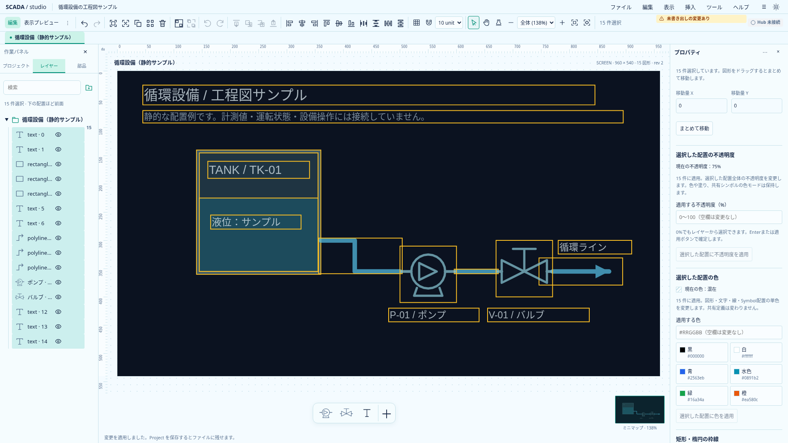
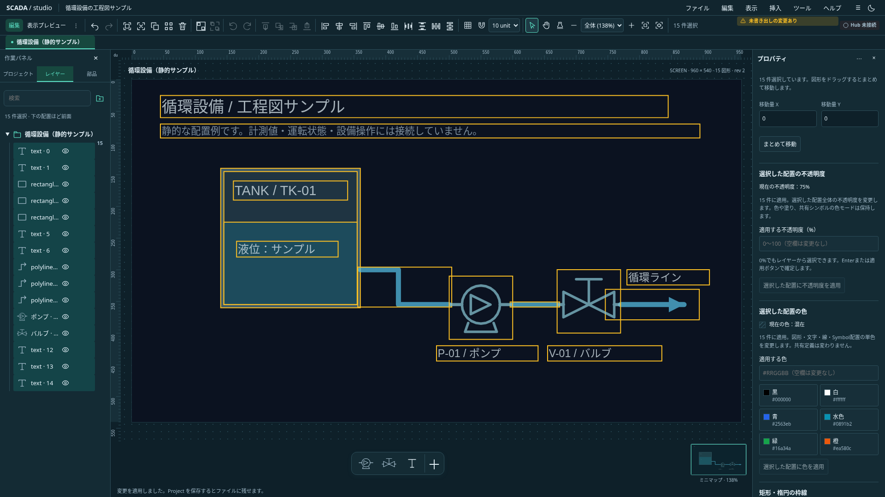

# 複数配置の不透明度

状態: **実装・関連検証済み**。既存の配置opacityを複数選択で明示適用する。Project0.31.0の保存契約は維持する。

## 範囲

図形・Text・線・Symbol・Image・埋込Viewの配置全体に同じ0〜100%を設定する。色α・塗り・枠線・gradient・Symbolの色モード・内部定義・原本・参照先画面を変更しない。共有定義内ではその定義が所有する配置だけを変更する。

現在値は共通値または「混在」で表示する。適用欄は空欄から始め、空欄・不正値を暗黙の0や100にしない。0%も有効で、レイヤーから再選択できる。非表示配置を含む件数を明示し、選択内をすべて変更する。ロック・グループを含む選択は一部だけ適用せず拒否する。グループ全体を合成したopacityは別契約とし、今回は追加しない。

既存の複数配置の色・線・枠線と同じ明示適用フォーム、対象世代・選択snapshot、IME、未適用入力保護を使う。Enterまたは適用ボタンで確定する。通常blurだけでは複数配置を変更しない。適用成功後にこの入力だけを空欄へ戻す。

`set-opacity`コマンドで対象と値を全件検証し、一回のUndoへまとめる。同値はno-opとする。Project・履歴・入力は拒否時に保持する。プレビューからの編集は既存境界で拒否する。

## 受入

- 異なるshape・colorMode・paint・参照を保持し、保存／読込とUndo／Redoが成立する。
- NaN／Infinity／範囲外／文字列の拒否、欠落・重複・空対象・ロック・グループ・プレビュー・所有者の拒否を確認する。
- 混在表示・0%・入力取消と対象変更・IME・他フォームとのdraft保護をブラウザで確認する。

## 実画面・検証

`scripts/capture-selection-opacity.mjs`で実際の適用後画面と不透明度表示の画素を確認して保存した。単体6件を含む関連TS76件、型チェック（エラー／警告なし）、本番ビルドが成功。不透明度のブラウザ5件と既存の色・浮動配置17件を確認した。不透明度の複数フォーム試験は、他の未適用フォームがある際に既存の確認を出す契約へ期待を修正し、5件を再実行して成功した。全ブラウザのローカル再実行ではない。既存のbundleサイズ警告は継続する。

色αの一括編集と合成グループ全体の不透明度は後続。
