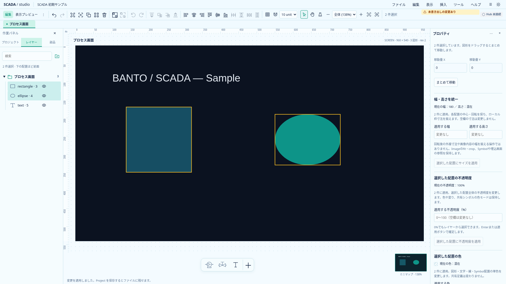
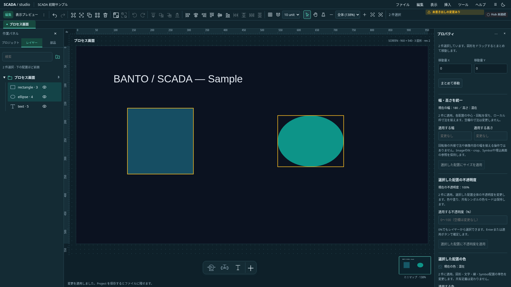

# 複数配置の幅・高さを統一する

状態: **実装・関連検証済み**。[作成支援の追加検討](scada-authoring-plant-operations-proposal.md)の寸法補助を小さな範囲で具体化する。Astraのレビューを反映する。Project0.31.0の保存形式は変えない。

## 初回範囲

複数選択のプロパティで「適用する幅」「適用する高さ」を明示入力する。未指定の寸法は変更しない。現在値は寸法ごとに共通値／混在で表示し、適用欄は空欄から始める。Enterまたはボタンで確定し、通常blurでは一括適用しない。選択IDの順序や最後にクリックした図形を暗黙の基準にしない。

保存上のローカル枠幅・高さを揃え、それぞれの配置中心と回転角を保持する。回転後の外接幅を揃える機能ではない。対象は矩形・楕円・Text・Symbol・Image・埋込View。枠の変更であり、Imageのfit／crop、Symbolの色・機器参照・共有定義、Viewの参照先を保持する。内部の文字サイズや配管も拡縮するグループ変形とは分ける。

Polyline・幾何グループ・ロックを含む場合は全体拒否する。対応する図形だけを暗黙に抜き出さない。非表示は件数を明示して変更できる。色や不透明度など他の書式は変更しない。

## 契約と受入

`set-size`で対象と正の有限寸法を全件検証し、各配置の新しい座標と枠を計算する。描画範囲が非有限になる変更と、桁落ちで配置中心を保持できない変更を拒否し、全件準備後に適用する。Undo一回、同値はno-op。現在の所有者と完全な選択snapshot、IME、複数フォームの未適用入力保護を共用する。成功時はこのフォームの入力だけを空欄に戻す。

回転配置の中心、幅だけ／高さだけ、混在shape、参照保持、拒否・原子性、同値とUndoを単体で確認する。ブラウザで混在表示・明示確定・IME・他draft・対象変更・ロック／非対応表示・両テーマを確認する。

## 実画面と検証

`scripts/capture-selection-size.mjs`で実際の幅統一後の画面と現在値の画素を確認し、そのPNGを保存した。

新規7件を含む関連TS45件、型チェック（エラー／警告なし）、本番ビルドが成功。新規5件と既存の色・不透明度を合わせたブラウザ16件を2並列で確認した。最初の定義所有者の単体試験は、幅を持つ配置がない配管だけのfixtureを誤って使っていたため、矩形等を含む既存サンプルへ直して確認した。全ブラウザのローカル再実行ではない。既存のbundleサイズ警告は継続する。

図形の暗黙の基準選択、回転後の外接寸法の統一、線・グループの変形は後続。
