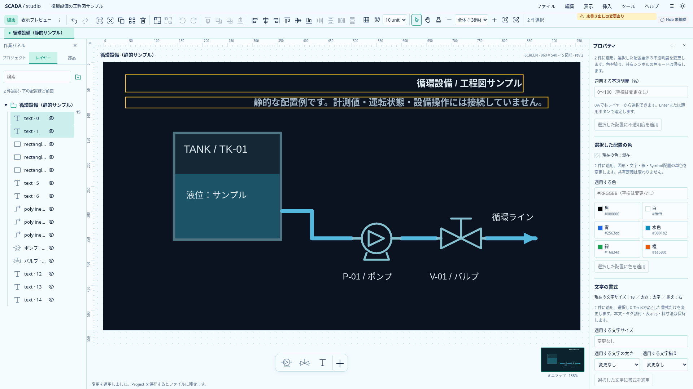
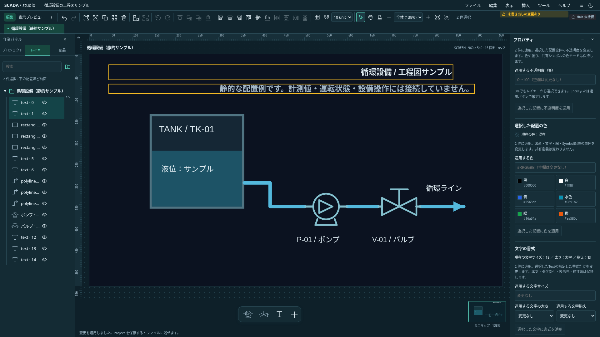

# Text配置の文字書式を一括編集する

状態: **実装・関連検証済み**。共通書式編集をTextへ広げる。Project0.31.0の既存TextStyleを利用し、保存形式は変えない。

複数のTextだけを選択した場合、文字サイズ・太さ・左右揃えを指定して明示適用する。空欄／変更なしの項目は保持し、現在値は項目別の共通値／混在で表示する。通常blurで一括変更せず、Enterまたは適用ボタンで確定する。

本文、直接タグ、slot、機器情報の表示元、bool文字色、位置・枠寸法・回転・色α・配置opacityは変更しない。共有定義内ではその定義が所有するTextを変更し、Symbol配置の選択から内部Textを暗黙に変更しない。

Text以外・ロック・グループを含む場合は全体拒否する。混在選択でTextだけを自動抽出しない。非表示のTextは件数を明示して適用できる。初回は既存の1行表示とフォントを維持し、複数行・自動折返し・縁取り・個別フォントは後続。

`set-text-style`コマンドは空patch、未知項目、不正な文字サイズ・太さ・揃えを全件変更前に拒否する。文字サイズは既存契約の0より大きく512以下、太さはnormal／bold、揃えはleft／center／right。同値はno-op、変更はUndo一回。既存の選択snapshot・対象世代・IME・複数フォームのdraft保護を使う。

単体で混在する元書式と未指定項目・Binding等の保持、拒否と原子性、保存・Undoを確認する。ブラウザで両テーマ・明示確定・IME・他フォーム・非対応混在・非表示／ロック・描画と共有定義の所有者を確認する。

## 実画面と検証

`scripts/capture-selection-text-style.mjs`で適用後の実画面と現在値の画素を確認して保存した。新規5件を含む関連TS15件、型チェック（エラー／警告なし）、本番ビルドが成功。新規5件と既存のサイズ統一・1行文字描画を合わせたブラウザ19件が2並列で成功した。定義所有者の選択に機器情報Textを加えた最終条件1件も再実行して成功。全ブラウザのローカル再実行ではない。既存のbundleサイズ警告は継続する。
