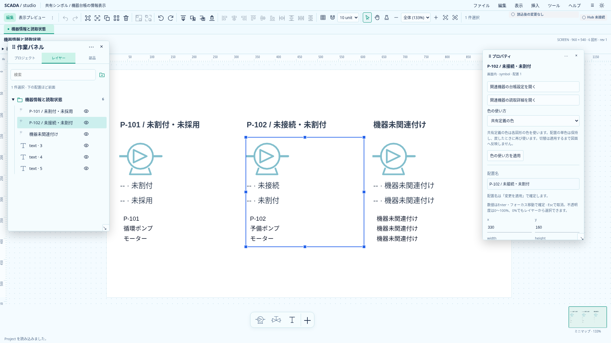
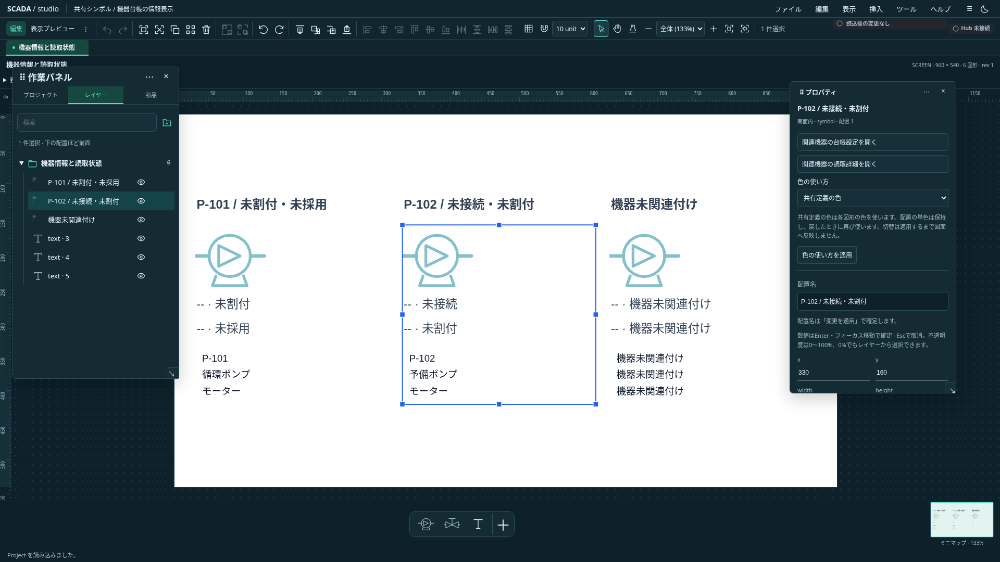

# 左作業パネルの浮動配置

状態: **Astraレビューを反映して実装・関連検証済み**。プロジェクト／レイヤー／部品の3タブを含む左作業パネル全体を対象とする。左右固定を標準に保ち、タブ個別分離・任意端へのドッキング・別OS窓は後続。[プロパティの初回設計](inspector-floating-design.md)と同じ入力保持契約を使う。

## 配置と操作

既存asideと3タブのDOMを維持し、CSS配置だけを切り替える。作業パネル見出しへ「浮動にする／左へ戻す」「配置を保存／保存配置に戻す」「隠す」を置く。常設メニューからも再表示・復帰できる。

見出しだけを移動ハンドルにする。レイヤーの所属変更、部品からの配置、スクロール・検索をパネル移動と混同しない。開始時に既存キャンバス操作とDnDを取り消す。移動・resizeの処理を共通化し、操作中のPanel IDを一つだけ持つ。Esc・capture喪失・blur・実window寸法の変更・上位Modal等は現在の操作だけを取り消す。

左右の浮動パネルはpointerdown／focusinで前面化する。DOM順やフォーカスは変更せず、二つのz順位だけを切り替える。Menu・Modalの層より下に置く。背面へTabで入った場合も前面へ出す。完全に隠れたパネルは常設メニューから表示・前面化する。重なりの自動解消は実装しない。

プレビューでは左側の画面選択を従来の固定表示へ戻し、編集時の浮動希望を保つ。狭い画面・高さ不足も一時固定へ退避する。キャンバスへ返す幅と既存の手動倍率・表示中心保持を共用する。

## 保存と入力

安定IDは`sidebar`。Banto UI設定に専用slotを追加し、Inspectorの保存slotを上書きしない。保存は明示操作のみ。前面順位・タブ・検索・展開・draft・Projectは保存対象外。標準復元は両パネルを固定へ戻し、明示保存slotを消さない。保存失敗は現在の配置と以前の保存slotを保つ。

検索・展開・スクロール・未適用入力・IMEを同じDOMに保持する。pointerによる見出し操作から入力へblurを発生させない。Tab／メニューでの通常のフォーカス移動は既存の数値確定契約に従う。

## 受入

- 両テーマで同じaside・form・input、3タブの検索・展開・入力・スクロールを保持する。
- 左右に同時に未適用入力を残し、前面化・移動・復帰・一括非表示・標準復元を行う。
- 左右の同時gestureを拒否し、所有者以外のイベントで誤確定しない。resize通知に先行するpointerupでも取消する。
- キーボード移動とresize、Tab・IME・上位Menu／Modal、部品／レイヤーDnDを確認する。
- 保存・再読込・破損／未知version・失敗、狭幅／プレビュー退避、手動倍率とキャンバス中心を確認する。
- Project・Undo・保存状態を配置操作だけでは変更しない。

## 実装と検証

`floating-panel.svelte.ts`の共通操作と単一所有者を左右で使う。`floating-sidebar.svelte.ts`は作業パネルの保存slot・文言・初期位置を渡し、`FloatingPanelHeader.svelte`が両パネルの見出し操作を共用する。前面化はpointer／focusに加え常設メニューからも指定できる。Panel ID／保存slotの識別・所有者は単体試験で確認する。

Banto UI設定のslotは`scada.designer.sidebar-placement`、形式は`layoutVersion:1`／`panelId:sidebar`／mode／rect。Inspectorの既存slotは維持する。左右とも幅280〜640px・高さ240〜900pxの範囲を使い、表示時だけ画面内へ補正する。

TS全1064件、型チェック（エラー／警告なし）と本番buildが成功。ブラウザは新規8件と既存Inspector12件が成功。両テーマ・同じDOM・左右のdraft・検索・Tab／前面化、保存／失敗／再読込、狭幅／プレビュー退避、部品DnD／Undo、操作排他、resize通知より早いpointerupの取消を確認した。位置補正の試験は、画面縮小による表示用clampとドラッグ確定の誤りを区別する。

`node scripts/capture-sidebar-floating.mjs docs/assets/frontend-ux`で実画面を撮影する。実際の文字画素を検査した同一PNGを記録する。

