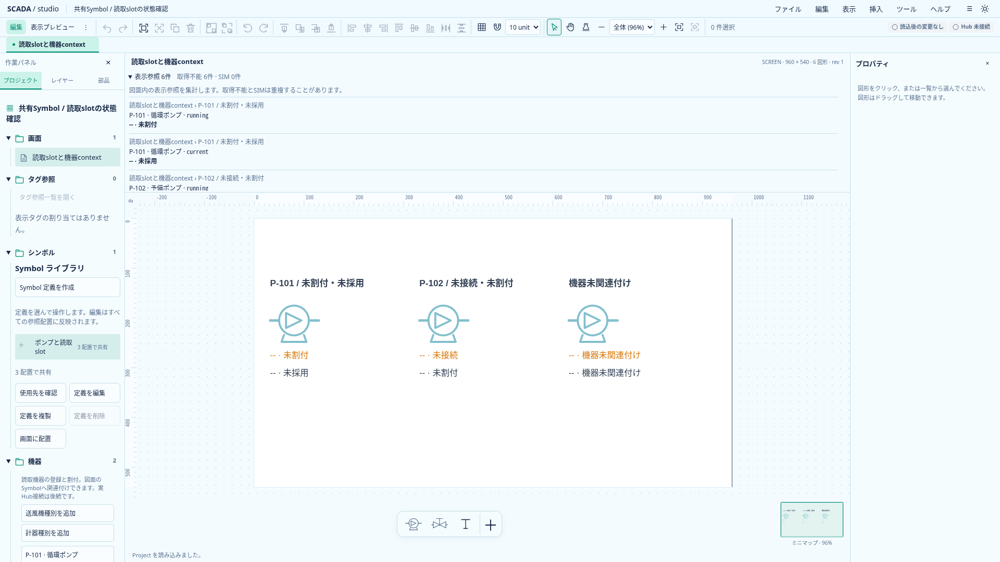
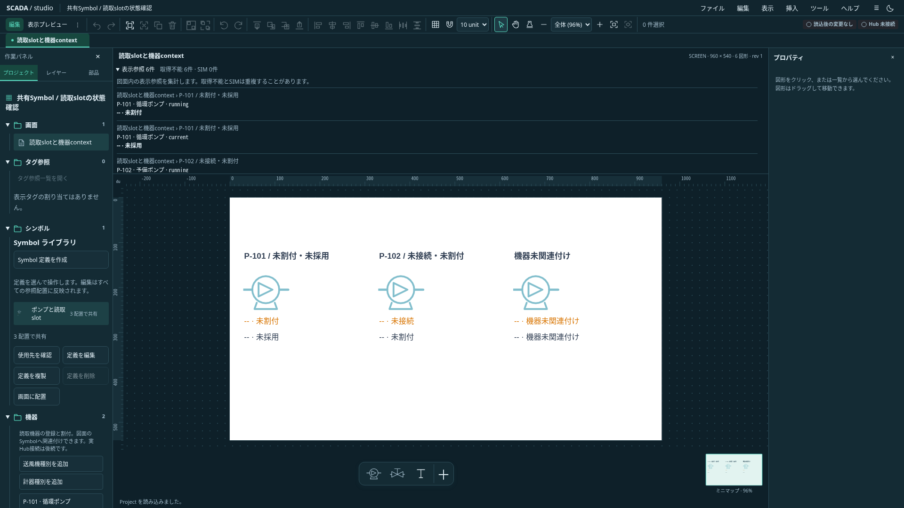

# 図面外の読取状態表示

状態: **メイン図面と読取小窓の状態一覧を実装**。2026-10-20。Projectは0.26.0を維持する。[bool Textの動的配色](bool-text-colors.md)を図形へ広げる前段として、図面のクリップ・倍率・αから独立した状態確認を設ける。図形の動的配色自体は今回追加しない。

## 表示と操作

図面上部と小窓に「表示参照 N件・取得不能 X件・SIM Y件」を表示する。Project全体の機器・宣言・タグ件数ではなく、現在の表示範囲にあるslot参照数である。同じ機器を別配置や別埋込で使えばそれぞれ数える。SIMと取得不能は重複することがあり、Bad／Staleのsimulationは両方へ数える。Goodのfalse／0は取得不能へ数えない。

見出しをクリック、またはフォーカスしてEnterで展開する。各行に画面・埋込配置・Symbol配置の経路、機器code／名前、slot、現在の文字・Quality・不正理由を表示する。由来がある場合はsource・mode・catalog revision・run ID・timestampも表示する。未採用・未割付・機器未関連付けを一律に通信異常とは呼ばない。

一覧は図面の外側に通常のレイアウトで置く。開いた分だけ図面表示領域を使い、図面へ重ねない。小窓は短いスクロール領域を使う。取得不能理由やSIMを任意のTextのサイズ・色・透明度へ依存させない。

閉じた状態では行をDOMへ作らない。開いた状態も20行ずつページ分割し、件数は全件を集計する。ページ内はスクロールでき、キーボードでフォーカス可能。展開中に一覧内でEscを押すと一覧だけを閉じ、見出しへフォーカスを戻す。次のEscは小窓の既存終了処理へ渡る。IME取消・処理済みのEscを奪わない。

開閉・ページはProject、Undo、保存へ入れない。画面変更・Project置換時は標準の閉じた状態へ戻す。取得結果の更新では開閉を変えず、内容・件数・由来を現在の結果へ更新する。

## 収集と取得境界

`slot-status-summary.ts`は表示範囲だけを収集する。現在の画面にある非表示でないSymbol配置と、非表示でない埋込Viewの1段内を対象にする。埋込先の非表示Symbolも除外する。配置のαや、共有定義内のText自身の非表示・αで参照を除外しない。未使用のslot宣言は数えない。同じSymbol配置の同じslotを複数Textが使う場合は1行へまとめる。

行のkeyは配置経路のID列とslot名の構造化JSON。機器ID＋slotだけで同一機器の別表示を潰さない。定義編集では、その定義の使用slotを機器未関連付けとして表示する。

状態は`resolveSymbolSlot()`へ委譲する。接続・世代・Project identity・値・Qualityの判定を収集側で複製しない。メイン・小窓とも、描画へ渡すものと同じEquipmentContextを使う。小窓のcontext省略時は現在Projectの未接続contextを使う。通常Designerは実Host未接続のまま。

現時点の参照元はTextの`slotBinding`。将来の図形色／名前付き状態定義は、同じ収集と表示へ追加する。直接Hub接続・購読・式評価・動的色の保存モデルを今回追加しない。

## 次の図形配色への方針

Astraのレビューでは、Textを非表示にできないよう制限しても、極小配置・重なり・枠外等による可読性は保証できないと指摘された。Textの可視性を図形配色の安全性の根拠にはしない。

次段は共有状態定義、または配色元Textへの参照を検討する。配色元Textを使う場合も色設定の共有参照として位置付け、取得不能理由・SIMは本表示へ接続する。塗りは有効な単色、折れ線は線と矢印を初回対象とし、gradient／patternや枠線を暗黙に単色化しない。参照保護・定義複製時のID再対応・単体clipboard・複数draftの原子的検証を同じ区切りで実装する。

## 検証と実画面

単体検証は配置内重複、未使用宣言、hidden／α0 Text、可視配置経路、同一画面の複数埋込、1段制限、Good false／0、SIMとQuality、旧frame／resetの値消去を確認する。

ブラウザ検証は両テーマで28参照のページ分割、開閉時のDOM、hidden Textに依存しない表示、Project置換、小窓のEscを確認する。既存の同一mountテストへ状態一覧も追加し、メイン・小窓の件数・SIM・取得不能・由来が現在のframeへ追従することを確認する。

`scripts/capture-slot-status.mjs`で実画面を1920×1080に撮影した。画像の加工は行わない。

最終ローカル検証は型0エラー／0警告、TS855件、本番build・全体整形が成功。状態一覧・同一mountの6件と既存小窓10件をブラウザで確認した。長い操作列の画面切替検証を独立ケースへ分割し、timeout・判定・retryは緩和していない。Astraの指摘に従い、Escをdetails内で処理し、IME／処理済みキーを保護した。最終静的レビューで追加の必須修正なし。Rust／保存schemaは変更していない。

後続のProject 0.27.0では[共有図形・配管の状態色追従](state-color-following.md)を追加した。この文書の初回範囲と区別する。
