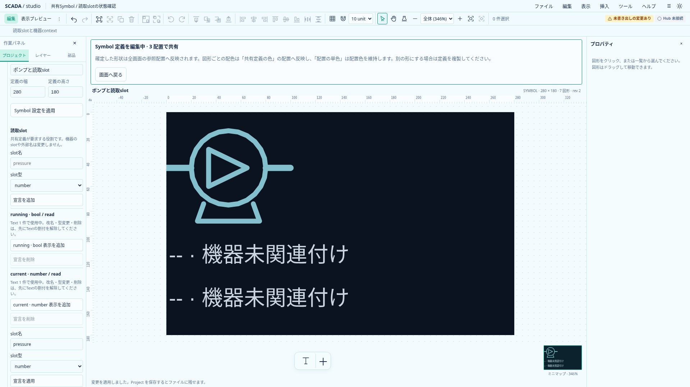
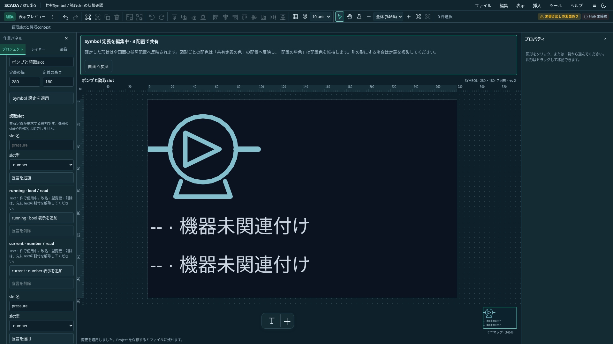

# 共有Symbolのslot宣言編集

状態: **任意名の追加・未使用宣言の編集／削除・Text参照保護を実装**。2026-10-20、Project形式は0.25.0を維持する。[共有Symbolの読取slot](symbol-read-slots.md)と[表示DTOの受入](read-slot-presentation.md)に続く編集工程。

## 操作

共有定義を編集し、左の「プロジェクト」→「プロジェクト設定」内の「読取slot」を使う。図面上部にあった3種類の表示追加ボタンもこの領域へ移した。カードを重ねず、宣言の行を区切る。

- 任意のASCII識別子とbool／numberを指定し、「宣言を追加」。宣言だけを追加し、図形・機器は自動作成しない。
- 未使用の宣言は名前・型を編集し、「宣言を適用」。削除も可能。
- 各宣言の「表示を追加」で、既存の`add-symbol-readout`を使ってTextを追加する。未宣言のrunning／current／valueは簡易追加を残す。
- Textから参照中なら使用件数と理由を表示し、改名・型変更・削除を止める。変更したい場合は先にTextの「読取slot」を静的テキストへ戻すか、参照Textを削除する。

宣言の追加・編集・削除はそれぞれ一回のUndo。Text表示の追加も従来どおり一回のUndo。入力中の別操作・定義移動・Undoには既存の未適用入力保護を使う。IME変換中のEnterで追加・適用しない。

## ドメイン契約

`add-symbol-slot`／`update-symbol-slot`／`remove-symbol-slot`は候補Projectだけを編集する。最終検証とrevision・履歴更新は既存`applyCommand`／`recordEdit`が所有し、失敗で部分変更を残さない。

使用判定は共有定義内の全Textを対象とし、非表示・ロック中も数える。同じ名前・型へのupdateは使用中でもno-opで、revisionやUndoを増やさない。未使用宣言は、Symbol自体が多数配置されていても編集できる。機器の型・採用slot・外部名は自動で変更しない。

改名先の重複、不正な識別子・型、64件超、存在しない定義・宣言を拒否する。最後の未使用宣言を削除したら`readSlots`プロパティを省略する。保存schemaの制約は維持し、TS／Rustの保存形式は変更しない。

## 入力と遅延操作

フォームの対象はworkspace世代・定義ID・編集開始時のslot名で保持する。入力途中の新しい名前をdraftの識別子に使わない。対象が変わった、またはDOMから外れたフォームは拒否する。

成功した追加フォームだけ名前・型を初期値へ戻してdraftを確定する。失敗した入力は保持する。未使用行の改名後は新しいslot名の行へ切り替わる。

宣言行からの「表示を追加」は`requireExisting`を指定し、実行時にも宣言の存在と型を確認する。未適用の改名を適用してから遅延操作が実行されても、古い名前の宣言を再作成しない。簡易追加は従来どおり宣言とTextを同時追加できる。

## 検証と後続

`symbol-slot-editing.test.ts`は使用中の拒否・同値no-op・hidden／locked参照・未使用の改名／型変更とUndo・原子的拒否・最後の削除・任意宣言のText追加・フォーム対象照合・遅延操作を確認する。`e2e/symbol-slot-editing.spec.ts`は両テーマの追加・編集・使用保護・保存、重複名の入力保持、別行操作・定義移動のdraft保護、IME、削除とUndo、改名後の遅延操作を確認する。

機器種別の自由編集、使用中slotの一括改名・Text参照の一括置換、動的配色、実Host／catalog／実Hub接続とFaceplateは後続。今回追加するのはSymbolが要求する宣言の編集であり、実設備のタグや機器を作成する操作ではない。

最終ローカル検証は型0エラー／0警告、TS807件、関連ブラウザ9件、本番buildを確認した。保存契約は既存のTS／Rust共通schemaを維持する。Astraの静的レビューで必須修正指摘なし。全体CIはPush後に確認する。

## 実画面

`scripts/capture-symbol-slot-editing.mjs`で、定義内文字色を明るくした撮影用Projectへ任意のpressure宣言を追加し、1920×1080で撮影する。

