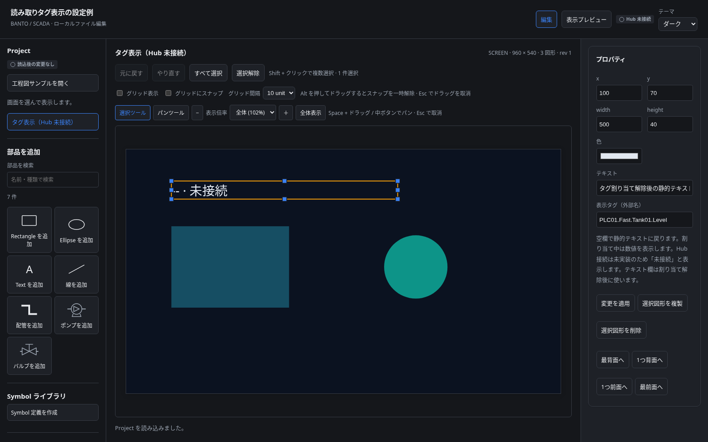
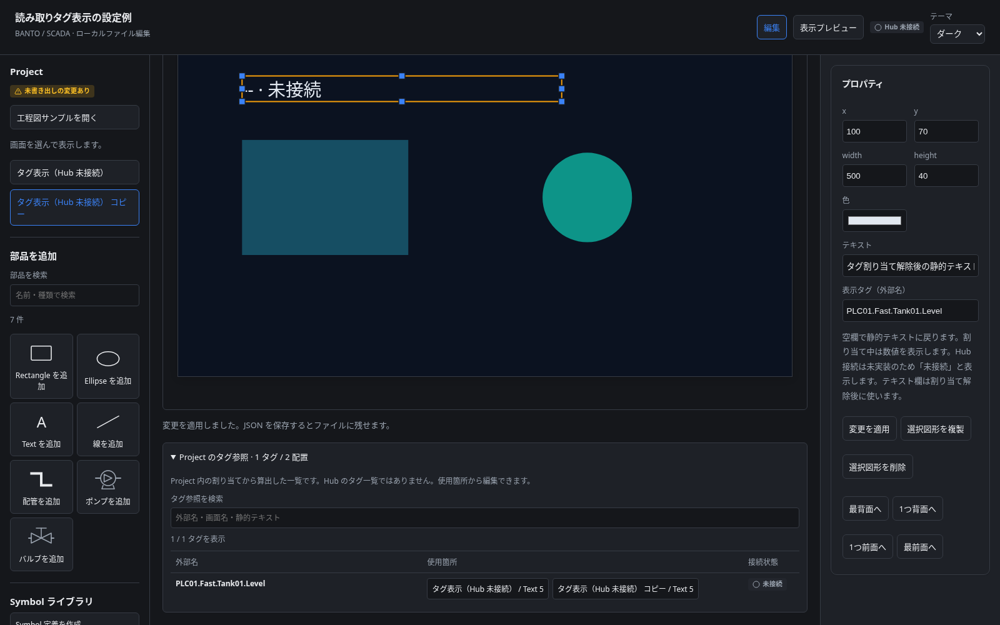

# 読み取りタグ Binding の初期契約

2026-10-18。上流 [SCADA §8.4 / §9](upstream/industrial/scada-design.md) と [Tag Client §3](upstream/industrial/banto-tagclient-design.md) に基づく。参照スナップショットの出典は [開発計画](development-plan.md#参照元) に記載する。

## 実装範囲

画面の Text に読み取り専用の数値 Binding を設定できる。Inspector の外部名を入力して適用し、空欄で解除する。静的 `text` は解除後に使う文字列として保持するが、割り当て中の欠測を静的値で置き換えない。配置・Text・Binding の変更は同じコマンドで検証し、既存の履歴と未適用入力保護を使う。

Project は schema / minRuntimeVersion `0.4.0`。旧 `0.2.0` / `0.3.0` の移行を追加せず、対応していない形式として拒否する。現行形式のサンプルは [tag-binding.project.json](../examples/tag-binding.project.json)。

```json
{
  "type": "text",
  "text": "割り当て解除後の静的テキスト",
  "binding": { "externalName": "PLC01.Fast.Tank01.Level" }
}
```

`binding` は省略でき、設定する場合は空白だけではない最大 1024 文字の外部名を要求する。名前は不透明な識別子として保持し、大文字小文字の変更、分割、類似名検索、自動再割り当てを行わない。Hub 側の存在と型はオフラインでは照合しない。現段階の構造検証が通っても、現場で解決できることを意味しない。内部数値 ID・PLC アドレス・認証情報・最新値・Quality は保存しない。

同じ外部名を複数の Text に割り当ててよい。配置や画面の複製でも外部名を保持する。将来 SDK の要求を生成するときには、外部名を集約して重複要求を避け、結果を各配置へ配る。独立した Binding UUID は今は導入しない。

共有 Symbol 定義内の直接 Binding は編集・読込とも拒否する。現場固有の参照は画面に置き、Symbol の再利用には後続の Equipment / slot の契約を使う。図形の色や運転状態の対応付け、文字列タグ、式、書込み Action は今回の範囲に含めない。

## Project のタグ参照一覧

割り当てがある Project では、編集キャンバス下の折りたたみ領域を展開すると、全画面で使っている外部名と使用箇所を確認できる。同じ名前を完全一致で集約し、大文字小文字の違う名前を勝手に統合しない。

外部名・画面名・解除後の静的テキストを検索できる。検索だけは大文字小文字・文字幅の違いを吸収するが、保存される名前は変更しない。使用箇所を押すと対象画面と Text を選択し、割り当て欄へフォーカスする。未適用入力は適用 / 破棄 / キャンセルで解決してから移動する。共有定義の編集中からも通常画面へ移動できる。

一覧は Project から算出し、編集・Undo / Redo・複製・削除で更新する。索引・検索・開閉状態を Project や履歴へ保存せず、別の Project を開いたら検索と開閉状態を初期化する。割り当てがゼロの場合は一覧を表示しない。表示プレビューにも出さない。

これは Hub の Tag Browser ではなく、タグの存在・型・現在値を照合した一覧ではない。接続状態は未接続と明記する。複数画面からの参照確認と修正先への移動を先に整え、実接続後の catalog 検索と区別する。

## 表示と値の境界

**現在のアプリは Hub に接続しない。** 全 Binding を編集・表示プレビューとも `-- · 未接続` と描画し、外部名を SVG の title で確認できる。

`tag-presentation.ts` は SDK の wire DTO ではなく、host から描画へ渡す最小の数値表示契約。`Renderer` の任意の `readings` に外部名をキーとする Map を渡せる。現在のアプリはこの Map を渡さず、疑似ライブ値も生成しない。

| 入力状態                          | 表示                   |
| --------------------------------- | ---------------------- |
| 読み取り結果なし / disconnected   | `-- · 未接続`          |
| unresolved                        | `-- · 未解決`          |
| invalid                           | `-- · 値が不正`        |
| resolved + Good + 有限数          | 数値（0 と負数を含む） |
| resolved + Good + null / 非有限数 | `-- · 値が不正`        |
| resolved + Stale                  | `-- · Stale`           |
| resolved + Bad                    | `-- · Bad`             |

Stale / Bad の直前値は表示しない。文字で状態を示し、色だけで判断させない。ある配置の未解決が別の配置の描画を止めない。外部名と値は SVG のテキストとして描画し、HTML として挿入しない。



2026-10-18、タグ参照一覧追加前の `7beedab` で `examples/tag-binding.project.json` を Chromium 1600×1000 で開いた実画面。ダウンロードや実設備の値取得を示す画像ではない。



2026-10-18、タグ表示サンプルの画面を UI で複製し、下部のタグ参照一覧を展開した実画面（Chromium 1600×1000）。中央領域を下へスクロールして一覧を表示している。両画面の同じ外部名を 1 行・2 配置にまとめ、Hub 未接続を明記している。

## SDK 境界の実装状況

`crates/scada-runtime` に固定 SDK の current と catalog を表示 DTO へ投影する処理を追加した。世代・型・source を確認し、Good の有限数だけを渡す。実 SDK とモック Hub の通信・切断は検証済みだが、ブラウザへ値を渡す Host は未実装なので、現在の画面表示は未接続のまま。

SDK は未解決名が 1 件でもあると購読全体の current を公開しないため、SCADA の局所的な欠測表示には [industrial #682](https://github.com/tyaro/banto-industrial/issues/682) の共有契約拡張を先行させる。catalog / resolution / current の同世代公開も同 Issue で扱う。Astra とのレビューに基づき、SCADA 側で再解決管理を重複実装する回避策は入れない。[Runtime SDK 境界](runtime-sdk.md) に詳細を記載する。

## 次の接続段階

Tag Browser の画面とタグ選択の操作は [UI 改訂提案](designer-ui-revision.md)、Equipment / slot・動的表示・監視オブジェクトへの拡張は [統合設計](scada-integrated-design.md) を参照する。画像中の BOOL slot は将来案で、現行 Text の数値型契約を変更しない。選択したタグは Inspector の未適用入力へ返し、既存の適用コマンドで Project へ反映する。

実接続は `banto-tagclient` を固定コミットで利用する Rust host から行う。フロントエンドで SDK の接続・購読・再解決・時刻による Stale 判定を再実装しない。式を導入するときも `banto-expr` を利用する。

host は catalog と実行世代を照合した SDK の current 値だけを `resolved` として公開し、SDK の品質・未解決・接続状態をこの表示契約へ変換する。数値型かを確認し、未対応型は `invalid` にする。切断・config_changed・Project 置換・再接続中は旧 Map を current として再利用せず、SDK の新しい snapshot が成立してから値を渡す。単なる Map はこの成立条件を検証しない。

Tag Browser、catalog の型照合、接続先設定、実購読、切断からの回復は未実装。認証・ユーザー管理は industrial 側で修正中のため延期し、今回新たな認証や PLC 直接接続を作らない。

## 検証

共通 JSON fixture で Rust / TypeScript の受理・拒否を確認する。単体テストは編集の原子性、履歴、複製、Quality の表示と SVG の実描画を検証する。ブラウザは割り当て・解除・不正入力の保持・JSON 往復・未接続プレビューを検証する。SDK の通信や実設備での値取得が検証済みという意味ではない。
