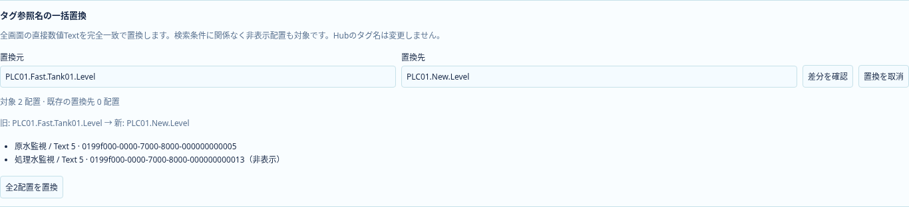
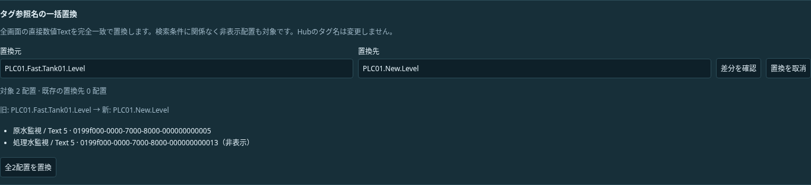

# I6：ローカルProjectのタグ参照名一括置換

2026-10-21。状態: **I6a／I6b実装・ローカル検証済み。I6aは全体CI成功、I6bはCI確認待ち**。Astraの読取レビューを踏まえ、[統合設計§9](scada-integrated-design.md#9-開発保守を支える機能)の参照名置換・差分確認を具体化する。[単体開発計画](upstream-independent-plan.md)の次工程。Project0.33.0と固定上流依存を維持する。

## 対象と操作

既存のタグ参照一覧から、一つの保存済みexternalNameを選び、新しい名前を入力する。対象は**全画面に直接置かれた数値Textのbinding.externalName**。非表示配置も対象。差分プレビューに画面名・オブジェクトID／表示名・旧参照名・新参照名・総件数を示し、明示適用する。検索フィルターは一覧表示だけに作用し、置換範囲を黙って狭めない。

一致判定は保存文字列の完全一致。検索のNFKC・大文字小文字無視を置換に流用しない。新しい名前は既存externalName検証を通し、無効文字列を暗黙に整形しない。新旧同一はno-opで履歴を作らない。既存名への統合は差分内で既存使用先の存在を示し、名前の存在だけでは禁止しない。

Equipmentのslot割付、Symbol定義／slot名、機器プロパティ、Action、Hubタグの作成・renameは対象外。部分一致・正規表現・CSV・複数名mappingは後続。保存名を変えるだけで、実Hubの存在・型適合を確認した表示にはしない。未接続／未確認の表示を維持する。

## 原子性と入力保護

純粋な候補計算→差分表示→既存command入口→Project全体検証→履歴採用の順にする。元Projectを直接変更せず、適用1回をUndo1回にする。Redo・保存再読込でも同じ結果になる。Text本文・数値書式・配置・他の参照名・画像資産は保持する。

ロックや幾何グループ等、既存編集制約により更新できない配置が一つでもあれば、理由と対象を示して全件拒否する。黙ってskipしない。必要なら先にロック解除等の既存操作を使う。

プレビューはProject／workspace世代と対象一覧に結び付ける。別操作・Undo・画面／Project差替え等で前提が変われば適用を拒否し、再計算を促す。未適用の他フォーム入力は既存draft guardを通す。取消・IME変換中・不正入力・検証失敗・古いsnapshotはProjectと履歴を変更しない。新しい汎用入力保護基盤は作らない。

## 実装区切りと受入

| 工程 | 内容                           | 完了条件                                                                                   | 状態                   |
| ---- | ------------------------------ | ------------------------------------------------------------------------------------------ | ---------------------- |
| I6a  | 純粋な対象収集・差分・command  | 完全一致、全画面／非表示、制約拒否、no-op、世代不一致、原子性、Undo／Redoを単体で確認      | 完了・CI成功           |
| I6b  | タグ参照一覧から差分確認・適用 | 検索の独立、件数／使用先、IME・draft・取消、保存再読込、ライト／ダークの操作と実画面を確認 | 実装・ローカル検証済み |

読む入口は`lib/binding-references.ts`、`designer/BindingReferences.svelte`、`editor/commands.ts`、`editor.ts`、`history.ts`、`designer/drafts.svelte.ts`（いずれも`apps/banto-scada/src/`配下）。タグ参照一覧の各外部名に一括置換の入口を追加し、差分確認・適用UIを接続した。基盤だけの完了を機能提供済みと記載せず、I6bと全体CI成功をもって初回提供完了とする。

## I6aの実装（2026-10-21）

`lib/binding-replacement.ts`が純粋な差分作成・既存使用先・拒否理由を所有し、`replace-binding-reference`をProject commandとして追加した。対象は呼出し側から受け取らず、適用時も全画面から完全一致で再収集する。新しい名前は候補Projectの既存検証を通す。原本は変更しない。

基準照合はrevisionを含む検証済みProjectの直列化snapshotを使い、内容変更・Undoによるrevision前進・別Projectを拒否する。workspace世代と画面切替、draft／IME／取消のUI側保護はI6bで接続する。基盤だけでそれらの操作確認が完了したとは扱わない。

追加単体14件で、全画面／非表示・完全一致・既存名統合・空白の保持・無効名・ロック／グループ・no-op・一括Undo／Redo・保存往復・古いsnapshot・revision上限・原子性を確認した。全単体1121件と型チェック（エラー・警告0）が成功。Project0.33.0・上流依存・読取接続の状態表示は変更しない。I6aの保存時点ではUI未接続で、実画面は後述のI6bで追加した。

I6aのローカル回帰検証では、既存タグ参照・割付・履歴のブラウザ7件、本番build、全体整形も成功した。新規置換UIの試験ではなく、既存機能の回帰確認として記録する。

## I6bのUIと受入（2026-10-21）

タグ参照一覧の「一括置換」から置換先を入力し、「差分を確認」で全画面の対象・旧／新参照名・既存の置換先件数／使用先・拒否理由を表示する。検索条件に関係なく対象を算出する。「全N配置を置換」で一括適用し、保存・Undo／Redoを既存入口へ戻す。Hubは未接続のままであり、この操作で実Hubの存在や型を確認したとは表示しない。

`BindingReplacement.svelte`は置換フォームと差分確認を所有し、既存draft guardへ登録する。別フォームの未適用入力は開始時・適用時に保護する。置換自体は確認なしの自動適用をしない。「適用して続行」からも明示適用または取消を案内し、他のフォームを部分適用する前に止める。取消・IME変換中は更新しない。別画面／mode／定義／workspace世代とProject参照を監視し、差分の前提が変われば再確認まで適用不可。読込でworkspaceが変わればフォームを破棄し、古い候補を再利用しない。

追加ブラウザ6件で両テーマ・検索独立・非表示対象・未接続表示・Undo／Redo・保存再読込・無効名・同名・ロック拒否・IME・取消・他フォーム入力・Project差替えを確認した。既存参照一覧2件の回帰も成功。旧試験の使用先ボタン数は、一括置換入口の追加に合わせ使用先だけを数えるよう更新した。型チェックはエラー・警告0、全単体1121件、本番build成功。

I6aの実装`f783428`は[全体CI39558083032](https://github.com/tyaro/temp-scada/actions/runs/39558083032)でFrontend・Rust・ブラウザ4分割・集約checkがすべて成功した。I6bの全体CIはPush後に確認する。Equipment／Symbol slot、実Hubのrename、正規表現等は引き続き対象外。

### ライト／ダークの実画面

既存の高さ調整操作でパネルを広げ、差分確認中のフォームを撮影した。プレビュー値はローカルProjectの参照名で、実Hubのデータではない。

I6bの既存タグ割付・履歴の追加回帰5件も成功した（新規6件＋既存7件、計13件の異なるブラウザケース）。画面撮影用の両テーマ2件再実行も成功。
